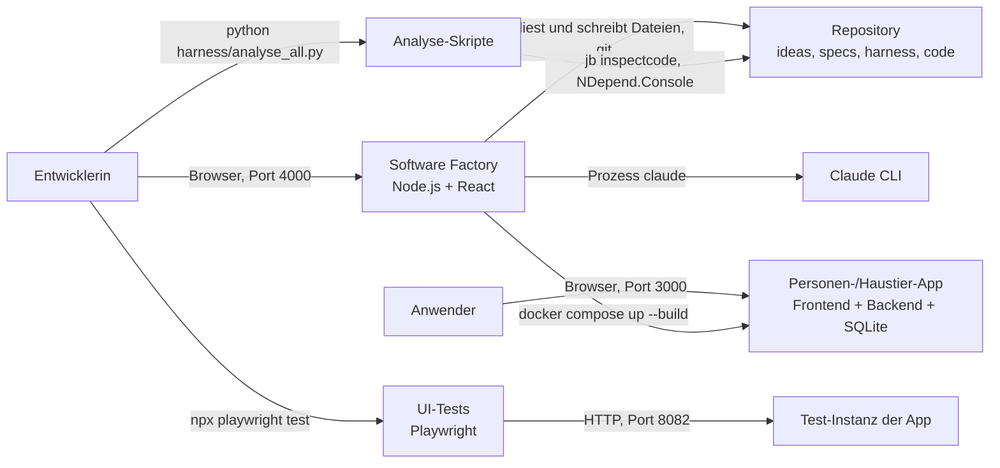
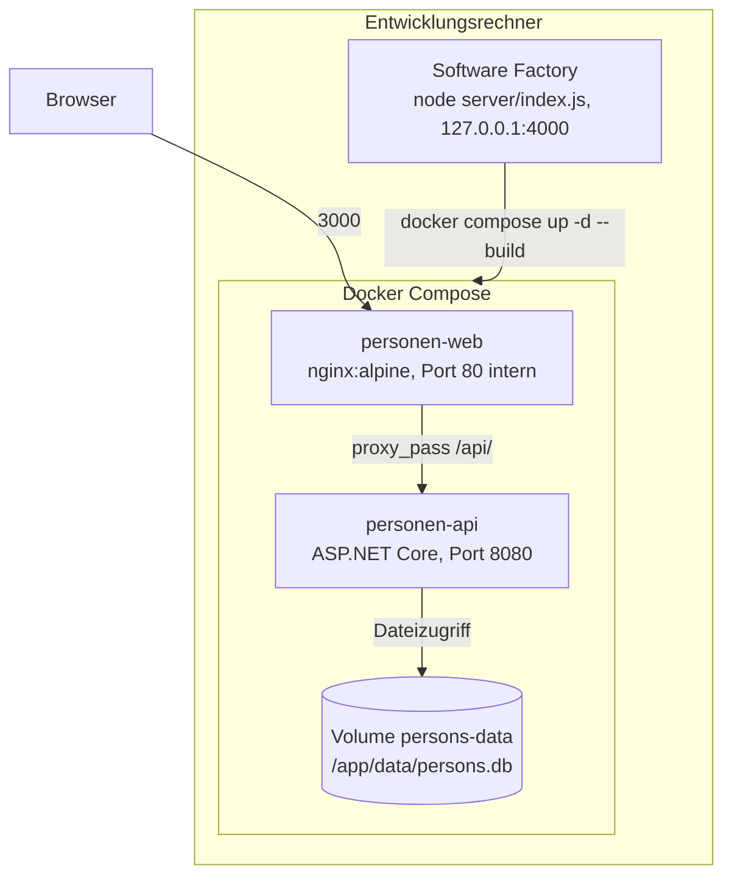

# Systemarchitektur

## Meta
- **Stand:** 2026-11-04
- **Bezug:** `docker-compose.yml`, `docker-compose.tests.yml`, `code/backend`, `code/frontend`, `code/factory`, `SoftwareFactory.cmd`, `harness/analyse_*.py`, `tests/ui`

## Zweck des Systems

Die Anwendung verwaltet Personen und Haustiere (Anlegen, Bearbeiten, Löschen, manuelle Reihenfolge der Personen, Zuordnung eines Haustiers zu einer Person). Fachlich beschreiben das [E1 Personen](../../specs/E1%20Personen) und [E2 Haustiere](../../specs/E2%20Haustiere).

Um die Anwendung herum liegen drei Entwicklungswerkzeuge im selben Repository: die Software Factory (lokale Oberfläche von der Idee bis zur Auslieferung, [E3](../../specs/E3%20Software%20Factory)), die Qualitätsanalyse-Skripte ([E4](../../specs/E4%20Qualit%C3%A4tsanalyse)) und die Playwright-UI-Tests unter `tests/ui`.

## Kontextabgrenzung

Das Diagramm zeigt, wer mit den Systemteilen spricht. Die Fachanwendung läuft in Docker; die Werkzeuge laufen direkt auf dem Entwicklungsrechner und greifen auf Dateien, `git`, `docker` und `claude` des Rechners zu.

| Nachbar | Rolle | Protokoll / Zugang |
|---|---|---|
| Anwender | bedient Personen und Haustiere | HTTP im Browser, `http://localhost:3000` |
| Entwicklerin | nutzt Factory, Skripte, Tests | Browser `http://localhost:4000`; Kommandozeile |
| Claude CLI (`claude`) | KI der Factory, lokal installiert und angemeldet | Kindprozess (`spawn`) aus `code/factory/server/agent.js` |
| `git`, `docker` | Sicherung und Auslieferung durch die Factory | Kindprozesse (`execFile`) aus `git.js` und `runs.js` |
| JetBrains `jb inspectcode` | ReSharper-Prüfung in `analyse_code.py` | Kommandozeile; Installation als .NET-Tool |
| NDepend.Console | Designprüfung in `analyse_swd.py` | fester Pfad `C:\Program Files (x86)\NDepend_2026\NDepend.Console.exe` |
| Browser-Spracherkennung | Spracheingabe der Factory (Chrome/Edge) | Cloud-Dienst des Browser-Herstellers, laut `code/factory/README.md` |

## Bausteine auf oberster Ebene

| Baustein | Pfad | Technologie | Verantwortung |
|---|---|---|---|
| Frontend | `code/frontend` | React, Vite (Build mit `node:22-alpine`), ausgeliefert von nginx | Oberfläche für Personen und Haustiere; leitet `/api/` an das Backend weiter |
| Backend | `code/backend` | ASP.NET Core (.NET 10), EF Core, `PersonsController`, `PetsController` | HTTP-Schnittstelle unter `/api/persons` und `/api/pets`, Validierung, Persistenz |
| Datenbank | Volume `persons-data` | SQLite, Datei `persons.db` | Speicherung; Schema über EF-Migrationen unter `code/backend/Migrations` |
| Software Factory | `code/factory` | Node.js, Express 5 (`server/`), React/Vite (`src/`) | Ideen, Anforderungen, Umsetzung, Verlauf; arbeitet direkt auf `ideas/`, `specs/`, `harness/` |
| Analyse-Skripte | `harness/analyse_all.py`, `analyse_code.py`, `analyse_swd.py` | Python | Code- und Designprüfung des Backends; Details in [E4 Qualitätsanalyse](../../specs/E4%20Qualit%C3%A4tsanalyse) |
| UI-Tests | `tests/ui` | Playwright (TypeScript), Chromium | Ende-zu-Ende-Tests für E1 und E2 gegen die Test-Instanz |

Die interne Gliederung der Bausteine steht in [Bausteine](02%20Bausteine.md), die Schnittstelle in [API](03%20API.md).

## Deployment

Das Diagramm zeigt die Container der App und die lokal laufende Factory. Der Browser erreicht nur das Frontend; `/api/` wird von nginx an das Backend weitergereicht, daher gibt es aus Sicht des Browsers eine einzige Herkunft.

Container und Ports laut `docker-compose.yml`:

| Service / Container | Image-Basis (Dockerfile) | Host-Port | Container-Port | Volume | Umgebungsvariablen |
|---|---|---|---|---|---|
| `backend` / `personen-api` | Build `mcr.microsoft.com/dotnet/sdk:10.0`, Laufzeit `aspnet:10.0` | `8080` | `8080` (`ASPNETCORE_HTTP_PORTS=8080` im Dockerfile) | `persons-data` nach `/app/data` | `ASPNETCORE_ENVIRONMENT=Development`, `ConnectionStrings__PersonsDb=Data Source=/app/data/persons.db` |
| `frontend` / `personen-web` | Build `node:22-alpine`, Laufzeit `nginx:alpine` | `3000` | `80` | keins | keine; `depends_on: backend` |

Beide Services starten mit `restart: unless-stopped`. Das Verzeichnis `/app/data` gehört im Image dem Benutzer `1001`, damit der unprivilegierte .NET-Prozess schreiben kann.

Die Test-Instanz (`docker-compose.tests.yml`) läuft getrennt von der Produktiv-Instanz:

| Service / Container | Host-Port | Volume | Umgebungsvariablen |
|---|---|---|---|
| `backend` / `personen-api-tests` | `5077` (auf `8080`) | `persons-tests-data` nach `/app/data` | `ASPNETCORE_ENVIRONMENT=Development`, `ConnectionStrings__PersonsDb=Data Source=/app/data/personen.tests.db`, `EnableTestEndpoints=true` |
| `frontend` / `personen-web-tests` | `8082` (auf `80`) | keins | keine |

Beide Test-Services haben `restart: "no"`. Die Playwright-Konfiguration (`tests/ui/playwright.config.ts`) nutzt `http://localhost:8082`, überschreibbar per `UI_TEST_BASE_URL`.

Die Software Factory läuft bewusst nicht im Container ([Entscheidung 3](#3-software-factory-als-lokaler-dienst-statt-container)). Start über `SoftwareFactory.cmd` (installiert bei Bedarf `node_modules`, baut die Oberfläche, öffnet `http://localhost:4000`, startet `node server\index.js`). Steuerbar über Umgebungsvariablen aus `code/factory/server/config.js`:

| Variable | Standard | Bedeutung |
|---|---|---|
| `FACTORY_PORT` | `4000` | Port des Dienstes, gebunden an `127.0.0.1` |
| `FACTORY_REPO` | zwei Ebenen über `code/factory` | Repository, auf dem die Factory arbeitet |
| `FACTORY_DATA` | `code/factory/data` | Gesprächsverläufe, Auftragsprotokolle, Einstellungen (nicht versioniert) |
| `FACTORY_APP_URL` | `http://localhost:3000` | Adresse der App für die Gesundheitsprüfung nach der Auslieferung |

Für die Entwicklung ohne Docker: Frontend `npm run dev` auf Port `5173` mit Proxy `/api` auf `http://localhost:5215` (`code/frontend/vite.config.js`, passend zu `launchSettings.json` des Backends); Factory-Oberfläche `npm run dev` auf Port `5174` mit Proxy auf `127.0.0.1:4000`.

## Querschnittsthemen

| Thema | Umsetzung |
|---|---|
| Fehlerbehandlung | Beide Controller tragen `[ApiController]` (automatische Modellvalidierung mit `400`). Fachliche Fehler werden im Controller als `NotFound()` bzw. `BadRequest("…")` mit Klartext (z. B. „Das Haustier existiert nicht.") zurückgegeben. Das Frontend kapselt Aufrufe in `code/frontend/src/api/persons.js` und `pets.js`. Vertrag: [API](03%20API.md). |
| CORS | `Program.cs` registriert die Policy `AllowFrontend` für `http://localhost:5173` (Vite-Entwicklungsserver). Im Docker-Betrieb ist CORS nicht nötig, weil nginx `/api/` same-origin weiterleitet. |
| Migrationen | `Program.cs` ruft beim Start `Database.Migrate()` auf; ein Schema-Update braucht keinen manuellen Schritt. Vorhandene Migrationen: `InitialCreate`, `AddPersonOrder`, `AddPets`. |
| Konfiguration | Connection String `ConnectionStrings:PersonsDb`; Standard `Data Source=persons.db` (Code und `appsettings.Development.json`), im Container per Umgebungsvariable auf das Volume gelegt. |
| Logging | Standard-Logging von ASP.NET Core: `Default` auf `Information`, `Microsoft.AspNetCore` auf `Warning` (`appsettings*.json`). Das Betriebsprotokoll der Container liest die Factory über `docker compose logs`. |
| Testunterstützung | `POST /api/testdata/reset` existiert nur mit `EnableTestEndpoints=true` und lehnt jede Datenbank ab, deren Name nicht auf `.tests.db` endet (`Program.cs`, `Data/TestData.cs`). |
| Zugriffsschutz Factory | Der Dienst bindet nur `127.0.0.1`, prüft den `Host`-Header gegen eine Allowlist, weist fremde `Origin`-Werte ab (DNS-Rebinding, CSRF) und verlangt für nicht-lesende Anfragen `application/json` (`server/index.js`). Eine Anmeldung gibt es nicht. |
| Live-Updates Factory | Server-Sent Events über `GET /api/events` (`server/bus.js`). |
| Qualitätssicherung | `analyse_all.py` baut das Backend einmal und startet dann `analyse_code.py` (ReSharper) und `analyse_swd.py` (NDepend) parallel. Exit `0` konform, `1` Verstöße, `2` Prüfung nicht möglich (nie als bestanden werten). Regeln: `harness/_code.md`, `harness/_design.md`. |

## Technische Entscheidungen

### 1. SQLite als Datenbank

**Kontext:** Einplatzanwendung für Personen und Haustiere ohne Mehrbenutzerlast. **Entscheidung:** SQLite über EF Core, Datei in einem Docker-Volume. **Konsequenz:** keine separate Datenbank, einfaches Backup per Volume; aber kein paralleler Schreibzugriff mehrerer Backend-Instanzen und kein Cluster. **Verworfene Alternative:** ein eigener Datenbankserver (z. B. PostgreSQL) als dritter Container, wegen unnötigem Betriebsaufwand für den Umfang.

### 2. nginx als Reverse Proxy statt CORS im Betrieb

**Kontext:** Frontend und Backend laufen in getrennten Containern. **Entscheidung:** nginx liefert die gebaute Oberfläche aus und leitet `/api/` an `backend:8080` weiter; der Hostname wird über den Docker-DNS (`resolver 127.0.0.11`) je Anfrage aufgelöst. **Konsequenz:** same-origin, das Frontend braucht keine Backend-Adresse, ein Backend-Neustart führt nicht zu einem dauerhaften `502`. Der Backend-Port `8080` ist trotzdem zusätzlich veröffentlicht. **Verworfene Alternative:** direkter Browserzugriff auf das Backend mit CORS; er erforderte eine konfigurierbare Backend-URL im Frontend und eine CORS-Policy pro Umgebung.

### 3. Software Factory als lokaler Dienst statt Container

**Kontext:** Die Factory benötigt `claude`, `git` und `docker` des Rechners samt Login der Entwicklerin. **Entscheidung:** eigener Node-Prozess, nur an `127.0.0.1` gebunden, Start über `SoftwareFactory.cmd`. **Konsequenz:** keine Isolation und keine Anmeldung; für einen Serverbetrieb wären Authentifizierung und Rechteverwaltung nötig (siehe `code/factory/README.md`). Die Factory ändert sich nicht selbst: Der Themenbereich `Software Factory` ist von der Umsetzung ausgenommen, und der Auslieferungsumfang schließt `code/factory` aus (`TOOL_EPICS`, `DELIVERY_PATHSPECS` in `config.js`). **Verworfene Alternative:** Betrieb im Docker-Container, weil dann Anmeldedaten, Git-Zugriff und Docker-Socket in den Container gereicht werden müssten.

### 4. Dateien als Datenhaltung der Factory

**Kontext:** Ideen, Anforderungen und Regeln liegen ohnehin als Markdown im Repository. **Entscheidung:** Die Factory liest und schreibt `ideas/` und `specs/` direkt; nur Gesprächsverläufe, Auftragsprotokolle und Einstellungen liegen in `code/factory/data`. **Konsequenz:** Änderungen sind per `git` nachvollziehbar, es gibt keine zweite Wahrheit; dafür sind die Dateiformate (siehe `server/specs.js`) Teil des Vertrags. **Verworfene Alternative:** eigene Datenbank der Factory, die mit dem Repository synchron gehalten werden müsste.

### 5. Eigene Test-Instanz mit Reset-Endpunkt

**Kontext:** UI-Tests brauchen reproduzierbare Daten und dürfen keine echten Daten berühren. **Entscheidung:** zweite Compose-Datei mit eigenen Ports (`5077`, `8082`), eigenem Volume und `personen.tests.db`; der Reset-Endpunkt ist nur per `EnableTestEndpoints` aktiv. **Konsequenz:** Produktiv- und Test-Instanz laufen parallel; der Endpunkt darf nie in einer Produktivkonfiguration aktiviert werden, die Dateinamensprüfung ist die letzte Sicherung. Playwright läuft seriell (`workers: 1`), weil alle Tests dieselbe Datenbank teilen. **Verworfene Alternative:** Testdaten über die öffentliche API je Test aufbauen und löschen, was langsamer und bei Fehlern unvollständig wäre.

### 6. Statische Analyse außerhalb des Builds

**Kontext:** Code- und Designregeln aus dem Harness sollen maschinell geprüft werden. **Entscheidung:** Python-Skripte rufen ReSharper-CLI und NDepend gegen Regeldateien im `harness/` auf. **Konsequenz:** Die Prüfung hängt von lokal installierten Werkzeugen ab (der NDepend-Pfad ist fest verdrahtet); fehlt eines, endet der Lauf mit Exit `2` statt mit einem grünen Ergebnis. **Verworfene Alternative:** Prüfung als Teil des Docker-Builds, weil kommerzielle Werkzeuge und Lizenzen nicht ins Image gehören.

## Auffälligkeiten

- `harness/_devdocs.md` nennt in den Beispielen Port `8081`, `PersonenApi` und `/api/personen`; der Code nutzt `3000`/`8080`, `Backend` und `/api/persons`. Maßgeblich ist der Code.
- Das Backend veröffentlicht Port `8080` zusätzlich zum nginx-Proxy; der Anwenderzugang bleibt `http://localhost:3000`.
