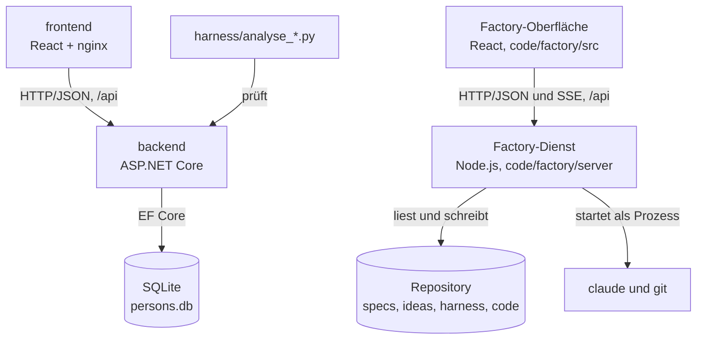
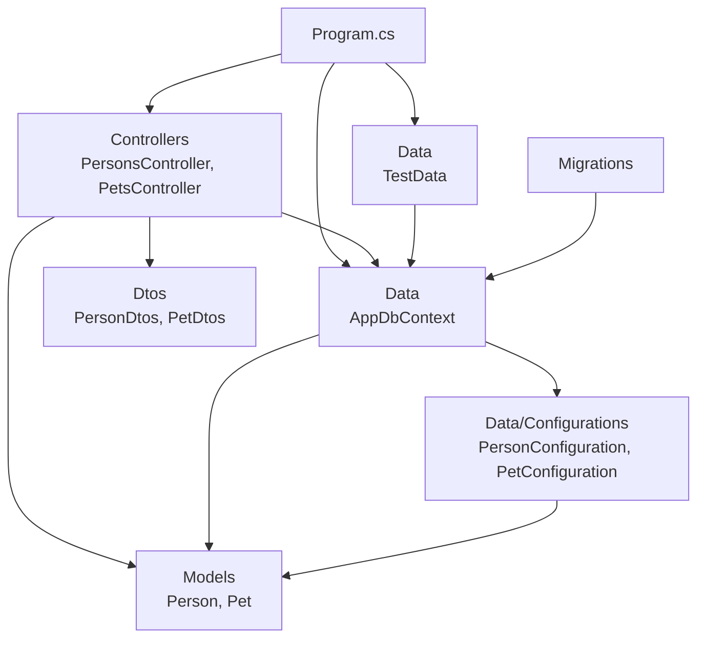
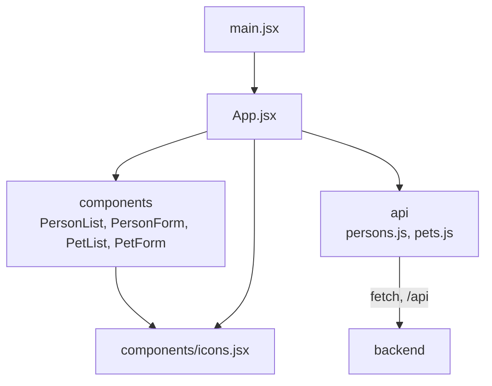
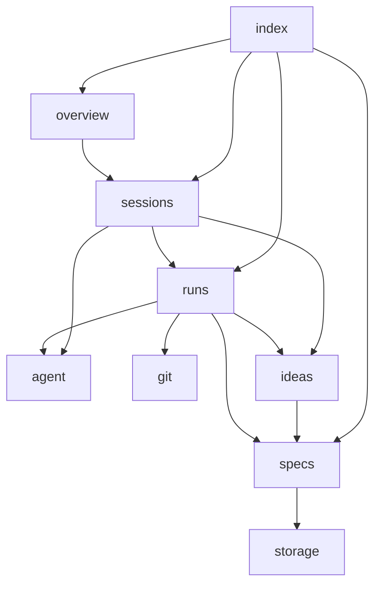
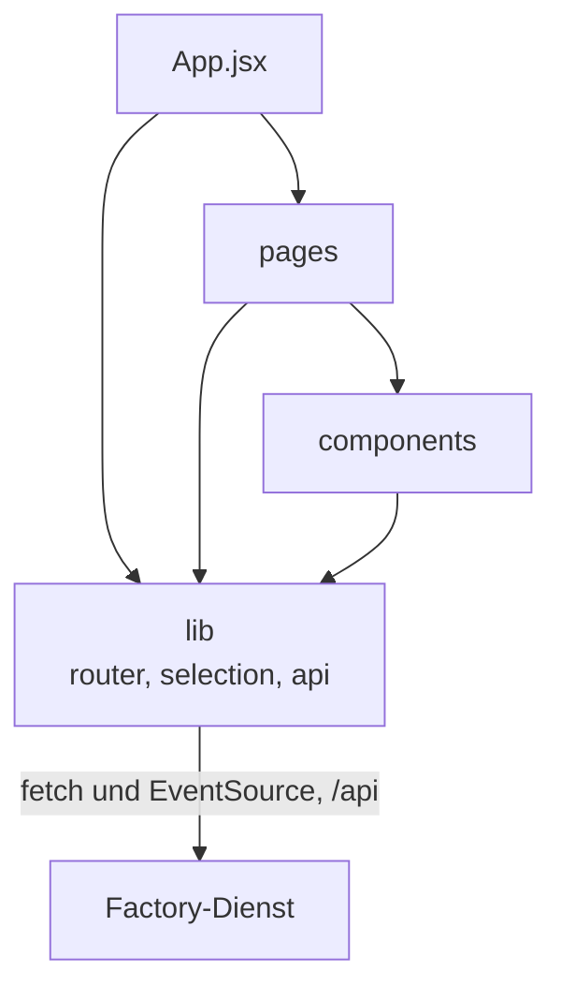
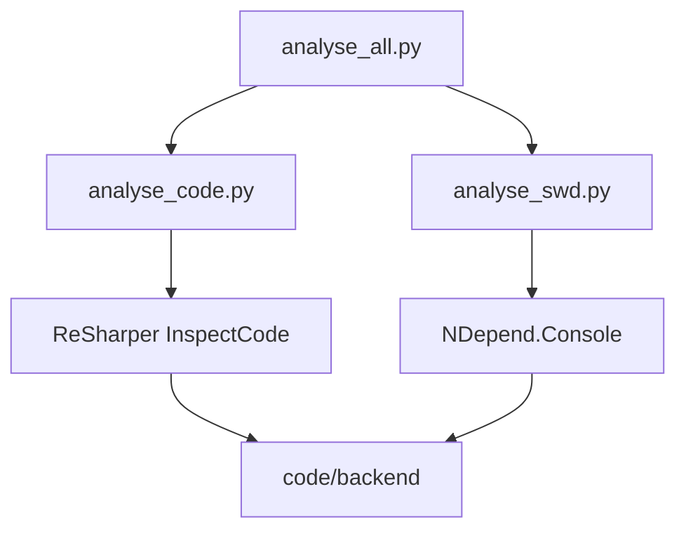

# 02 Bausteine

## Meta
- **Stand:** 2026-11-04
- **Bezug:** `code/backend`, `code/frontend/src`, `code/factory/server`, `code/factory/src`, `harness/analyse_*.py`, `docker-compose.yml`

Dieses Dokument beschreibt, welche Bausteine es innerhalb des Systems gibt und wer wen nutzt. Laufzeit, Ports und Deployment stehen in `01 Systemarchitektur.md`, die HTTP-Schnittstelle in `03 API.md`. Fachliche Anforderungen stehen in `specs/` und werden hier nicht wiederholt.

Gliederung: Ebene 1 zeigt die Container, Ebene 2 die Bausteine je Container, Ebene 3 das Innenleben der Factory-Bausteine, die sich nicht aus dem Code allein erschließen.

---

## Ebene 1: Container

Das System besteht aus der Personenverwaltung (`backend`, `frontend`, Datenbank) und der davon getrennten Software Factory, die als lokaler Node-Dienst auf dem Entwicklerrechner läuft. Das Diagramm zeigt, welcher Container welchen anderen nutzt.

| Baustein | Pfad | Verantwortung | Nutzt |
|---|---|---|---|
| backend | `code/backend` | HTTP-Schnittstelle der Personen- und Haustierverwaltung, Persistenz | SQLite |
| frontend | `code/frontend` | Browser-Oberfläche der Personenverwaltung; nginx liefert sie aus und leitet `/api/` an `backend` weiter (`nginx.conf`) | backend |
| Factory-Dienst | `code/factory/server` | Dateizugriff auf `ideas/` und `specs/`, KI-Gespräche und -Aufträge, Git | Repository, `claude`, `git` |
| Factory-Oberfläche | `code/factory/src` | Bedienung der Factory im Browser | Factory-Dienst |
| Analyseskripte | `harness/analyse_*.py` | Prüfung des Backends gegen die Harness-Regeln | backend (Quelltext und Assembly) |

Der Factory-Dienst gehört nicht zu `docker-compose.yml`. Er arbeitet bewusst mit `claude`, `git` und `docker` des Rechners und bindet nur an `127.0.0.1` (siehe `code/factory/README.md`, `server/index.js`).

Abhängigkeitsrichtungen auf Ebene 1:

- Erlaubt: `frontend` nach `backend` (nur über HTTP), `backend` nach SQLite, Factory-Oberfläche nach Factory-Dienst (nur über HTTP und SSE).
- Verboten: Das `backend` kennt das `frontend` nicht und die Personenverwaltung nicht die Factory. Die Factory-Oberfläche greift nie direkt auf Dateien, Git oder `claude` zu.
- Die Factory darf Dateien unter `code/factory` bei einer Umsetzung nicht ändern (`DELIVERY_PATHSPECS` in `server/config.js`, Dateiregeln in `server/agent.js`) und führt Anforderungen des Themenbereichs „Software Factory" nicht aus (`TOOL_EPICS`).

---

## Ebene 2: backend

Das Backend ist ein Projekt (`Backend.csproj`, Namespace `Backend`) mit vier Schichten und einem Startpunkt. Controller geben ausschließlich DTOs zurück und bilden Entität und DTO selbst aufeinander ab (z. B. `new PersonResponse(...)` in `PersonsController`).

| Baustein | Pfad | Verantwortung | Nutzt |
|---|---|---|---|
| Program | `code/backend/Program.cs` | Composition Root: Dienste registrieren, CORS-Richtlinie `AllowFrontend`, `Database.Migrate()` beim Start, OpenAPI in Development, Testendpunkt `POST /api/testdata/reset` nur bei `EnableTestEndpoints=true` | Controllers (per `MapControllers`), Data, `TestData` |
| Controllers | `code/backend/Controllers` | HTTP-Endpunkte `api/persons` und `api/pets`, Statuscodes, Validierungsergebnis, Mapping auf DTOs | Data, Dtos, Models |
| Dtos | `code/backend/Dtos` | Request-/Response-Typen der HTTP-Schnittstelle inkl. Validierungsattribute | — |
| Models | `code/backend/Models` | Entitäten `Person` und `Pet` | — |
| Data | `code/backend/Data` | `AppDbContext` (`DbSet`s, lädt Konfigurationen per `ApplyConfigurationsFromAssembly`) | Models, Data/Configurations |
| Data/Configurations | `code/backend/Data/Configurations` | EF-Mapping je Entität (Tabelle, Schlüssel, Längen, Fremdschlüssel) | Models |
| TestData | `code/backend/Data/TestData.cs` | Testbetrieb: Datenbank leeren und deterministischen Basisdatensatz laden | Data, Models |
| Migrations | `code/backend/Migrations` | Generierte EF-Migrationen und Modell-Snapshot | Data (`AppDbContext`) |

Der leere Ordner `code/backend/Configurations` enthält keinen Code; die Konfigurationen liegen unter `Data/Configurations`.

Abhängigkeitsrichtungen:

- Erlaubt: Controllers nach Data, Dtos und Models; Data nach Models; Configurations nach Models.
- Verboten: Models und Dtos kennen keine anderen Bausteine. Data kennt weder Controllers noch Dtos. Controller geben keine Entitäten nach außen.
- Verbindliche Vorgaben zu Struktur und Stil stehen in `harness/_design.md` und `harness/_code.md`; `harness/analyse_swd.py` und `analyse_code.py` prüfen sie (siehe unten).

---

## Ebene 2: frontend

Einseitige React-Anwendung (Vite). `App.jsx` hält den Zustand und lädt Daten; Komponenten stellen dar; `api` kapselt `fetch`.

| Baustein | Pfad | Verantwortung | Nutzt |
|---|---|---|---|
| main | `code/frontend/src/main.jsx` | Einstiegspunkt, rendert `App` | App |
| App | `code/frontend/src/App.jsx` | Zustand, Datenladen, Zusammenspiel von Listen und Formularen für Personen und Haustiere | components, api |
| components | `code/frontend/src/components` | Darstellung und Eingabe: `PersonList`, `PersonForm`, `PetList`, `PetForm`, Symbole in `icons.jsx` | icons (nur intern) |
| api | `code/frontend/src/api` | HTTP-Zugriff auf `/api/persons` und `/api/pets`, Übersetzung von Fehlerantworten in Meldungen | Backend-HTTP |

Abhängigkeitsrichtungen:

- Erlaubt: App nach components und api.
- Verboten: components importieren weder `api` noch `App` (sie erhalten Daten und Callbacks per Props); `api` importiert keine Komponenten. Pfade zum Backend stehen nur in `api`.
- Visuelle Regeln stehen ausschließlich in `harness/_uiux.md`.

---

## Ebene 2: Factory-Dienst (`code/factory/server`)

Node.js-Dienst (Express, ES-Module). `index.js` ist die einzige Stelle, die HTTP kennt. Die übrigen Module sind nach Verantwortung geschnitten; es gibt keine Zyklen (`sessions` nutzt `runs`, nicht umgekehrt).

| Baustein | Pfad | Verantwortung | Nutzt |
|---|---|---|---|
| index | `server/index.js` | Routen unter `/api`, SSE-Endpunkt `/api/events`, Host-Prüfung, liefert `dist/` aus, bindet an `127.0.0.1` | runs, sessions, specs, overview, git, storage, bus, errors, config |
| config | `server/config.js` | Pfade (per `FACTORY_REPO`, `FACTORY_DATA`, `FACTORY_PORT` umlenkbar), Modelle, Standardeinstellungen, Geltungsbereich einer Umsetzung | — |
| errors | `server/errors.js` | `HttpError` mit Statuscode und anzeigbarer Meldung | — |
| storage | `server/storage.js` | Dateizugriff: atomares Schreiben mit Wiederholung bei Sperren, JSON, Einstellungen, Ereignisprotokoll | config |
| specs | `server/specs.js` | `specs/` als Baum lesen, Stories parsen und rendern, validieren, Status setzen | config, errors, storage |
| ideas | `server/ideas.js` | `ideas/` lesen, parsen, rendern, Überführungsziele bestimmen | config, errors, specs, storage |
| git | `server/git.js` | Git-Aufrufe im Repository, schreibende Aufrufe seriell | config |
| prompts | `server/prompts.js` | Systemtexte, Prompts und JSON-Schemata für die KI; Regeln werden zur Laufzeit aus `harness/` gelesen | config, storage |
| agent | `server/agent.js` | Startet `claude` als Prozess mit Rechteprofil, bricht Prozessbäume ab | config |
| bus | `server/bus.js` | Live-Benachrichtigung der Oberflächen per Server-Sent Events | — |
| sessions | `server/sessions.js` | Gespräche: Ideen-Dialog und Anforderungs-Studio, Qualitätsprüfung | agent, bus, ideas, specs, git, prompts, storage, errors, runs |
| runs | `server/runs.js` | Aufträge: Überführung, Umsetzung, Zurücknehmen; Sperre offener Arbeit | agent, bus, git, ideas, specs, prompts, storage, errors, config |
| overview | `server/overview.js` | Lesesichten: Cockpit-Kennzahlen, Verlauf, Einstellungen, Systemstatus, Story-Detail | git, ideas, runs, sessions, specs, storage, config |

Das Diagramm zeigt den Kern; `config`, `errors`, `bus`, `prompts` und `storage` werden von fast allen genutzt und sind zur Lesbarkeit weggelassen (Tabelle: Spalte „Nutzt").

Abhängigkeitsrichtungen:

- Erlaubt: nur von oben nach unten entlang `index` → `sessions`/`runs`/`overview` → `ideas`/`specs`/`git`/`agent` → `storage`/`config`/`errors`.
- Verboten: `config`, `errors`, `bus`, `storage`, `agent` kennen keine Fachmodule; `specs` und `ideas` kennen weder `runs` noch `sessions`; `runs` importiert `sessions` nicht. Nur `index.js` spricht HTTP.
- `formats.test.js` prüft das Parsen und Rendern von Ideen und Stories (`ideas`, `specs`); für den Themenbereich E3 werden keine weiteren Tests geschrieben (siehe `AGENTS.md`).

---

## Ebene 2: Factory-Oberfläche (`code/factory/src`)

React-Anwendung (Vite, Port 5174 im Entwicklungsmodus mit Proxy auf den Dienst). Ein eigener Router und ein Kontext ersetzen Bibliotheken.

| Baustein | Pfad | Verantwortung | Nutzt |
|---|---|---|---|
| App | `src/App.jsx` | Navigation, Seitenwahl nach Route, stellt `SelectionContext` bereit | pages, lib, components/icons |
| pages | `src/pages` | Je eine Ansicht: Cockpit, Ideen, Ideen-Arbeitsbereich, Anforderungen, Story, Assistent, Umsetzung, Lauf, Verlauf, Einstellungen | components, lib |
| components | `src/components` | Wiederverwendbare Teile: `ui.jsx` (Grundelemente), `Conversation`, `StoryEditor`, `QualityCheck`, `RunPanel`, Modale, `icons.jsx` | lib, ui |
| lib | `src/lib` | `api.js` (HTTP, gemeinsamer SSE-Kanal, `useLive`), `router.js`, `selection.js`, `format.js` (Beschriftungen, Zahlen, Datum), `voice.js` (Sprache) | Factory-Dienst (nur `api.js`) |

Abhängigkeitsrichtungen:

- Erlaubt: App nach pages; pages nach components und lib; components nach lib und untereinander (`ui.jsx` und `icons.jsx` als Grundlage); Komponenten wie `StoryEditor` und `StartDeliveryModal` rufen `api` direkt.
- Verboten: lib importiert weder pages noch components; components importieren keine pages; pages importieren einander nicht. Nur `lib/api.js` kennt URLs und HTTP.

---

## Ebene 3: Factory-Bausteine mit Innenleben

### agent (`server/agent.js`)

Einzige Stelle, die `claude` startet (`spawn('claude', …)`). Kapselt drei Dinge: Rechteprofile (`read`, `specs`, Umsetzung) mit erlaubten und verbotenen Werkzeugen und Pfaden, den Prozesslauf mit Abbruch (`killTree`, unter Windows `taskkill`) und die Fehlerklasse `AgentError`. Die Grenzen werden nach einem Lauf zusätzlich gegen Git geprüft (Kommentar im Kopf der Datei); die Prüfung selbst liegt in `runs`. Das Profil für die Umsetzung verbietet `git` und `docker` sowie Schreibzugriff auf `code/factory/**`, weil Sichern und Ausliefern der Dienst übernimmt.

### bus (`server/bus.js`)

Hält die Menge der offenen SSE-Verbindungen. `notify(topic, id)` sendet an alle; ein Intervall hält Verbindungen mit Kommentarzeilen offen. `sessions` und `runs` rufen `notify` nach Zustandsänderungen; die Oberfläche lädt daraufhin per `useLive` (`src/lib/api.js`) das betroffene Thema neu. Es gibt keinen Zustand außer den Verbindungen.

### runs (`server/runs.js`)

Aufträge laufen im Hintergrund und überleben einen Neustart nur als Protokoll: Zustand liegt als JSON unter `DATA_DIR` (über `storage`), `recoverRuns()` räumt beim Start unterbrochene Läufe auf. Drei Auftragsarten: Überführung einer Idee in Anforderungen (`startTransfer`), Umsetzung von Stories (`startDelivery`, danach Sicherung per `git`) und Zurücknehmen (`startRevert`). `assertSpecsUnlocked`, `isBusy` und `isIdeaInTransfer` schützen offene Arbeit; `sessions` fragt Letzteres ab, bevor es Ideen ändert.

### sessions (`server/sessions.js`)

Zwei Gesprächsarten mit gleichem Muster: Ideen-Dialog (`createIdea`, `sendIdeaMessage`, `approveIdea`) und Anforderungs-Studio (`createStudio`, `saveStudio`). Jede Runde ruft `runAgent` mit dem schreibgeschützten Profil und einem JSON-Schema aus `prompts`; das Ergebnis aktualisiert den Entwurf und wird per `notify` gemeldet. `checkStory` führt die Qualitätsprüfung einer Story aus.

---

## Analyseskripte (`harness/analyse_*.py`)

Werkzeuge der Entwicklung, nicht Teil der Laufzeit. Sie prüfen ausschließlich das Backend (`code/backend/Backend.csproj`).

| Baustein | Pfad | Verantwortung | Nutzt |
|---|---|---|---|
| analyse_all | `harness/analyse_all.py` | Baut einmal vorab, startet beide Prüfungen parallel, Exit 0 / 1 / 2 | analyse_code, analyse_swd |
| analyse_code | `harness/analyse_code.py` | ReSharper-Prüfung (`jb inspectcode`) gegen `PersonManager.sln.DotSettings` | `harness/PersonManager.sln.DotSettings`, Backend.csproj |
| analyse_swd | `harness/analyse_swd.py` | NDepend-Prüfung der Assembly gegen `_design.ndrules` | `harness/_design.ndrules`, Backend.csproj |

Regel: `analyse_*.py` ändern keinen Code; Zwischenergebnisse liegen im Temp-Verzeichnis außerhalb des Repositorys. Exit 2 bedeutet „Prüfung nicht möglich" und gilt nie als bestanden. Die Pflicht, gefundene Issues zu beheben, steht in `AGENTS.md`.
