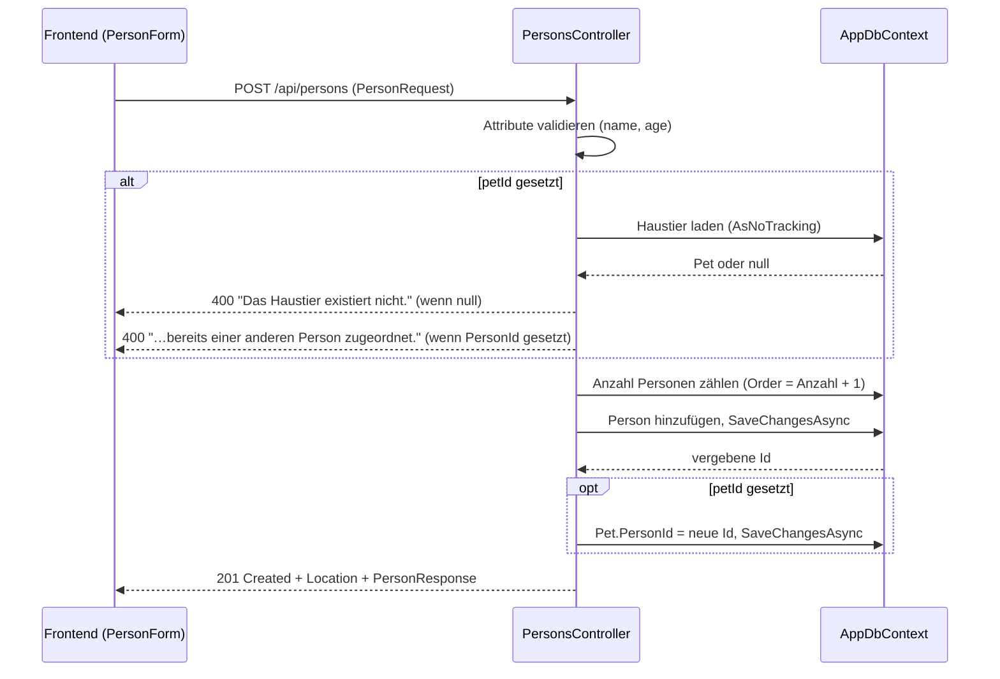
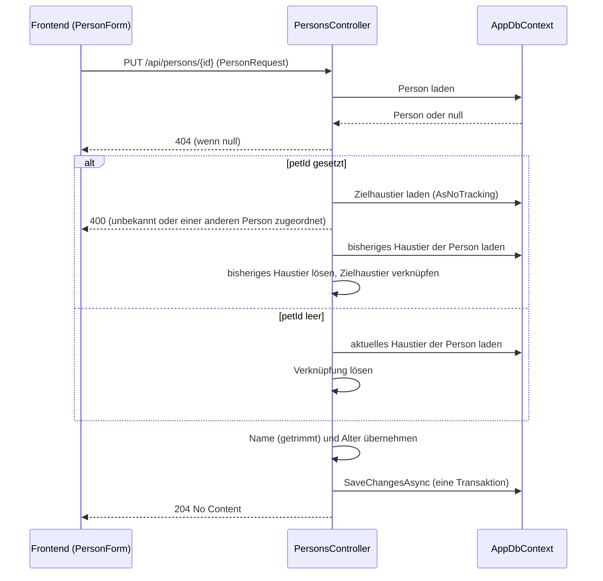
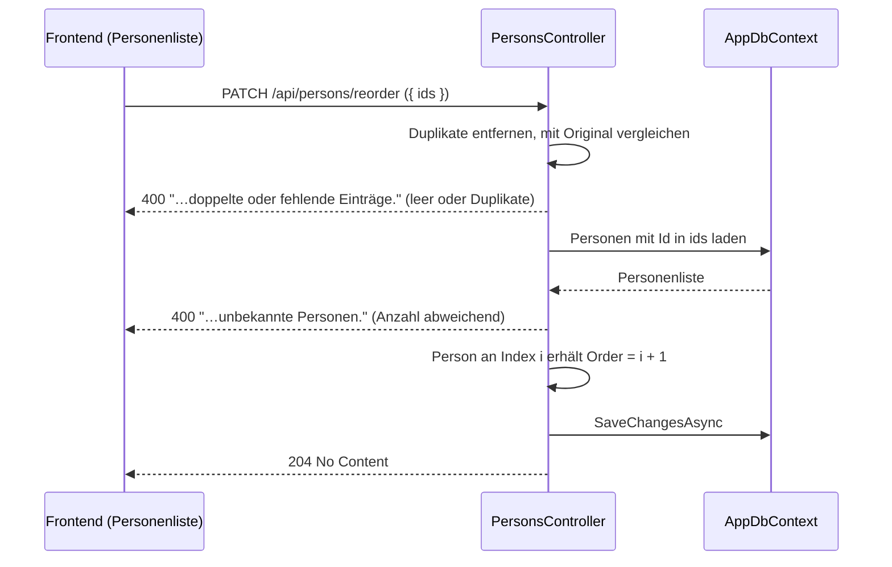
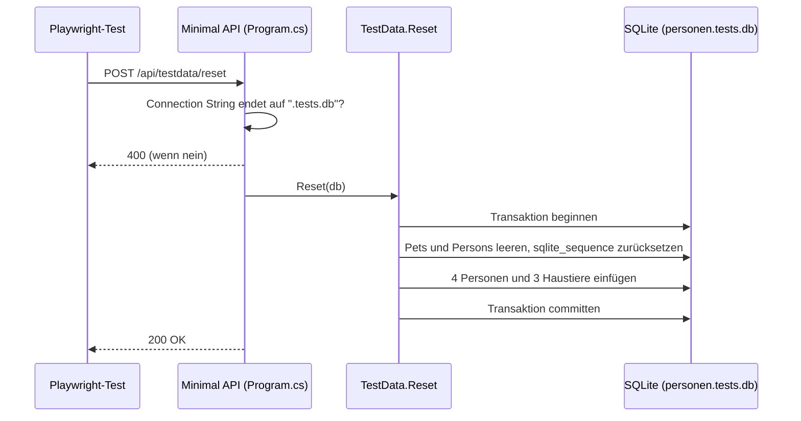
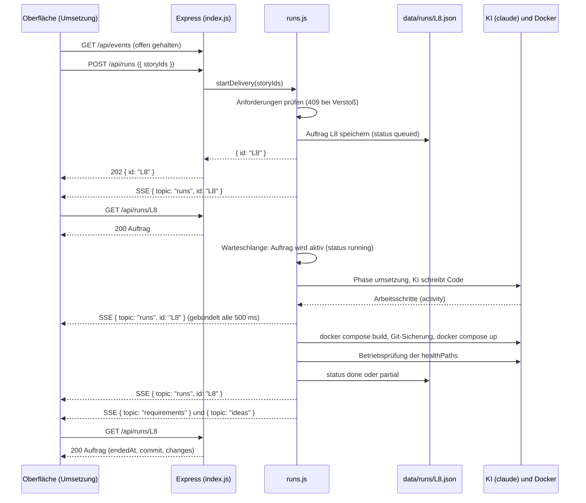
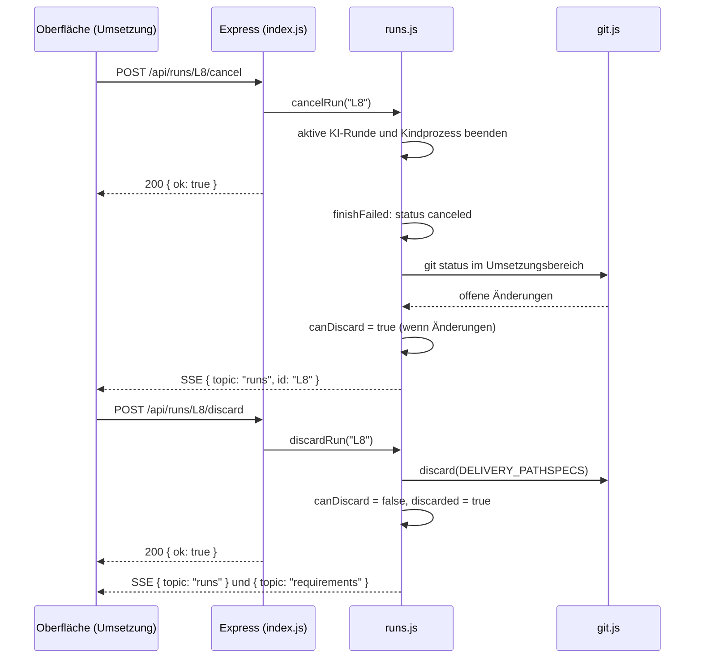
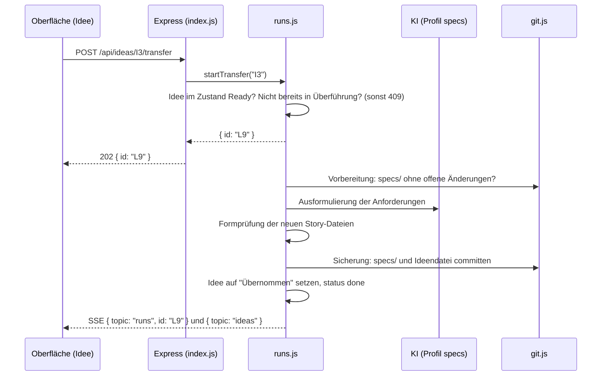

# API

## Meta
- **Stand:** 2026-11-04
- **Bezug:** `code/backend` (`Controllers/`, `Dtos/`, `Program.cs`, `Data/TestData.cs`), `code/factory/server` (`index.js`, `runs.js`, `sessions.js`, `overview.js`, `specs.js`, `bus.js`, `errors.js`, `config.js`), `code/frontend/src/api`, `docker-compose.yml`, `docker-compose.tests.yml`

Dieses Dokument beschreibt, **wie** man die beiden HTTP-Schnittstellen des Projekts aufruft. **Welche** Endpunkte es fachlich gibt und warum, steht in den Backend-Spezifikationen; die Endpunktlisten werden hier nicht doppelt gepflegt:

- E1 Personen: [`_Backend.md`](../../specs/E1%20Personen/_Backend.md)
- E2 Haustiere: [`_Backend.md`](../../specs/E2%20Haustiere/_Backend.md)
- E3 Software Factory: [`_Backend.md`](../../specs/E3%20Software%20Factory/_Backend.md)

Das Dokument hat zwei voneinander unabhängige Schnittstellen:

| Abschnitt | Dienst | Technik | Adresse | Format |
|---|---|---|---|---|
| A | App-Backend (Personen, Haustiere) | ASP.NET Core, `code/backend` | Container `personen-api`, Host-Port `8080` | JSON, Fehler als `ProblemDetails` bzw. Klartext |
| B | Factory-Server | Node.js mit Express 5, `code/factory/server` | `http://localhost:4000` (`FACTORY_PORT`) | JSON, Fehler als `{ "error": "…" }`, Live-Kanal per SSE |

---

# A App-Backend

## A.1 Grundlagen

- **Basis-URLs:** `/api/persons`, `/api/pets`. Im Betrieb erreicht der Browser das Backend über den nginx des Frontends (`http://localhost:3000/api/...`, Proxy auf `backend:8080`); im Entwicklungsmodus ruft das Vite-Frontend (`http://localhost:5173`) das Backend direkt auf.
- **CORS:** Die Richtlinie `AllowFrontend` erlaubt ausschließlich die Herkunft `http://localhost:5173` mit beliebiger Methode und beliebigen Headern (`Program.cs`). Über nginx (gleiche Herkunft) ist CORS nicht beteiligt.
- **Authentifizierung:** keine.
- **Datenformat:** JSON. Der Server liefert Feldnamen in `camelCase` (`id`, `name`, `age`, `petId`, `personId`, `personName`). Beim Lesen von Anfragen ist die Groß-/Kleinschreibung der Feldnamen egal; die Specs schreiben die Felder in `PascalCase` (`Name`, `Age`), auf der Leitung gilt `camelCase`.
- **Migrationen:** Beim Start wendet `Program.cs` alle EF-Core-Migrationen an (`Database.Migrate()`), danach nimmt der Dienst Anfragen an.
- **OpenAPI:** `GET /openapi/v1.json` existiert nur, wenn `ASPNETCORE_ENVIRONMENT=Development` (so setzt es `docker-compose.yml`).
- **Verknüpfungsregel:** Eine Person hat höchstens ein Haustier (1:1), die Prüfung erfolgt im Controller. Beide Seiten können die Verknüpfung setzen: `PetId` an der Person, `PersonId` am Haustier.

## A.2 Fehlerformat

Das Backend verwendet **drei** Fehlerformen. Die Endpunkte unten verweisen nur noch auf diese Abschnitte.

### Validierungsfehler (automatisch, `400`)

Verletzt der Body die Attribute der Request-DTOs (`[Required]`, `[StringLength]`, `[Range]`, `[RegularExpression]`) oder ist er kein lesbares JSON, antwortet `[ApiController]` mit `ValidationProblemDetails` (`application/problem+json`). Der Controller-Code wird dann nicht erreicht. Die Meldungen stammen aus den `ErrorMessage`-Texten der DTOs:

```json
{
  "type": "https://tools.ietf.org/html/rfc9110#section-15.5.1",
  "title": "One or more validation errors occurred.",
  "status": 400,
  "errors": {
    "Name": ["Name ist erforderlich."],
    "Age": ["Alter muss zwischen 0 und 150 liegen."]
  },
  "traceId": "00-4bf92f3577b34da6a3ce929d0e0e4736-00f067aa0ba902b7-00"
}
```

Die Schlüssel in `errors` sind die Property-Namen der DTOs in `PascalCase`. Ein ungültiger JSON-Body erzeugt denselben Aufbau mit Schlüssel `$` bzw. `request`.

### Nicht gefunden (`404`)

`NotFound()` ohne Body wird von `[ApiController]` in `ProblemDetails` umgewandelt:

```json
{
  "type": "https://tools.ietf.org/html/rfc9110#section-15.5.5",
  "title": "Not Found",
  "status": 404,
  "traceId": "00-4bf92f3577b34da6a3ce929d0e0e4736-00f067aa0ba902b7-00"
}
```

### Fachregel verletzt (`400`, Klartext)

Verstöße gegen Fachregeln (unbekannte Verknüpfung, Haustier/Person bereits vergeben, ungültige Reihenfolge) liefern `BadRequest("…")` mit einem **String als Body**, kein `ProblemDetails`. Je nach `Accept`-Header ist das `text/plain` oder ein JSON-String:

```
Das Haustier ist bereits einer anderen Person zugeordnet.
```

Der Frontend-Client (`code/frontend/src/api/persons.js`, `pets.js`) wertet nur `title`, `errors` und `detail` eines JSON-Objekts aus. Bei einem String-Body fällt er daher auf die Meldung `HTTP 400` zurück (siehe Abschnitt [Abweichungen](#abweichungen-zwischen-spec-code-und-harness)).

## A.3 Personen (`/api/persons`)

Fachliche Übersicht: [E1 `_Backend.md`](../../specs/E1%20Personen/_Backend.md).

**Datentypen** (`Dtos/PersonDtos.cs`)

| DTO | Felder | Regeln |
|---|---|---|
| `PersonResponse` | `id` (int), `name` (string), `age` (int) | Antwort für alle Lesezugriffe |
| `PersonRequest` | `name` (string), `age` (int), `petId` (int, optional) | `name`: Pflicht, max. 150 Zeichen, wird getrimmt; `age`: 0 bis 150; `petId`: optional |
| `PersonPositionRequest` | `ids` (int[]) | Pflichtfeld |

Hinweis zu `age`: Der Typ ist ein nicht-nullbares `int`. Fehlt das Feld im Body, wird `0` gebunden und `[Required]` schlägt nicht an; das Alter `0` ist zugleich ein gültiger Wert.

### `GET /api/persons`

Liefert alle Personen nach `Order` aufsteigend, bei gleichem `Order` nach `Name`.

**Antwort `200 OK`**

```json
[
  { "id": 1, "name": "Anna Berger", "age": 34 },
  { "id": 2, "name": "Jonas Weber", "age": 41 },
  { "id": 4, "name": "Maria Schneider", "age": 28 },
  { "id": 3, "name": "Tom Krüger", "age": 55 }
]
```

| Code | Bedeutung |
|---|---|
| `200` | Liste zurückgegeben, ggf. leer |

### `GET /api/persons/{id}`

Liefert eine Person.

| Parameter | Ort | Typ | Pflicht | Bedeutung |
|---|---|---|---|---|
| `id` | Pfad | int | ja | Id der Person; eine nicht numerische Id trifft die Route nicht (`404` ohne Body vom Routing) |

**Antwort `200 OK`**

```json
{ "id": 1, "name": "Anna Berger", "age": 34 }
```

| Code | Bedeutung |
|---|---|
| `200` | Person gefunden |
| `404` | Person unbekannt, Body als `ProblemDetails` (A.2) |

### `POST /api/persons`

Legt eine Person an und verknüpft optional ein bestehendes, noch freies Haustier. Die neue Person erhält `Order = Anzahl vorhandener Personen + 1`. Der Ablauf umfasst zwei Speichervorgänge, siehe Sequenzdiagramm in A.5.

**Anfrage**

```json
{ "name": "Lena Hoffmann", "age": 29, "petId": 3 }
```

**Antwort `201 Created`** mit `Location: /api/persons/5`

```json
{ "id": 5, "name": "Lena Hoffmann", "age": 29 }
```

| Code | Bedeutung |
|---|---|
| `201` | Person angelegt, `Location` zeigt auf `GET /api/persons/{id}` |
| `400` | Validierungsfehler (A.2, `ValidationProblemDetails`) |
| `400` | `Das Haustier existiert nicht.` (Klartext, A.2) |
| `400` | `Das Haustier ist bereits einer anderen Person zugeordnet.` (Klartext, A.2) |

### `PUT /api/persons/{id}`

Ersetzt Name und Alter und setzt die Haustier-Verknüpfung neu. Die Haustier-Verknüpfung folgt dem Wert von `petId`:

- `petId` gesetzt: Das bisherige Haustier der Person (falls ein anderes) wird gelöst, das angegebene wird verknüpft.
- `petId` fehlt oder ist `null`: Ein vorhandenes Haustier der Person wird gelöst.

Der Ablauf steht im Sequenzdiagramm in A.5. Die Reihenfolge (`Order`) ändert dieser Endpunkt nicht.

**Anfrage**

```json
{ "name": "Anna Berger-Lang", "age": 35, "petId": null }
```

| Code | Bedeutung |
|---|---|
| `204` | Gespeichert, kein Body |
| `400` | Validierungsfehler (A.2) |
| `400` | `Das Haustier existiert nicht.` bzw. `Das Haustier ist bereits einer anderen Person zugeordnet.` (Klartext, A.2) |
| `404` | Person unbekannt (`ProblemDetails`, A.2) |

Ein Haustier gilt nur dann als vergeben, wenn es einer **anderen** Person gehört; das Haustier der eigenen Person erneut zu übergeben ist zulässig.

### `DELETE /api/persons/{id}`

Löscht die Person. Ein zugeordnetes Haustier bleibt bestehen; seine `PersonId` wird gelöst (Fremdschlüsselverhalten der EF-Konfiguration, siehe `Data/Configurations/PetConfiguration.cs`).

| Code | Bedeutung |
|---|---|
| `204` | Gelöscht, kein Body |
| `404` | Person unbekannt (`ProblemDetails`, A.2) |

### `PATCH /api/persons/reorder`

Setzt die manuelle Reihenfolge. Die Person an Index `i` der Liste erhält `Order = i + 1`. Es werden nur die übergebenen Personen neu nummeriert; eine Teilliste ist zulässig, der Controller prüft nicht auf Vollständigkeit.

**Anfrage**

```json
{ "ids": [3, 1, 2, 4] }
```

| Code | Bedeutung |
|---|---|
| `204` | Reihenfolge gespeichert, kein Body |
| `400` | `Reihenfolge enthält doppelte oder fehlende Einträge.` (Klartext): Liste leer oder enthält Duplikate |
| `400` | `Reihenfolge enthält unbekannte Personen.` (Klartext): mindestens eine Id existiert nicht |
| `400` | `ids` fehlt oder ist kein Array (`ValidationProblemDetails`, A.2) |

Da die Route `reorder` ein Literal ist und `{id:int}` eine Ganzzahl verlangt, kollidiert `PATCH /reorder` nicht mit den Id-Routen.

## A.4 Haustiere (`/api/pets`)

Fachliche Übersicht: [E2 `_Backend.md`](../../specs/E2%20Haustiere/_Backend.md).

**Datentypen** (`Dtos/PetDtos.cs`)

| DTO | Felder | Regeln |
|---|---|---|
| `PetResponse` | `id` (int), `name` (string), `species` (string), `personId` (int oder `null`), `personName` (string oder `null`) | `personName` wird per Unterabfrage aus der verknüpften Person gelesen |
| `PetRequest` | `name` (string), `species` (string), `personId` (int, optional) | `name`: Pflicht, max. 150 Zeichen, getrimmt; `species`: genau einer der Werte `Hund`, `Katze`, `Vogel`, `Dinosaurier` (Regex, Groß-/Kleinschreibung relevant); `personId`: optional |

### `GET /api/pets`

Liefert alle Haustiere nach `Name`, bei gleichem Namen nach `Id`.

**Antwort `200 OK`**

```json
[
  { "id": 1, "name": "Fiete", "species": "Hund", "personId": 1, "personName": "Anna Berger" },
  { "id": 2, "name": "Minka", "species": "Katze", "personId": 4, "personName": "Maria Schneider" },
  { "id": 3, "name": "Rex", "species": "Hund", "personId": null, "personName": null }
]
```

| Code | Bedeutung |
|---|---|
| `200` | Liste zurückgegeben, ggf. leer |

### `GET /api/pets/{id}`

Liefert ein Haustier im Format von `PetResponse`.

| Code | Bedeutung |
|---|---|
| `200` | Haustier gefunden |
| `404` | Haustier unbekannt (`ProblemDetails`, A.2) |

### `POST /api/pets`

Legt ein Haustier an, optional direkt einer Person zugeordnet.

**Anfrage**

```json
{ "name": "Pico", "species": "Vogel", "personId": 2 }
```

**Antwort `201 Created`** mit `Location: /api/pets/4`

```json
{ "id": 4, "name": "Pico", "species": "Vogel", "personId": 2, "personName": "Jonas Weber" }
```

| Code | Bedeutung |
|---|---|
| `201` | Haustier angelegt |
| `400` | Validierungsfehler, z. B. `Spezies ist ungültig.` (A.2, `ValidationProblemDetails`) |
| `400` | `Die Person existiert nicht.` (Klartext, A.2) |
| `400` | `Die Person hat bereits ein Haustier.` (Klartext, A.2) |

### `PUT /api/pets/{id}`

Ersetzt Name, Spezies und Person. Ein fehlendes oder `null`-wertiges `personId` löst die Verknüpfung. Anders als `PUT /api/persons/{id}` wird hier kein anderes Haustier umgehängt: Hat die Zielperson bereits ein anderes Haustier, lehnt der Endpunkt mit `400` ab.

**Anfrage**

```json
{ "name": "Rex", "species": "Hund", "personId": null }
```

| Code | Bedeutung |
|---|---|
| `204` | Gespeichert, kein Body |
| `400` | Validierungsfehler (A.2) |
| `400` | `Die Person existiert nicht.` bzw. `Die Person hat bereits ein Haustier.` (Klartext, A.2) |
| `404` | Haustier unbekannt (`ProblemDetails`, A.2) |

### `DELETE /api/pets/{id}`

Löscht das Haustier. Die Person bleibt unverändert.

| Code | Bedeutung |
|---|---|
| `204` | Gelöscht, kein Body |
| `404` | Haustier unbekannt (`ProblemDetails`, A.2) |

## A.5 Sequenzdiagramme

### Person mit Haustier anlegen (`POST /api/persons`)

Das Diagramm zeigt die Prüfung des Haustiers vor dem Anlegen und die zwei getrennten `SaveChangesAsync`-Aufrufe: Die Person wird zuerst gespeichert, damit ihre `Id` feststeht, danach folgt die Verknüpfung am Haustier. Zwischen den beiden Aufrufen gibt es keine gemeinsame Transaktion.



### Haustier einer Person umhängen (`PUT /api/persons/{id}`)

Das Diagramm zeigt, dass ein Aufruf bis zu zwei Haustiere ändert (das bisherige wird gelöst, das neue verknüpft) und alles in **einem** `SaveChangesAsync` committet wird.



### Reihenfolge ändern (`PATCH /api/persons/reorder`)

Das Diagramm zeigt die Prüfung der Id-Liste und das Neu-Nummerieren. Das Frontend sendet nach einem Verschieben die vollständige Id-Liste in der neuen Anzeigereihenfolge.



## A.6 Test-Endpunkt (nur Testumgebung)

### `POST /api/testdata/reset`

Setzt die Datenbank auf den deterministischen Basisdatensatz zurück (UI-Tests, siehe `harness/_uitests.md`). Der Endpunkt wird in `Program.cs` nur registriert, wenn die Konfiguration `EnableTestEndpoints` den Wert `true` hat (gesetzt in `docker-compose.tests.yml`, Host-Port `5077`). Im normalen Betrieb (`docker-compose.yml`) existiert die Route nicht und antwortet `404`.

**Anfrage:** kein Body.

**Basisdatensatz nach dem Reset** (`Data/TestData.cs`): vier Personen (Anna Berger 34 `Order 1`, Jonas Weber 41 `Order 2`, Tom Krüger 55 `Order 3`, Maria Schneider 28 `Order 3`) und drei Haustiere (Fiete, Hund, bei Anna; Minka, Katze, bei Maria; Rex, Hund, ohne Person). `Order 3` ist bewusst doppelt vergeben, damit die Sortierung „gleicher `Order` dann `Name`“ prüfbar ist. Die Autoinkrement-Zähler werden zurückgesetzt, die Ids sind fest.

| Code | Bedeutung |
|---|---|
| `200` | Zurückgesetzt, kein Body |
| `400` | Klartext `Der Reset ist nur gegen eine Testdatenbank (.tests.db) erlaubt.`, wenn die Connection-String-Datei nicht auf `.tests.db` endet |



---

# B Factory-API

## B.1 Grundlagen

- **Dienst:** Express 5 in `code/factory/server/index.js`, lokal auf `127.0.0.1:4000` (`FACTORY_PORT`). Die gebaute Oberfläche kommt aus `code/factory/dist`, im Entwicklungsmodus läuft Vite auf Port `5174` und leitet `/api` weiter. Der Dienst ist nicht Teil von `docker-compose.yml`.
- **Zugriffsschutz** (Middleware vor allen Routen):

| Prüfung | Verstoß | Antwort |
|---|---|---|
| `Host` ist `localhost:4000`, `127.0.0.1:4000`, `localhost:5174` oder `127.0.0.1:5174` | andere Hosts | `403` `{ "error": "Zugriff nur lokal erlaubt." }` |
| `Origin` (falls gesendet) hat einen dieser Hosts | fremde oder ungültige Herkunft | `403`, gleiche Meldung |
| Methoden außer `GET`/`HEAD` senden `Content-Type: application/json` | anderer Inhaltstyp | `415` `{ "error": "Ungültiges Anfrageformat." }` |

- **Body:** JSON, höchstens `4mb` (`express.json({ limit: '4mb' })`). Anfragen ohne Body, aber mit Inhaltstyp `application/json`, sind zulässig; Felder sind dann `undefined`.
- **Kennungen:** Ideen `I{n}`, Entwürfe des Assistenten `A{n}`, Aufträge `L{n}`, Anforderungen `E{n}-F{n}-S{n}`. Aufträge und Sitzungen werden vor dem Dateizugriff per Regex geprüft; eine ungültige Kennung führt zu `404`.
- **Asynchrone Operationen** antworten mit `202 Accepted`. Das Ergebnis erscheint im Live-Kanal (B.3) und beim erneuten Lesen der Ressource.

## B.2 Fehlerformat

Alle Fehler der Factory haben dieselbe Form (`errors.js`, Fehler-Middleware in `index.js`):

```json
{ "error": "Diese Anforderung existiert nicht mehr." }
```

Die Meldung ist deutsch und für die direkte Anzeige in der Oberfläche gedacht.

| Code | Auslöser |
|---|---|
| `400` | `badRequest`: fehlende oder ungültige Eingabe (z. B. `Bitte beschreiben Sie Ihre Idee.`); zusätzlich unlesbarer JSON-Body: `Die Anfrage konnte nicht gelesen werden.` |
| `403` | Zugriffsschutz (B.1) |
| `404` | `notFound`: Ressource unbekannt; unbekannte Adresse unter `/api`: `Unbekannte Adresse.` |
| `409` | `conflict`: Zustand erlaubt die Aktion nicht (z. B. Auftrag läuft, Idee nicht freigegeben, Anforderungen gesperrt) |
| `415` | Zugriffsschutz (B.1) |
| `500` | Jeder andere Fehler, auch Fehler der KI-Anbindung (`AgentError`): Body `{ "error": err.message }`, ersatzweise `Es ist ein unerwarteter Fehler aufgetreten.` |

Ein Body über 4 MB wird von Express mit Status `413` abgelehnt; die Fehler-Middleware behandelt ihn wie einen unbekannten Fehler und antwortet mit `500` und der Meldung von Express.

Die Aufrufe unten nennen nur noch die Statuscodes dieser Tabelle. Alle `404` sind `{ "error": … }` mit der jeweiligen Meldung.

## B.3 Live-Kanal (Server-Sent Events)

### `GET /api/events`

Hält eine Verbindung offen (`Content-Type: text/event-stream`, `Cache-Control: no-cache`) und schickt Hinweise, **dass** sich etwas geändert hat. Die Meldung enthält keine Nutzdaten; der Client lädt die betroffene Ressource anschließend selbst nach.

Beim Verbindungsaufbau sendet der Server `retry: 2000` (der Browser verbindet sich nach 2 Sekunden neu). Alle 25 Sekunden folgt der Kommentar `: ping`, damit die Verbindung offen bleibt. Jede Änderung ist eine Zeile `data:` mit JSON:

```
retry: 2000

data: {"topic":"runs","id":"L7"}

data: {"topic":"requirements","id":null}

: ping
```

| Feld | Typ | Bedeutung |
|---|---|---|
| `topic` | string | `ideas`, `requirements`, `runs`, `studio` oder `settings` |
| `id` | string oder `null` | Kennung der geänderten Ressource, sofern bekannt |

Die Zuordnung von Auslösern zu Themen steht in [E3 `_Backend.md`](../../specs/E3%20Software%20Factory/_Backend.md#live-meldungen). Zusätzlich beobachtet der Dienst `specs/` und `ideas/` per Dateisystem-Watcher und meldet Änderungen (entprellt um 300 ms) als `requirements` bzw. `ideas`, auch wenn sie nicht von der Factory stammen. Während ein Auftrag läuft, werden Aktivitätsmeldungen gebündelt höchstens alle 500 ms als `runs` gesendet.

| Code | Bedeutung |
|---|---|
| `200` | Kanal geöffnet, bleibt bis zum Verbindungsende offen |

## B.4 Übersicht und Einstellungen

Fachliche Beschreibung der Kennzahlen: [E3 `_Backend.md`](../../specs/E3%20Software%20Factory/_Backend.md).

### `GET /api/overview`

Kennzahlen des Cockpits. Themenbereiche der Factory selbst (`isTool`) zählen nicht mit.

**Antwort `200 OK`** (gekürzt)

```json
{
  "ideas": { "draft": 1, "ready": 0, "transferred": 2 },
  "totals": {
    "stories": 40, "open": 3, "implemented": 37, "criteria": 160,
    "epics": 2, "features": 8, "rate": 93, "deliveries": 5,
    "avgDurationMs": 612345.5, "costUsd": 12.34
  },
  "byEpic": [{ "name": "Personen", "number": 1, "umgesetzt": 30, "offen": 1 }],
  "daily": [],
  "actions": [
    { "tone": "green", "title": "3 Anforderungen warten auf die Umsetzung", "href": "#/anforderungen?filter=offen", "cta": "Anforderungen auswählen" }
  ],
  "activeRuns": [],
  "openDrafts": 0,
  "recent": [],
  "nav": { "ideasOpen": 1, "requirementsOpen": 3, "runsActive": 0 }
}
```

`actions[].tone` ist `orange`, `green` oder `error`; `daily` ist die Git-Aktivität der letzten 14 Tage; `recent` sind die zwölf jüngsten Ereignisse; `activeRuns` sind Aufträge im Status `queued` oder `running` (ohne `activity`).

### `GET /api/history`

Ereignisse der Factory (`source: "factory"`) und die letzten 100 Git-Versionen (`source: "version"`, `type: "version"`) gemischt, neueste zuerst.

```json
[
  { "at": "2026-11-04T09:10:11.000Z", "type": "delivery", "title": "Umsetzung L3 ausgeliefert (2 von 2 Anforderungen)", "ref": { "run": "L3" }, "source": "factory" },
  { "at": "2026-11-04T09:09:02.000Z", "type": "version", "title": "umsetzung: E2-F1-S1, E2-F1-S2", "ref": { "commit": "60056fd…" }, "source": "version", "author": "David Tielke" }
]
```

### `GET /api/system`

Zustand der Umgebung (KI-Anbindung, Docker, Git, laufende Anwendung). Werkzeugprüfungen für `claude` und `git` werden fünf Minuten zwischengespeichert.

```json
{
  "checks": [
    { "key": "ai", "label": "KI-Anbindung", "ok": true, "detail": "2.1.0 (Claude Code)" },
    { "key": "docker", "label": "Betriebsumgebung", "ok": true, "detail": "Docker 27.3.1" },
    { "key": "git", "label": "Versionsverwaltung", "ok": true, "detail": "git version 2.47.0" },
    { "key": "app", "label": "Anwendung", "ok": true, "detail": "http://localhost:3000" }
  ],
  "app": { "url": "http://localhost:3000", "online": true },
  "user": "David Tielke"
}
```

### `GET /api/settings`

```json
{
  "dialogModel": "claude-sonnet-5-5",
  "buildModel": "claude-opus-5-5",
  "appUrl": "http://localhost:3000",
  "healthPaths": ["/", "/api/persons"],
  "models": [
    { "id": "claude-haiku-5-5", "label": "Schnell", "detail": "Haiku 5.5" },
    { "id": "claude-sonnet-5-5", "label": "Ausgewogen", "detail": "Sonnet 5.5" },
    { "id": "claude-opus-5-5", "label": "Gründlich", "detail": "Opus 5.5" },
    { "id": "claude-fable-5-1", "label": "Maximal", "detail": "Fable 5.1" }
  ],
  "dialogLabel": "Sonnet 5.5",
  "buildLabel": "Opus 5.5"
}
```

Die Defaults stammen aus `config.js`; gespeicherte Werte (`data/settings.json`) überschreiben sie.

### `PUT /api/settings`

Setzt das Modell für Gesprächsrunden (`dialogModel`) und/oder für Überführung und Umsetzung (`buildModel`). Nur diese beiden Felder werden ausgewertet; nicht gesendete oder leere Felder bleiben unverändert. Antwortet mit dem Format von `GET /api/settings` und meldet das Thema `settings`.

```json
{ "dialogModel": "claude-haiku-5-5", "buildModel": "claude-opus-5-5" }
```

| Code | Bedeutung |
|---|---|
| `200` | Gespeichert, aktuelle Einstellungen im Body |
| `400` | `Unbekanntes KI-Modell.` |

## B.5 Ideen (`/api/ideas`)

Eine Idee ist eine Datei unter `ideas/` plus eine Gesprächssitzung (`I{n}`). Gesprächsrunden laufen im Hintergrund; die Aufrufe antworten sofort.

| Methode und Pfad | Anfrage | Erfolg | Fehler |
|---|---|---|---|
| `GET /api/ideas` | – | `200` Liste von Idee-Zusammenfassungen | – |
| `GET /api/ideas/{id}` | – | `200` Idee mit Dokument und Gespräch | `404` |
| `POST /api/ideas` | `{ "text": "…" }` | `201` `{ "id": "I3" }` | `400` |
| `POST /api/ideas/{id}/message` | `{ "text": "…", "answers": … }` | `202` `{ "ok": true }` | `400`, `404`, `409` |
| `POST /api/ideas/{id}/retry` | – | `202` `{ "ok": true }` | `404`, `409` |
| `PUT /api/ideas/{id}/document` | Teilmenge von `title`, `problem`, `solution`, `inScope`, `outOfScope`, `openPoints` | `200` `{ "ok": true }` | `404`, `409` |
| `POST /api/ideas/{id}/approve` | – | `200` `{ "ok": true }` | `404`, `409` |
| `POST /api/ideas/{id}/reopen` | – | `200` `{ "ok": true }` | `404`, `409` |
| `POST /api/ideas/{id}/transfer` | – | `202` `{ "id": "L8" }` | `404`, `409` |
| `DELETE /api/ideas/{id}` | – | `200` `{ "ok": true }` | `404`, `409` |

(Diese Tabelle fasst nur Anfrage- und Antwortformen zusammen; die fachlichen Regeln stehen in der Spec.)

**Zusammenfassung einer Idee** (Element von `GET /api/ideas`)

```json
{
  "id": "I3",
  "number": 3,
  "path": "ideas/I3 Dunkelmodus.md",
  "title": "Dunkelmodus",
  "state": "Draft",
  "problem": "Die Oberfläche blendet abends.",
  "readiness": { "problem": true, "audience": true, "scope": false, "behavior": false, "feasibility": false, "noOpenPoints": false, "approved": false },
  "readyCount": 2,
  "readyTotal": 7,
  "busy": false,
  "error": null,
  "waitingForUser": true,
  "phase": "verstehen",
  "updatedAt": "2026-11-04T08:15:00.000Z"
}
```

`state` ist `Draft`, `Ready` oder `Übernommen`. `GET /api/ideas/{id}` ergänzt `doc` (Titel, Zustand, Abschnitte `problem`, `solution`, `inScope`, `outOfScope`, `impactSpecs`, `impactData`, `impactBackend`, `impactCode`, `decisions`, `openPoints`, `transfer`), `messages` (`{ role, text, questions, answers, at }`), `pendingQuestions`, `activity` (die letzten 30 Arbeitsschritte der laufenden Runde), `costUsd` und `readinessLabels`.

**Wichtige `409`-Fälle:** `message`, `retry`, `document` und `approve` nur im Zustand `Draft` und nur, solange die KI nicht arbeitet (`Die KI arbeitet noch an der letzten Antwort.`); `approve` zusätzlich nur, wenn alle Bereitschaftskriterien außer `approved` erfüllt sind; `reopen` nur im Zustand `Ready` und nicht während einer Überführung; `transfer` nur im Zustand `Ready` und nur einmal gleichzeitig je Idee; `DELETE` nie im Zustand `Übernommen`.

## B.6 Anforderungen (`/api/requirements`)

Anforderungen sind Markdown-Dateien unter `specs/`. Schreibende Aufrufe sichern die Änderung sofort per Git-Version und sind gesperrt (`409`), solange ein Auftrag läuft (`Während eines laufenden Auftrags lassen sich Anforderungen nicht ändern. Bitte warten Sie den Abschluss ab.`).

### `GET /api/requirements`

Der gesamte Bestand als Baum plus Sperrzustand.

```json
{
  "tree": [
    {
      "number": 1, "name": "Personen", "dirName": "E1 Personen", "isTool": false,
      "appendices": ["Backend", "Datenstruktur", "Menüstruktur"],
      "features": [
        {
          "number": 1, "name": "Personenliste", "dirName": "F1 Personenliste",
          "stories": [
            {
              "id": "E1-F1-S1", "number": 1, "title": "Personen anzeigen", "state": "Implemented",
              "userStory": "Als Sachbearbeiter …", "description": "…",
              "criteria": [{ "heading": "Liste", "items": ["Die Liste zeigt …"] }],
              "criteriaCount": 4, "path": "specs/E1 Personen/F1 Personenliste/S1 Personen anzeigen.md",
              "epicNumber": 1, "epicName": "Personen", "featureNumber": 1, "featureName": "Personenliste", "isTool": false
            }
          ]
        }
      ]
    }
  ],
  "locked": false
}
```

`locked` ist `true`, solange ein Auftrag läuft. `state` ist `Modified` oder `Implemented`.

### `GET /api/requirements/{id}`

Eine Anforderung (Felder wie im Baum) plus `history` (Git-Verlauf der Datei, bis 15 Einträge), `origin` (Idee, aus der sie stammt, oder `null`) und `runs` (Umsetzungen, die sie enthalten: `{ id, status, endedAt, commit }`).

| Code | Bedeutung |
|---|---|
| `200` | Anforderung gefunden |
| `404` | `Diese Anforderung existiert nicht mehr.` |

### `GET /api/appendix/{epic}/{name}`

Liefert eine Unterlage eines Themenbereichs, z. B. `GET /api/appendix/1/Backend` für `specs/E1 Personen/_Backend.md`.

```json
{ "markdown": "# Backend — Personen\n\n…" }
```

| Code | Bedeutung |
|---|---|
| `200` | Unterlage gefunden |
| `404` | `Diese Unterlage existiert nicht.` |

### `POST /api/requirements`

Legt eine Anforderung mit `State: Modified` an. Fehlen Themenbereich oder Funktion, werden sie angelegt (Nummern werden hinten angehängt). Der Themenbereich „Software Factory“ ist ausgeschlossen.

```json
{
  "title": "Haustier-Foto anzeigen",
  "userStory": "Als Sachbearbeiter möchte ich ein Foto sehen, damit ich das Tier erkenne.",
  "description": "",
  "criteria": [{ "heading": "Anzeige", "items": ["Das Foto erscheint in der Liste."] }],
  "placement": { "epicNumber": 2, "epicName": "Haustiere", "featureNumber": 1, "featureName": "Haustierliste" }
}
```

**Antwort `201 Created`**

```json
{ "id": "E2-F1-S5", "path": "specs/E2 Haustiere/F1 Haustierliste/S5 Haustier-Foto anzeigen.md" }
```

| Code | Bedeutung |
|---|---|
| `201` | Angelegt und als Git-Version gesichert |
| `400` | Titel fehlt oder länger als 120 Zeichen, Nutzen fehlt, kein Abnahmekriterium, Themenbereich oder Funktion fehlen, Themenbereich „Software Factory“ |
| `409` | Anforderungen gesperrt (Auftrag läuft) |

### `POST /api/requirements/check`

Lässt die KI eine Anforderung gegen die INVEST-Regeln prüfen. Der Aufruf **wartet** auf das Ergebnis (Profil `read`, bis 5 Minuten) und verändert nichts.

**Anfrage:** `{ title, userStory, description, criteria }` wie bei `POST`.

**Antwort `200 OK`**

```json
{
  "verdict": "nachbessern",
  "summary": "Zwei Kriterien sind nicht eindeutig prüfbar.",
  "findings": [
    {
      "criterion": "Das Foto erscheint schnell.",
      "principle": "Testbar",
      "problem": "„schnell“ ist nicht messbar.",
      "suggestions": ["Das Foto erscheint innerhalb von 2 Sekunden."]
    }
  ]
}
```

`verdict` ist `gut` oder `nachbessern`; `principle` ist eines von `Unabhängig`, `Verhandelbar`, `Wertvoll`, `Schätzbar`, `Klein`, `Testbar`.

| Code | Bedeutung |
|---|---|
| `200` | Prüfergebnis |
| `400` | Eingabe unvollständig (wie bei `POST`) |
| `500` | KI-Fehler oder keine auswertbare Antwort |

### `PUT /api/requirements/{id}`

Ersetzt den Inhalt. Ist der Inhalt identisch, passiert nichts (`changed: false`, keine Git-Version). Jede inhaltliche Änderung setzt `State` auf `Modified` zurück; ändert sich der Titel, wird die Datei umbenannt (`oldPath`).

**Anfrage:** `{ title, userStory, description, criteria }`.

**Antwort `200 OK`**

```json
{ "id": "E2-F1-S5", "path": "specs/E2 Haustiere/F1 Haustierliste/S5 Foto anzeigen.md", "oldPath": "specs/E2 Haustiere/F1 Haustierliste/S5 Haustier-Foto anzeigen.md", "changed": true }
```

| Code | Bedeutung |
|---|---|
| `200` | Verarbeitet; `changed` zeigt, ob etwas geschrieben wurde |
| `400` | Eingabe ungültig; Themenbereich „Software Factory“ |
| `404` | Anforderung unbekannt |
| `409` | Anforderungen gesperrt |

### `DELETE /api/requirements/{id}`

Entfernt die Datei und sichert das als Git-Version.

| Code | Bedeutung |
|---|---|
| `200` | `{ "ok": true }` |
| `404` | Anforderung unbekannt |
| `409` | Anforderungen gesperrt; oder die Anforderung war schon einmal umgesetzt bzw. gehört zur Factory (`Bereits umgesetzte Anforderungen bleiben als Nachweis erhalten und lassen sich nicht löschen.`) |

## B.7 Anforderungs-Assistent (`/api/studio`)

Der Assistent führt ein Gespräch (`A{n}`) mit einem Entwurf (`draft`), der am Ende per `save` als Anforderung gespeichert wird. Gesprächsrunden laufen wie bei Ideen im Hintergrund.

| Methode und Pfad | Anfrage | Erfolg | Fehler |
|---|---|---|---|
| `GET /api/studio` | – | `200` offene Entwürfe, nach Nummer | – |
| `GET /api/studio/{id}` | – | `200` Entwurf | `404` |
| `POST /api/studio` | `{ "text": "…", "storyId": "E1-F1-S1" }` (`storyId` optional) | `201` `{ "id": "A2" }` | `400`, `404` |
| `POST /api/studio/{id}/message` | `{ "text": "…", "answers": … }` | `202` `{ "ok": true }` | `400`, `404`, `409` |
| `POST /api/studio/{id}/retry` | – | `202` `{ "ok": true }` | `404`, `409` |
| `PUT /api/studio/{id}/draft` | Teilmenge von `title`, `userStory`, `description`, `criteria`, `placement` | `200` `{ "ok": true }` | `404`, `409` |
| `POST /api/studio/{id}/save` | – | `200` `{ id, path }` (bei Änderung zusätzlich `oldPath`, `changed`) | `400`, `404`, `409` |
| `DELETE /api/studio/{id}` | – | `200` `{ "ok": true }` | `404`, `409` |

**Entwurf** (`GET /api/studio/{id}`)

```json
{
  "id": "A2", "kind": "studio", "number": 2, "status": "open", "storyId": null,
  "createdAt": "2026-11-04T08:00:00.000Z", "updatedAt": "2026-11-04T08:02:00.000Z",
  "draft": {
    "title": "", "userStory": "", "description": "", "criteria": [],
    "placement": { "epicNumber": null, "epicName": "", "featureNumber": null, "featureName": "" }
  },
  "messages": [{ "role": "user", "text": "Ich möchte Fotos zu Haustieren.", "answers": null, "at": "2026-11-04T08:00:00.000Z" }],
  "pendingQuestions": [], "readiness": {}, "busy": true, "activity": [], "error": null, "costUsd": 0,
  "readinessLabels": [{ "key": "goal", "label": "Rolle, Ziel und Nutzen sind klar" }],
  "readyCount": 0, "readyTotal": 4, "waitingForUser": false
}
```

Mit `storyId` überarbeitet der Assistent eine bestehende Anforderung: Der Entwurf startet mit deren Inhalt, die Einordnung bleibt fest, und `save` ruft intern die Änderungslogik von `PUT /api/requirements/{id}` auf. `save` und `PUT .../draft` sind nur bei `status: "open"` möglich (sonst `409 Dieser Entwurf wurde bereits gespeichert.`); `save` ist zusätzlich gesperrt, solange ein Auftrag läuft.

## B.8 Aufträge (`/api/runs`)

Aufträge sind lang laufende Vorgänge der Fertigungsstraße. Es gibt drei Typen: `transfer` (Idee in Anforderungen überführen), `delivery` (Anforderungen umsetzen und ausliefern) und `revert` (Auslieferung zurücknehmen). Sie ändern den gemeinsamen Arbeitsstand und laufen deshalb strikt nacheinander (Warteschlange, ein aktiver Auftrag).

| Methode und Pfad | Anfrage | Erfolg | Fehler |
|---|---|---|---|
| `GET /api/runs` | – | `200` Aufträge ohne `activity`, neueste zuerst | – |
| `GET /api/runs/{id}` | – | `200` Auftrag mit den letzten 600 Einträgen in `activity` | `404` |
| `POST /api/runs` | `{ "storyIds": ["E1-F2-S3"] }` | `202` `{ "id": "L8" }` | `404`, `409` |
| `POST /api/runs/{id}/cancel` | – | `200` `{ "ok": true }` | `404`, `409` |
| `POST /api/runs/{id}/discard` | – | `200` `{ "ok": true }` | `404`, `409` |
| `POST /api/runs/{id}/revert` | – | `202` `{ "id": "L9" }` | `404`, `409` |
| `POST /api/runs/{id}/retry` | – | `202` `{ "id": "L10" }` | `404`, `409` |

Die Aufträge der Ideen-Überführung starten über `POST /api/ideas/{id}/transfer` (B.5), nicht über `POST /api/runs`.

**Auftrag** (`GET /api/runs/{id}`)

```json
{
  "id": "L8",
  "type": "delivery",
  "title": "Haustier-Foto anzeigen",
  "status": "running",
  "queuedAt": "2026-11-04T09:00:00.000Z",
  "startedAt": "2026-11-04T09:00:01.000Z",
  "endedAt": null,
  "phases": [
    { "key": "vorbereitung", "label": "Vorbereitung", "status": "done", "startedAt": "2026-11-04T09:00:01.000Z", "endedAt": "2026-11-04T09:00:05.000Z" },
    { "key": "umsetzung", "label": "Umsetzung", "status": "active", "startedAt": "2026-11-04T09:00:05.000Z", "endedAt": null },
    { "key": "pruefung", "label": "Prüfung", "status": "pending", "startedAt": null, "endedAt": null }
  ],
  "activity": [
    { "kind": "step", "text": "Liest Anforderung", "detail": "specs/E2 Haustiere/F1 Haustierliste/S5 Haustier-Foto anzeigen.md", "at": "2026-11-04T09:00:06.000Z" }
  ],
  "stories": [{ "id": "E2-F1-S5", "title": "Haustier-Foto anzeigen", "path": "specs/E2 Haustiere/F1 Haustierliste/S5 Haustier-Foto anzeigen.md", "done": false, "note": "" }],
  "summary": "",
  "error": null,
  "errorDetail": null,
  "commit": null,
  "baseCommit": "60056fd…",
  "changes": null,
  "costUsd": 0.42,
  "repairs": 0,
  "canDiscard": false,
  "revertedBy": null
}
```

| Feld | Bedeutung |
|---|---|
| `type` | `transfer`, `delivery`, `revert` |
| `status` | `queued`, `running`, `done`, `partial` (nur Umsetzung, nicht alle Anforderungen fertig), `failed`, `canceled` |
| `phases[].key` | `transfer`: `vorbereitung`, `ausformulierung`, `pruefung`, `sicherung`; `delivery`: `vorbereitung`, `umsetzung`, `pruefung`, `sicherung`, `auslieferung`, `abnahme`; `revert`: `vorbereitung`, `ruecknahme`, `auslieferung`, `abnahme` |
| `phases[].status` | `pending`, `active`, `done`, `failed` |
| `activity[].kind` | `step` (Arbeitsschritt), `narration` (Text der KI), `hint` (Hinweis der Factory); höchstens 1.500 Einträge werden gehalten |
| `changes` | nach der Sicherung `{ files: [{ path, added, removed }], areas, added, removed }`; `areas` zählt Dateien je Bereich (`Oberfläche`, `Datenbank`, `Serverlogik`, `Anforderungen`, `Betriebsumgebung`) |
| `canDiscard` | `true`, wenn der Auftrag unvollständig endete und verwerfbare Änderungen im Arbeitsstand liegen |
| `ideaId`, `storyPaths` | nur bei `transfer` |
| `targetRun`, `targetCommits` | nur bei `revert` |
| `commit`, `commits` | Git-Versionen des Auftrags (mehrere bei Nachbesserungen) |

**Statuscodes im Detail**

| Aufruf | Code | Bedeutung |
|---|---|---|
| `POST /api/runs` | `404` | eine `storyIds`-Kennung existiert nicht |
| `POST /api/runs` | `409` | keine Anforderung gewählt; Anforderung bereits umgesetzt; Anforderung gehört zur Software Factory; Anforderung bereits in einem wartenden oder laufenden Auftrag |
| `POST /api/runs/{id}/cancel` | `409` | Auftrag läuft nicht mehr. Ein wartender Auftrag wird sofort zu `canceled`, ein laufender beendet seine KI-Runde bzw. seinen Kindprozess |
| `POST /api/runs/{id}/discard` | `409` | keine verwerfbaren Änderungen (`canDiscard: false`) oder ein anderer Auftrag läuft |
| `POST /api/runs/{id}/revert` | `409` | Auftrag ist keine ausgelieferte Umsetzung; bereits zurückgenommen; enthält eine Datenbankänderung (`code/backend/Migrations/`); Rücknahme läuft schon |
| `POST /api/runs/{id}/retry` | `409` | verwerfbare Änderungen bestehen noch; alle Anforderungen sind umgesetzt; Typ `revert` ist nicht wiederholbar |

`retry` startet je nach Typ einen neuen Auftrag: bei `delivery` mit den noch offenen Anforderungen des alten Auftrags, bei `transfer` mit derselben Idee.

## B.9 Sequenzdiagramme

### Umsetzung beauftragen und live verfolgen

Das Diagramm zeigt den Weg von `POST /api/runs` bis zum Ende der Umsetzung: Der Aufruf kehrt sofort mit `202` zurück, die Arbeit läuft in der Warteschlange, und die Oberfläche erfährt jede Änderung über den Live-Kanal und lädt den Auftrag dann nach.



### Auftrag abbrechen oder verwerfen

Das Diagramm zeigt die Steuerung eines laufenden oder gescheiterten Auftrags. `cancel` beendet nur die laufende Arbeit; offene Änderungen im Arbeitsstand bleiben bis zu einem ausdrücklichen `discard` bestehen.



### Idee in Anforderungen überführen

Das Diagramm zeigt den Weg einer freigegebenen Idee zu neuen Anforderungen. Die Vorbedingung `Ready` wird synchron geprüft, die eigentliche Überführung läuft als Auftrag vom Typ `transfer`.



---

# Abweichungen zwischen Spec, Code und Harness

Stand 2026-11-04. Der Code gilt als Wahrheit; die Punkte sind benannt, nicht stillschweigend übernommen.

| # | Befund | Quelle |
|---|---|---|
| 1 | Die Backend-Specs E1 und E2 sprechen bei Fachregel-Verstößen von „Problem-JSON (`title` bzw. `errors`)“. Tatsächlich liefern nur Attribut-Validierung und `NotFound()` `ProblemDetails`; alle Fachregel-Fehler (`BadRequest("…")`) liefern einen reinen String. | `PersonsController`, `PetsController` gegen `_Backend.md` |
| 2 | `harness/_design.md` verlangt Fehler-Bodies als `new { message = "…" }` ohne `ProblemDetails`. Der Code folgt dem nicht (String bzw. `ProblemDetails`). | `harness/_design.md`, Zeile zu Error bodies |
| 3 | Der Frontend-Client wertet nur `title`, `errors`, `detail` aus. Fachregel-Meldungen im String-Body erreichen die Anzeige daher nicht, es erscheint `HTTP 400`. | `code/frontend/src/api/persons.js`, `pets.js` |
| 4 | `POST /api/testdata/reset` ist in keiner Backend-Spec beschrieben. | `Program.cs`, `specs/E1 Personen/_Backend.md` |
| 5 | Die E1-Spec nennt für `PATCH /reorder` „fehlende Einträge“ als Fehler. Der Code lehnt nur leere Listen, Duplikate und unbekannte Ids ab; eine Teilliste bekannter Ids wird akzeptiert. | `PersonsController.UpdatePersonsPosition` |
| 6 | `Age` ist ein nicht-nullbares `int`: Ein fehlendes Feld ergibt `0` statt des Fehlers `Alter ist erforderlich.`. | `PersonDtos.cs` |
| 7 | `DELETE /api/studio/{id}` kann auch `404` liefern (unbekannter Entwurf); die Factory-Spec nennt nur `409`. | `sessions.deleteStudio`, `_Backend.md` E3 |
| 8 | Ein Body über 4 MB endet als `500` statt als `413`/`400`. | `index.js` (Fehler-Middleware) |
