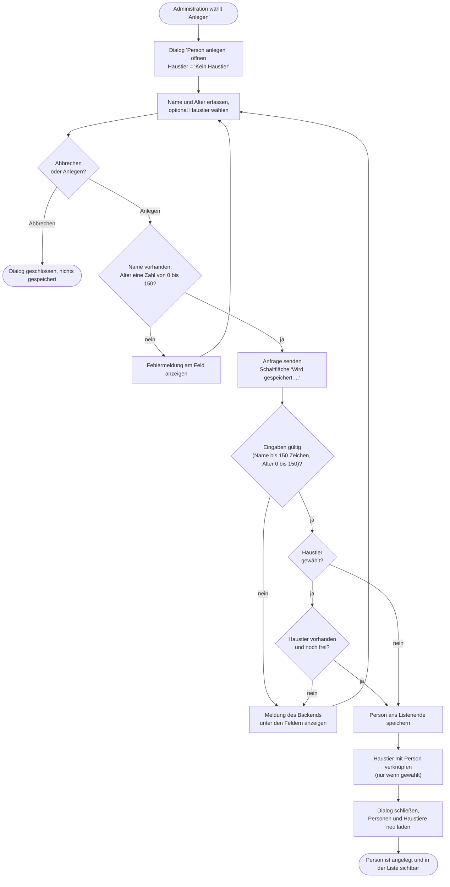

# GP1 Person anlegen

## Meta
- **Stand:** 2026-11-04
- **Bezug:** specs/E1 Personen/F3 Person anlegen, code/frontend/src (App.jsx, components/PersonForm.jsx, api/persons.js), code/backend (Controllers/PersonsController.cs, Dtos/PersonDtos.cs)

## Ziel
Eine gültige Person mit Name und Alter ist dauerhaft gespeichert, steht am Ende der Personenliste und ist auf Wunsch mit einem bisher freien Haustier verknüpft.

## Auslöser
Die Administration wählt in der Kopfzeile der Personen-Ansicht die Primäraktion „Anlegen" ([F3 S1](../../../specs/E1%20Personen/F3%20Person%20anlegen/S1%20Anlegen-Dialog.md)).

## Beteiligte
| Rolle / System | Beitrag |
|---|---|
| Administration | Erfasst Name, Alter und optional ein Haustier, löst das Speichern aus. |
| Frontend (`App`, `PersonForm`) | Hält den Dialogzustand, validiert als UX-Hilfe, sendet die Anfrage, lädt danach Personen und Haustiere neu. |
| Frontend (`api/persons.js`) | Schickt `POST /api/persons` und wandelt Fehlerantworten in eine Meldung um. |
| Backend (`PersonsController`) | Autoritative Validierung, Prüfung des Haustiers, Vergabe von `Order`, Speichern, Antwort `201 Created`. |
| Datenbank (`AppDbContext`) | Persistiert `Person` und die Verknüpfung `Pet.PersonId`. |

## Ablauf
Das Diagramm zeigt den Prozess aus Sicht der Administration mit allen Fehlerpfaden. Die clientseitige Prüfung hält den Dialog offen, ohne das Backend zu belasten; die Prüfung im Backend ist maßgeblich.

## Schritte
| # | Schritt | Verantwortlich | Ergebnis |
|---|---|---|---|
| 1 | Dialog öffnen: `App` setzt `formOpen = 'create'` und rendert `PersonForm` mit `initial = null`; Fokus liegt im Feld `Name`. | Frontend | Leerer Dialog, Titel „Person anlegen.", Haustier-Auswahl auf „Kein Haustier". |
| 2 | Felder erfassen: `Name` (`maxLength` 150), `Alter` (Zahlenfeld 0 bis 150), `Haustier` (`select`). Die Optionen zeigen „{Name} ({Species})"; ein Haustier mit gesetzter `personId` ist `disabled`, weil es im Anlegen-Modus keine eigene Person gibt ([F3 S5](../../../specs/E1%20Personen/F3%20Person%20anlegen/S5%20Tier-Zuordnung%20im%20Anlegen-Dialog.md)). | Administration, Frontend | Eingaben im Formularzustand. |
| 3 | Client-Validierung in `validate()` ([F3 S2](../../../specs/E1%20Personen/F3%20Person%20anlegen/S2%20Validierung%20des%20Anlegen-Dialogs.md)): leerer `Name` oder nicht numerisches bzw. außerhalb 0 bis 150 liegendes `Alter` setzt Feldfehler und bricht ab. | Frontend | Feldfehler oder Freigabe zum Senden. |
| 4 | Payload bilden: `name` getrimmt, `age` als Zahl, `petId` nur bei gewähltem Haustier. `saving = true` deaktiviert den Submit-Button und zeigt „Wird gespeichert …" ([F3 S3](../../../specs/E1%20Personen/F3%20Person%20anlegen/S3%20Anlegen%20abwickeln.md)). | Frontend | `POST /api/persons` mit `{ name, age, petId? }`. |
| 5 | Modellvalidierung: `[ApiController]` prüft `PersonRequest` (`Name` erforderlich, höchstens 150 Zeichen; `Age` erforderlich, 0 bis 150) und antwortet bei Verstoß automatisch mit `400` und `ValidationProblemDetails`. | Backend | Weiter oder `400`. |
| 6 | Haustier prüfen (nur bei `PetId`): unbekannte Id ergibt `400` „Das Haustier existiert nicht."; ein Haustier mit gesetzter `PersonId` ergibt `400` „Das Haustier ist bereits einer anderen Person zugeordnet." | Backend | Weiter oder `400`. |
| 7 | Person speichern: `Name` getrimmt, `Order` = Anzahl bestehender Personen + 1; erstes `SaveChangesAsync`. | Backend, Datenbank | Person mit vergebener `Id`. |
| 8 | Haustier verknüpfen (nur bei `PetId`): `Pet.PersonId` auf die neue `Id` setzen; zweites `SaveChangesAsync`. | Backend, Datenbank | 1:1-Verknüpfung gespeichert. |
| 9 | Antwort `201 Created` mit `Location` auf `GET /api/persons/{id}` und `PersonResponse` (`id`, `name`, `age`). | Backend | Erfolgsantwort. |
| 10 | `handleCreate` schließt den Dialog (`setFormOpen(null)`) und ruft `loadAll()` auf; Personen und Haustiere werden parallel neu geladen. | Frontend | Neue Person steht in der Liste, Zähler in der Navigation sind aktuell. |

Die Fehlerdarstellung im Dialog ist in [F3 S4](../../../specs/E1%20Personen/F3%20Person%20anlegen/S4%20API-Fehler%20im%20Dialog.md) fachlich beschrieben. Technisch gilt: `api/persons.js` liest bei einem Nicht-2xx-Status den Body und wählt die Meldung in dieser Reihenfolge: `title`, die zusammengefassten Werte von `errors` (mit „, " verbunden), `detail`, sonst „HTTP {Status}". `PersonForm` fängt den geworfenen `Error` in `handleSubmit` ab und zeigt `err.message` in `apiError` unter den Feldern; `saving` wird im `finally` zurückgesetzt, das Formular ist erneut absendbar.

## Ausnahmen
| Fall | Verhalten |
|---|---|
| Client-Validierung schlägt fehl | Kein Request. Feldfehler „Name ist erforderlich.", „Alter muss eine Zahl sein." bzw. „Alter muss zwischen 0 und 150 liegen."; Dialog bleibt offen. |
| Modellvalidierung im Backend schlägt fehl (z. B. `Name` länger als 150 Zeichen, umgangene Client-Prüfung) | `400` mit `errors`; die Meldungen erscheinen verbunden als `apiError` unter den Feldern. Nichts wird gespeichert. |
| Haustier existiert nicht (zwischenzeitlich gelöscht) | `400` mit Klartext „Das Haustier existiert nicht." Der Body ist kein JSON-Objekt mit `title`, `errors` oder `detail`; die Meldung in `apiError` lautet daher voraussichtlich „HTTP 400" statt des Klartexts. Abweichung von [F3 S2](../../../specs/E1%20Personen/F3%20Person%20anlegen/S2%20Validierung%20des%20Anlegen-Dialogs.md) und [F3 S4](../../../specs/E1%20Personen/F3%20Person%20anlegen/S4%20API-Fehler%20im%20Dialog.md), die die Backend-Meldung fordern. Zu prüfen (siehe Hinweis unten). |
| Haustier gehört bereits einer anderen Person (parallel verknüpft) | Wie oben: `400` mit Klartext „Das Haustier ist bereits einer anderen Person zugeordnet."; nichts wird gespeichert. Die Auswahl im Dialog sperrt solche Haustiere nur auf dem Stand des letzten Ladens. |
| Backend nicht erreichbar oder `5xx` | `fetch` wirft bzw. die Meldung lautet „HTTP {Status}"; Anzeige in `apiError`, Dialog bleibt offen. |
| Zweites Speichern schlägt nach dem ersten fehl (Schritt 8) | Beide `SaveChangesAsync` laufen ohne gemeinsame Transaktion. Die Person ist dann bereits gespeichert, die Verknüpfung fehlt, die Antwort ist ein Serverfehler. |
| Abbrechen, Klick auf den Hintergrund, Schließen-Kreuz oder `Esc` | Dialog schließt ohne Speicherung. |
| `loadAll()` scheitert nach erfolgreichem Anlegen | Die Person ist gespeichert und der Dialog geschlossen; `App` zeigt die Fehlermeldung oberhalb der Liste. |

**Hinweis zur Fehlermeldung bei `BadRequest("…")`:** `PersonsController` gibt für die Haustier-Prüfungen `BadRequest(string)` zurück. Mit `[ApiController]` wird ein String-Body nicht in `ProblemDetails` umgewandelt; er geht als JSON-String über die Leitung. `res.json()` liefert dann einen String, für den keine der Abfragen auf `title`, `errors` oder `detail` greift. Diese Annahme ist aus dem Code abgeleitet und nicht durch einen Lauf bestätigt.
