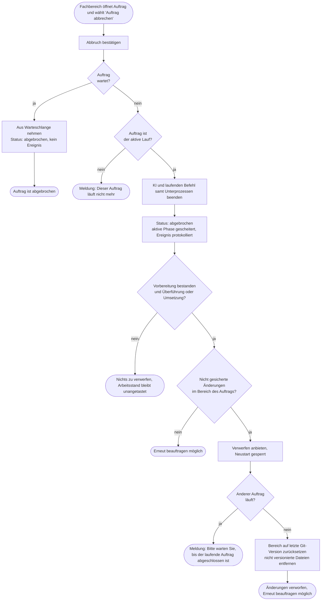
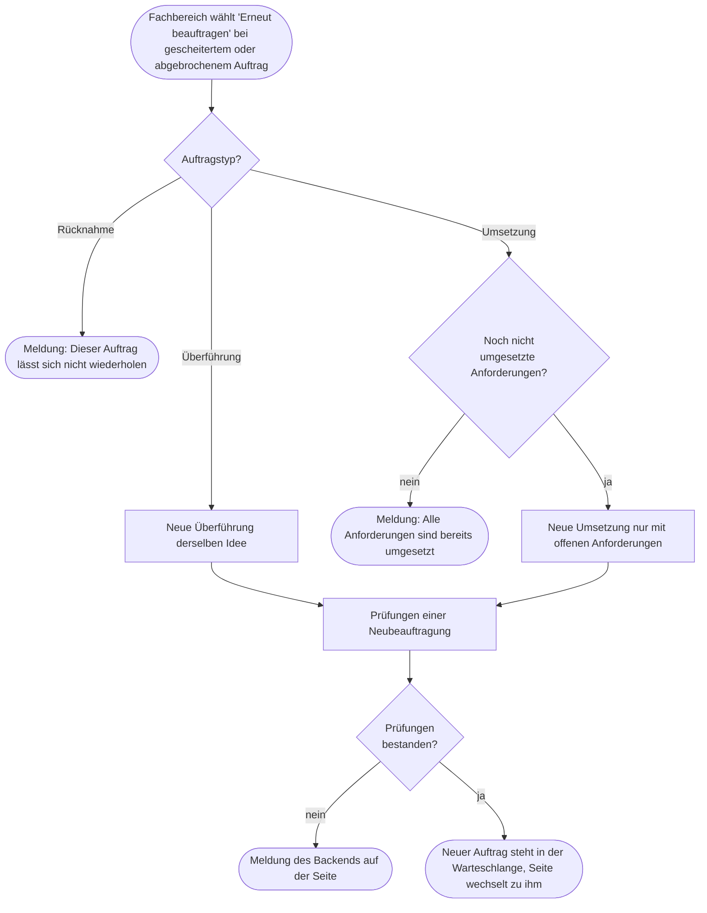
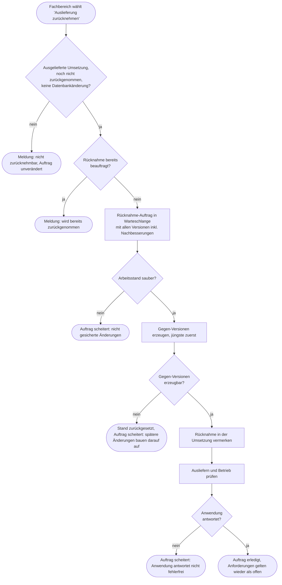
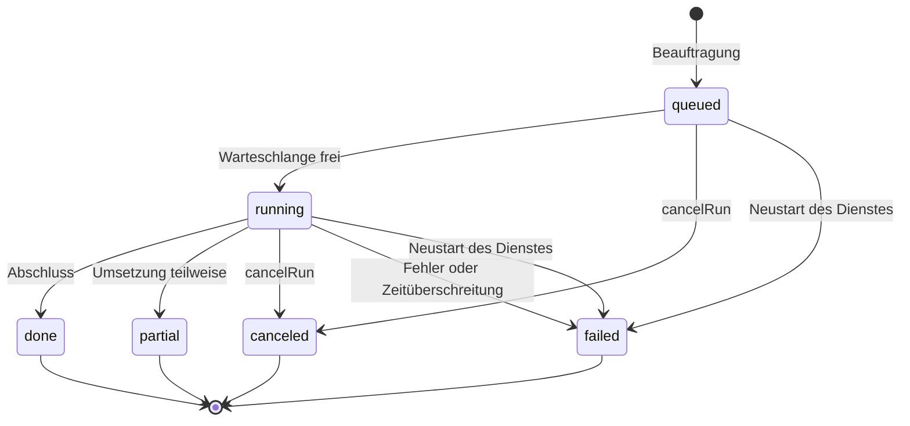

# GP10 Auftrag abbrechen und Auslieferung zurücknehmen

## Meta
- **Stand:** 2026-11-04
- **Bezug:** specs/E3 Software Factory/F10 Umsetzung (S6, S7, S8), code/factory/server (runs.js, git.js, agent.js, config.js, index.js), code/factory/src/pages/RunPage.jsx

## Ziel
Der Fachbereich beendet einen Auftrag der Fertigungsstraße, entfernt dessen nicht gesicherte Änderungen oder stellt eine bereits ausgelieferte Umsetzung wieder her und kann den Auftrag anschließend erneut beauftragen, ohne fremde offene Arbeit im Git-Arbeitsstand zu verlieren.

## Auslöser
Eine der Aktionen auf der Auftragsseite (`#/umsetzung/{id}`):

- „Auftrag abbrechen“ bei Status `queued` oder `running`
- „Änderungen verwerfen“ bei gesetztem `canDiscard`
- „Erneut beauftragen“ bei Status `failed` oder `canceled`
- „Auslieferung zurücknehmen“ bei einer ausgelieferten Umsetzung

Zusätzlich markiert der Dienst beim Neustart unterbrochene Aufträge als gescheitert (`recoverRuns`).

## Beteiligte
| Rolle / System | Beitrag |
|---|---|
| Fachbereich | Löst die Aktion aus und bestätigt den jeweiligen Dialog |
| Oberfläche (`RunPage`) | Blendet Buttons nach Status, `canDiscard`, `revertedBy` und Datenbankänderung ein, wechselt nach Neubeauftragung zum neuen Auftrag |
| Factory-Backend (`runs.js`) | Hält Warteschlange und aktiven Auftrag, setzt Status und `canDiscard`, prüft Sperren (`409`) |
| KI-Prozess und Befehle (`agent.js`, `killTree`) | Werden beim Abbruch samt Unterprozessen beendet |
| Git (`git.js`) | Liefert den Arbeitsstand (`status`), setzt zurück (`discard`) und erzeugt Gegen-Versionen (`revert`) |
| Docker Compose | Baut und startet die zurückgenommene Version (Auslieferung und Betriebsprüfung) |

Die HTTP-Aufrufe sind `POST /api/runs/:id/cancel`, `/discard`, `/retry` (jeweils `200` bzw. `202`) und `/revert` (`202`), definiert in `index.js`. Fachliche Regeln und Meldungstexte stehen in den Specs [S6](../../../specs/E3%20Software%20Factory/F10%20Umsetzung/S6%20Abbrechen%20und%20Verwerfen.md), [S7](../../../specs/E3%20Software%20Factory/F10%20Umsetzung/S7%20Auslieferung%20zur%C3%BCcknehmen.md) und [S8](../../../specs/E3%20Software%20Factory/F10%20Umsetzung/S8%20Erneut%20beauftragen.md).

## Ablauf

Das Diagramm zeigt die vier Aktionen ab der Auftragsseite mit ihren Sperren und Fehlerpfaden. Wegen der Größe ist es in Abbrechen und Verwerfen (A), Neu beauftragen (B) und Zurücknehmen (C) geteilt.

**A) Abbrechen und Verwerfen**

**B) Erneut beauftragen**

Hinweis: Bei gesetztem `canDiscard` ist der Button ausgeblendet; ein direkter Aufruf endet mit der Meldung „Bitte verwerfen Sie zuerst die Änderungen des abgebrochenen Laufs.“ und bricht vor dem Typ-Zweig ab.

**C) Auslieferung zurücknehmen**

## Zustandsübergänge des Auftrags

Das Diagramm zeigt die Stati (`status`), die für diese Prozesse relevant sind. `partial` entsteht nur bei einer Umsetzung, die nicht alle Anforderungen abschließt.

`canDiscard` und `revertedBy` sind Felder, keine Stati: `canDiscard` wird in `finishFailed` und `recoverRuns` gesetzt und durch `discardRun` auf `false` zurückgesetzt; `revertedBy` trägt `executeRevert` in der zurückgenommenen Umsetzung ein.

## Schritte
| # | Schritt | Verantwortlich | Ergebnis |
|---|---|---|---|
| 1 | Abbruch bestätigen | Fachbereich, `RunPage` | `POST /api/runs/{id}/cancel` |
| 2 | Wartenden Auftrag entfernen | `cancelRun` | Status `canceled`, aus der Warteschlange genommen, kein Ereignis |
| 3 | Laufenden Auftrag stoppen | `cancelRun`, `killTree` | `canceled` am Kontext gesetzt, KI-Prozess und Befehl samt Unterprozessen beendet (unter Windows `taskkill /T /F`) |
| 4 | Abbruch abschließen | `finishFailed` | Status `canceled`, aktive Phase `failed`, Ereignis `run` „… abgebrochen“ |
| 5 | Schutzbereich ermitteln | `finishFailed`, `discardScope` | `canDiscard` nur bei Überführung oder Umsetzung mit `workStarted` und offenen Änderungen: Überführung prüft `specs`, Umsetzung `DELIVERY_PATHSPECS` (`code` ohne `code/factory`, `specs`, `docker-compose.yml`) |
| 6 | Änderungen verwerfen | `discardRun`, `git.discard` | `git restore --source=HEAD --staged --worktree` und `git clean -fd` im Bereich, `canDiscard=false`, Ereignis „Änderungen aus {id} verworfen“ |
| 7 | Erneut beauftragen | `retryRun` | Umsetzung: neuer Auftrag nur mit Anforderungen, die nicht `Implemented` sind; Überführung: neue Überführung derselben Idee; Antwort `202`, UI wechselt zu `#/umsetzung/{neueId}` |
| 8 | Rücknahme beauftragen | `startRevert` | Auftrag `revert` „Rücknahme von {id}“ mit `targetRun`, `stories` und `targetCommits` (alle Versionen, jüngste zuerst) |
| 9 | Arbeitsstand prüfen | `executeRevert` | Bei offenen Änderungen in `DELIVERY_PATHSPECS` Abbruch mit Fehler |
| 10 | Gegen-Versionen erzeugen | `git.revert` | `git revert --no-edit` auf alle Versionen; bei Konflikt `git revert --abort` |
| 11 | Rücknahme vermerken | `executeRevert` | `revertedBy` in der zurückgenommenen Umsetzung gesetzt |
| 12 | Ausliefern und prüfen | `bringUpAndVerify` | Phasen „Auslieferung“ und „Betriebsprüfung“, danach Status `done`, Ereignis `delivery` |

## Ausnahmen
| Fall | Verhalten |
|---|---|
| Abbruch eines Auftrags, der nicht mehr aktiv ist | `409` „Dieser Auftrag läuft nicht mehr.“ |
| Auftrag scheitert in der Vorbereitung | `workStarted` ist noch nicht gesetzt, daher kein `canDiscard`: offene Änderungen gehören dem Anwender und werden nie verworfen |
| Offene Änderungen vor Beginn einer Umsetzung, Überführung oder Rücknahme | Auftrag scheitert in der Vorbereitung; bei Überführung zählen nur Änderungen unter `specs` |
| Rücknahme scheitert oder wird abgebrochen | `canDiscard` bleibt `false`, da Rücknahmen nie verwerfbar sind; `git.revert` setzt den Stand selbst zurück |
| Neustart des Dienstes während eines Auftrags | `recoverRuns` setzt `queued` und `running` auf `failed` mit „Der Auftrag wurde durch einen Neustart des Dienstes unterbrochen.“; `canDiscard` nur bei Überführung oder Umsetzung mit `workStarted` (Offene Änderungen werden hier nicht geprüft, anders als in `finishFailed`) |
| Verwerfen ohne `canDiscard` | `409` „Zu diesem Auftrag gibt es keine verwerfbaren Änderungen.“ |
| Verwerfen, während ein Auftrag läuft | `409` „Bitte warten Sie, bis der laufende Auftrag abgeschlossen ist.“ |
| Neu beauftragen bei `canDiscard` | `409` „Bitte verwerfen Sie zuerst die Änderungen des abgebrochenen Laufs.“ |
| Neu beauftragen einer Rücknahme | `409` „Dieser Auftrag lässt sich nicht wiederholen.“ |
| Neu beauftragen ohne offene Anforderungen | `409` „Alle Anforderungen dieses Auftrags sind bereits umgesetzt.“ |
| Rücknahme eines anderen Typs oder ohne `commit` | `409` „Nur ausgelieferte Umsetzungen lassen sich zurücknehmen.“ |
| Rücknahme bei gesetztem `revertedBy` | `409` „Diese Auslieferung wurde bereits zurückgenommen.“ |
| Rücknahme einer Auslieferung mit Datei unter `code/backend/Migrations/` | `409`, Button ausgeblendet: Die Datenbank bliebe auf dem neuen Stand, während der Code zurückspringt |
| Zweite Rücknahme derselben Auslieferung in Warteschlange oder Lauf | `409` „Diese Auslieferung wird bereits zurückgenommen.“ |
| Gegen-Version nicht erzeugbar (Folgeänderungen) | Auftrag `failed` mit „… weil spätere Änderungen darauf aufbauen.“, Git-Stand zurückgesetzt, `revertedBy` bleibt leer |
| Rücknahme: Betrieb antwortet nicht fehlerfrei | Auftrag `failed`; `revertedBy` ist zu diesem Zeitpunkt bereits gesetzt, die Gegen-Version bleibt in Git. Eine Nachbesserung findet bei Rücknahmen nicht statt |
