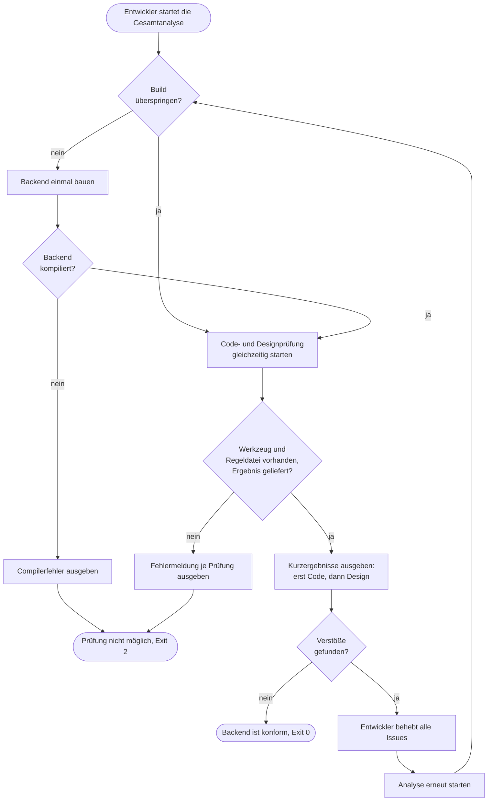

# GP11 Qualitätsanalyse ausführen

## Meta
- **Stand:** 2026-11-04
- **Bezug:** specs/E4 Qualitätsanalyse/F1 Analyse-Skripte, harness/analyse_all.py, harness/analyse_code.py, harness/analyse_swd.py, harness/_design.ndrules, code/backend/Backend.csproj

## Ziel
Der Entwickler weiß nach einem Befehl, ob das Backend die Code- und Designvorgaben einhält, und kennt bei Verstößen die Stellen, die er korrigieren muss.

## Auslöser
Schritt 3 des Dev-Workflows in `AGENTS.md`: Der Code ist geändert und die Specs sind nachgezogen, danach folgt `python harness/analyse_all.py`. Die Einzelprüfungen `analyse_code.py` und `analyse_swd.py` können auch direkt gestartet werden.

## Beteiligte
| Rolle / System | Beitrag |
|---|---|
| Entwickler | Startet die Analyse, behebt alle gemeldeten Issues, auch ältere, und wiederholt den Lauf |
| Gesamtanalyse (`analyse_all.py`) | Baut einmal, startet beide Prüfungen gleichzeitig, gibt die Kurzergebnisse aus und liefert den höchsten Exit-Code |
| Code-Analyse (`analyse_code.py`) | Prüft den Code mit ReSharper InspectCode gegen `harness/PersonManager.sln.DotSettings` ([`_code.md`](../../../harness/_code.md)) |
| Design-Analyse (`analyse_swd.py`) | Baut bei Bedarf und prüft die Assembly mit NDepend gegen `harness/_design.ndrules` ([`_design.md`](../../../harness/_design.md)) |

## Ablauf
Das Diagramm zeigt die Gesamtanalyse mit Build, den beiden parallelen Prüfungen und den drei Ergebnissen (konform, Verstöße, Prüfung nicht möglich). Aus den Exit-Codes ist abzulesen, ob der Entwickler fixen oder die Umgebung reparieren muss.

## Schritte
| # | Schritt | Verantwortlich | Ergebnis |
|---|---|---|---|
| 1 | Backend einmal bauen (entfällt mit `--no-build`). Compilerfehler stoppen den Lauf, die Prüfungen werden dann nicht gestartet. | Gesamtanalyse | Aktuelle Assembly oder `build ERROR` mit Datei, Zeile, Fehlercode und Text |
| 2 | Code-Analyse starten: Regeldatei und `jb` prüfen, altes Ergebnis löschen, InspectCode ohne persönliche Einstellungen ausführen. Befunde ab `SUGGESTION` zählen. | Code-Analyse | `code OK` oder `code FAIL {n} Issues`, gruppiert nach Datei, Zeile und Regel, Compilerfehler zuerst |
| 3 | Design-Analyse starten (parallel zu 2): Regeldatei und NDepend prüfen, altes Ergebnis löschen, ausschließlich die Regeln aus `harness/_design.ndrules` ausführen (aktuell 38 Regeln in 5 Gruppen: Architektur, Entitäten, DTOs, Data/EF Core, Controller). | Design-Analyse | `swd OK {n} Regeln` oder `swd FAIL {x}/{n} Regeln verletzt` mit Regelname, Beschreibung, Element, Datei und Zeile |
| 4 | Ergebnisse validieren: Keine geladene Regel, nicht ausführbare Regel oder unvollständiges Ergebnis gelten als Fehler, nie als bestanden. | Design-Analyse | Exit-Code 2 statt eines scheinbar sauberen Laufs |
| 5 | Ausgabe zusammenführen, Code-Ergebnis vor Design-Ergebnis. `--max {n}` begrenzt jede Prüfung auf `n` Treffer (Standard 100, `0` = alle), die letzte Zeile nennt die ausgeblendeten Treffer. | Gesamtanalyse | Kurzergebnis beider Prüfungen |
| 6 | Exit-Code bilden: der höchste Exit-Code beider Prüfungen. | Gesamtanalyse | `0` konform, `1` Verstöße, `2` Prüfung nicht möglich |
| 7 | Bei Exit `1` alle Issues beheben, auch ältere, und die Analyse wiederholen. Die manuell zu prüfenden Punkte, die die Regeldatei als nicht statisch prüfbar nennt, bleiben bindend ([`_design.md`](../../../harness/_design.md), Abschnitt 7). Erst bei Exit `0` folgt Schritt 4 des Dev-Workflows (git commit). | Entwickler | Konformes Backend |

Der Lauf vom 2026-11-04 ergab `code OK` und `swd OK 38 Regeln` mit Exit-Code 0.

Fachliche Grundlage der drei Befehle:
- [Code-Analyse (S1)](../../../specs/E4%20Qualit%C3%A4tsanalyse/F1%20Analyse-Skripte/S1%20Code-Analyse.md)
- [Design-Analyse (S2)](../../../specs/E4%20Qualit%C3%A4tsanalyse/F1%20Analyse-Skripte/S2%20Design-Analyse.md)
- [Gesamtanalyse (S3)](../../../specs/E4%20Qualit%C3%A4tsanalyse/F1%20Analyse-Skripte/S3%20Gesamtanalyse.md)

## Ausnahmen
| Fall | Verhalten |
|---|---|
| Backend kompiliert nicht | Ausgabe beginnt mit `build ERROR`, jeder Compilerfehler einmal; die Analysen starten nicht, Exit 2 |
| `jb` (ReSharper) nicht installiert, Regeldatei fehlt oder InspectCode scheitert | Ausgabe beginnt mit `code ERROR`, Exit 2 |
| NDepend nicht installiert, Regeldatei fehlt, kein Ergebnis oder keine Regel geladen | Ausgabe beginnt mit `swd ERROR`, Exit 2 |
| Regel in `_design.ndrules` nicht ausführbar (z. B. Syntaxfehler in der Abfrage) | `swd ERROR` mit Regelname und Fehlermeldung, Exit 2 |
| Skript stürzt unerwartet ab | Ausgabe `code ERROR`, `swd ERROR` bzw. `all ERROR` mit Fehlertyp, Exit 2; ein Absturz sieht nie wie ein Befund (Exit 1) aus |
| Ergebnis eines früheren Laufs liegt noch vor | Wird vor jedem Lauf gelöscht und nie als aktuelles Ergebnis ausgegeben |
| Mehr Treffer als `--max` | Ausgabe wird gekürzt, die Gesamtzahl bleibt vollständig, die letzte Zeile nennt den Rest; `--max 0` zeigt alles |
| Eine Prüfung meldet `1`, die andere `2` | Gesamt-Exit ist `2`: die Prüfung gilt als nicht durchgeführt und darf nicht als bestanden gewertet werden |
