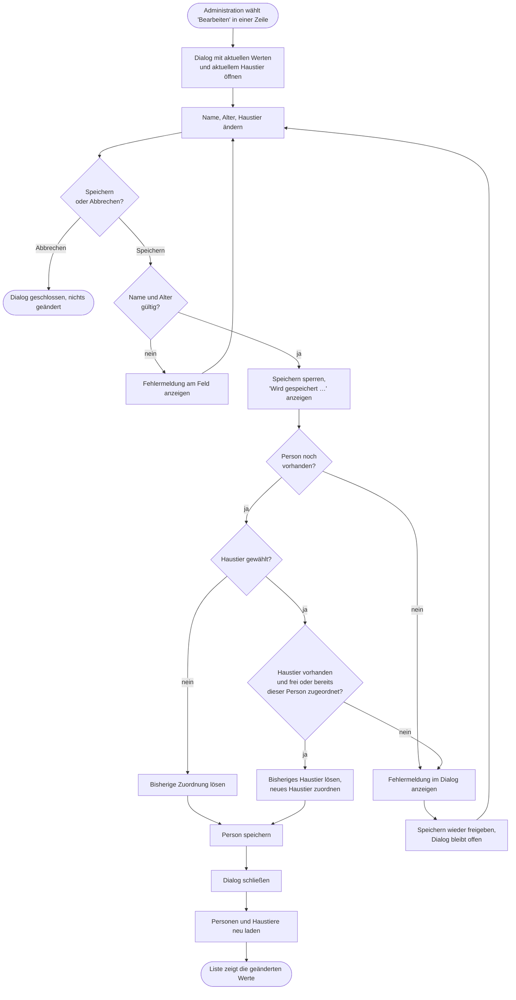

# GP2 Person bearbeiten

## Meta
- **Stand:** 2026-11-04
- **Bezug:** specs/E1 Personen/F4 Person bearbeiten, code/frontend/src (`App.jsx`, `components/PersonList.jsx`, `components/PersonForm.jsx`, `api/persons.js`), code/backend (`Controllers/PersonsController.cs`, `Dtos/PersonDtos.cs`)

## Ziel
Name, Alter und Haustier-Zuordnung einer vorhandenen Person werden geändert und dauerhaft gespeichert; die Liste zeigt danach die neuen Werte.

## Auslöser
Die Administration klickt in der Personenliste auf den Icon-Button „Bearbeiten" einer Zeile (`aria-label` „Person {id} bearbeiten"). Fachliche Vorgaben: [F4 Person bearbeiten](../../../specs/E1%20Personen/F4%20Person%20bearbeiten/) (S1 Aktion, S2 Dialog, S3 Abwicklung, S4 Fehler, S5 Tier-Zuordnung).

## Beteiligte
| Rolle / System | Beitrag |
|---|---|
| Administration | Öffnet den Dialog, ändert Felder, speichert oder bricht ab |
| Frontend (`PersonList`) | Stellt die Bearbeiten-Aktion je Zeile bereit und meldet die gewählte Person an `App` |
| Frontend (`App`) | Hält den Dialogzustand (`formOpen`), ermittelt das aktuell verknüpfte Haustier, lädt Personen und Haustiere nach dem Speichern neu |
| Frontend (`PersonForm`) | Vorbelegter Dialog, Feldvalidierung, Statusanzeige beim Speichern, Fehleranzeige |
| Frontend (`api/persons.js`) | Sendet `PUT /api/persons/{id}`, übersetzt Fehlerantworten in eine Meldung |
| Backend (`PersonsController`) | Prüft Person und Haustier, aktualisiert Person und Zuordnung, antwortet mit Statuscode |
| Datenbank (`AppDbContext`) | Persistiert Person und Haustier-Verknüpfung in einem `SaveChangesAsync` |

## Ablauf
Das Diagramm zeigt den Weg von der Bearbeiten-Aktion bis zur aktualisierten Liste. Fehlerpfade (Eingabefehler, Haustier-Konflikt, Person nicht mehr vorhanden) führen in den Dialog zurück, der geöffnet bleibt.

## Schritte
| # | Schritt | Verantwortlich | Ergebnis |
|---|---|---|---|
| 1 | Bearbeiten-Aktion der Zeile auslösen | Administration, `PersonList` (`onEdit`) | `App` setzt `formOpen` auf die gewählte Person |
| 2 | Dialog öffnen | `App`, `PersonForm` | Titel „Person {id} bearbeiten", `Name` und `Alter` aus der Person vorbelegt; `App` übergibt als `initialPet` das Haustier, dessen `personId` der Person entspricht (aus dem zuletzt geladenen Haustierbestand) |
| 3 | Haustier-Auswahl aufbauen | `PersonForm` | Option „Kein Haustier" plus alle Haustiere; Haustiere mit `personId` einer anderen Person sind `disabled`, das eigene bleibt wählbar |
| 4 | Felder ändern | Administration | Neue Werte im Formularzustand |
| 5 | Abbrechen | Administration | Schließen über „Abbrechen", „Schließen", Klick auf den Hintergrund oder `Escape`; es wird nichts gesendet |
| 6 | Eingabe prüfen | `PersonForm.validate` | Name nicht leer, Alter Zahl von 0 bis 150; sonst Feldfehler und kein Request |
| 7 | Anfrage senden | `PersonForm`, `App.handleUpdate`, `updatePerson` | `PUT /api/persons/{id}` mit `{ name, age }`; `petId` nur, wenn ein Haustier gewählt ist. Der Button ist gesperrt und zeigt „Wird gespeichert …" |
| 8 | Person und Haustier prüfen | `PersonsController.UpdatePerson` | Person über `Id` gesucht; bei `PetId` Existenz und Besitz des Haustiers geprüft |
| 9 | Zuordnung anpassen | `PersonsController.UpdatePerson` | Ohne `PetId`: aktuelles Haustier der Person freigeben. Mit `PetId`: bisheriges anderes Haustier freigeben, gewähltes zuordnen |
| 10 | Speichern | `PersonsController`, `AppDbContext` | `Name` (getrimmt) und `Age` gesetzt, ein `SaveChangesAsync`, Antwort `204 No Content` |
| 11 | Abschluss | `App.handleUpdate` | `formOpen` wird `null` (Dialog zu), `loadAll` lädt Personen und Haustiere parallel neu |

## Ausnahmen
| Fall | Verhalten |
|---|---|
| Name leer oder Alter keine Zahl / außerhalb 0–150 | Feldfehler im Dialog („Name ist erforderlich.", „Alter muss eine Zahl sein.", „Alter muss zwischen 0 und 150 liegen."); es wird kein Request gesendet. Das Backend prüft dieselben Regeln erneut über `PersonRequest` (maximal 150 Zeichen für `Name`) |
| Person wurde parallel gelöscht | Backend antwortet `404 Not Found` (`ProblemDetails`); `request` in `persons.js` nutzt `title`, die Meldung („Not Found") erscheint im Dialog, der offen bleibt |
| Gewähltes Haustier existiert nicht mehr | `400 Bad Request` mit Text „Das Haustier existiert nicht." |
| Gewähltes Haustier gehört inzwischen einer anderen Person (Haustierliste im Frontend veraltet) | `400 Bad Request` mit Text „Das Haustier ist bereits einer anderen Person zugeordnet." |
| Anzeige der `400`-Meldung | Die Texte kommen als Klartext-Body, nicht als JSON; `request` fängt den Parse-Fehler ab und zeigt daher `HTTP 400` statt des Backend-Textes. Das weicht von [S4](../../../specs/E1%20Personen/F4%20Person%20bearbeiten/S4%20Speichern-Fehler%20im%20Dialog.md) („zeigt die Fehlermeldung des Backends") ab, solange der Body kein JSON ist |
| Netzwerkfehler oder Server nicht erreichbar | `fetch` wirft; `PersonForm` zeigt die Fehlermeldung des Browsers im Dialog |
| Jeder Fehler beim Speichern | `finally` gibt den Button wieder frei, der Dialog bleibt offen, die Liste wird nicht neu geladen; erneutes Speichern ist möglich |
| Fehler beim anschließenden Neuladen | `PUT` war erfolgreich und der Dialog ist bereits geschlossen; `loadAll` zeigt den Fehler oberhalb der Liste |
