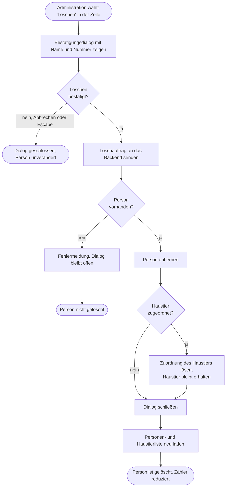

# GP3 Person löschen

## Meta
- **Stand:** 2026-11-04
- **Bezug:** specs/E1 Personen/F5 Person löschen, code/frontend/src (App.jsx, components/PersonList.jsx, api/persons.js), code/backend/Controllers/PersonsController.cs, code/backend/Data/Configurations/PetConfiguration.cs

## Ziel
Eine Person wird nach ausdrücklicher Bestätigung dauerhaft entfernt; ein zugeordnetes Haustier bleibt erhalten und ist danach keiner Person mehr zugeordnet.

## Auslöser
Die Administration klickt in der Zeile einer Person auf den Danger-Icon-Button „Person {id} löschen" ([F5 S1](../../../specs/E1%20Personen/F5%20Person%20l%C3%B6schen/S1%20L%C3%B6schen-Aktion%20in%20der%20Zeile.md)).

## Beteiligte
| Rolle / System | Beitrag |
|---|---|
| Administration | Löst das Löschen aus und bestätigt oder bricht ab |
| Frontend (`PersonList`, `App`) | Zeigt die Aktion und den Bestätigungsdialog, sendet `DELETE /api/persons/{id}`, lädt Personen- und Haustierliste neu |
| Backend (`PersonsController`) | Entfernt die Person, beantwortet mit `204` oder `404` |
| Datenbank (`PetConfiguration`) | Setzt beim Löschen `Pets.PersonId` über `DeleteBehavior.SetNull` auf leer |

## Ablauf
Das Diagramm zeigt den Weg von der Zeilenaktion bis zur aktualisierten Liste, einschließlich Abbruch und Fehlerfall.

## Schritte
| # | Schritt | Verantwortlich | Ergebnis |
|---|---|---|---|
| 1 | Löschen-Aktion in der Zeile wählen (`onDelete(p)` setzt `deleteTarget`) | Administration, Frontend | Bestätigungsdialog ist offen ([S1](../../../specs/E1%20Personen/F5%20Person%20l%C3%B6schen/S1%20L%C3%B6schen-Aktion%20in%20der%20Zeile.md)) |
| 2 | Dialog mit Name und Nummer der Person lesen und entscheiden | Administration | „Abbrechen", Klick auf den Hintergrund oder `Escape` setzen `deleteTarget` zurück, es wird nichts gelöscht ([S2](../../../specs/E1%20Personen/F5%20Person%20l%C3%B6schen/S2%20L%C3%B6sch-Best%C3%A4tigungsdialog.md)) |
| 3 | „Löschen" bestätigen (`handleDelete` ruft `deletePerson(id)`) | Frontend | `DELETE /api/persons/{id}` wird gesendet |
| 4 | Person laden und entfernen (`DeletePerson`) | Backend | Person ist aus `Persons` entfernt, Antwort `204 No Content` |
| 5 | Haustier-Zuordnung lösen | Datenbank | Die Fremdschlüsselbeziehung `Pets.PersonId` ist mit `OnDelete(DeleteBehavior.SetNull)` konfiguriert; die Datenbank setzt den Wert auf leer, das Haustier wird nicht gelöscht |
| 6 | Dialog schließen und neu laden (`setDeleteTarget(null)`, `loadAll()`) | Frontend | Personenliste und Haustierliste sind aktuell; das Haustier steht ohne Person weiter in der Liste ([S3](../../../specs/E1%20Personen/F5%20Person%20l%C3%B6schen/S3%20L%C3%B6schen%20abwickeln.md)) |

## Folgen für Haustier und Reihenfolge
- **Haustier:** wird nicht kaskadierend gelöscht. Der Eintrag bleibt bestehen, `PersonId` wird leer. Wegen des eindeutigen Index auf `Pets.PersonId` kann das Haustier danach einer anderen Person zugeordnet werden.
- **Reihenfolge:** Der Controller rückt die übrigen Personen nicht nach. Die Werte von `Person.Order` behalten eine Lücke, die Sortierung (`Order`, dann `Name`) bleibt davon unberührt. Eine neu angelegte Person erhält `Order = Anzahl + 1` und kann dadurch denselben Wert wie eine bestehende Person tragen; in diesem Fall entscheidet der Name. Die Darstellung der Liste ist davon nicht beeinträchtigt, die Reihenfolge wird erst bei einer manuellen Umsortierung (`PATCH /api/persons/reorder`) wieder durchgehend nummeriert.

## Ausnahmen
| Fall | Verhalten |
|---|---|
| Abbruch (Schaltfläche, Hintergrundklick, `Escape`) | Dialog schließt, kein Aufruf an das Backend |
| Person existiert nicht mehr (z. B. von anderer Sitzung gelöscht) | Backend antwortet `404 Not Found`; `request()` in `api/persons.js` wirft einen Fehler, der Dialog bleibt offen |
| Netzwerk- oder Serverfehler | Gleiches Verhalten: Fehler wird geworfen, Dialog bleibt offen und die Liste wird nicht neu geladen |
| Fehler in `handleDelete` | `handleDelete` in `App.jsx` fängt den Fehler nicht ab. Der Administration wird daher keine Fehlermeldung angezeigt (Ist-Stand, im Gegensatz zu `handleReorder`, das `setError` aufruft) |
