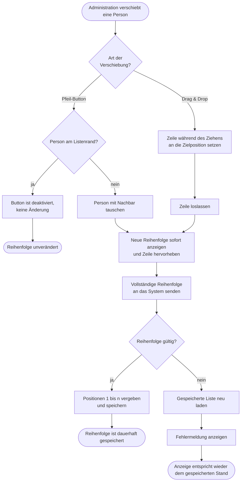
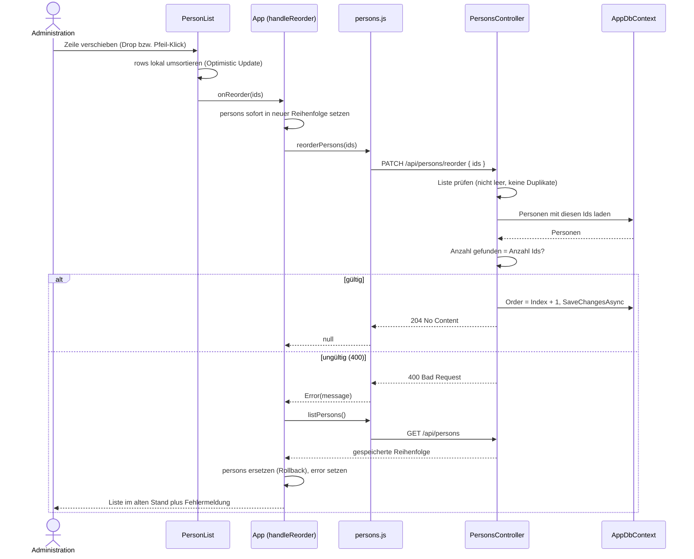

# GP4 Reihenfolge verwalten

## Meta
- **Stand:** 2026-11-04
- **Bezug:** specs/E1 Personen/F6 Reihenfolge verwalten, code/frontend/src/components/PersonList.jsx, code/frontend/src/App.jsx, code/frontend/src/api/persons.js, code/backend/Controllers/PersonsController.cs

## Ziel
Die Administration legt die manuelle Anzeigereihenfolge der Personen fest und das System speichert sie dauerhaft.

## Auslöser
Die Administration verschiebt eine Zeile in der Personenliste, entweder per Drag & Drop am Griff oder per Pfeil-Button „nach oben" bzw. „nach unten" ([S1](../../../specs/E1%20Personen/F6%20Reihenfolge%20verwalten/S1%20Verschieben%20per%20Drag%20%26%20Drop.md), [S2](../../../specs/E1%20Personen/F6%20Reihenfolge%20verwalten/S2%20Verschieben%20per%20Pfeil-Buttons.md)).

## Beteiligte
| Rolle / System | Beitrag |
|---|---|
| Administration | Verschiebt Zeilen und sieht das Ergebnis sofort |
| `PersonList` | Hält die lokale Zeilenreihenfolge (`rows`), verarbeitet Drag & Drop und Pfeil-Buttons, animiert die Zeilen, ruft `onReorder` mit der vollständigen ID-Liste |
| `App` (`handleReorder`) | Übernimmt die Reihenfolge sofort in den Seitenzustand, ruft die API, lädt bei Fehler neu und zeigt die Meldung |
| `persons.js` (`reorderPersons`) | Sendet `PATCH /api/persons/reorder` mit `{ "ids": [...] }` und wandelt Fehlerantworten in eine Meldung |
| `PersonsController` (`UpdatePersonsPosition`) | Validiert die ID-Liste, vergibt `Order` 1 bis n, speichert |
| `AppDbContext` / SQLite | Persistiert die `Order`-Werte; `GET /api/persons` sortiert danach |

## Ablauf
Der Ablauf zeigt die fachlichen Entscheidungen: Die neue Reihenfolge erscheint sofort, die Speicherung wird danach geprüft, und bei Ablehnung wird der gespeicherte Stand wiederhergestellt.

Das Sequenzdiagramm zeigt die Beteiligten über die Zeit, insbesondere den Zeitpunkt der Anzeigeänderung vor der Backend-Antwort und den Rollback im Fehlerfall.

## Schritte
| # | Schritt | Verantwortlich | Ergebnis |
|---|---|---|---|
| 1 | Zeile verschieben: Der Griff scharfschalten (`onMouseDown`) und ziehen, oder Pfeil-Button klicken. Pfeil am ersten bzw. letzten Eintrag ist `disabled`. | Administration, `PersonList` | `rows` ist lokal umsortiert |
| 2 | Beim Ziehen wird `rows` bei jedem `dragover` angepasst; per Pfeil wird sofort getauscht. Pfeil-Verschiebungen gleiten animiert (FLIP, 220 ms), beim Ziehen springen die Zeilen ohne Animation ([S3](../../../specs/E1%20Personen/F6%20Reihenfolge%20verwalten/S3%20Animation%20und%20Hervorhebung.md)). | `PersonList` | Neue Reihenfolge ist sofort sichtbar |
| 3 | Beim Loslassen (`dragend`) bzw. direkt beim Pfeil-Klick ruft `PersonList` `onReorder` mit allen IDs in neuer Reihenfolge. | `PersonList` | ID-Liste ist übergeben |
| 4 | `handleReorder` setzt `persons` sofort in die neue Reihenfolge (Optimistic Update), bevor die Antwort vorliegt ([S4](../../../specs/E1%20Personen/F6%20Reihenfolge%20verwalten/S4%20Optimistic%20Update%20und%20Rollback.md)). | `App` | Seitenzustand entspricht der Anzeige |
| 5 | `reorderPersons` sendet `PATCH /api/persons/reorder` mit `{ "ids": [3, 1, 2] }`. | `persons.js` | Anfrage ist unterwegs |
| 6 | Das Backend prüft die Liste: nicht leer, keine doppelten Ids, alle Ids existieren ([S5](../../../specs/E1%20Personen/F6%20Reihenfolge%20verwalten/S5%20Reorder-Validierung%20im%20Backend.md)). | `PersonsController` | Liste gültig oder `400` |
| 7 | Bei gültiger Liste setzt das Backend `Order` = Listenindex + 1 und speichert. Antwort `204 No Content`. | `PersonsController`, `AppDbContext` | Reihenfolge persistiert |
| 8 | Bei Fehler lädt `handleReorder` die Liste mit `loadAll()` neu und setzt die Fehlermeldung. | `App` | Anzeige entspricht wieder dem gespeicherten Stand |

Die Reihenfolge wird beim Lesen über `OrderBy(Order).ThenBy(Name)` hergestellt; neue Personen erhalten `Order` = Anzahl der Personen + 1 (siehe [GP1 bis GP3](.) für Anlegen und Löschen). Zugehörige Endpunktbeschreibung: [03 API](../03%20API.md).

## Ausnahmen
| Fall | Verhalten |
|---|---|
| Person steht an erster Stelle bzw. letzter Stelle | Pfeil „nach oben" bzw. „nach unten" ist deaktiviert; `moveRow` bricht bei einem Ziel außerhalb der Liste ab |
| Leere ID-Liste | `400 Bad Request`, „Reihenfolge enthält doppelte oder fehlende Einträge." |
| Doppelte Ids | `400 Bad Request`, dieselbe Meldung |
| Id einer nicht (mehr) existierenden Person, etwa nach Löschen in einem anderen Browserfenster | `400 Bad Request`, „Reihenfolge enthält unbekannte Personen." Das Frontend lädt die Liste neu und zeigt eine Fehlermeldung |
| Backend nicht erreichbar oder anderer Fehler | `fetch` bzw. `request` wirft einen Fehler; derselbe Rollback über `loadAll()` und Fehleranzeige |
| Parent-Daten ändern sich (Laden, Anlegen, Löschen) | `PersonList` setzt `rows` auf die neuen `persons` zurück; ein laufender lokaler Zustand wird verworfen |

**Hinweise zum Ist-Stand (am Code geprüft):**
- Das Backend verlangt keine *vollständige* Liste aller Personen, sondern prüft nur auf nicht leer, eindeutig und bekannt. Nur die übergebenen Personen erhalten neue `Order`-Werte; die Vollständigkeit stellt das Frontend sicher, indem es immer alle IDs sendet.
- Die `400`-Fälle liefern über `BadRequest("…")` die Meldung als JSON-String. `request` in `persons.js` liest `title`, `errors` und `detail` aus dem Body; bei einem reinen String greift keines davon, sodass die angezeigte Meldung dann `HTTP 400` lautet statt des Backend-Textes aus [S4](../../../specs/E1%20Personen/F6%20Reihenfolge%20verwalten/S4%20Optimistic%20Update%20und%20Rollback.md). Dieser Punkt wurde nicht im laufenden System nachgestellt.
