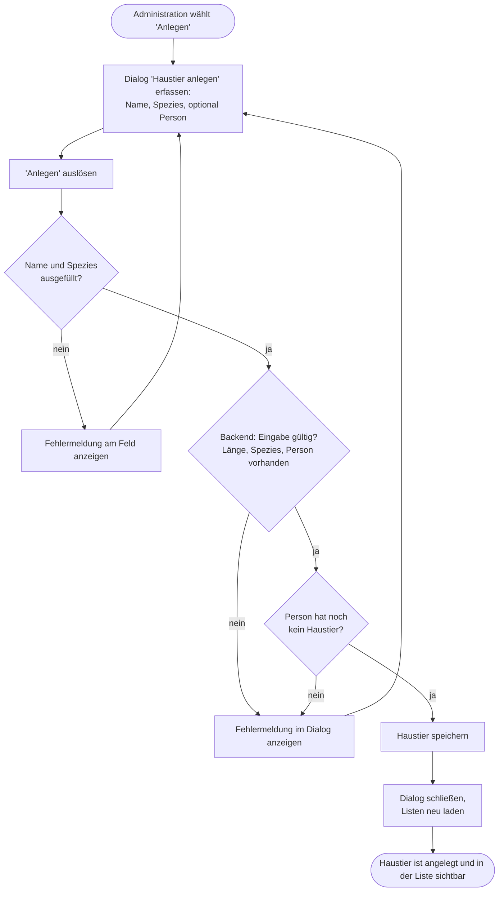
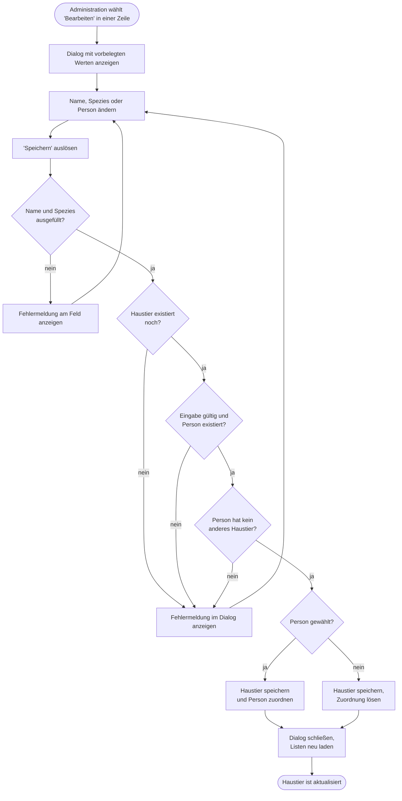
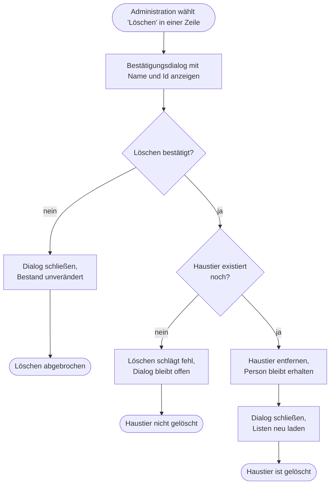

# GP5 Haustier verwalten

## Meta
- **Stand:** 2026-11-04
- **Bezug:** specs/E2 Haustiere, code/backend (PetsController, PetDtos, PetConfiguration, Pet), code/frontend/src (App.jsx, components/PetForm.jsx, components/PetList.jsx, api/pets.js)

## Ziel
Der Bestand an Haustieren ist angelegt, geändert oder bereinigt, und jedes Haustier ist höchstens einer Person zugeordnet.

## Auslöser
Die Administration wählt in der Ansicht „Haustiere" die Aktion „Anlegen", das Stift-Symbol (Bearbeiten) oder das Papierkorb-Symbol (Löschen) einer Zeile.

## Beteiligte
| Rolle / System | Beitrag |
|---|---|
| Administration | Erfasst Name, Spezies und optional eine Person; bestätigt das Löschen |
| Frontend (`PetForm`, `PetList`, `App`) | Prüft Pflichtfelder vor dem Senden, sperrt bereits vergebene Personen in der Auswahl, lädt nach jeder Änderung Personen und Haustiere neu |
| Backend (`PetsController`) | Validiert autoritativ (Name, Spezies, Person vorhanden, 1:1-Regel), speichert, liefert Fehlermeldungen |
| Datenbank | Tabelle `Pets`; `PersonId` ist nullable und eindeutig (Unique-Index), Fremdschlüssel mit `SetNull` |

Fachliche Regeln und Akzeptanzkriterien stehen in den Specs: [Backend E2](../../../specs/E2%20Haustiere/_Backend.md), [Datenstruktur E2](../../../specs/E2%20Haustiere/_Datenstruktur.md). Endpunkt-Formate: [API](../03%20API.md).

## Ablauf

### Teilablauf A: Haustier anlegen
Das Diagramm zeigt das Anlegen mit der Prüfung im Dialog und der autoritativen Prüfung im Backend; bei beiden Fehlerarten bleibt der Dialog geöffnet. Specs: [F2 Haustier anlegen](../../../specs/E2%20Haustiere/F2%20Haustier%20anlegen/).

### Teilablauf B: Haustier bearbeiten und Person zuordnen oder lösen
Das Diagramm zeigt das Ändern der Stammdaten und der Personenzuordnung; die Wahl „Keine Person" löst eine bestehende Zuordnung. Specs: [F3 Haustier bearbeiten](../../../specs/E2%20Haustiere/F3%20Haustier%20bearbeiten/).

### Teilablauf C: Haustier löschen
Das Diagramm zeigt das Löschen mit Bestätigung; die zugeordnete Person bleibt unberührt. Specs: [F4 Haustier löschen](../../../specs/E2%20Haustiere/F4%20Haustier%20l%C3%B6schen/).

## Schritte
| # | Schritt | Verantwortlich | Ergebnis |
|---|---|---|---|
| 1 | Aktion in der Ansicht „Haustiere" wählen | Administration | Dialog (Anlegen/Bearbeiten) oder Bestätigungsdialog (Löschen) öffnet sich |
| 2 | Name, Spezies (`Hund`, `Katze`, `Vogel`, `Dinosaurier`) und optional Person erfassen; Personen mit bereits vorhandenem anderen Haustier sind nicht wählbar | Administration, `PetForm` | Eingabe liegt vor |
| 3 | Pflichtfelder Name und Spezies prüfen | `PetForm` | Fehlermeldungen am Feld oder Weiter zu Schritt 4 |
| 4 | Anfrage an das Backend senden; Schaltfläche zeigt „Wird gespeichert …" und ist gesperrt | `PetForm`, `api/pets.js` | Anfrage ist unterwegs |
| 5 | Name (max. 150 Zeichen), Spezies, Existenz der Person und 1:1-Regel prüfen; Name wird getrimmt | `PetsController` | Gültig oder `400` mit Meldung |
| 6 | Haustier anlegen, ändern oder entfernen; bei Person gewählt wird `PersonId` gesetzt, sonst geleert | `PetsController`, Datenbank | Datensatz in `Pets` geändert (`201` bzw. `204`) |
| 7 | Dialog schließen, Personen und Haustiere neu laden, Zähler am Navigationseintrag aktualisieren | `App` | Liste zeigt den neuen Stand inkl. Personenname je Haustier |

## Ausnahmen
| Fall | Verhalten |
|---|---|
| Name leer oder Spezies nicht gewählt | Fehlermeldung am Feld („Name ist erforderlich.", „Spezies ist erforderlich."), keine Anfrage |
| Name länger als 150 Zeichen oder ungültige Spezies (nur per direktem API-Aufruf möglich) | Backend antwortet `400`; Meldung erscheint im Dialog |
| Person existiert nicht mehr (z. B. zwischenzeitlich gelöscht) | `400` „Die Person existiert nicht."; Meldung im Dialog, Dialog bleibt offen |
| Person hat bereits ein anderes Haustier (1:1-Regel; z. B. Konflikt durch parallele Bearbeitung) | `400` „Die Person hat bereits ein Haustier."; Meldung im Dialog. Im Dialog sind solche Personen vorab gesperrt, das Haustier selbst zählt beim Bearbeiten nicht als Konflikt |
| Haustier beim Bearbeiten nicht mehr vorhanden | `404`, Meldung `HTTP 404` im Dialog |
| Haustier beim Löschen nicht mehr vorhanden | `404`; `App.handlePetDelete` fängt den Fehler nicht ab, der Bestätigungsdialog bleibt ohne Meldung geöffnet. Abweichung vom Wunschverhalten, im Code so vorhanden |
| Person wird gelöscht, die ein Haustier hat | Haustier bleibt erhalten; Fremdschlüssel `SetNull` löst nur die Zuordnung (siehe [Datenstruktur E2](../../../specs/E2%20Haustiere/_Datenstruktur.md)) |
| Abbruch per „Abbrechen", Schließen-Symbol, Escape oder Klick auf den Hintergrund | Dialog schließt ohne Änderung, siehe [F5 Modal-Verhalten](../../../specs/E2%20Haustiere/F5%20Modal-Verhalten/) |
| Laden der Listen schlägt fehl | Fehleranzeige in der Ansicht, siehe [F1 Haustier-Übersicht](../../../specs/E2%20Haustiere/F1%20Haustier-%C3%9Cbersicht/) |
