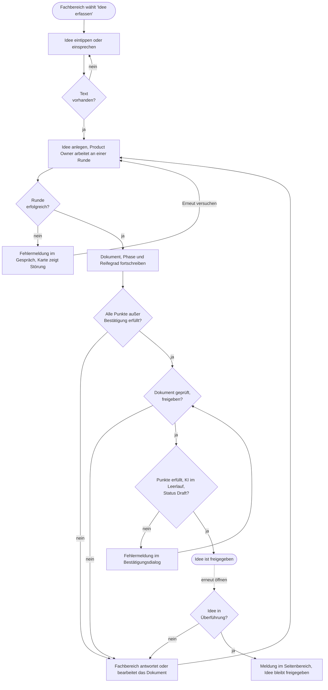
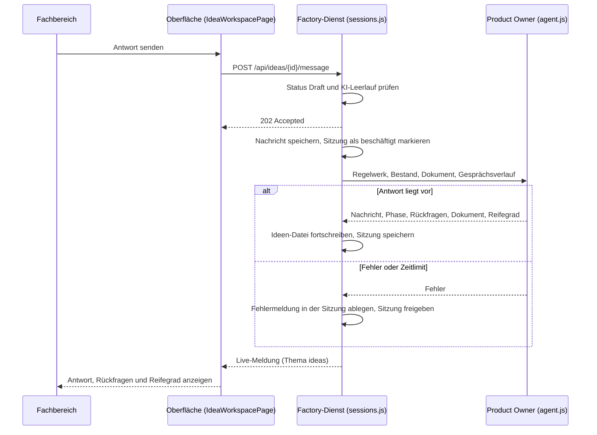

# GP6 Idee erfassen und verfeinern

## Meta
- **Stand:** 2026-11-04
- **Bezug:** specs/E3 Software Factory/F3 Ideen-Tafel, specs/E3 Software Factory/F4 Ideen-Dialog, code/factory/server (`ideas.js`, `sessions.js`, `agent.js`, `prompts.js`, `index.js`), code/factory/src (`IdeasPage`, `IdeaWorkspacePage`, `IntakeModal`, `Conversation`)

> Für das Epic E3 „Software Factory" werden dauerhaft keine Tests geschrieben (siehe `AGENTS.md`). Dieser Prozess hat deshalb keine zugehörige Testsuite.

## Ziel
Aus einer groben Idee des Fachbereichs entsteht im Gespräch mit der KI als Product Owner ein vollständig geklärtes Ideen-Dokument, das der Fachbereich ausdrücklich freigibt.

## Auslöser
Der Fachbereich wählt auf der Ideen-Tafel „Idee erfassen" (auch über `#/ideen?neu=1`) und beschreibt seine Idee. Fachliche Grundlage: [Idee erfassen](../../../specs/E3%20Software%20Factory/F3%20Ideen-Tafel/S2%20Idee%20erfassen.md).

## Beteiligte
| Rolle / System | Beitrag |
|---|---|
| Fachbereich (Stakeholder) | Beschreibt die Idee, beantwortet Rückfragen, korrigiert das Dokument, gibt frei oder öffnet erneut. |
| Product Owner (KI) | Prüft die Idee kritisch nach `harness/_ideas.md` und gegen den Bestand, stellt Rückfragen, liefert Dokumentinhalt, Phase und Reifegrad. Liest nur (Profil `read`). |
| Factory-Dienst | Legt die Idee an, führt die KI-Runden im Hintergrund aus, schreibt das Ideen-Dokument fort, prüft Freigabe und Statuswechsel. |
| Dateiablage | `ideas/I{n} {Titel}.md` (Dokument), Sitzungsdatei `sessions/I{n}.json` im Datenverzeichnis der Factory (Gespräch, Phase, Reifegrad). |
| Git | Versioniert nur die Freigabe (`idee: {id} {Titel} freigegeben`). |

## Ablauf

Das Ablaufdiagramm zeigt den Weg von der Erfassung bis zur Freigabe samt Fehlerpfaden (KI-Störung, abgelehnte Freigabe) und der Rückkehr in die Klärung durch erneutes Öffnen. Die Fachbereichs-Antwort kann jederzeit auch bei erfüllten Punkten statt der Freigabe erfolgen; die Freigabe ist nie automatisch.

Das Sequenzdiagramm zeigt das Zusammenspiel von Fachbereich, Oberfläche, Factory-Dienst und KI innerhalb einer Gesprächsrunde; die Oberfläche erfährt das Ergebnis nicht aus der Antwort, sondern über die Live-Meldung.

## Schritte
| # | Schritt | Verantwortlich | Ergebnis |
|---|---|---|---|
| 1 | Idee erfassen: Text im Dialog „Idee erfassen" eintippen oder, wenn der Browser Spracheingabe unterstützt, einsprechen (`IntakeModal`); wer einspricht, setzt das Gespräch anschließend im Gesprächsmodus fort. Leerer Text wird clientseitig mit „Bitte beschreiben Sie Ihr Anliegen." und serverseitig mit `400` abgelehnt. | Fachbereich | Nicht leerer Ideentext |
| 2 | Idee anlegen (`POST /api/ideas`, `201`): nächste freie Nummer über Ideen- und Sitzungsdateien vergeben, Datei `ideas/I{n} Neue Idee.md` mit Status `Draft` schreiben, Text als `problem` und erste Nachricht speichern, Phase `verstehen`, Event `idea` auslösen. Keine Git-Version. | Factory-Dienst | Idee `I{n}` auf der Tafel in der Spalte „In Klärung" |
| 3 | Erste KI-Runde im Hintergrund starten (die Anlage antwortet vorher mit `201` und der Kennung), danach wechselt die Oberfläche zu `#/ideen/{id}`. | Factory-Dienst | Gesprächsansicht mit Hinweis „Product Owner arbeitet" |
| 4 | KI-Runde ausführen: Prompt aus Regelwerk, Bestandsübersicht, Dokument und Verlauf; die KI arbeitet mit Rechteprofil `read` (nur Read, Glob, Grep) und dem Modell aus `dialogModel`; höchstens 4 Runden gleichzeitig, weitere warten auf einen freien Platz; Zeitlimit 5 Minuten ab Start der KI. Die letzten 4 Arbeitsschritte erscheinen live im Verlauf. | Product Owner (KI) | Strukturierte Antwort mit `message`, `phase`, `questions`, `document`, `readiness` |
| 5 | Dokument fortschreiben: Titel nur bei nicht leerem Wert übernehmen, Inhaltsfelder ersetzen, offene Punkte ersetzen, neue Entscheidungen mit Datum anhängen; Phase und Reifegrad in der Sitzung ablegen; die Antwort der KI samt Rückfragen wird als Nachricht angehängt. | Factory-Dienst | Aktualisierte Ideen-Datei, Antwort im Gespräch |
| 6 | Rückfragen beantworten: höchstens 3 Rückfragen mit 2 bis 4 Optionen, einzeln im Assistenten-Modus mit Option, optionaler Ergänzung und Zurückgehen; eine freie Antwort beendet alle offenen Rückfragen. Die Antwort wird als Frage-Antwort-Paare gesendet (`POST /api/ideas/{id}/message`, `202`); der Dienst prüft Status `Draft` und KI-Leerlauf. Weiter bei Schritt 4. | Fachbereich | Neue Nachricht, nächste Runde |
| 7 | Dokument selbst bearbeiten: nur Status `Draft` und KI im Leerlauf; übernommen werden `title`, `problem`, `solution`, `inScope`, `outOfScope`, `openPoints` (`PUT /api/ideas/{id}/document`), die Datei wird bei Titeländerung umbenannt. | Fachbereich | Korrigiertes Dokument, keine Git-Version, kein Event |
| 8 | Reifegrad beobachten: Die ersten fünf Punkte stammen aus dem `readiness` der letzten KI-Runde, „keine offenen Punkte" gilt bei leerer Liste offener Punkte und erfülltem Punkt „Problem", „Bestätigung" nur außerhalb von `Draft`. Fünf Phasen (Verstehen, Hinterfragen, Machbarkeit, Verfeinern, Abschließen) und sieben Punkte der Definition of Ready; die Tafelkarte zeigt „Arbeitet", „Störung", „Wartet auf Sie" oder „Bereit zur Freigabe". | Fachbereich | Entscheidungsgrundlage für die Freigabe |
| 9 | Idee freigeben (`POST /api/ideas/{id}/approve`): Der Dienst prüft Status `Draft`, KI im Leerlauf und alle Punkte außer der Bestätigung, setzt `Ready`, ergänzt die Entscheidung zur Freigabe, erzeugt die Git-Version und das Event `idea`. | Fachbereich, Factory-Dienst | Idee in der Spalte „Freigegeben", Gespräch schreibgeschützt |
| 10 | Idee erneut öffnen (`POST /api/ideas/{id}/reopen`): ohne Bestätigungsdialog, Status zurück auf `Draft`, Freigabe-Entscheidung bleibt erhalten, keine Git-Version, Event `idea`. | Fachbereich, Factory-Dienst | Idee wieder in Klärung |

Die Überführung freigegebener Ideen in Anforderungen (F6) und das Verwerfen von Ideen ([Idee verwerfen](../../../specs/E3%20Software%20Factory/F4%20Ideen-Dialog/S7%20Idee%20verwerfen.md)) sind nicht Teil dieses Prozesses.

## Ausnahmen
| Fall | Verhalten |
|---|---|
| Leerer Ideentext | `400` „Bitte beschreiben Sie Ihre Idee."; UI zeigt „Bitte beschreiben Sie Ihr Anliegen."; Dialog bleibt offen. |
| Leere Antwort im Gespräch | `400` „Bitte geben Sie eine Antwort ein."; der Senden-Button ist bei leerer Eingabe deaktiviert. |
| KI nicht angemeldet, Kontingent erschöpft, KI-Anbindung fehlt, Zeitlimit von 5 Minuten, keine auswertbare Antwort | Die Runde endet mit Fehler; die Sitzung wird frei, die Fehlermeldung steht im Verlauf, die Tafelkarte zeigt „Störung". „Erneut versuchen" (`POST /api/ideas/{id}/retry`) wiederholt die Runde ohne neue Nachricht. |
| „Erneut versuchen" ohne vorhandenes Gespräch | `404` „Zu dieser Idee gibt es noch kein Gespräch." |
| Neustart des Dienstes während einer Runde | `recoverSessions()` beendet die Runde mit „Die Antwort wurde durch einen Neustart unterbrochen. Bitte versuchen Sie es erneut."; Wiederholung über „Erneut versuchen". |
| Nachricht, Bearbeiten oder Freigabe während einer KI-Runde | `409` „Die KI arbeitet noch an der letzten Antwort." |
| Nachricht, Bearbeiten oder Freigabe außerhalb des Status `Draft` | `409` „Diese Idee ist freigegeben. Öffnen Sie sie erneut, um weiter daran zu arbeiten." |
| Freigabe, obwohl Punkte der Definition of Ready fehlen | `409` „Die Idee ist noch nicht bereit: {fehlende Punkte}."; die Meldung erscheint im Bestätigungsdialog. Der Button ist in der Oberfläche vorab deaktiviert. |
| Erneutes Öffnen außerhalb des Status `Ready` | `409` „Nur freigegebene Ideen lassen sich erneut öffnen." |
| Erneutes Öffnen während der Überführung in Anforderungen | `409` „Diese Idee wird gerade in Anforderungen überführt." |
| Spracheingabe im Browser nicht unterstützt | Mikrofon- und Gesprächsmodus-Schaltflächen erscheinen nicht; Eingabe nur per Tastatur. |
| Unbekannte Ideen-Kennung | Die Oberfläche zeigt „Diese Idee existiert nicht mehr." |
| Ideen-Dateien, die nicht dem Format `ideas/I{n} {Titel}.md` entsprechen | Erscheinen nicht auf der Tafel. |

## Verwandte Dokumente
- Specs: [Tafel nach Status](../../../specs/E3%20Software%20Factory/F3%20Ideen-Tafel/S1%20Tafel%20nach%20Status.md), [Idee erfassen](../../../specs/E3%20Software%20Factory/F3%20Ideen-Tafel/S2%20Idee%20erfassen.md), [Gespräch mit dem Product Owner](../../../specs/E3%20Software%20Factory/F4%20Ideen-Dialog/S1%20Gespr%C3%A4ch%20mit%20dem%20Product%20Owner.md), [Rückfragen im Assistenten-Modus](../../../specs/E3%20Software%20Factory/F4%20Ideen-Dialog/S2%20R%C3%BCckfragen%20im%20Assistenten-Modus.md), [Reifegrad und Phasen](../../../specs/E3%20Software%20Factory/F4%20Ideen-Dialog/S3%20Reifegrad%20und%20Phasen.md), [Stand der Idee](../../../specs/E3%20Software%20Factory/F4%20Ideen-Dialog/S4%20Stand%20der%20Idee.md), [Idee bearbeiten](../../../specs/E3%20Software%20Factory/F4%20Ideen-Dialog/S5%20Idee%20bearbeiten.md), [Idee freigeben und erneut öffnen](../../../specs/E3%20Software%20Factory/F4%20Ideen-Dialog/S6%20Idee%20freigeben%20und%20erneut%20%C3%B6ffnen.md)
- Regelwerk der KI: `harness/_ideas.md`
