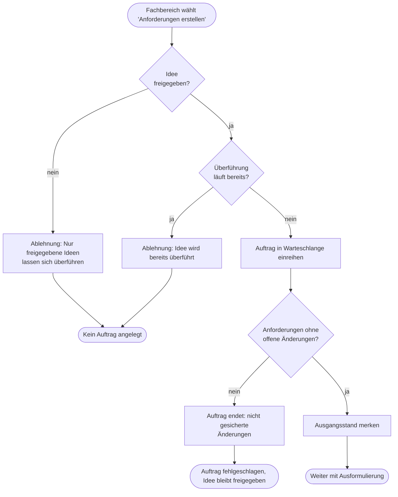
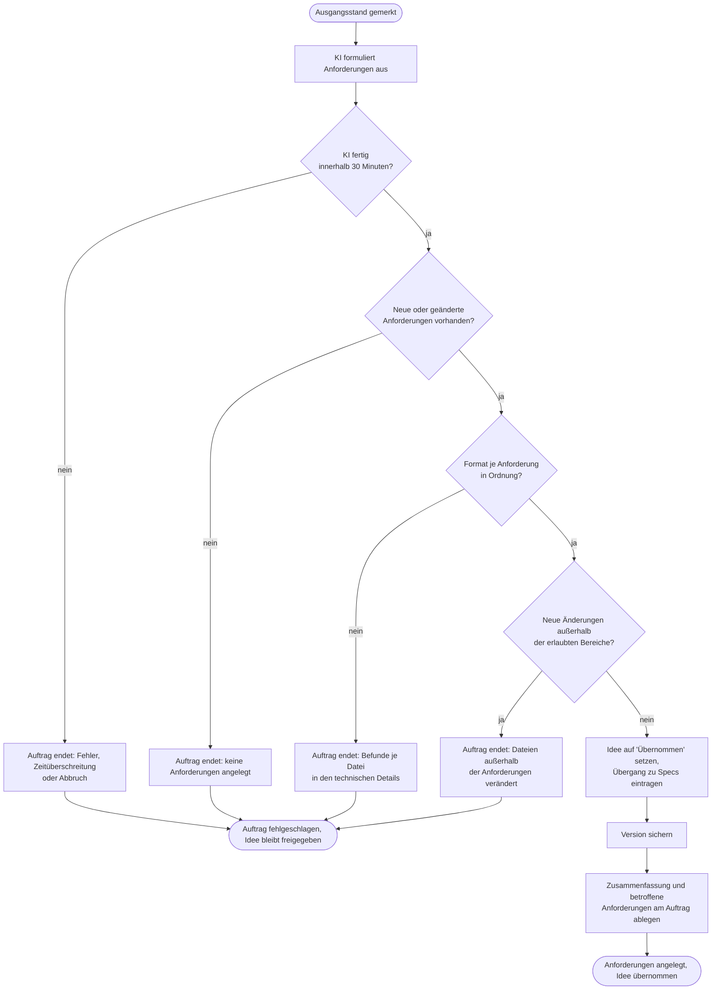
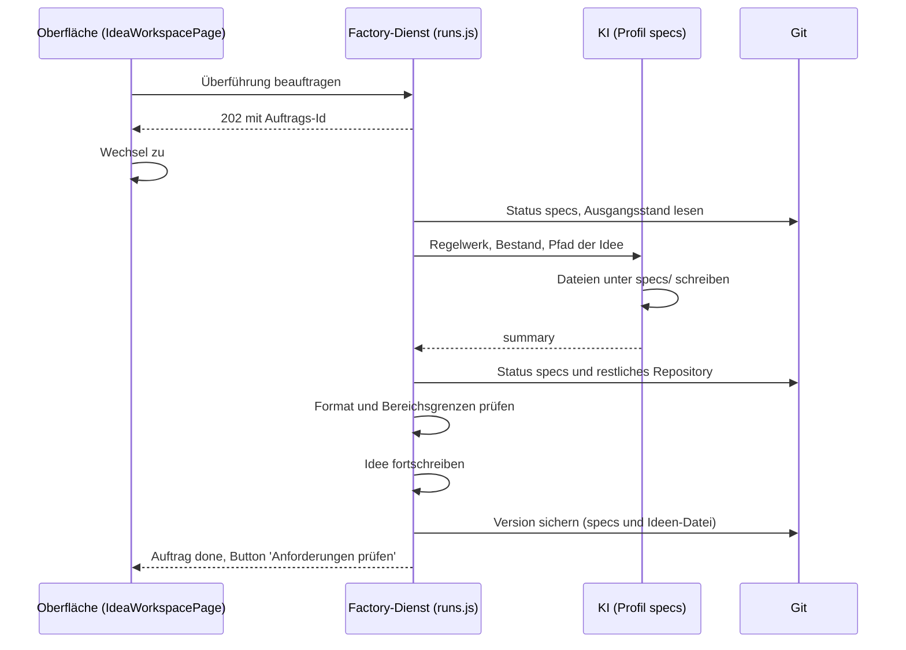
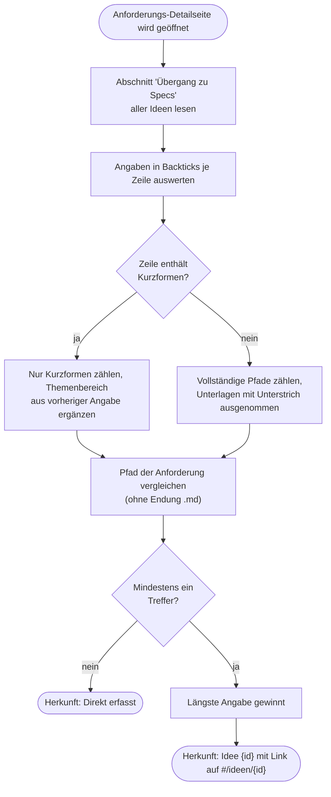

# GP7 Idee in Anforderungen überführen

## Meta
- **Stand:** 2026-11-04
- **Bezug:** specs/E3 Software Factory/F6 Überführung in Anforderungen, code/factory/server (runs.js, specs.js, ideas.js, git.js, prompts.js, index.js), code/factory/src (IdeaWorkspacePage.jsx, RunPage.jsx)

## Ziel
Eine freigegebene Idee (Status `Ready`) wird von der KI in prüfbare Anforderungen unter `specs/` ausformuliert, formal geprüft und als Git-Version gesichert; die Idee wird `Übernommen` und bleibt als Herkunft der Anforderungen auffindbar.

## Auslöser
Der Fachbereich klickt in der Ideen-Werkstatt bei einer Idee im Status `Ready` auf „Anforderungen erstellen“ und bestätigt den Dialog (`POST /api/ideas/:id/transfer` in `index.js`, Antwort `202` mit der Auftrags-Id). Die Idee hat zuvor im Ideen-Dialog die Definition of Ready erfüllt und wurde bestätigt (`Ready`, siehe `harness/_ideas.md`).

Fachliche Regeln: [S1 Anforderungen aus Idee erstellen](../../../specs/E3%20Software%20Factory/F6%20%C3%9Cberf%C3%BChrung%20in%20Anforderungen/S1%20Anforderungen%20aus%20Idee%20erstellen.md), [S2 Prüfung und Sicherung](../../../specs/E3%20Software%20Factory/F6%20%C3%9Cberf%C3%BChrung%20in%20Anforderungen/S2%20Pr%C3%BCfung%20und%20Sicherung.md), [S3 Herkunft der Anforderungen](../../../specs/E3%20Software%20Factory/F6%20%C3%9Cberf%C3%BChrung%20in%20Anforderungen/S3%20Herkunft%20der%20Anforderungen.md).

## Beteiligte
| Rolle / System | Beitrag |
|---|---|
| Fachbereich | Beauftragt die Überführung, prüft danach die Anforderungen (Filter „offen“) |
| Factory-Oberfläche | Zeigt Bestätigungsdialog und Fehlermeldung, wechselt zur Auftragsseite `#/umsetzung/{id}` |
| Factory-Dienst (`runs.js`) | Prüft Voraussetzungen, führt den Auftrag in der Warteschlange aus, prüft das Ergebnis, schreibt die Idee fort |
| KI (`runAgent` in `agent.js`, Rechteprofil `specs`) | Läuft als Unterprozess `claude -p` ohne MCP-Server; darf lesen (`Read`, `Glob`, `Grep`) und nur unter `specs/**` schreiben (`Edit`, `Write`), keine Shell. Formuliert die Anforderungen nach `harness/_requirements.md` (Status `Modified`/`Implemented`, siehe dort); Modell `buildModel`, Arbeitstiefe `high`, Zeitlimit 30 Minuten; Ergebnis als `summary` per `StructuredOutput` |
| Git (`git.js`) | Statusprüfung, Ausgangsstand (`head`), Sicherung als Version (`commitPaths`) |
| Ideen-Datei (`ideas/`) | Trägt Status und Abschnitt `## Übergang zu Specs` |

## Ablauf
Das erste Diagramm zeigt die Beauftragung und die Vorbereitung; die Ausführung folgt im zweiten Diagramm. Jeder Fehlerpfad beendet den Auftrag mit Status `failed`, die Idee bleibt `Ready`.

Das zweite Diagramm zeigt Ausformulierung, Prüfung und Sicherung.

Die zeitliche Abstimmung zwischen Oberfläche, Dienst, KI und Git:

## Schritte
| # | Schritt | Verantwortlich | Ergebnis |
|---|---|---|---|
| 1 | Beauftragen: Idee muss `Ready` sein, keine wartende oder laufende Überführung derselben Idee (`startTransfer`) | Factory-Dienst | Auftrag vom Typ `transfer` mit Titel der Idee, Ereignis „Überführung {id} für Idee … beauftragt“ |
| 2 | Auftrag in die Warteschlange einreihen; es läuft immer nur ein Auftrag (`processQueue`) | Factory-Dienst | Auftrag startet, sobald die Fertigung frei ist |
| 3 | Phase „Vorbereitung“: `specs/` auf nicht gesicherte Änderungen prüfen, `baseCommit` merken, Änderungen außerhalb von `specs`, `ideas`, `code/factory` als Vorzustand festhalten | Factory-Dienst, Git | Sauberer Ausgangsstand |
| 4 | Phase „Ausformulierung“: KI schreibt Anforderungen mit Status `Modified`, hält `_Datenstruktur.md`, `_Menüstruktur.md`, `_Backend.md` aktuell, liefert `summary` (`transferPrompt`) | KI | Neue und geänderte Dateien unter `specs/` |
| 5 | Phase „Formprüfung“: geänderte und neue Dateien im Muster `specs/E{n} …/F{n} …/S{n} ….md` (`isStoryPath`) sammeln, je Datei Titel, Status (`Modified` oder `Implemented`), User Story und Akzeptanzkriterien prüfen (`storyProblems`) | Factory-Dienst | Befunde oder freigegebene Dateiliste |
| 6 | Bereichsprüfung: seit dem Start neu hinzugekommene Änderungen außerhalb von `specs`, `ideas`, `code/factory` aufdecken | Factory-Dienst, Git | Kein Verstoß |
| 7 | Phase „Sicherung“: Idee auf `Übernommen` setzen, Zeile `{Datum}: Überführt in {Pfade}.` unter `## Übergang zu Specs` ergänzen | Factory-Dienst | Fortgeschriebene Ideen-Datei |
| 8 | Version `idee: {id} {Titel} in anforderungen überführt` mit `specs` und Ideen-Datei erzeugen; Text listet alle Anforderungen | Git | Commit, am Auftrag als `commit` vermerkt |
| 9 | `summary`, `storyPaths` und `stories` am Auftrag ablegen, Status `done`, Ereignis „Idee {id} »{Titel}« in {n} Anforderungen überführt“ | Factory-Dienst | Auftragsseite zeigt „Anforderungen prüfen“ (`#/anforderungen?filter=offen`) |
| 10 | Herkunft ableiten: Beim Öffnen einer Anforderung wertet `originOfStory` die Einträge unter `## Übergang zu Specs` aller Ideen aus (`transferTargets`) | Factory-Dienst | Karte „Einordnung“ zeigt „Idee {id} »{Titel}«“ oder „Direkt erfasst“ |

### Herkunft der Anforderungen
Die Herkunft wird nicht am Auftrag gespeichert, sondern bei jedem Abruf aus den Ideen-Dateien abgeleitet; dadurch zählen auch von Hand gepflegte Einträge.

## Ausnahmen
| Fall | Verhalten |
|---|---|
| Idee nicht `Ready` | `409` „Nur freigegebene Ideen lassen sich in Anforderungen überführen.“; kein Auftrag |
| Wartende oder laufende Überführung derselben Idee | `409` „Diese Idee wird bereits überführt.“; die Oberfläche zeigt die Meldung im Dialog |
| Offene Änderungen unter `specs/` | Auftrag endet mit „Unter den Anforderungen liegen nicht gesicherte Änderungen. Bitte sichern oder verwerfen Sie diese zuerst.“; es wird nichts verworfen, `workStarted` ist noch nicht gesetzt |
| KI nicht angemeldet, Kontingent erschöpft, `claude` nicht installiert | `agent.js` übersetzt den Fehler in eine Klartextmeldung („Die KI ist nicht angemeldet …“, „Das KI-Kontingent …“, „… nicht installiert“); sonst „Die KI konnte den Auftrag nicht abschließen.“ Der Auftrag endet als `failed` |
| KI überschreitet 30 Minuten | „Die KI hat die Zeitvorgabe überschritten.“; der Prozessbaum wird beendet |
| KI versucht nicht freigegebene Aktionen (z. B. Schreiben außerhalb `specs/`) | Blockiert durch das Rechteprofil, als Hinweis im Auftragsverlauf vermerkt; zusätzlich greift die Bereichsprüfung gegen Git |
| KI scheitert oder Auftrag wird abgebrochen | Auftrag endet als `failed` bzw. `canceled`; zeigt `run.canDiscard` offene Änderungen unter `specs`, lassen sie sich verwerfen (`discardScope`: nur `specs`) |
| Keine neue oder geänderte Anforderungsdatei | „Die KI hat keine Anforderungen angelegt.“ |
| Format-Befunde („Titel fehlt“, „Status ungültig“, „Nutzen fehlt“, „Abnahmekriterien fehlen“) | „Einige Anforderungen entsprechen nicht dem vorgeschriebenen Format.“; Befunde je Datei in den technischen Details |
| Neue Änderungen außerhalb von `specs`, `ideas`, `code/factory` | „Die KI hat Dateien außerhalb der Anforderungen verändert.“; Dateien in den technischen Details. Änderungen, die schon vor dem Start vorlagen, zählen nicht |
| Fehler vor der Sicherung | Idee bleibt `Ready`, die Überführung lässt sich erneut beauftragen; Ereignis „… fehlgeschlagen“ |
| Idee im Status `Übernommen` | Gespräch ist abgeschlossen und die Idee wird nicht mehr geändert (`harness/_ideas.md`); Button „Anforderungen ansehen“ führt zu `#/anforderungen` |
| Dialogaktion an einer Idee, die gerade überführt wird | `sessions.js` weist mit `409` „Diese Idee wird gerade in Anforderungen überführt.“ ab |
| Während des Auftrags Änderung an Anforderungen | `assertSpecsUnlocked` weist mit `409` ab |
| Angabe verweist auf eine Unterlage (`specs/E2 Haustiere/_Datenstruktur.md`) oder `S5` neben `S50` | Unterlage zählt nicht als Ziel; `…/S5` erfasst nicht `…/S50` |
