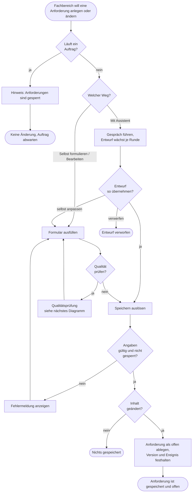
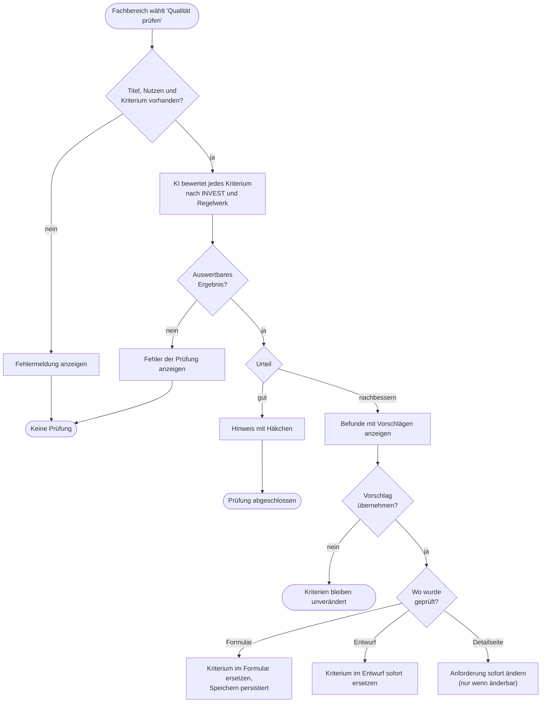

# GP8 Anforderung formulieren und prüfen

## Meta
- **Stand:** 2026-11-04
- **Bezug:** specs/E3 Software Factory/F7 Anforderungen, specs/E3 Software Factory/F8 Anforderungs-Assistent, specs/E3 Software Factory/F9 Qualitätsprüfung, code/factory/server (`specs.js`, `sessions.js`, `agent.js`, `prompts.js`, `runs.js`, `index.js`), code/factory/src (`RequirementsPage`, `StoryPage`, `StoryEditor`, `QualityCheck`, `AssistantPage`)

## Ziel
Eine Anforderung (Story mit Abnahmekriterien) entsteht, ändert sich oder entfällt so, dass sie vor der Umsetzung eindeutig und prüfbar ist und nie mit einem laufenden Auftrag kollidiert.

## Auslöser
Der Fachbereich öffnet die Seite „Anforderungen“ und wählt „Anforderung anlegen“, öffnet eine Anforderung zum Bearbeiten, Überarbeiten oder Entfernen oder startet die Qualitätsprüfung.

## Beteiligte
| Rolle / System | Beitrag |
|---|---|
| Fachbereich | Beschreibt das Anliegen, entscheidet über Weg, Entwurf, Vorschläge und Entfernen |
| Factory-Oberfläche | Liste, Detailseite, Formular, Assistenten-Seite, Ergebnis der Qualitätsprüfung |
| Factory-Server | Validiert, schreibt Story-Dateien unter `specs/`, prüft die Sperre, löst Events aus |
| KI-Agent | Führt das Entwurfsgespräch und prüft die Abnahmekriterien (Rechteprofil `read`, Modell aus `dialogModel`) |
| Versionsverwaltung (Git) | Hält jede Änderung als eigene Version fest |
| Auftrag (Umsetzung) | Sperrt Anforderungen, solange er läuft (siehe specs/E3 Software Factory/F10 Umsetzung) |

## Ablauf

Das Diagramm zeigt den Hauptablauf vom Wunsch nach einer Änderung bis zur gespeicherten Anforderung. Die Sperre wirkt vor jeder Schreibaktion; Fehler führen zurück ins Formular bzw. zur Meldung.

Das zweite Diagramm zeigt die Qualitätsprüfung der Abnahmekriterien und die Übernahme eines Vorschlags. Die Prüfung selbst ändert nichts; erst die Übernahme schreibt, und zwar je nach Ort unterschiedlich.

## Schritte
| # | Schritt | Verantwortlich | Ergebnis |
|---|---|---|---|
| 1 | Liste und Detailseite ansehen (`GET /api/requirements`, `GET /api/requirements/{id}`); das Feld `locked` meldet, ob ein Auftrag läuft | Factory-Oberfläche, `runs.isBusy()` | Struktur, Status und Sperrzustand sichtbar |
| 2 | Weg wählen: „Selbst formulieren“ öffnet `StoryEditor`, „Mit dem KI-Assistenten entwickeln“ den Einstieg | Fachbereich | Formular oder Assistenten-Einstieg |
| 3a | Selbst formulieren: Einordnung (Themenbereich, Funktion, auch neu), Titel, Nutzen, Beschreibung, Kriterien erfassen; `POST /api/requirements` | Fachbereich, `specs.createStory` | Datei `S{n} {Titel}.md` mit Status `Modified`, Nummer hinten angehängt |
| 3b | Assistent: `POST /api/studio` legt Entwurf `A{n}` in `code/factory/data/sessions` an und startet die erste KI-Runde im Hintergrund | `sessions.createStudio` | Entwurf mit Status `open`, noch keine Datei unter `specs/` |
| 4 | Gespräch: Antworten über `POST /api/studio/{id}/message`; die KI liefert je Runde den vollständigen Entwurf und den Reifegrad (`{n}/4`), der Server ersetzt beides | KI-Agent, `sessions.studioTurn` | Wachsender Entwurf |
| 5 | Entwurf selbst anpassen (`PUT /api/studio/{id}/draft`) oder verwerfen (`DELETE /api/studio/{id}`); beides nur, wenn die KI nicht arbeitet | Fachbereich | Angepasster oder entfernter Entwurf |
| 6 | Entwurf speichern (`POST /api/studio/{id}/save`): legt die Anforderung an, bei Überarbeitung (`storyId` gesetzt) ändert er die bestehende | `sessions.saveStudio` | Entwurf `saved`, Feld `savedStory` gesetzt |
| 7 | Bearbeiten: `PUT /api/requirements/{id}` mit vorausgefülltem Formular ohne Einordnung; Mit-Assistent-Überarbeitung startet einen Entwurf auf einer Kopie | `specs.updateStory` | Bei Änderung Status `Modified`, Datei bei Titeländerung umbenannt, Nummer stabil |
| 8 | Entfernen: `DELETE /api/requirements/{id}` nach Bestätigung; erlaubt nur, wenn die Datei nie `Implemented` war | `git.wasEverImplemented`, `specs.deleteStory` | Datei (und leerer Funktionsordner) entfernt, Ansicht wechselt zu `#/anforderungen` |
| 9 | Qualität prüfen: `POST /api/requirements/check` validiert, ruft die KI und wartet auf das Ergebnis (`verdict`, `summary`, `findings`); nichts wird gespeichert | `sessions.checkStory`, `runAgent` | Hinweis mit Befunden und INVEST-Prinzip je Befund |
| 10 | Vorschlag übernehmen: das Kriterium mit exaktem Text `criterion` wird durch alle `suggestions` ersetzt (`applyFinding`); auf der Detailseite folgt `PUT /api/requirements/{id}` | Fachbereich, `QualityCheck` | Befund verschwindet; je Ort lokal, im Entwurf oder in der Anforderung wirksam |
| 11 | Jede schreibende Aktion ruft vorher `runs.assertSpecsUnlocked()` auf; nach Änderung erzeugt der Server eine Git-Version (`git.commitPaths`) und ein Ereignis `requirement` und meldet `requirements` an die Oberfläche | Factory-Server | Nachvollziehbare Änderung, Oberfläche aktualisiert sich live |

Die Git-Betreffzeilen und Ereignistitel je Aktion stehen in den Specs (F7 S5/S6, F8 S3/S4, F9 S2) und werden hier nicht wiederholt.

## Ausnahmen
| Fall | Verhalten |
|---|---|
| Ein Auftrag läuft | `POST`, `PUT`, `DELETE` auf `/api/requirements` und `POST /api/studio/{id}/save` antworten `409`; die Oberfläche blendet „Bearbeiten“, „Mit Assistent überarbeiten“ und „Vorschlag übernehmen“ aus, „Anforderung entfernen“ ist deaktiviert, „Anforderung anlegen“ bleibt aktiv. Die Sperre endet mit dem Auftrag ([F7 S8](../../../specs/E3%20Software%20Factory/F7%20Anforderungen/S8%20Sperre%20w%C3%A4hrend%20eines%20Auftrags.md)) |
| Titel, Nutzen oder Kriterium fehlen, Titel länger als 120 Zeichen | `400` mit Meldung aus `specs.validateStory`; das Formular zeigt sie an, Eingaben bleiben erhalten |
| Werkzeug-Themenbereich (Software Factory) | Anlegen und Bearbeiten antworten `400`, Entfernen `409`; Entfernen und Prüfung sind in der Oberfläche ausgeblendet |
| Inhalt beim Bearbeiten unverändert | Antwort mit `changed: false`; keine Git-Version, kein Ereignis |
| Anforderung war schon einmal `Implemented` | Entfernen mit `409`, die Anforderung bleibt als Nachweis; ein Bearbeiten setzt sie wieder auf `Modified` |
| Unbekannte Anforderung oder unbekannter Entwurf | `404` („Diese Anforderung existiert nicht mehr.“ bzw. „Dieser Entwurf existiert nicht mehr.“) |
| KI arbeitet noch an der letzten Antwort | Entwurf bearbeiten, speichern und verwerfen sind gesperrt (`409`) |
| Entwurf bereits gespeichert | Weitere Nachrichten, Bearbeitungen und Speichern antworten `409` („Dieser Entwurf wurde bereits gespeichert.“) |
| Leeres Anliegen beim Start des Assistenten | `400`, kein Entwurf wird angelegt |
| KI liefert keine auswertbare Antwort oder scheitert (Qualitätsprüfung) | Fehlermeldung in der Oberfläche; es wird nichts verändert, die Prüfung lässt sich wiederholen |
| Vorschlag auf der Detailseite schlägt serverseitig fehl | Fehlermeldung des Servers auf der Detailseite; der Befund bleibt stehen |
