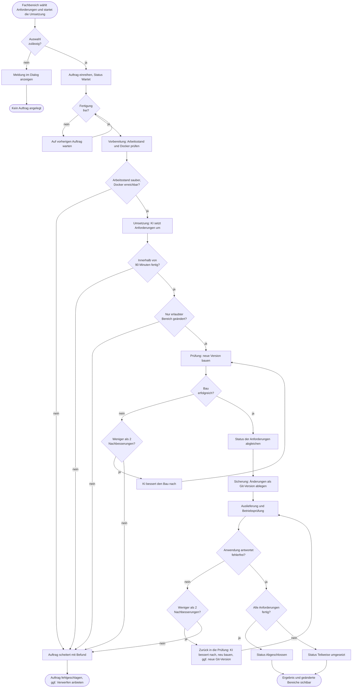
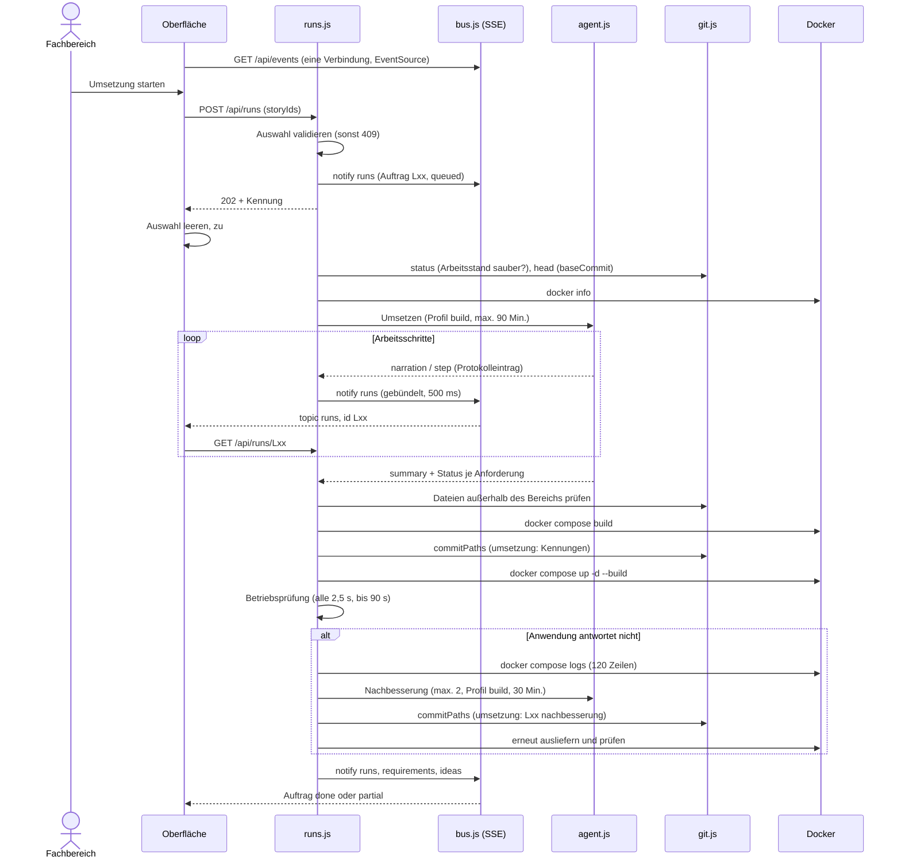

# GP9 Umsetzung beauftragen und ausliefern

## Meta
- **Stand:** 2026-11-04
- **Bezug:** specs/E3 Software Factory/F10 Umsetzung, specs/E3 Software Factory/F1 App-Shell/S3 Live-Aktualisierung.md, code/factory/server (runs.js, agent.js, bus.js, git.js, storage.js, index.js, prompts.js), code/factory/src (pages/DeliveryPage.jsx, pages/RunPage.jsx, components/RunPanel.jsx, components/StartDeliveryModal.jsx, lib/api.js)

## Ziel
Ausgewählte offene Anforderungen werden von der KI vollständig umgesetzt, als Git-Version gesichert, ausgeliefert und im Betrieb geprüft; der Fachbereich verfolgt jeden Schritt live nachvollziehbar mit.

## Auslöser
Der Fachbereich wählt unter „Anforderungen“ eine oder mehrere offene Anforderungen aus (oder öffnet die Detailseite) und bestätigt im Dialog „Umsetzung beauftragen.“ den Button „Umsetzung starten“ ([S1](../../../specs/E3%20Software%20Factory/F10%20Umsetzung/S1%20Auswahl%20und%20Beauftragung.md)). Die Oberfläche sendet `POST /api/runs` mit `storyIds`.

## Beteiligte
| Rolle / System | Beitrag |
|---|---|
| Fachbereich | wählt aus, beauftragt, verfolgt Protokoll und Ergebnis, bricht ggf. ab |
| Oberfläche (`StartDeliveryModal`, `DeliveryPage`, `RunPage`, `RunPanel`) | Auswahl, Dialog, Auftragsliste, Phasenanzeige, Arbeitsprotokoll; lädt per `useLive` nach |
| Factory-Dienst (`runs.js`) | validiert, reiht ein, führt die sechs Phasen aus, persistiert den Auftrag als `code/factory/data/runs/{id}.json` |
| KI-Agent (`agent.js`) | setzt um (Rechteprofil `build`, Modell `buildModel`, Arbeitstiefe `high`) und bessert nach |
| Git (`git.js`) | Status, Sicherung als Git-Version, Änderungsstatistik |
| Docker / Anwendung | Bau, Auslieferung und Betriebsprüfung über `appUrl` und `healthPaths` |
| Live-Kanal (`bus.js`, `GET /api/events`) | meldet jede Auftragsänderung als Server-Sent Event an alle geöffneten Ansichten |

## Ablauf
Das Ablaufdiagramm zeigt den fachlichen Weg vom Beauftragen bis zum Abschluss einschließlich der Fehler- und Nachbesserungspfade; Abbrechen und Zurücknehmen sind eigene Vorgänge und hier ausgespart.

Das Sequenzdiagramm zeigt das Zusammenspiel der Systeme über die Zeit, inklusive Live-Meldungen an die Oberfläche.

## Schritte
| # | Schritt | Verantwortlich | Ergebnis |
|---|---|---|---|
| 1 | Auswahl treffen: Auswahlfeld je offener Anforderung, Auswahl bleibt beim Seitenwechsel erhalten, geht beim Neuladen verloren ([S1](../../../specs/E3%20Software%20Factory/F10%20Umsetzung/S1%20Auswahl%20und%20Beauftragung.md)) | Fachbereich, Oberfläche (`lib/selection.js`) | Auswahlleiste mit „{n} Anforderungen ausgewählt“ |
| 2 | Beauftragen: Dialog `StartDeliveryModal` bestätigen; `startDelivery` prüft Kennungen und legt Auftrag Typ `delivery` mit Titel der Anforderung bzw. „{n} Anforderungen“ an | Fachbereich, Factory-Dienst | `202` mit Kennung `L{n}`, Ereignis `run` im Verlauf |
| 3 | Einreihen: `enqueue` speichert den Auftrag mit Status `queued`, `processQueue` startet ihn, sobald kein Auftrag aktiv ist; `transfer`, `delivery` und `revert` teilen sich eine Warteschlange, Reihenfolge der Beauftragung ([S2](../../../specs/E3%20Software%20Factory/F10%20Umsetzung/S2%20Warteschlange.md)) | Factory-Dienst | höchstens ein laufender Auftrag, Liste auf `#/umsetzung` |
| 4 | Vorbereitung: nicht gesicherte Änderungen in `code` (ohne `code/factory`), `specs` und `docker-compose.yml` sowie `docker info` prüfen; `baseCommit` und bereits geänderte Dateien außerhalb des Bereichs merken | Factory-Dienst, Git, Docker | Ausgangsstand festgehalten |
| 5 | Umsetzung: KI liest `AGENTS.md`, `harness/_requirements.md` und bei Oberflächenänderungen `harness/_uiux.md`, ändert `code/backend` und `code/frontend` (bei Datenänderung inkl. Migration), zieht `specs/` nach, setzt fertige Anforderungen sofort auf `Implemented`, prüft mit `npm --prefix code/frontend run build` und `dotnet build code/backend` ([S3](../../../specs/E3%20Software%20Factory/F10%20Umsetzung/S3%20Ablauf%20und%20Phasen.md)); alle 3 s gleicht der Dienst den Fortschritt mit den Dateien ab | KI-Agent | `summary` und je Anforderung `done` und `note` |
| 6 | Prüfung: Dateien außerhalb des erlaubten Bereichs (`code` ohne `code/factory`, `specs`, `ideas`, `docker-compose.yml`) ausschließen, `docker compose build`, Status je Anforderung auf `Implemented` oder `Modified` abgleichen | Factory-Dienst | geprüfte, lauffähige Version |
| 7 | Sicherung: Git-Version `umsetzung: {Kennungen}` bzw. `umsetzung: {id} teilweise, keine anforderung abgeschlossen`, Text enthält `summary`; `changes` aus allen `commits` ermitteln ([S9](../../../specs/E3%20Software%20Factory/F10%20Umsetzung/S9%20Ge%C3%A4nderte%20Bereiche.md)) | Factory-Dienst, Git | `commit`, `commits`, `changes` (Bereiche Oberfläche, Datenbank, Serverlogik, Anforderungen, Betriebsumgebung); ohne Änderung keine Version |
| 8 | Auslieferung und Betriebsprüfung: `docker compose up -d --build`, danach alle `healthPaths` unter `appUrl` abfragen (alle 2,5 s, je Abfrage 5 s, gesamt 90 s) | Factory-Dienst, Docker | Anwendung antwortet fehlerfrei |
| 9 | Nachbesserung: bei Bau- oder Auslieferungsfehler erhält die KI Befund und die letzten 6000 Zeichen Protokoll (bei Betriebsstörung inkl. 120 Zeilen `docker compose logs`), danach erneut bauen und ausliefern; höchstens 2 je Schritt, `repairs` zählt mit ([S10](../../../specs/E3%20Software%20Factory/F10%20Umsetzung/S10%20Selbstst%C3%A4ndige%20Nachbesserung.md)) | KI-Agent, Factory-Dienst | ggf. Git-Version `umsetzung: {id} nachbesserung` |
| 10 | Abschluss: Status `done` (alle fertig) oder `partial`; Ereignis `delivery` „Umsetzung {id} ausgeliefert ({k} von {n} Anforderungen)“; `requirements` und `ideas` werden gemeldet | Factory-Dienst | Ergebnis-Karte mit `summary`, Eckdaten, `costUsd` ([S5](../../../specs/E3%20Software%20Factory/F10%20Umsetzung/S5%20Ergebnis.md)) |

### Arbeitsprotokoll
Jeder Schritt der KI und der Factory wird als Eintrag (`kind`: `narration`, `step`, `hint`) mit Zeitstempel in `activity` abgelegt: höchstens 1500 Einträge je Auftrag im Speicher, 600 in der Antwort von `GET /api/runs/{id}`. Die Übersetzung technischer Aktionen in Fachsprache erfolgt vor der Ablage; die Rohangabe steht im Feld `detail` und ist über „Technische Details einblenden“ sichtbar ([S4](../../../specs/E3%20Software%20Factory/F10%20Umsetzung/S4%20Arbeitsprotokoll.md)). Blockierte KI-Aktionen erscheinen als Hinweis.

### Live-Aktualisierung
Die Oberfläche öffnet über `subscribe` in `lib/api.js` genau eine `EventSource` auf `GET /api/events`. `saveRun` in `runs.js` ruft bei jeder Speicherung `notify('runs', id)` auf; `bus.js` schreibt `data: {"topic":"runs","id":"L3"}` an alle Clients und sendet alle 25 Sekunden `: ping`. Protokolleinträge werden über einen Timer von 500 ms gebündelt gespeichert. `useLive` in `DeliveryPage` (Thema `runs`) und `RunPage` (Thema `runs`) lädt daraufhin neu und bündelt Meldungen innerhalb von 200 ms ([F1 S3](../../../specs/E3%20Software%20Factory/F1%20App-Shell/S3%20Live-Aktualisierung.md)). Am Ende jedes Auftrags meldet `processQueue` zusätzlich `requirements` und `ideas`.

## Ausnahmen
| Fall | Verhalten |
|---|---|
| Keine Anforderung übergeben | `409` „Bitte wählen Sie mindestens eine Anforderung aus.“; Dialog zeigt die Meldung |
| Anforderung bereits `Implemented` | `409` „Die Anforderung {id} ist bereits umgesetzt.“ |
| Anforderung gehört zum Werkzeug-Themenbereich | `409` „Der Themenbereich „Software Factory“ lässt sich nicht über die Factory selbst umsetzen.“ |
| Anforderung bereits wartend oder laufend beauftragt | `409` „Die Anforderung {id} ist bereits beauftragt.“ |
| Nicht gesicherte Änderungen im Arbeitsstand | Auftrag `failed` in der Vorbereitung, Befund mit Dateiliste; offene Änderungen bleiben unangetastet (nicht verwerfbar) |
| Docker nicht erreichbar | Auftrag `failed`: „Die Betriebsumgebung ist nicht erreichbar. Bitte starten Sie Docker Desktop.“ |
| KI ändert Dateien außerhalb des erlaubten Bereichs (neu seit Start) | Auftrag `failed`: „Die KI hat Dateien außerhalb des erlaubten Bereichs verändert.“ |
| Zeitvorgabe der KI überschritten (90 Min. Umsetzung, 30 Min. Nachbesserung) | Auftrag `failed`: „Die KI hat die Zeitvorgabe überschritten.“ |
| Bau oder Auslieferung scheitert auch nach 2 Nachbesserungen | Auftrag `failed` mit letztem Befund (`error`) und Technischen Details (`errorDetail`) |
| Betriebsprüfung 90 s erfolglos | Befund „Die Anwendung antwortet nach der Auslieferung nicht fehlerfrei.“, Betriebsprotokoll angehängt, Nachbesserung |
| Nach Scheitern liegen eigene Änderungen vor | `canDiscard` gesetzt; Verwerfen und erneutes Beauftragen siehe [S6](../../../specs/E3%20Software%20Factory/F10%20Umsetzung/S6%20Abbrechen%20und%20Verwerfen.md) und [S8](../../../specs/E3%20Software%20Factory/F10%20Umsetzung/S8%20Erneut%20beauftragen.md) |
| Abbruch durch den Fachbereich | Status `canceled`, keine weitere Nachbesserung |
| Neustart des Factory-Dienstes | `recoverRuns` setzt wartende und laufende Aufträge auf `failed`: „Der Auftrag wurde durch einen Neustart des Dienstes unterbrochen.“ |
| Auslieferung später zurücknehmen | eigener Auftrag Typ `revert`, siehe [S7](../../../specs/E3%20Software%20Factory/F10%20Umsetzung/S7%20Auslieferung%20zur%C3%BCcknehmen.md) |
| Live-Kanal unterbrochen | Browser verbindet nach 2 s neu (`retry: 2000`); zuletzt geladene Daten bleiben sichtbar |

## Hinweis zum Dev-Workflow
Der Workflow aus [AGENTS.md](../../../AGENTS.md) (Code schreiben, Specs nachziehen, Analyse, Commit, `docker compose up`) wird in der Factory aufgeteilt: Die KI schreibt Code, zieht `specs/` nach und prüft mit den Build-Befehlen für Oberfläche und Serverlogik; Git-Version und `docker compose up -d --build` übernimmt der Dienst, der KI sind `git` und `docker` untersagt. `analyse_all.py` wird im Prompt aus `prompts.js` nicht aufgerufen.
