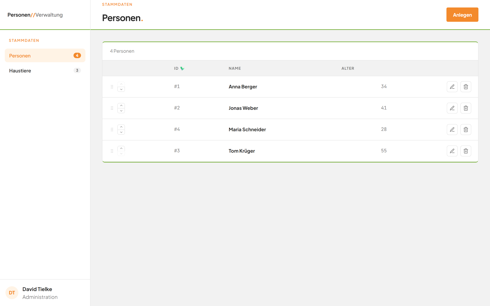
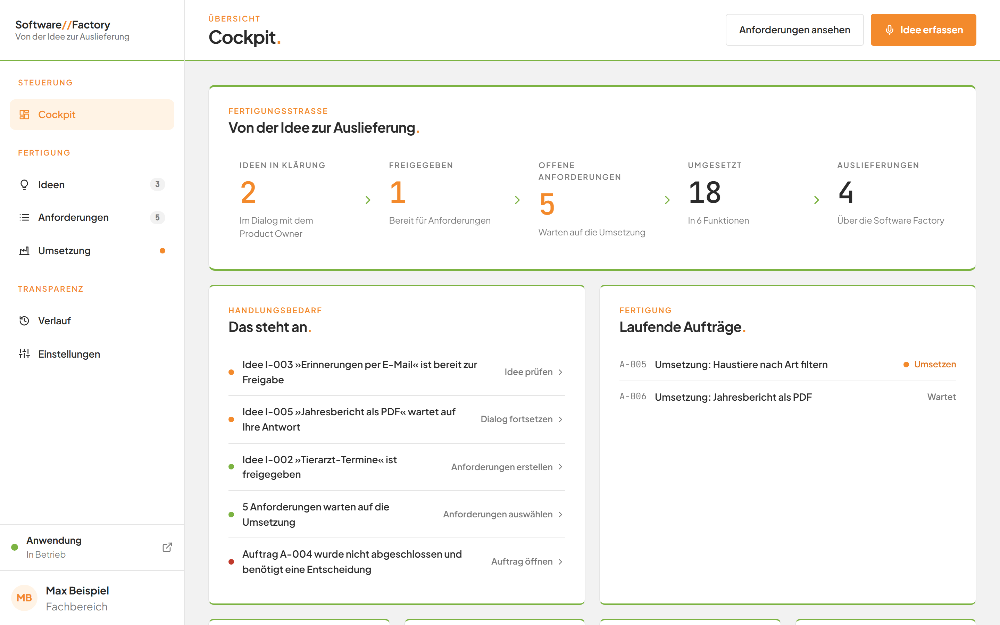
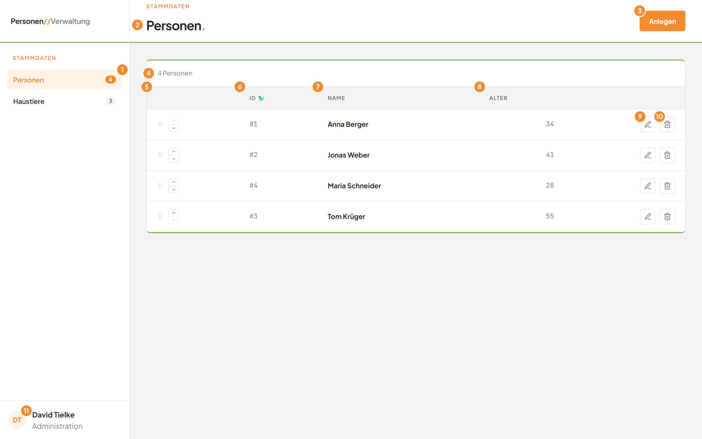
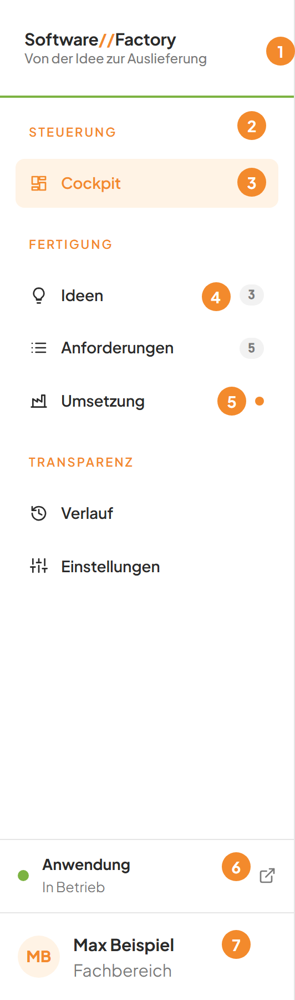

# Die Anwendung zum ersten Mal öffnen

## Worum geht es hier?

Diese Seite zeigt Ihnen, wie Sie die beiden Teile der Anwendung öffnen. Sie erklärt außerdem, wie der Bildschirm aufgebaut ist und welche Begriffe immer wiederkehren. Lesen Sie sie zuerst, wenn Sie die Anwendung noch nie gesehen haben.

## Wo finde ich das?

Die Anwendung besteht aus zwei Teilen. Jeder Teil hat eine eigene Adresse.

| Teil | Adresse | Wofür |
|---|---|---|
| Personen- und Haustierverwaltung | `http://localhost:3000` | Personen und Haustiere pflegen |
| Software Factory | `http://localhost:4000` | Ideen zu Anforderungen machen und umsetzen lassen |

Beide Adressen gelten für den Rechner, auf dem die Anwendung läuft. Auf einem anderen Rechner im Netz öffnen sie sich nicht.

1. Öffnen Sie Ihren Browser, zum Beispiel Chrome oder Edge.
2. Tippen Sie die Adresse in die Adresszeile ganz oben. Für die Verwaltung ist das `http://localhost:3000`.
3. Drücken Sie die Eingabetaste.
4. Die Seite **Personen** öffnet sich. Sie müssen sich nicht anmelden.

*Bild 1: Die Personenverwaltung nach dem Öffnen.*

Für die Software Factory tippen Sie stattdessen `http://localhost:4000` ein. Das Cockpit öffnet sich.

*Bild 2: Die Software Factory nach dem Öffnen.*

## Was Sie auf dem Bildschirm sehen

Beide Teile sehen ähnlich aus. Links steht eine Leiste mit der Navigation. Rechts davon steht der Inhalt der gewählten Seite.

*Bild 3: Die wichtigsten Bereiche der Personenverwaltung.*

| Nr. | Element | Bedeutung |
|---|---|---|
| 1 | Eintrag **Personen** in der linken Leiste | Zeigt die Personenliste. Orange hinterlegt heißt: Diese Seite ist geöffnet. |
| 2 | Titel der Seite | Nennt die Seite, auf der Sie sich befinden. |
| 3 | Schaltfläche **Anlegen** | Öffnet das Fenster zum Anlegen eines neuen Eintrags. |
| 11 | Name unten in der linken Leiste | Zeigt, wer angemeldet ist. |

Die übrigen Markierungen erklärt die Seite [Die Personenliste](E1-personen/02-personenliste.md).

In der Software Factory wählen Sie den Bereich ebenfalls links. Die Seite [Die Oberfläche kennenlernen](E3-software-factory/01-navigation.md) erklärt die Seitenleiste.

*Bild 4: Die Seitenleiste der Software Factory.*

## Schritt für Schritt: Zwischen den Seiten wechseln

1. Klicken Sie in der linken Leiste auf den gewünschten Eintrag, zum Beispiel **Haustiere**.
2. Der Eintrag wird orange hinterlegt. Rechts erscheint die gewählte Seite.
3. Klicken Sie auf einen anderen Eintrag, um die Seite erneut zu wechseln.

## Schritt für Schritt: Zwischen den beiden Teilen wechseln

1. Öffnen Sie in Ihrem Browser einen neuen Tab.
2. Tippen Sie die Adresse des anderen Teils ein, zum Beispiel `http://localhost:4000`.
3. Drücken Sie die Eingabetaste. Der andere Teil öffnet sich.
4. Wechseln Sie zwischen den beiden Tabs, wann immer Sie möchten.

## Grundbegriffe

| Begriff | Bedeutung |
|---|---|
| Person | Ein Mensch, den Sie in der Verwaltung führen. Er hat einen Namen und ein Alter. |
| Haustier | Ein Tier, das Sie in der Verwaltung führen. Es kann einer Person gehören. |
| Zuordnung | Die Verbindung zwischen einem Haustier und einer Person. Ein Tier gehört zu höchstens einer Person. |
| Software Factory | Der Teil, der aus Ihren Ideen neue Funktionen für die Anwendung macht. |
| Idee | Ein erster Wunsch an die Anwendung, in eigenen Worten beschrieben. |
| Product Owner | Die KI, mit der Sie eine Idee im Gespräch klären. |
| Anforderung | Eine genau beschriebene Änderung, die die Software Factory umsetzen kann. |
| Abnahmekriterium | Eine prüfbare Aussage, an der man erkennt, dass eine Anforderung erfüllt ist. |
| Auftrag | Eine Arbeit, die die Software Factory ausführt, zum Beispiel eine Umsetzung. |
| Umsetzung | Die Software Factory baut die gewünschte Änderung und liefert sie aus. |
| Auslieferung | Die fertige neue Version der Anwendung. |

## Gut zu wissen

- Sie müssen sich in keinem der beiden Teile anmelden.
- Die Verwaltung und die Software Factory laufen unabhängig voneinander. Ist der eine Teil aus, kann der andere trotzdem laufen.
- Die Software Factory lässt sich nur auf dem Rechner öffnen, auf dem sie läuft.
- Die Software Factory aktualisiert ihre Anzeigen von selbst. Sie müssen die Seite nicht neu laden.
- Schließen Sie ein Fenster mit **Abbrechen**, wird nichts gespeichert.

## Wenn etwas nicht klappt

| Das sehen Sie | Das bedeutet es | Das tun Sie |
|---|---|---|
| Der Browser meldet, die Seite sei nicht erreichbar | Der Teil läuft nicht, oder die Adresse ist falsch. | Prüfen Sie die Adresse. Bitten Sie sonst die Person, die die Anwendung betreut, den Teil zu starten. |
| **Der Factory-Dienst ist nicht erreichbar.** | Die Software Factory kann ihren Dienst auf diesem Rechner nicht erreichen. | Prüfen Sie, ob die Software Factory gestartet ist. Laden Sie die Seite danach neu. |
| Die Seite bleibt leer oder zeigt alte Zahlen | Die Seite hat sich nicht aktualisiert. | Laden Sie die Seite im Browser neu. |

Weitere Antworten finden Sie in den [häufigen Fragen](faq.md). Wählen Sie dann Ihr Modul auf der [Startseite](README.md).
