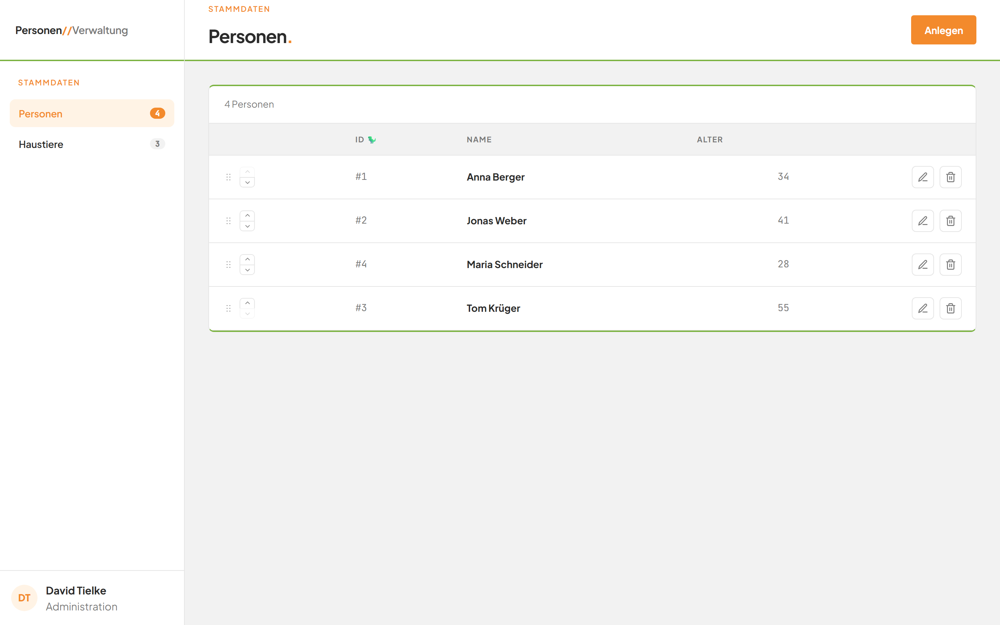
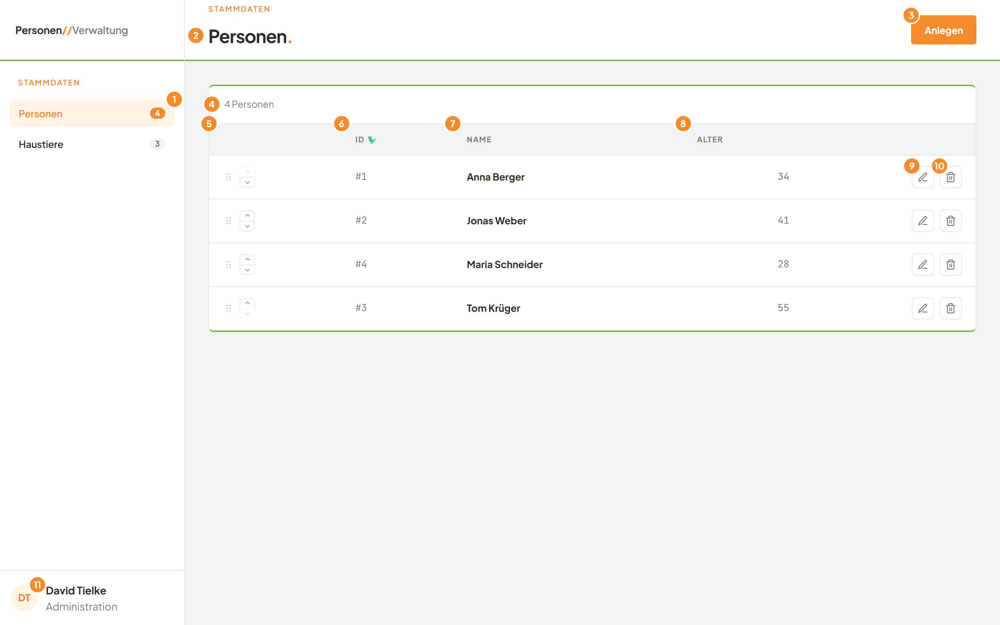

# Die Anwendung im Überblick

## Worum geht es hier?

Diese Seite erklärt den Aufbau des Bildschirms. Sie brauchen ihn, um sich zurechtzufinden. Er bleibt bei allen Arbeiten gleich: links die Leiste mit der Navigation, oben die Kopfzeile, darunter der Inhalt.

## Wo finde ich das?

1. Öffnen Sie die Anwendung in Ihrem Browser.
2. Die Seite **Personen** öffnet sich automatisch.

*Bild 1: Die Anwendung direkt nach dem Öffnen.*

## Was Sie auf dem Bildschirm sehen

*Bild 2: Die wichtigsten Bereiche des Bildschirms.*

| Nr. | Element | Bedeutung |
|---|---|---|
| 1 | Eintrag **Personen** in der linken Leiste | Zeigt die Personenliste. Orange hinterlegt bedeutet: Diese Seite ist gerade geöffnet. Die Zahl daneben nennt, wie viele Personen es gibt. |
| 2 | Titel **Personen.** mit dem Wort **Stammdaten** darüber | Nennt die Seite, auf der Sie sich befinden. |
| 3 | Schaltfläche **Anlegen** | Öffnet das Fenster zum Anlegen einer neuen Person. |
| 11 | Kürzel **DT** mit **David Tielke** und **Administration** | Zeigt, wer angemeldet ist. Die Angabe steht unten in der linken Leiste. |

Die übrigen Markierungen auf dem Bild erklärt die Seite [Die Personenliste](02-personenliste.md).

Oben links in der Leiste steht der Name der Anwendung: **Personen//Verwaltung**. Darunter steht die Gruppe **Stammdaten** mit den Einträgen **Personen** und **Haustiere**.

## Schritt für Schritt: Zwischen Personen und Haustieren wechseln

1. Klicken Sie in der linken Leiste unter **Stammdaten** auf **Haustiere**.
2. Der Eintrag **Haustiere** ist nun orange hinterlegt. Der Titel oben lautet **Haustiere.** Die Liste der Haustiere erscheint.
3. Klicken Sie in der linken Leiste auf **Personen**.
4. Die Personenliste erscheint wieder.

## Gut zu wissen

- Die Zahl am Eintrag **Personen** steigt, wenn Sie eine Person anlegen. Sie sinkt, wenn Sie eine Person löschen.
- Die Schaltfläche **Anlegen** gehört immer zur Seite, die gerade geöffnet ist. Auf der Seite **Personen** legt sie eine Person an.
- Wie Sie Haustiere verwalten, steht in der Anleitung zum Modul Haustiere.

## Wenn etwas nicht klappt

| Das sehen Sie | Das bedeutet es | Das tun Sie |
|---|---|---|
| Der Eintrag **Haustiere** ist orange, Sie wollten aber Personen sehen | Sie haben die Seite gewechselt. | Klicken Sie in der linken Leiste auf **Personen**. |
| Die Zahl am Eintrag zeigt noch keine Zahl | Die Anwendung lädt noch. | Warten Sie einen Moment. Laden Sie die Seite im Browser neu, wenn sich nichts ändert. |
