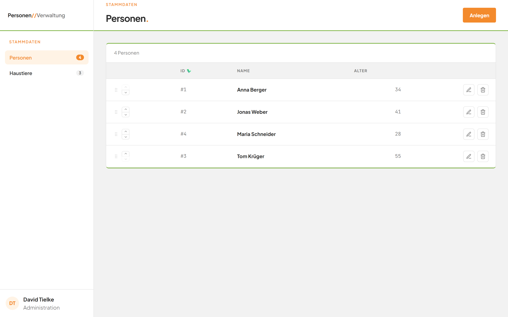
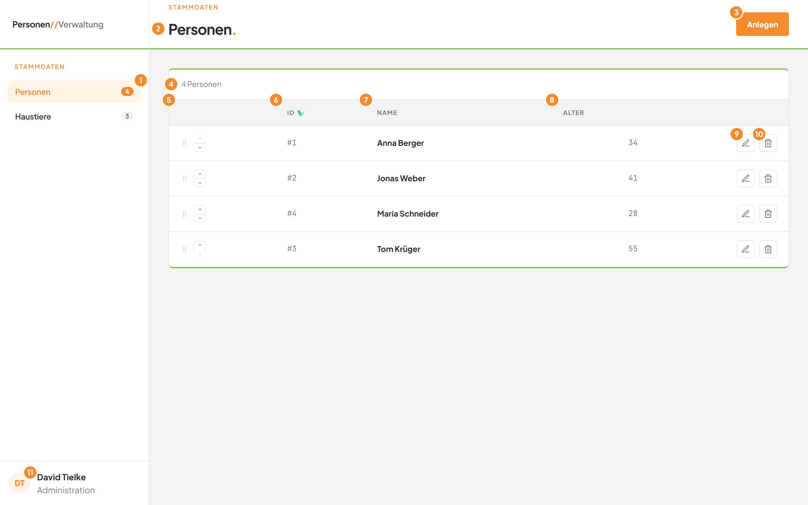
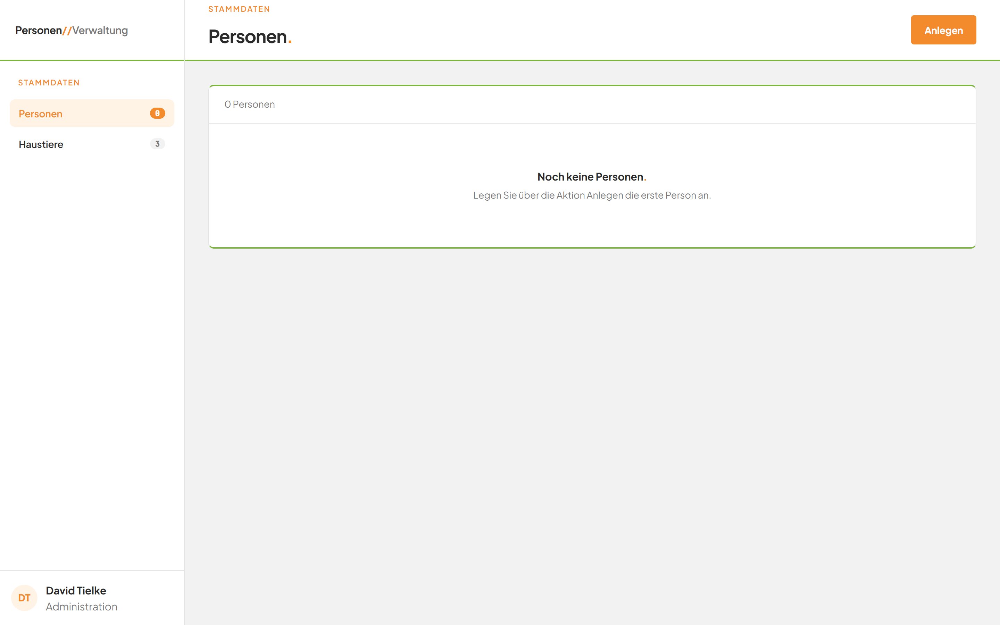
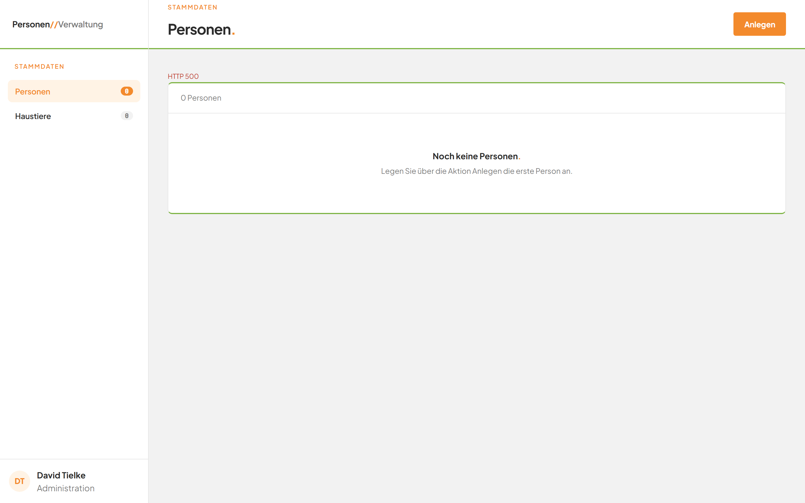

# Die Personenliste ansehen

## Worum geht es hier?

Die Personenliste zeigt alle Personen auf einen Blick. Sie ist Ihr Ausgangspunkt für alles Weitere: Von hier aus legen Sie Personen an, ändern, löschen und ordnen sie.

## Wo finde ich das?

1. Öffnen Sie die Anwendung in Ihrem Browser.
2. Die Personenliste erscheint sofort. Falls Sie auf der Seite **Haustiere** sind: Klicken Sie in der linken Leiste auf **Personen**.

*Bild 1: Die Personenliste.*

## Was Sie auf dem Bildschirm sehen

*Bild 2: Die Personenliste mit Markierungen.*

| Nr. | Element | Bedeutung |
|---|---|---|
| 1 | Eintrag **Personen** mit Zahl | Zeigt, dass Sie auf der Personenliste sind, und wie viele Personen es gibt. |
| 2 | Titel **Personen.** | Nennt die Seite. |
| 3 | Schaltfläche **Anlegen** | Öffnet das Fenster für eine neue Person. |
| 4 | Zähler über der Tabelle, zum Beispiel **4 Personen** | Nennt die Anzahl der Personen. Bei genau einer Person steht dort **1 Person**, bei keiner **0 Personen**. |
| 5 | Spalte ohne Überschrift (Reihenfolge) | Enthält pro Zeile den Griff zum Ziehen und zwei Pfeile. Damit ändern Sie die Reihenfolge. |
| 6 | Spalte **ID** | Zeigt die Nummer der Person, zum Beispiel **#1**. Die Nummer vergibt die Anwendung selbst. Neben der Überschrift steht ein kleines Dinosaurier-Symbol. |
| 7 | Spalte **Name** | Zeigt den Namen der Person. |
| 8 | Spalte **Alter** | Zeigt das Alter der Person in Jahren. |
| 9 | Stift-Schaltfläche | Öffnet das Fenster zum Bearbeiten dieser Person. |
| 10 | Mülleimer-Schaltfläche | Öffnet die Rückfrage zum Löschen dieser Person. |
| 11 | Kürzel **DT** | Zeigt den angemeldeten Benutzer. |

Die Personen erscheinen in der Reihenfolge, die Sie festgelegt haben. Wurde noch keine Reihenfolge festgelegt, sind sie nach Name geordnet.

## Schritt für Schritt: Eine Person in der Liste finden

1. Schauen Sie in der Spalte **Name** nach dem gesuchten Namen.
2. Lesen Sie in derselben Zeile die **ID** und das **Alter** ab.

## Schritt für Schritt: Mit leerer Liste umgehen

Gibt es keine Person, zeigt die Seite keine Tabelle.

*Bild 3: Die leere Personenliste.*

1. Lesen Sie den Titel **Noch keine Personen.** und den Hinweis darunter.
2. Klicken Sie oben rechts auf **Anlegen**.
3. Folgen Sie der Anleitung [Eine Person anlegen](03-person-anlegen.md).
4. Nach dem Speichern erscheint die Tabelle mit der neuen Person.

## Gut zu wissen

- Beim Laden der Seite steht über der Tabelle kurz **Wird geladen …**. Danach erscheint die Anzahl.
- Die Tabelle lässt sich nicht durchsuchen und nicht per Klick auf die Überschrift sortieren. Die Reihenfolge ändern Sie mit den Pfeilen oder durch Ziehen.
- Ein Fehler erscheint als rote Zeile oberhalb der Tabelle. Sie verschwindet, sobald die nächste Aktion gelingt.

## Wenn etwas nicht klappt

*Bild 4: Eine Fehlermeldung über der Tabelle.*

| Das sehen Sie | Das bedeutet es | Das tun Sie |
|---|---|---|
| Rote Zeile **HTTP 500** (oder eine andere Nummer) über der Tabelle | Die Anwendung konnte die Personen nicht laden. | Laden Sie die Seite im Browser neu. Bleibt die Meldung, wenden Sie sich an Ihre Administration. |
| Rote Zeile **Reihenfolge enthält doppelte oder fehlende Einträge.** | Die neue Reihenfolge wurde nicht übernommen. | Laden Sie die Seite neu und ändern Sie die Reihenfolge erneut. |
| **Noch keine Personen.** statt einer Tabelle | Es gibt noch keine Person. | Legen Sie die erste Person an. |

Weitere Hilfe: [Häufige Fragen zum Modul Personen](faq.md).
