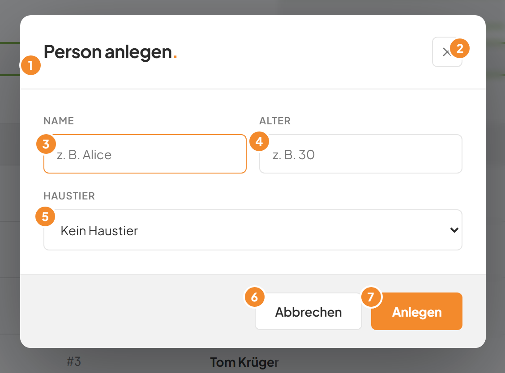
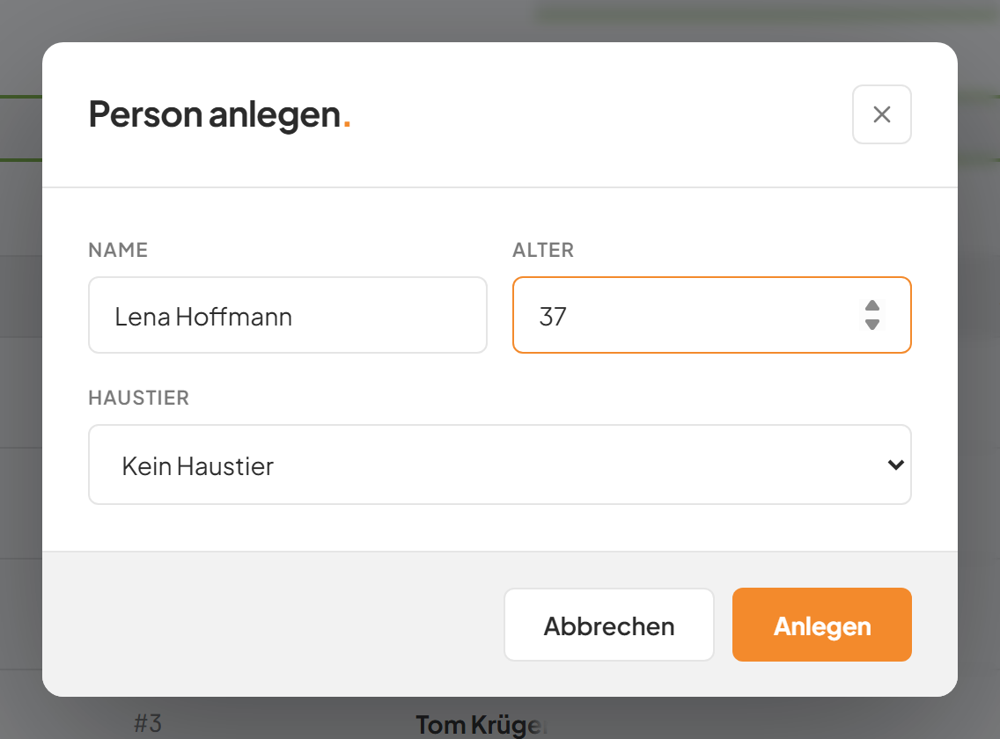
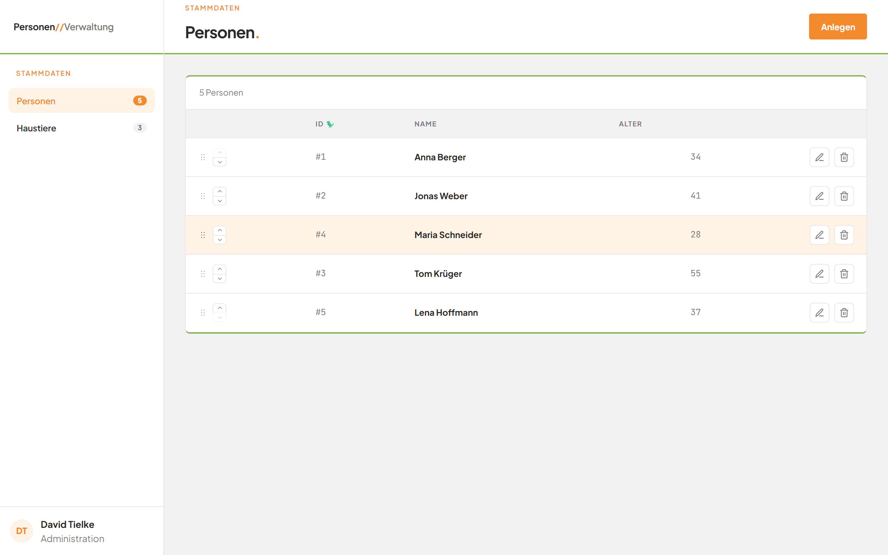
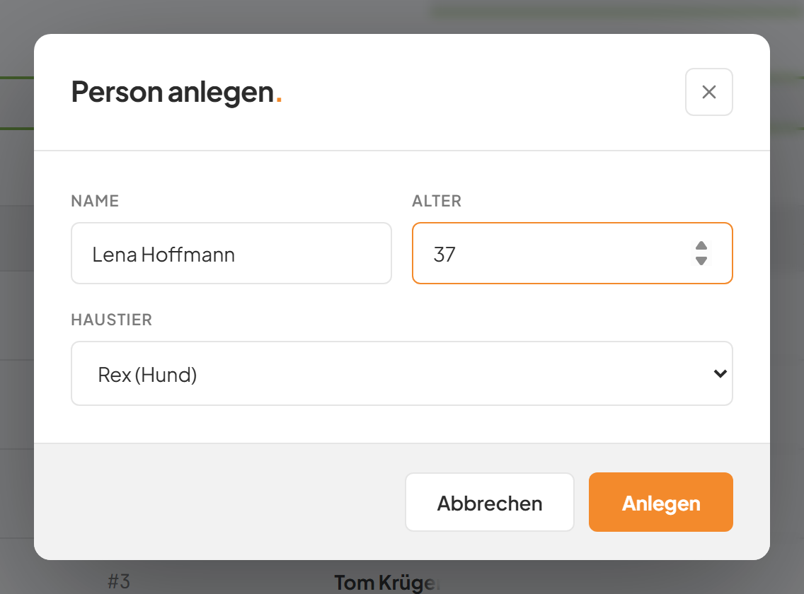
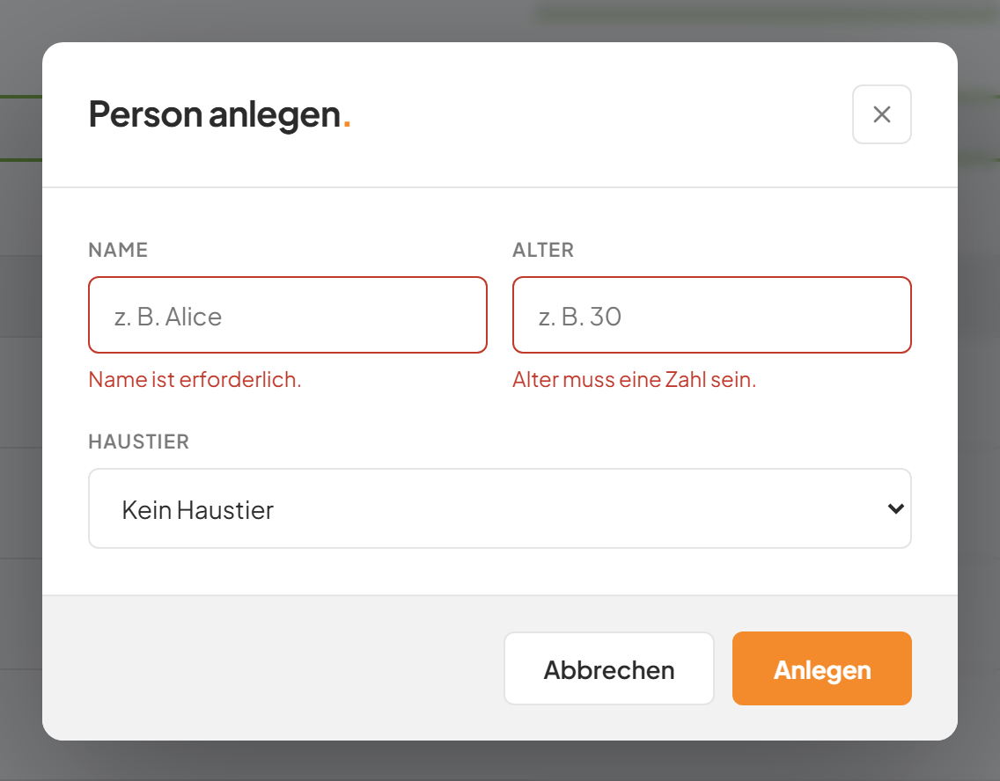

# Eine Person anlegen

## Worum geht es hier?

Hier tragen Sie eine neue Person ein. Dazu öffnet sich ein Fenster, das sich über die Seite legt. Dieses Fenster heißt Dialog. Sie geben Name und Alter ein und wählen auf Wunsch ein Haustier.

## Wo finde ich das?

1. Öffnen Sie die Anwendung. Die Seite **Personen** erscheint.
2. Klicken Sie oben rechts auf **Anlegen**.
3. Der Dialog **Person anlegen.** öffnet sich.

*Bild 1: Der Dialog zum Anlegen einer Person.*

## Was Sie auf dem Bildschirm sehen

| Nr. | Element | Bedeutung |
|---|---|---|
| 1 | Titel **Person anlegen.** | Zeigt, dass Sie eine neue Person eintragen. |
| 2 | Schließen-Schaltfläche (Kreuz) oben rechts | Schließt den Dialog, ohne etwas zu speichern. |
| 3 | Feld **Name** | Hier tragen Sie den Namen ein. Der graue Text **z. B. Alice** ist nur ein Beispiel. Erlaubt sind bis zu 150 Zeichen. |
| 4 | Feld **Alter** | Hier tragen Sie das Alter als Zahl von 0 bis 150 ein. Der graue Text **z. B. 30** ist nur ein Beispiel. |
| 5 | Auswahl **Haustier** | Optional. Zeigt zuerst **Kein Haustier**. Hier wählen Sie ein Haustier aus. |
| 6 | Schaltfläche **Abbrechen** | Schließt den Dialog, ohne zu speichern. |
| 7 | Schaltfläche **Anlegen** | Speichert die neue Person. |

Beim Öffnen steht der Cursor schon im Feld **Name**. Sie können sofort schreiben.

## Schritt für Schritt: Eine Person anlegen

1. Klicken Sie oben rechts auf **Anlegen**. Der Dialog öffnet sich.
2. Tippen Sie in das Feld **Name** den Namen, zum Beispiel **Lena Hoffmann**.
3. Klicken Sie in das Feld **Alter** und tippen Sie eine Zahl, zum Beispiel **37**.

*Bild 2: Der ausgefüllte Dialog.*

4. Klicken Sie unten rechts im Dialog auf **Anlegen**.
5. Während des Speicherns steht auf der Schaltfläche kurz **Wird gespeichert …**. Sie ist dann nicht klickbar.
6. Der Dialog schließt sich. Die neue Person steht in der Liste, und der Zähler zeigt eine Person mehr.

*Bild 3: Die Liste nach dem Anlegen. Die neue Person steht am Ende.*

## Schritt für Schritt: Beim Anlegen ein Haustier zuordnen

1. Öffnen Sie den Dialog mit **Anlegen** und tragen Sie Name und Alter ein.
2. Klicken Sie auf die Auswahl **Haustier**.
3. Klicken Sie auf ein Haustier, zum Beispiel **Rex (Hund)**. Die Einträge lauten Name und Tierart in Klammern.

*Bild 4: Das Haustier Rex ist ausgewählt.*

4. Klicken Sie auf **Anlegen**.
5. Die Person ist angelegt und dem Haustier zugeordnet.

Möchten Sie kein Haustier zuordnen, lassen Sie **Kein Haustier** stehen.

## Schritt für Schritt: Einen Fehler in der Eingabe beheben

1. Klicken Sie auf **Anlegen**, obwohl ein Feld fehlt oder falsch ist.
2. Der Dialog bleibt offen. Unter dem betroffenen Feld steht eine rote Meldung, und das Feld hat einen roten Rahmen.

*Bild 5: Der Dialog mit Fehlermeldungen unter den Feldern.*

3. Lesen Sie die Meldung und korrigieren Sie das Feld.
4. Klicken Sie erneut auf **Anlegen**.

## Gut zu wissen

- Leerzeichen vor und nach dem Namen werden automatisch entfernt.
- Haustiere, die schon einer anderen Person gehören, sind in der Auswahl grau und nicht wählbar. Ein Haustier gehört immer nur einer Person.
- Die neue Person erscheint am Ende der Liste. Wie Sie sie verschieben, steht unter [Die Reihenfolge ändern](06-reihenfolge-aendern.md).
- Zum Schließen ohne Speichern gibt es vier Wege: Klicken Sie auf **Abbrechen**, auf das Kreuz oben rechts oder auf den dunklen Bereich außerhalb des Dialogs. Oder drücken Sie die Taste Esc. Empfohlen ist **Abbrechen**.
- Ein Klick innerhalb des Dialogs schließt ihn nicht.

## Wenn etwas nicht klappt

| Das sehen Sie | Das bedeutet es | Das tun Sie |
|---|---|---|
| **Name ist erforderlich.** | Das Feld **Name** ist leer oder enthält nur Leerzeichen. | Tragen Sie einen Namen ein. |
| **Alter muss eine Zahl sein.** | Das Feld **Alter** ist leer oder enthält keine Zahl. | Tragen Sie eine Zahl ein, zum Beispiel **30**. |
| **Alter muss zwischen 0 und 150 liegen.** | Die Zahl ist zu klein oder zu groß. | Tragen Sie eine Zahl von 0 bis 150 ein. |
| **HTTP 400** unter den Feldern | Die Anwendung hat die Eingabe abgelehnt. Häufigster Grund: Das gewählte Haustier gehört inzwischen einer anderen Person. | Schließen Sie den Dialog, öffnen Sie ihn neu und wählen Sie ein freies Haustier oder **Kein Haustier**. |
| Andere Meldung unter den Feldern, zum Beispiel **HTTP 500** | Das Speichern ist aus einem anderen Grund fehlgeschlagen. | Klicken Sie nach einem Moment erneut auf **Anlegen**. Hilft das nicht, wenden Sie sich an Ihre Administration. |

Weitere Hilfe: [Häufige Fragen zum Modul Personen](faq.md).
