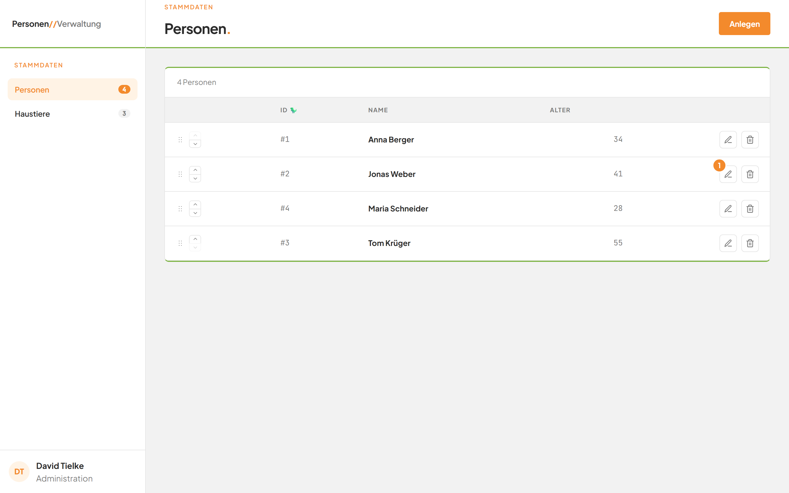
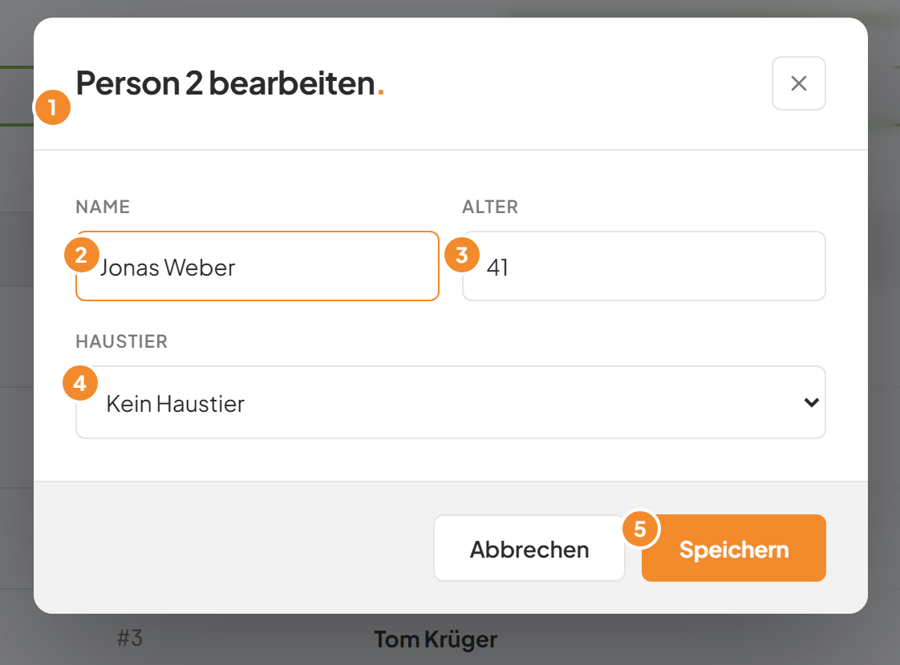
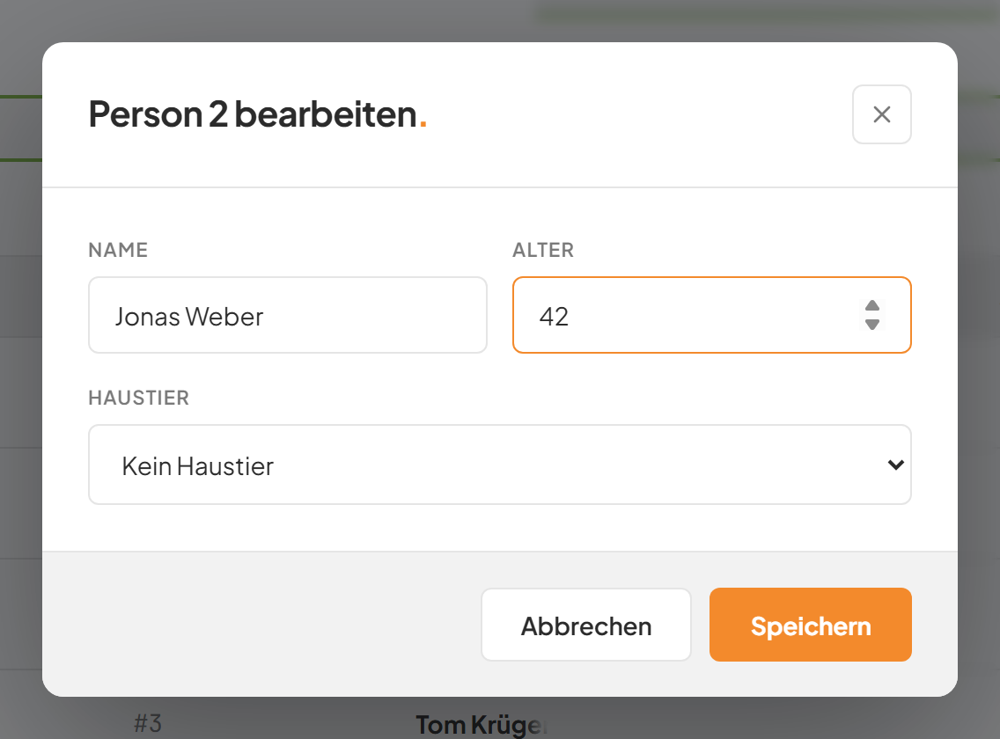
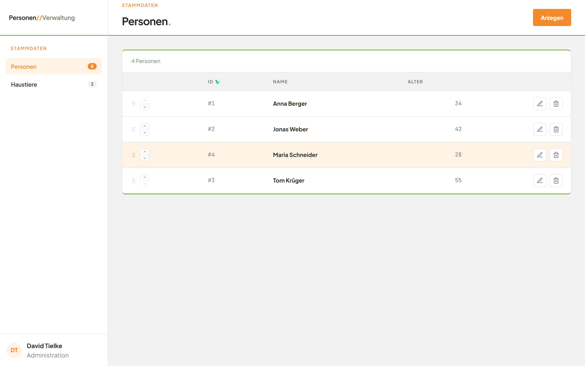

# Eine Person bearbeiten

## Worum geht es hier?

Hier ändern Sie Name, Alter oder Haustier einer vorhandenen Person. Sie brauchen das zum Beispiel bei einem Tippfehler oder wenn sich das Haustier ändert. Der Dialog sieht aus wie beim Anlegen, ist aber schon mit den aktuellen Angaben gefüllt.

## Wo finde ich das?

1. Öffnen Sie die Anwendung. Die Seite **Personen** erscheint.
2. Suchen Sie die Person in der Liste.
3. Klicken Sie am Ende ihrer Zeile auf die Stift-Schaltfläche.

*Bild 1: Die Stift-Schaltfläche am Ende der Zeile.*

## Was Sie auf dem Bildschirm sehen

*Bild 2: Der Dialog zum Bearbeiten.*

| Nr. | Element | Bedeutung |
|---|---|---|
| 1 | Titel, zum Beispiel **Person 2 bearbeiten.** | Nennt die Nummer der Person, die Sie ändern. |
| 2 | Feld **Name** | Zeigt den aktuellen Namen. |
| 3 | Feld **Alter** | Zeigt das aktuelle Alter. |
| 4 | Auswahl **Haustier** | Zeigt das zugeordnete Haustier. Hat die Person keines, steht dort **Kein Haustier**. |
| 5 | Schaltfläche **Speichern** | Übernimmt Ihre Änderungen. |

Unten links neben **Speichern** steht **Abbrechen**. Oben rechts steht das Kreuz zum Schließen.

## Schritt für Schritt: Name oder Alter ändern

1. Klicken Sie in der Zeile der Person auf die Stift-Schaltfläche. Der Dialog öffnet sich.
2. Ändern Sie das Feld **Name** oder das Feld **Alter**, zum Beispiel das Alter auf **42**.

*Bild 3: Der Dialog mit geänderter Eingabe.*

3. Klicken Sie unten rechts auf **Speichern**.
4. Während des Speicherns steht auf der Schaltfläche kurz **Wird gespeichert …**.
5. Der Dialog schließt sich. Die Liste zeigt die neuen Werte.

*Bild 4: Die Liste nach dem Speichern.*

## Schritt für Schritt: Das Haustier ändern oder entfernen

1. Öffnen Sie den Dialog über die Stift-Schaltfläche.
2. Klicken Sie auf die Auswahl **Haustier**.
3. Klicken Sie auf ein anderes Haustier. Oder klicken Sie auf **Kein Haustier**, um die Zuordnung aufzuheben.
4. Klicken Sie auf **Speichern**.
5. Die Zuordnung ist geändert. Das Haustier selbst bleibt in jedem Fall erhalten.

## Gut zu wissen

- Der Dialog prüft die Eingaben wie beim Anlegen. Die Regeln für **Name** und **Alter** stehen unter [Eine Person anlegen](03-person-anlegen.md).
- Das Haustier der Person selbst ist wählbar. Haustiere, die einer anderen Person gehören, sind grau und nicht wählbar.
- Mit **Abbrechen** schließen Sie den Dialog, ohne etwas zu ändern. Ebenso wirken das Kreuz oben rechts, die Taste Esc und ein Klick auf den dunklen Bereich außerhalb des Dialogs.
- Die ID einer Person, zum Beispiel **#2**, lässt sich nicht ändern.

## Wenn etwas nicht klappt

| Das sehen Sie | Das bedeutet es | Das tun Sie |
|---|---|---|
| **Name ist erforderlich.** | Das Feld **Name** ist leer. | Tragen Sie einen Namen ein. |
| **Alter muss eine Zahl sein.** | Das Feld **Alter** ist leer oder keine Zahl. | Tragen Sie eine Zahl ein. |
| **Alter muss zwischen 0 und 150 liegen.** | Die Zahl ist zu klein oder zu groß. | Tragen Sie eine Zahl von 0 bis 150 ein. |
| **Not Found** unter den Feldern | Die Person gibt es nicht mehr, zum Beispiel weil jemand sie gelöscht hat. | Schließen Sie den Dialog. Laden Sie die Seite neu und prüfen Sie die Liste. |
| **HTTP 400** unter den Feldern | Die Anwendung hat die Eingabe abgelehnt. Häufigster Grund: Das gewählte Haustier gehört inzwischen einer anderen Person. | Öffnen Sie den Dialog neu und wählen Sie ein freies Haustier oder **Kein Haustier**. |

Weitere Hilfe: [Häufige Fragen zum Modul Personen](faq.md).
