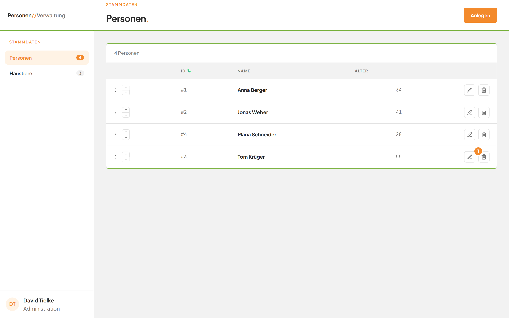
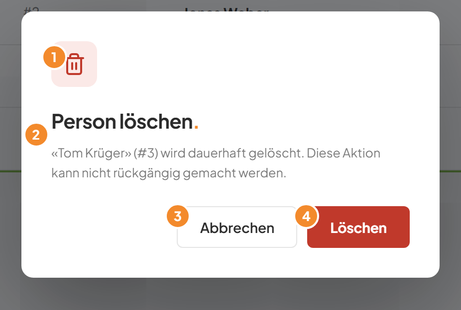
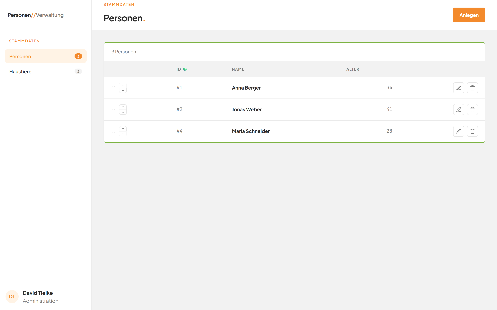

# Eine Person löschen

## Worum geht es hier?

Hier entfernen Sie eine Person dauerhaft aus dem Bestand. Zur Sicherheit fragt die Anwendung vorher nach. Ein Löschen lässt sich nicht rückgängig machen.

## Wo finde ich das?

1. Öffnen Sie die Anwendung. Die Seite **Personen** erscheint.
2. Suchen Sie die Person in der Liste.
3. Klicken Sie am Ende ihrer Zeile auf die Mülleimer-Schaltfläche. Sie steht rechts neben dem Stift.

*Bild 1: Die Mülleimer-Schaltfläche am Ende der Zeile.*

## Was Sie auf dem Bildschirm sehen

Es öffnet sich eine kleine Rückfrage.

*Bild 2: Die Rückfrage vor dem Löschen.*

| Nr. | Element | Bedeutung |
|---|---|---|
| 1 | Rotes Mülleimer-Symbol | Zeigt, dass es um ein Löschen geht. |
| 2 | Titel **Person löschen.** mit Text darunter | Nennt Name und Nummer der Person, zum Beispiel **«Tom Krüger» (#3)**, und warnt: Die Person wird dauerhaft gelöscht, die Aktion kann nicht rückgängig gemacht werden. |
| 3 | Schaltfläche **Abbrechen** | Schließt die Rückfrage. Nichts wird gelöscht. |
| 4 | Rote Schaltfläche **Löschen** | Löscht die Person endgültig. |

## Schritt für Schritt: Eine Person löschen

1. Klicken Sie in der Zeile der Person auf die Mülleimer-Schaltfläche. Die Rückfrage öffnet sich.
2. Prüfen Sie Name und Nummer im Text.
3. Klicken Sie auf die rote Schaltfläche **Löschen**.
4. Die Rückfrage schließt sich. Die Person ist aus der Liste verschwunden.

*Bild 3: Die Liste nach dem Löschen. Der Zähler zeigt eine Person weniger.*

## Schritt für Schritt: Das Löschen abbrechen

1. Öffnen Sie die Rückfrage wie oben.
2. Klicken Sie auf **Abbrechen**.
3. Die Rückfrage schließt sich. Die Person bleibt unverändert in der Liste.

## Gut zu wissen

- Das Löschen passiert erst, wenn Sie auf **Löschen** klicken. Das Öffnen der Rückfrage löscht nichts.
- Die Rückfrage schließt sich auch mit der Taste Esc und mit einem Klick auf den dunklen Bereich außerhalb. Beides löscht nichts. Empfohlen ist **Abbrechen**.
- Hatte die Person ein Haustier, bleibt das Haustier erhalten. Es gehört danach keiner Person mehr. Sie sehen das in der Liste der Haustiere.
- Der Zähler am Eintrag **Personen** in der linken Leiste sinkt um eins.

## Wenn etwas nicht klappt

| Das sehen Sie | Das bedeutet es | Das tun Sie |
|---|---|---|
| Rote Fehlerzeile über der Tabelle, zum Beispiel **HTTP 500** | Das Löschen ist fehlgeschlagen oder die Liste ließ sich nicht neu laden. | Laden Sie die Seite neu und prüfen Sie, ob die Person noch in der Liste steht. Wiederholen Sie das Löschen bei Bedarf. |
| Die Person ist versehentlich gelöscht | Ein Löschen lässt sich nicht rückgängig machen. | Legen Sie die Person neu an, siehe [Eine Person anlegen](03-person-anlegen.md). Sie erhält eine neue Nummer. |

Weitere Hilfe: [Häufige Fragen zum Modul Personen](faq.md).
