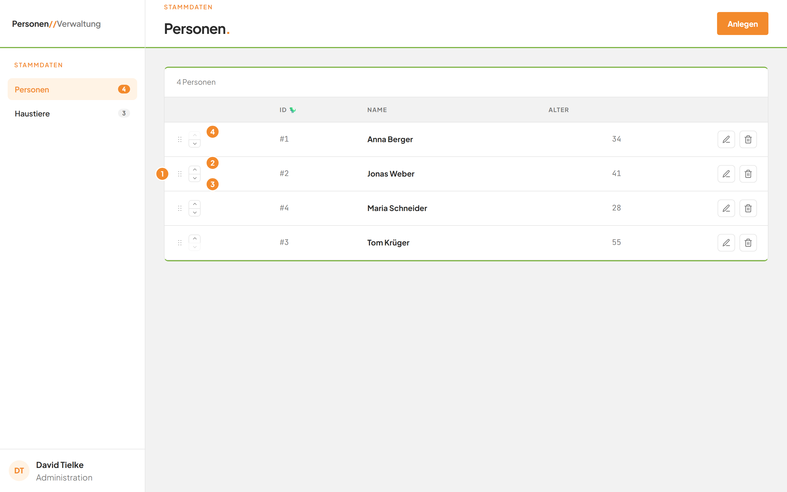
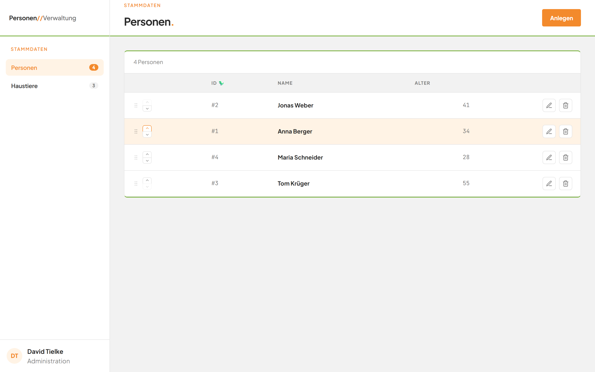

# Die Reihenfolge der Personen ändern

## Worum geht es hier?

Sie bestimmen selbst, in welcher Reihenfolge die Personen in der Liste stehen. Die Reihenfolge bleibt gespeichert. Sie ändern sie mit zwei Pfeilen pro Zeile oder durch Ziehen.

## Wo finde ich das?

1. Öffnen Sie die Anwendung. Die Seite **Personen** erscheint.
2. Schauen Sie in die erste Spalte der Tabelle. Sie hat keine Überschrift und steht ganz links.

*Bild 1: Die Bedienelemente der Reihenfolge in der ersten Spalte.*

## Was Sie auf dem Bildschirm sehen

| Nr. | Element | Bedeutung |
|---|---|---|
| 1 | Ziehgriff (sechs kleine Punkte) | Hier fassen Sie die Zeile an, um sie zu ziehen. |
| 2 | Pfeil nach oben | Schiebt die Person um eine Zeile nach oben. |
| 3 | Pfeil nach unten | Schiebt die Person um eine Zeile nach unten. |
| 4 | Ausgegrauter Pfeil | Bei der obersten Person ist der Pfeil nach oben ausgegraut. Bei der untersten ist der Pfeil nach unten ausgegraut. Dort geht es nicht weiter. |

## Schritt für Schritt: Mit den Pfeilen verschieben (empfohlen)

1. Suchen Sie die Person, die Sie verschieben möchten.
2. Klicken Sie in ihrer Zeile auf den Pfeil nach oben oder nach unten.
3. Die Person tauscht den Platz mit der Nachbarzeile. Die Zeilen gleiten kurz an ihre neue Stelle.
4. Die verschobene Zeile leuchtet kurz orange auf. So sehen Sie, wo sie jetzt steht.
5. Die neue Reihenfolge ist sofort gespeichert.

*Bild 2: Jonas Weber steht nach einem Klick auf den Pfeil nach oben an erster Stelle.*

Für mehrere Positionen klicken Sie mehrmals auf denselben Pfeil.

## Schritt für Schritt: Durch Ziehen verschieben

1. Zeigen Sie mit der Maus auf den Ziehgriff der Person.
2. Halten Sie die linke Maustaste gedrückt.
3. Ziehen Sie die Zeile an die gewünschte Stelle. Die anderen Zeilen weichen dabei aus. Hinter dem Mauszeiger fallen bunte Punkte herunter.
4. Lassen Sie die Maustaste los.
5. Die Zeile bleibt an der neuen Stelle, leuchtet kurz orange auf, und die Reihenfolge ist gespeichert.

Lassen Sie die Zeile an ihrer alten Stelle los, ändert sich nichts.

## Gut zu wissen

- Nur der Ziehgriff lässt sich ziehen. Ein Ziehen an Name oder Alter bewirkt nichts.
- Die Reihenfolge erscheint sofort. Gespeichert wird sie im Hintergrund.
- Neue Personen erscheinen am Ende der Liste.
- Wer die Anwendung ohne Maus bedient, nutzt die Pfeile.

## Wenn etwas nicht klappt

| Das sehen Sie | Das bedeutet es | Das tun Sie |
|---|---|---|
| Rote Zeile **Reihenfolge enthält doppelte oder fehlende Einträge.** über der Tabelle | Die Liste hat sich zwischenzeitlich verändert, zum Beispiel weil jemand eine Person gelöscht hat. Die Reihenfolge wurde nicht gespeichert. | Die Liste lädt sich neu und zeigt den gültigen Stand. Ändern Sie die Reihenfolge noch einmal. |
| Rote Zeile **Reihenfolge enthält unbekannte Personen.** über der Tabelle | Eine Person in Ihrer Ansicht gibt es nicht mehr. | Warten Sie, bis die Liste neu geladen ist, und versuchen Sie es erneut. |
| Rote Zeile **HTTP 400** oder **HTTP 500** über der Tabelle | Das Speichern der Reihenfolge ist fehlgeschlagen. | Die Liste zeigt wieder den gespeicherten Stand. Versuchen Sie es erneut oder laden Sie die Seite neu. |
| Ein Pfeil lässt sich nicht anklicken | Die Person steht schon ganz oben beziehungsweise ganz unten. | Nutzen Sie den anderen Pfeil. |

Weitere Hilfe: [Häufige Fragen zum Modul Personen](faq.md).
