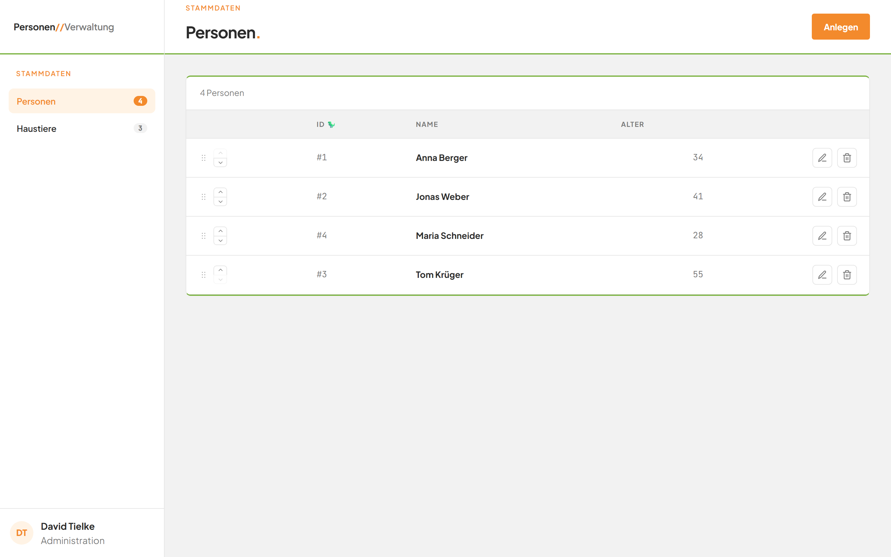

# Modul Personen

## Was kann dieses Modul?

Im Modul Personen verwalten Sie die Personen Ihres Bestands. Sie sehen alle Personen in einer Tabelle. Sie können neue Personen anlegen, ihre Angaben ändern und sie löschen. Sie bestimmen außerdem die Reihenfolge der Personen und ordnen jeder Person ein Haustier zu.

*Bild 1: Die Personenliste nach dem Öffnen der Anwendung.*

## Die Seiten dieses Moduls

Lesen Sie die Seiten in dieser Reihenfolge. So lernen Sie die Anwendung Schritt für Schritt kennen.

1. [Die Anwendung im Überblick](01-navigation.md) – die linke Leiste, die Kopfzeile und der Wechsel zwischen Personen und Haustieren.
2. [Die Personenliste](02-personenliste.md) – was die Tabelle zeigt und was Sie bei leerer Liste oder Fehlern sehen.
3. [Eine Person anlegen](03-person-anlegen.md) – eine neue Person eintragen, optional mit Haustier.
4. [Eine Person bearbeiten](04-person-bearbeiten.md) – Name, Alter und Haustier einer Person ändern.
5. [Eine Person löschen](05-person-loeschen.md) – eine Person nach Rückfrage dauerhaft entfernen.
6. [Die Reihenfolge ändern](06-reihenfolge-aendern.md) – Personen per Pfeil oder Ziehen anders anordnen.

## Häufige Fragen

Antworten auf typische Fragen und alle Fehlermeldungen finden Sie in den [häufigen Fragen zum Modul Personen](faq.md).
