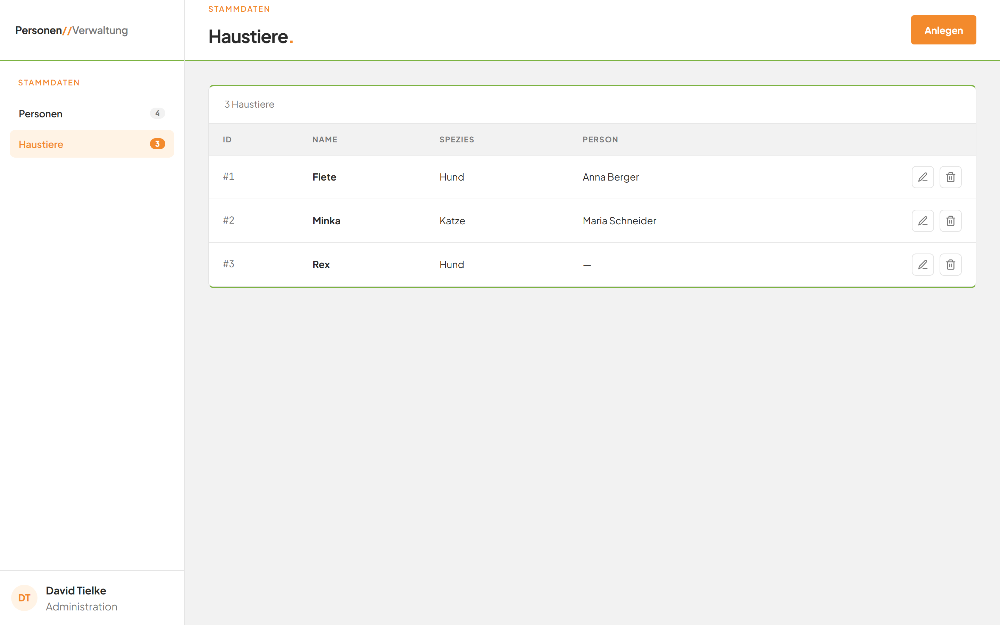
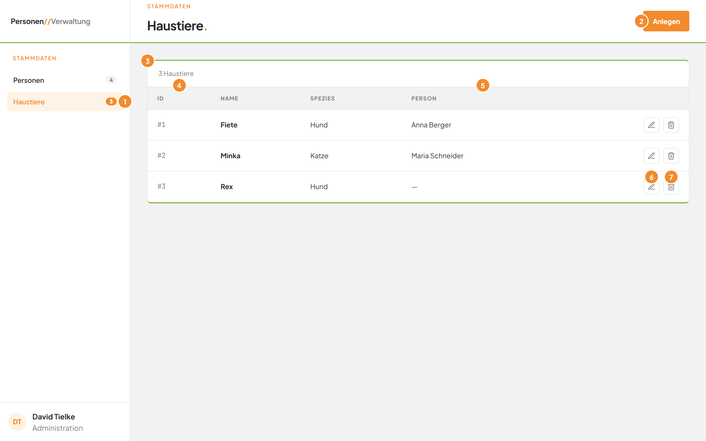
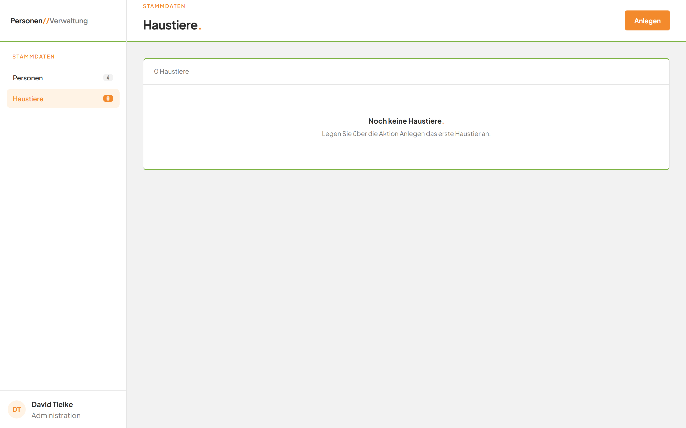
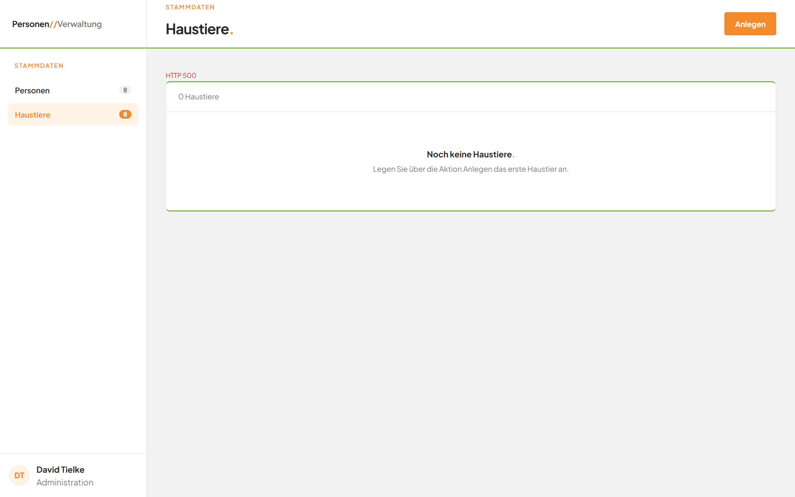

# Alle Haustiere ansehen

## Worum geht es hier?
Die Haustierliste zeigt alle gespeicherten Tiere in einer Tabelle. Sie sehen auf einen Blick, wie viele Tiere es gibt und zu welcher Person ein Tier gehört. Von hier aus legen Sie Tiere an, ändern sie oder löschen sie.

## Wo finde ich das?
1. Öffnen Sie die Anwendung im Browser.
2. Klicken Sie in der linken Leiste unter **Stammdaten** auf **Haustiere**.

Die Seite zeigt oben die Überschrift **Haustiere.** und darunter die Tabelle. Der Eintrag **Haustiere** in der linken Leiste ist orange hinterlegt.

*Bild 1: Die Haustierliste nach dem Öffnen.*

## Was Sie auf dem Bildschirm sehen

*Bild 2: Die Bereiche der Haustierliste.*

| Nr. | Element | Bedeutung |
|---|---|---|
| 1 | Eintrag **Haustiere** in der linken Leiste | Öffnet diese Seite. Die kleine Zahl daneben zeigt, wie viele Tiere es gibt. |
| 2 | Schaltfläche **Anlegen** oben rechts | Öffnet das Fenster zum Anlegen eines neuen Tiers. |
| 3 | Zähler über der Tabelle | Zeigt die Anzahl der Tiere, zum Beispiel „3 Haustiere". Beim Laden steht dort „Wird geladen …". |
| 4 | Spalte **ID** | Die laufende Nummer des Tiers, zum Beispiel „#1". |
| 5 | Spalte **Person** | Der Name der zugeordneten Person. Ohne Zuordnung steht dort „—". |
| 6 | Stift-Symbol am Zeilenende | Öffnet das Fenster zum Bearbeiten dieses Tiers. |
| 7 | Mülleimer-Symbol am Zeilenende | Öffnet die Rückfrage zum Löschen dieses Tiers. |

Die Spalten **Name** und **Spezies** zeigen den Namen und die Art des Tiers. Die Tiere stehen nach Name sortiert, von A bis Z.

## Schritt für Schritt: Ein Tier in der Liste finden
1. Klicken Sie in der linken Leiste auf **Haustiere**.
2. Lesen Sie in der Spalte **Name** nach dem gesuchten Tier. Die Liste ist alphabetisch geordnet.
3. Lesen Sie in derselben Zeile die **Spezies** und die **Person** ab.

Die Zeile zeigt alle Angaben zum Tier.

## Gut zu wissen
- Sind noch keine Tiere gespeichert, sehen Sie statt der Tabelle den Hinweis „Noch keine Haustiere." mit dem Text „Legen Sie über die Aktion Anlegen das erste Haustier an." Klicken Sie dann oben rechts auf **Anlegen**.
- Der Zähler zeigt bei genau einem Tier „1 Haustier".
- Zwei Tiere dürfen denselben Namen haben. Sie unterscheiden sich dann an der ID.

*Bild 3: So sieht die Seite aus, wenn noch kein Tier gespeichert ist.*

## Wenn etwas nicht klappt
| Das sehen Sie | Das bedeutet es | Das tun Sie |
|---|---|---|
| Eine rote Meldung über der Tabelle, zum Beispiel „HTTP 500" | Die Liste konnte nicht geladen werden. | Laden Sie die Seite im Browser neu. Bleibt die Meldung, wenden Sie sich an Ihre Administration. |
| „Wird geladen …" bleibt stehen | Die Anwendung wartet auf die Antwort. | Warten Sie einen Moment und laden Sie die Seite neu. |

*Bild 4: Eine Fehlermeldung steht in Rot über der Tabelle.*

Weitere Antworten finden Sie in den [häufigen Fragen](faq.md).
