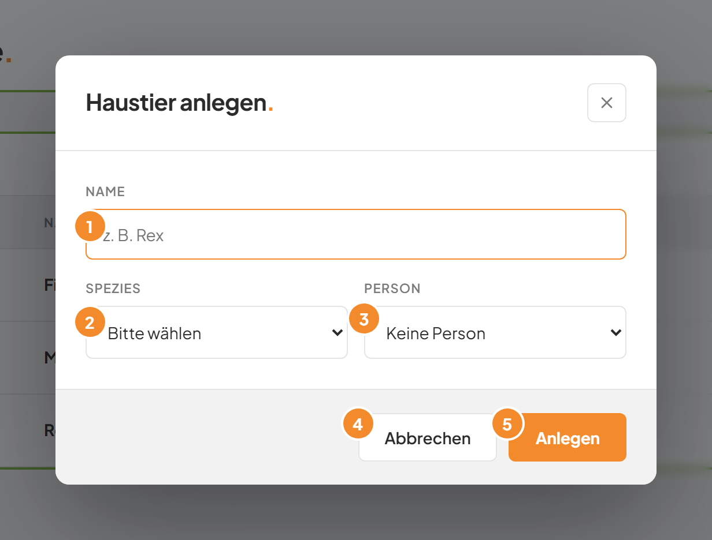
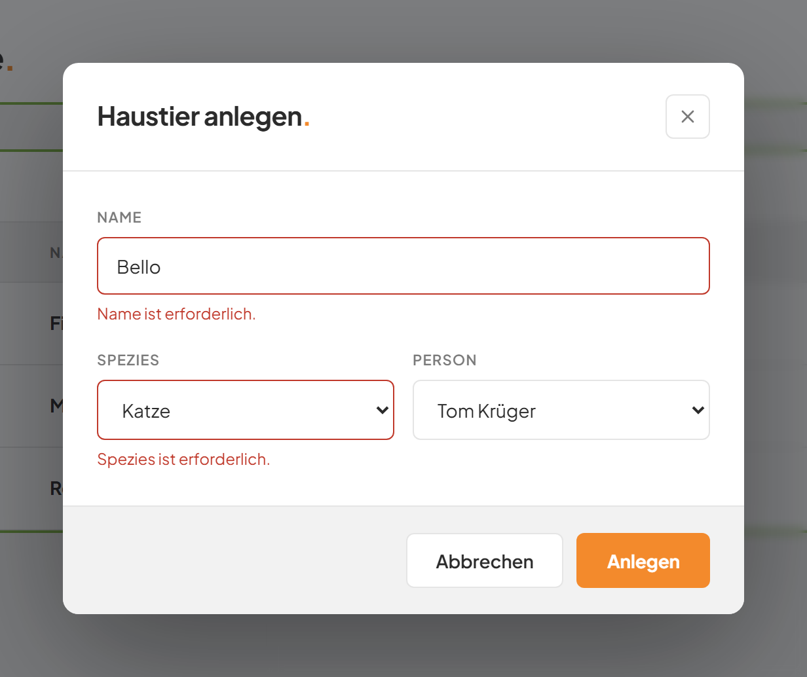
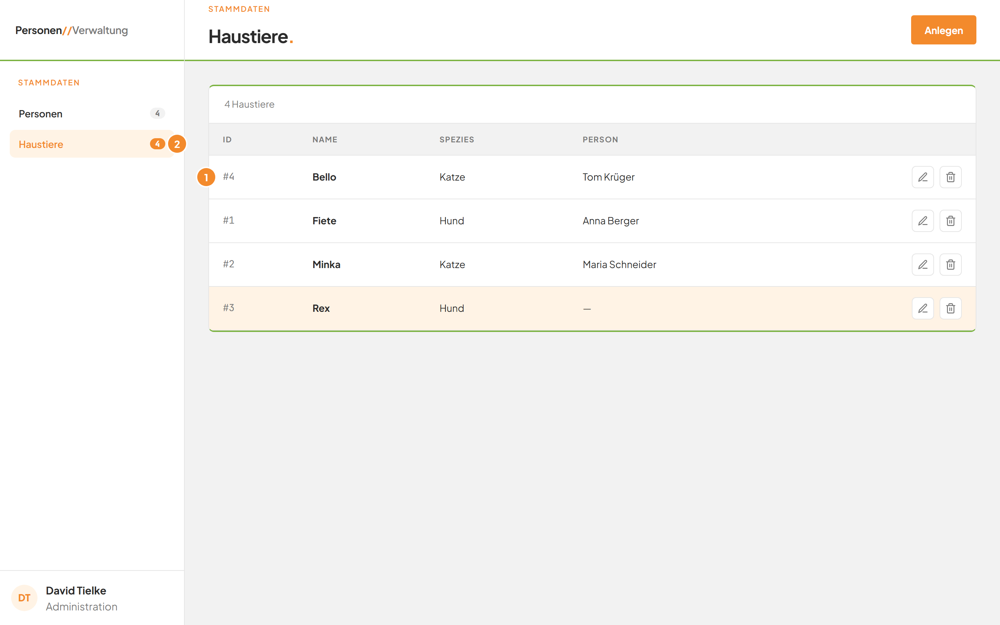
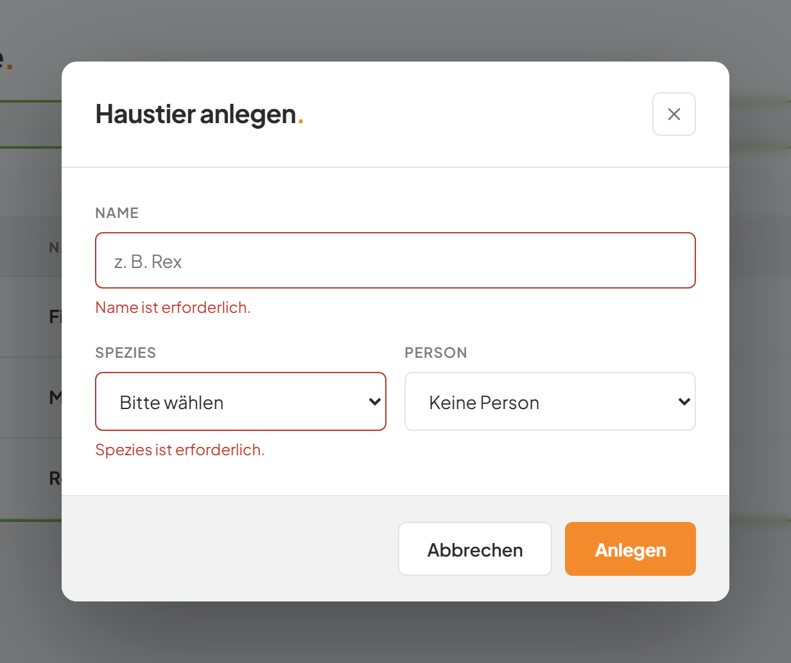

# Ein Haustier anlegen

## Worum geht es hier?
Hier erfassen Sie ein neues Tier. Sie geben einen Namen und die Art des Tiers an. Optional ordnen Sie das Tier gleich einer Person zu.

## Wo finde ich das?
1. Klicken Sie in der linken Leiste auf **Haustiere**.
2. Klicken Sie oben rechts auf **Anlegen**.

Ein Fenster mit dem Titel **Haustier anlegen.** öffnet sich.

*Bild 1: Das Fenster zum Anlegen eines Tiers.*

## Was Sie auf dem Bildschirm sehen
| Nr. | Element | Bedeutung |
|---|---|---|
| 1 | Feld **Name** | Der Name des Tiers. Pflichtfeld, bis zu 150 Zeichen. Der Cursor steht beim Öffnen schon hier. |
| 2 | Feld **Spezies** | Die Art des Tiers: Hund, Katze, Vogel oder Dinosaurier. Pflichtfeld. |
| 3 | Feld **Person** | Die Person, zu der das Tier gehört. Freiwillig. Voreingestellt ist **Keine Person**. |
| 4 | Schaltfläche **Abbrechen** | Schließt das Fenster, ohne zu speichern. |
| 5 | Schaltfläche **Anlegen** | Speichert das neue Tier. |

## Schritt für Schritt: Ein Haustier anlegen
1. Klicken Sie in das Feld **Name**, falls der Cursor nicht schon dort steht.
2. Tippen Sie den Namen ein, zum Beispiel „Bello".
3. Klicken Sie auf das Feld **Spezies** und wählen Sie eine Art, zum Beispiel „Katze".
4. Klicken Sie auf das Feld **Person**, wenn das Tier zu einer Person gehört, und wählen Sie die Person.
5. Klicken Sie unten rechts auf **Anlegen**.

*Bild 2: Das ausgefüllte Fenster vor dem Speichern.*

Das Fenster schließt sich. Das neue Tier steht in der Liste. Der Zähler und die Zahl neben **Haustiere** in der linken Leiste sind um eins größer.

*Bild 3: Das neue Tier erscheint in der Liste (1), die Zahl in der Leiste steigt (2).*

## Gut zu wissen
- Fehlt der Name oder die Spezies, speichert die Anwendung nicht. Unter dem Feld steht eine rote Meldung: „Name ist erforderlich." oder „Spezies ist erforderlich." Füllen Sie das Feld aus und klicken Sie erneut auf **Anlegen**.
- Leerzeichen am Anfang und am Ende des Namens werden entfernt.
- Personen, die schon ein Tier haben, sind in der Auswahl **Person** grau und nicht wählbar. Jede Person hat höchstens ein Tier. Mehr dazu im [Modul Personen](../E1-personen/README.md).
- Beim Speichern steht auf der Schaltfläche kurz „Wird gespeichert …". Klicken Sie in dieser Zeit nicht erneut.
- Sie können die Person später ändern, siehe [Haustier bearbeiten](03-haustier-bearbeiten.md).

*Bild 4: Meldungen bei leeren Pflichtfeldern.*

## Wenn etwas nicht klappt
| Das sehen Sie | Das bedeutet es | Das tun Sie |
|---|---|---|
| „Name ist erforderlich." | Das Feld **Name** ist leer. | Tippen Sie einen Namen ein. |
| „Spezies ist erforderlich." | Im Feld **Spezies** steht noch „Bitte wählen". | Wählen Sie eine Art aus. |
| Eine rote Meldung unter den Feldern, zum Beispiel „HTTP 400" | Die Anwendung konnte das Tier nicht speichern. Oft hat die gewählte Person inzwischen ein anderes Tier. | Wählen Sie eine andere Person oder **Keine Person**. Klicken Sie erneut auf **Anlegen**. |

Das Fenster bleibt bei einer Meldung offen. Ihre Eingaben bleiben erhalten. Weitere Antworten stehen in den [häufigen Fragen](faq.md).
