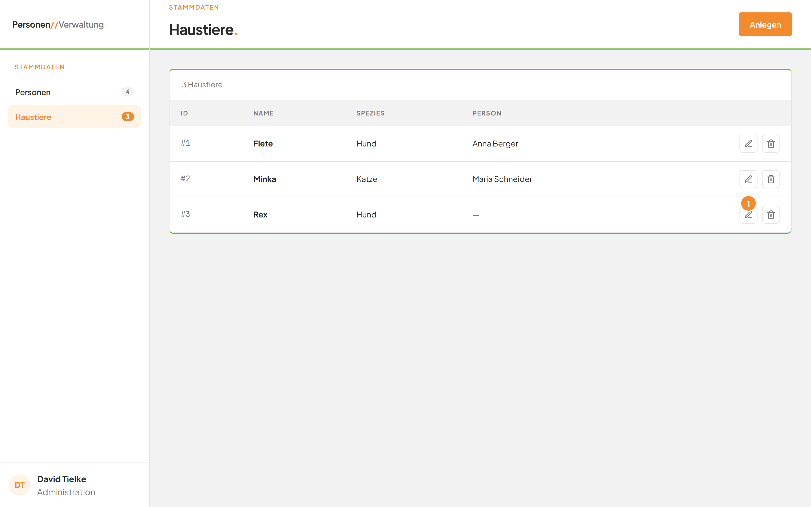
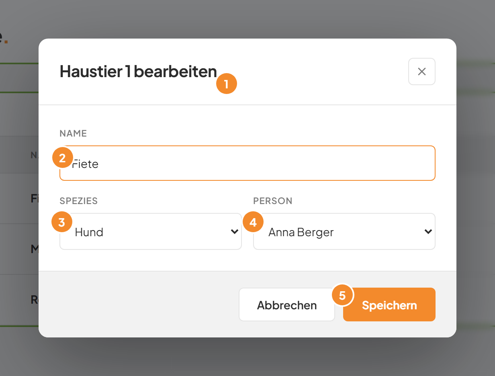
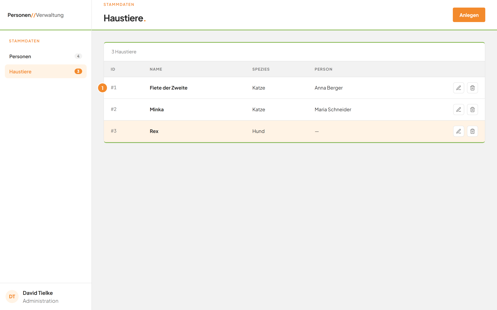

# Ein Haustier bearbeiten

## Worum geht es hier?
Hier ändern Sie die Angaben eines vorhandenen Tiers. Sie korrigieren den Namen, die Spezies oder die zugeordnete Person.

## Wo finde ich das?
1. Klicken Sie in der linken Leiste auf **Haustiere**.
2. Suchen Sie in der Liste die Zeile des Tiers.
3. Klicken Sie am Zeilenende auf das Stift-Symbol.

*Bild 1: Das Stift-Symbol (1) am Ende der Zeile öffnet das Fenster zum Bearbeiten.*

## Was Sie auf dem Bildschirm sehen
Das Fenster trägt den Titel **Haustier 1 bearbeiten.** Die Zahl ist die ID des Tiers. Alle Felder sind mit den aktuellen Angaben gefüllt.

*Bild 2: Das Bearbeiten-Fenster für das Tier mit der ID 1.*

| Nr. | Element | Bedeutung |
|---|---|---|
| 1 | Titel **Haustier 1 bearbeiten.** | Zeigt, welches Tier Sie ändern. |
| 2 | Feld **Name** | Der aktuelle Name. |
| 3 | Feld **Spezies** | Die aktuelle Art. |
| 4 | Feld **Person** | Die aktuell zugeordnete Person, oder **Keine Person**. |
| 5 | Schaltfläche **Speichern** | Übernimmt Ihre Änderungen. |

Unten im Fenster steht neben **Speichern** außerdem **Abbrechen**.

## Schritt für Schritt: Ein Haustier ändern
1. Klicken Sie in der Zeile des Tiers auf das Stift-Symbol.
2. Ändern Sie im Feld **Name**, im Feld **Spezies** oder im Feld **Person** die gewünschte Angabe.
3. Klicken Sie unten rechts auf **Speichern**.

Das Fenster schließt sich. Die Liste zeigt die neuen Angaben.

*Bild 3: Die geänderte Zeile (1) in der Liste.*

## Schritt für Schritt: Ein Tier einer Person zuordnen oder lösen
1. Öffnen Sie das Fenster zum Bearbeiten.
2. Klicken Sie auf das Feld **Person**.
3. Wählen Sie eine Person, um das Tier zuzuordnen. Wählen Sie **Keine Person**, um die Zuordnung zu lösen.
4. Klicken Sie auf **Speichern**.

In der Spalte **Person** steht der neue Name oder „—".

## Gut zu wissen
- Für **Name** und **Spezies** gelten dieselben Regeln wie beim [Anlegen](02-haustier-anlegen.md): Beide sind Pflicht.
- Die Person, die dem Tier jetzt zugeordnet ist, bleibt wählbar. Personen mit einem anderen Tier sind grau.
- Mit **Abbrechen** schließen Sie das Fenster, ohne etwas zu ändern.
- Die Zuordnung können Sie auch in der Personenverwaltung ändern, siehe [Modul Personen](../E1-personen/README.md).
- Während des Speicherns steht auf der Schaltfläche „Wird gespeichert …".

## Wenn etwas nicht klappt
| Das sehen Sie | Das bedeutet es | Das tun Sie |
|---|---|---|
| „Name ist erforderlich." | Das Feld **Name** ist leer. | Tippen Sie einen Namen ein. |
| „Spezies ist erforderlich." | Es ist keine Art gewählt. | Wählen Sie eine Art aus. |
| „HTTP 400" unter den Feldern | Die Person hat inzwischen ein anderes Tier. | Wählen Sie eine andere Person oder **Keine Person**. |
| „Not Found" unter den Feldern | Das Tier wurde inzwischen gelöscht. | Klicken Sie auf **Abbrechen**. Prüfen Sie die Liste. |

Weitere Antworten stehen in den [häufigen Fragen](faq.md).
