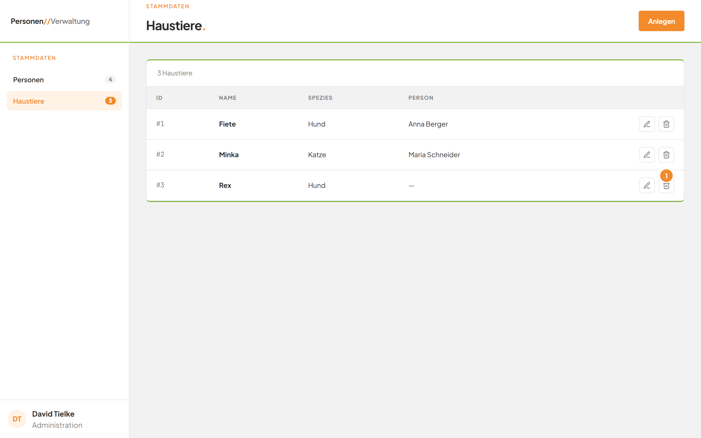
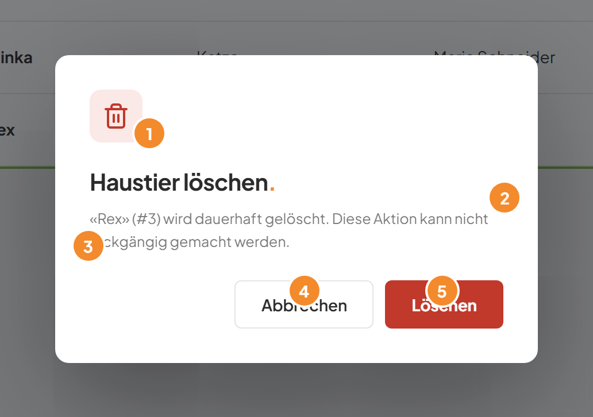
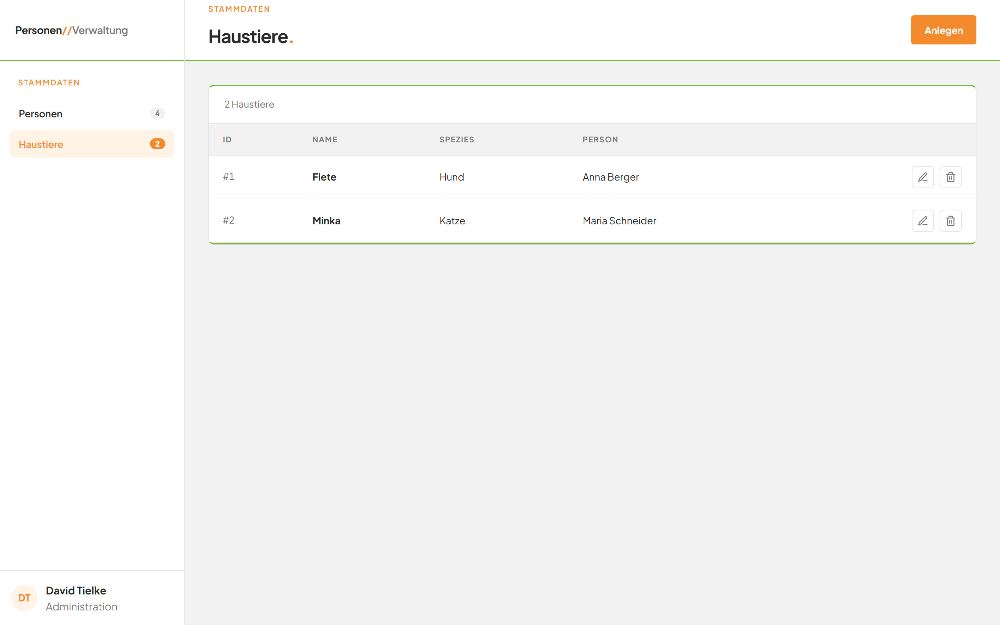

# Ein Haustier löschen

## Worum geht es hier?
Hier entfernen Sie ein Tier dauerhaft aus der Liste. Vor dem Löschen fragt die Anwendung noch einmal nach. Eine zugeordnete Person bleibt erhalten.

## Wo finde ich das?
1. Klicken Sie in der linken Leiste auf **Haustiere**.
2. Suchen Sie in der Liste die Zeile des Tiers.
3. Klicken Sie am Zeilenende auf das Mülleimer-Symbol.

*Bild 1: Das Mülleimer-Symbol (1) öffnet die Rückfrage.*

## Was Sie auf dem Bildschirm sehen

*Bild 2: Die Rückfrage vor dem Löschen.*

| Nr. | Element | Bedeutung |
|---|---|---|
| 1 | Rotes Mülleimer-Symbol | Weist darauf hin, dass etwas gelöscht wird. |
| 2 | Titel **Haustier löschen.** | Zeigt den Zweck des Fensters. |
| 3 | Hinweistext | Nennt Name und ID des Tiers, zum Beispiel „«Rex» (#3) wird dauerhaft gelöscht. Diese Aktion kann nicht rückgängig gemacht werden." |
| 4 | Schaltfläche **Abbrechen** | Schließt die Rückfrage, das Tier bleibt erhalten. |
| 5 | Rote Schaltfläche **Löschen** | Löscht das Tier endgültig. |

## Schritt für Schritt: Ein Haustier löschen
1. Klicken Sie in der Zeile des Tiers auf das Mülleimer-Symbol.
2. Prüfen Sie im Hinweistext, ob Name und ID zum richtigen Tier gehören.
3. Klicken Sie auf die rote Schaltfläche **Löschen**.

Die Rückfrage schließt sich. Das Tier steht nicht mehr in der Liste. Der Zähler und die Zahl neben **Haustiere** sind um eins kleiner.

*Bild 3: Die Liste nach dem Löschen.*

## Gut zu wissen
- Das Löschen lässt sich nicht rückgängig machen. Sie müssten das Tier neu [anlegen](02-haustier-anlegen.md).
- Gehörte das Tier zu einer Person, bleibt die Person in der Personenliste erhalten. Sie hat danach kein Tier mehr und kann ein neues bekommen. Siehe [Modul Personen](../E1-personen/README.md).
- Erst der Klick auf **Löschen** entfernt das Tier. Mit **Abbrechen** passiert nichts.

## Wenn etwas nicht klappt
| Das sehen Sie | Das bedeutet es | Das tun Sie |
|---|---|---|
| Eine rote Meldung über der Tabelle, zum Beispiel „Not Found" | Das Tier wurde inzwischen schon gelöscht. | Laden Sie die Seite neu. Das Tier ist dann nicht mehr in der Liste. |
| Eine rote Meldung wie „HTTP 500" | Das Löschen ist fehlgeschlagen. | Versuchen Sie es erneut. Bleibt die Meldung, wenden Sie sich an Ihre Administration. |

Weitere Antworten stehen in den [häufigen Fragen](faq.md).
