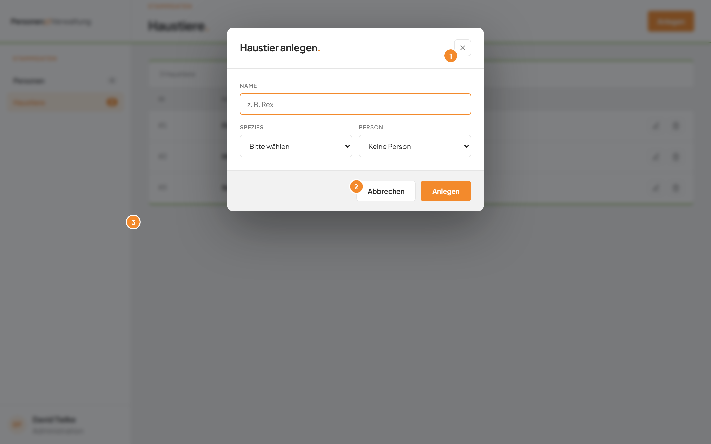

# Ein Fenster schließen, ohne zu speichern

## Worum geht es hier?
Sie haben ein Fenster geöffnet, möchten aber nichts ändern. Das gilt für das Anlegen, das Bearbeiten und die Rückfrage zum Löschen. Hier lesen Sie, wie Sie das Fenster verlassen, ohne dass etwas geschieht.

## Wo finde ich das?
1. Klicken Sie in der linken Leiste auf **Haustiere**.
2. Klicken Sie oben rechts auf **Anlegen**.

Das Fenster **Haustier anlegen.** öffnet sich. Alle anderen Fenster des Moduls schließen Sie auf dieselbe Weise.

## Was Sie auf dem Bildschirm sehen

*Bild 1: Die Wege, ein Fenster zu schließen.*

| Nr. | Element | Bedeutung |
|---|---|---|
| 1 | Kreuz oben rechts im Fenster | Schließt das Fenster. |
| 2 | Schaltfläche **Abbrechen** | Schließt das Fenster. |
| 3 | Abgedunkelter Bereich außerhalb des Fensters | Ein Klick darauf schließt das Fenster. |

## Schritt für Schritt: Ein Fenster schließen
1. Klicken Sie unten im Fenster auf **Abbrechen**.

Das Fenster verschwindet. Die Haustierliste bleibt unverändert.

## Gut zu wissen
- Die Taste Esc auf Ihrer Tastatur schließt das Fenster ebenfalls.
- Ein Klick in das Fenster selbst schließt es nicht.
- Beim Schließen gehen Ihre Eingaben verloren. Es wird nichts gespeichert.
- Ein Klick auf den Hintergrund kann versehentlich passieren. Haben Sie viel eingetippt, klicken Sie darum vorsichtig.

## Wenn etwas nicht klappt
| Das sehen Sie | Das bedeutet es | Das tun Sie |
|---|---|---|
| Das Fenster bleibt trotz Klick auf den Hintergrund offen | Sie haben in das Fenster selbst geklickt. | Klicken Sie auf **Abbrechen**. |
| Die Taste Esc bewirkt nichts | Der Browser ist gerade nicht im Vordergrund. | Klicken Sie auf **Abbrechen**. |

Weitere Antworten stehen in den [häufigen Fragen](faq.md).
