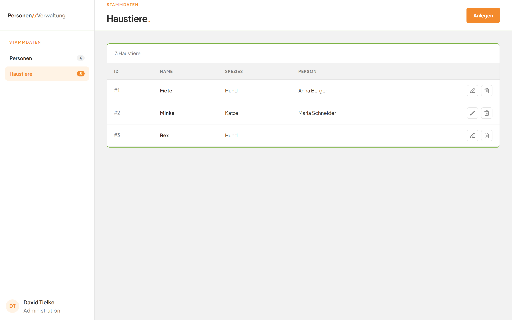

# Modul Haustiere

## Was kann dieses Modul?
Im Modul **Haustiere** verwalten Sie alle Tiere an einem Ort. Sie sehen eine Liste aller Tiere. Sie legen neue Tiere an, ändern Angaben und löschen Tiere, die Sie nicht mehr brauchen. Jedes Tier kann einer Person zugeordnet werden. Jedes Tier gehört zu höchstens einer Person, und jede Person hat höchstens ein Tier. Mehr zu den Personen steht im [Modul Personen](../E1-personen/README.md).

*Bild 1: Die Haustierliste nach dem Öffnen.*

## Die Seiten dieses Moduls
1. [Haustierliste](01-haustierliste.md): Alle Tiere ansehen und die Bedeutung der Spalten verstehen.
2. [Haustier anlegen](02-haustier-anlegen.md): Ein neues Tier erfassen.
3. [Haustier bearbeiten](03-haustier-bearbeiten.md): Name, Spezies oder Person eines Tiers ändern.
4. [Haustier löschen](04-haustier-loeschen.md): Ein Tier dauerhaft entfernen.
5. [Dialoge schließen](05-dialoge-schliessen.md): Ein geöffnetes Fenster ohne Speichern verlassen.

Antworten auf häufige Fragen und alle Fehlermeldungen finden Sie in den [häufigen Fragen zu Haustieren](faq.md).
