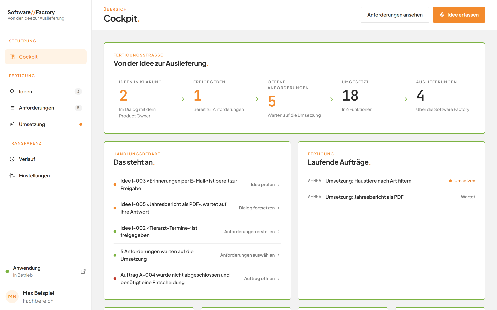
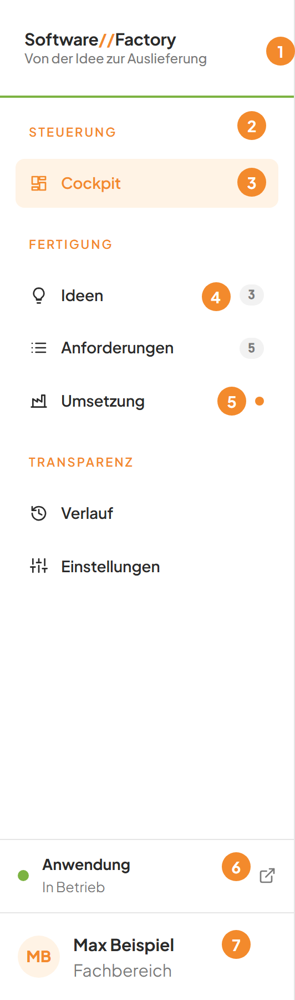
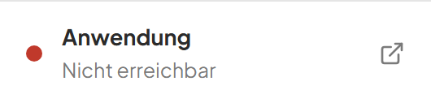

# Die Oberfläche kennenlernen und zwischen den Bereichen wechseln

## Worum geht es hier?
Die Software Factory begleitet eine Idee von der ersten Skizze bis zur Auslieferung. Diese Seite erklärt die feste Seitenleiste links. Sie zeigt immer, wo Sie sind, und führt Sie in jeden Bereich. Außerdem sehen Sie dort, ob Ihre Anwendung läuft und wo Arbeit auf Sie wartet.

## Wo finde ich das?
1. Öffnen Sie die Software Factory im Browser.
2. Die Seitenleiste steht auf jeder Seite links. Sie verschwindet nie.

*Bild 1: Die Software Factory nach dem Öffnen. Links die Seitenleiste, rechts das Cockpit.*

Der Browser-Tab trägt den Titel **Software Factory**.

## Was Sie auf dem Bildschirm sehen

*Bild 2: Die Seitenleiste mit Markierungen.*

| Nr. | Element | Bedeutung |
|---|---|---|
| 1 | **Software//Factory** mit dem Zusatz **Von der Idee zur Auslieferung** | Die Marke. Ein Klick darauf öffnet immer das Cockpit. |
| 2 | Gruppenüberschriften **Steuerung**, **Fertigung**, **Transparenz** | Sie ordnen die Einträge darunter. |
| 3 | Orange hinterlegter Eintrag | Der Bereich, in dem Sie gerade sind. Hier ist es **Cockpit**. |
| 4 | Graue Zahl hinter **Ideen** oder **Anforderungen** | Wie viele Einträge noch Ihre Aufmerksamkeit brauchen. |
| 5 | Orangener Punkt hinter **Umsetzung** | Mindestens ein Auftrag wartet oder läuft gerade. |
| 6 | **Anwendung** mit dem Zustand **In Betrieb** oder **Nicht erreichbar** | Zeigt, ob Ihre ausgelieferte Anwendung antwortet. Ein Klick öffnet sie in einem neuen Tab. |
| 7 | Ihr Name mit der Rolle **Fachbereich** | Der angemeldete Anwender mit Kürzel. |

Die Einträge im Überblick:

| Gruppe | Eintrag | Wofür |
|---|---|---|
| **Steuerung** | **Cockpit** | Überblick über alles. Siehe [Das Cockpit](02-cockpit.md). |
| **Fertigung** | **Ideen** | Ideen sammeln und klären. Siehe [Die Ideen-Tafel](03-ideen-tafel.md). |
| **Fertigung** | **Anforderungen** | Anforderungen lesen und bearbeiten. Siehe [Anforderungen](07-anforderungen.md). |
| **Fertigung** | **Umsetzung** | Aufträge und Auslieferungen. Siehe [Umsetzung](10-umsetzung.md). |
| **Transparenz** | **Verlauf** | Alle Ereignisse der Reihe nach. Siehe [Verlauf](11-verlauf.md). |
| **Transparenz** | **Einstellungen** | Systemzustand, KI-Qualität, Sprache. Siehe [Einstellungen](12-einstellungen.md). |

## Schritt für Schritt: Den Bereich wechseln
1. Klicken Sie in der linken Seitenleiste auf den gewünschten Eintrag, zum Beispiel **Ideen**.
2. Der Eintrag wird orange hinterlegt. Rechts erscheint der gewählte Bereich.
3. Um zurück zum Überblick zu kommen, klicken Sie oben links auf **Software//Factory**.

Im Anforderungs-Assistenten bleibt der Eintrag **Anforderungen** orange hinterlegt. Das gehört zusammen. Siehe [Der Anforderungs-Assistent](08-anforderungs-assistent.md).

## Schritt für Schritt: Den Zustand Ihrer Anwendung prüfen
1. Sehen Sie in der Seitenleiste unter der Navigation auf den Bereich **Anwendung**.
2. Steht dort **In Betrieb** mit grünem Punkt, antwortet Ihre Anwendung.
3. Steht dort **Nicht erreichbar**, antwortet sie nicht.

*Bild 3: Der Statusbereich, wenn die Anwendung nicht antwortet.*

4. Klicken Sie auf den Bereich **Anwendung**. Ihre Anwendung öffnet sich in einem neuen Browser-Tab.

## Gut zu wissen
- Eine Zahl, die 0 wäre, wird nicht angezeigt. Fehlt die Zahl, gibt es dort nichts zu tun.
- Hinter **Umsetzung** steht nie eine Zahl, nur der orange Punkt.
- Die Zahl hinter **Anforderungen** zählt nur Anforderungen der Fachanwendung. Die Anforderungen der Software Factory selbst zählen nicht mit.
- Der Zustand der Anwendung wird beim Öffnen und danach alle 30 Sekunden geprüft. Ein Warten von mehr als 3 Sekunden gilt als nicht erreichbar.
- Ihr Name stammt aus der Einstellung der Versionsverwaltung auf diesem Rechner. Ist dort kein Name hinterlegt, steht **Fachbereich** an dieser Stelle. Das Kürzel besteht aus den Anfangsbuchstaben der ersten beiden Namensteile.
- Die Software Factory aktualisiert sich selbst. Zahlen, Punkte und Listen ändern sich, sobald sich etwas ändert, auch wenn eine Änderung außerhalb der Software Factory geschieht. Sie müssen die Seite nicht neu laden.
- Öffnen Sie eine unbekannte Adresse, zeigt die Software Factory das Cockpit. Dann ist in der Seitenleiste kein Eintrag orange hinterlegt.

## Wenn etwas nicht klappt
| Das sehen Sie | Das bedeutet es | Das tun Sie |
|---|---|---|
| **Der Factory-Dienst ist nicht erreichbar.** | Die Software Factory kann ihren Hintergrunddienst auf diesem Rechner nicht erreichen. | Prüfen Sie, ob die Software Factory noch gestartet ist. Laden Sie die Seite danach neu. |
| **Die Anfrage ist fehlgeschlagen.** | Der Dienst hat geantwortet, aber keinen Grund genannt. | Versuchen Sie es noch einmal. Bleibt es dabei, prüfen Sie den [Systemzustand](12-einstellungen.md). |
| **Nicht erreichbar** unter **Anwendung** | Ihre ausgelieferte Anwendung antwortet nicht. | Prüfen Sie unter **Einstellungen**, ob Docker Desktop gestartet ist. |
| Zahlen oder Listen wirken veraltet | Die Verbindung für die Aktualisierung ist unterbrochen. Die zuletzt geladenen Daten bleiben sichtbar. | Laden Sie die Seite im Browser neu. |

Weitere Antworten finden Sie in den [häufigen Fragen](faq.md).
