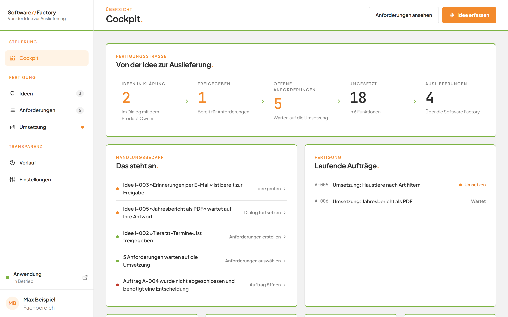
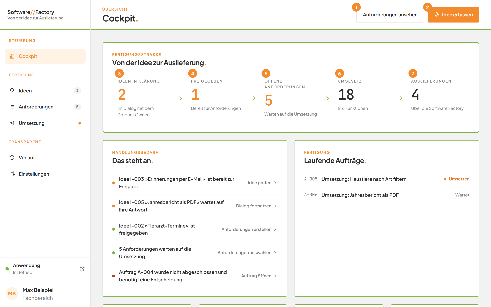
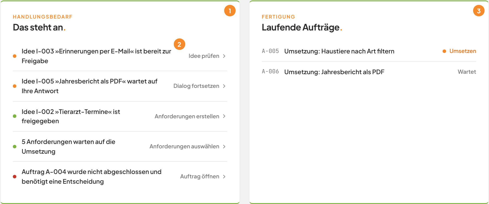
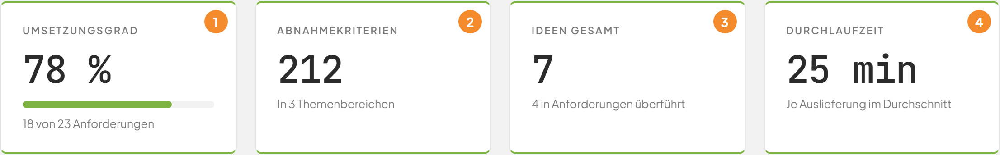
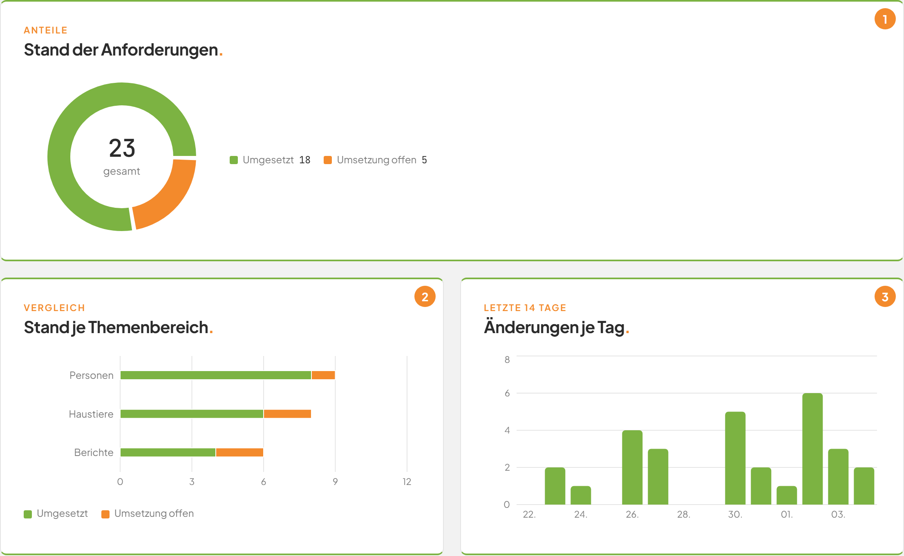
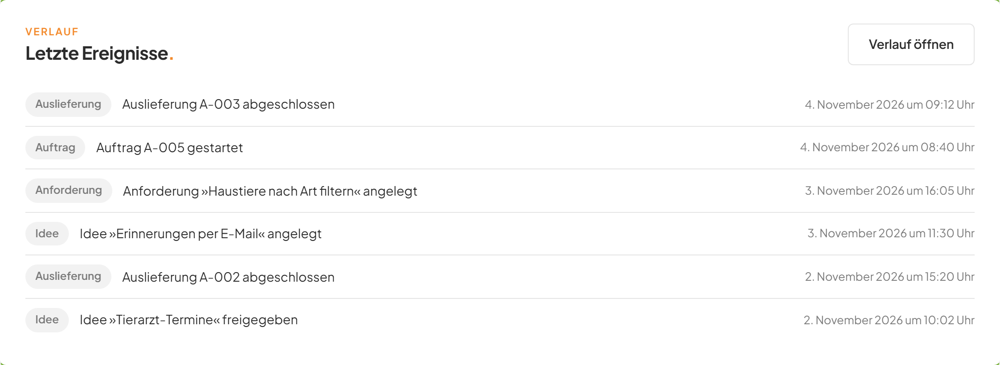
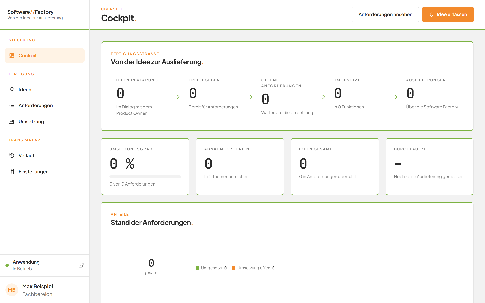
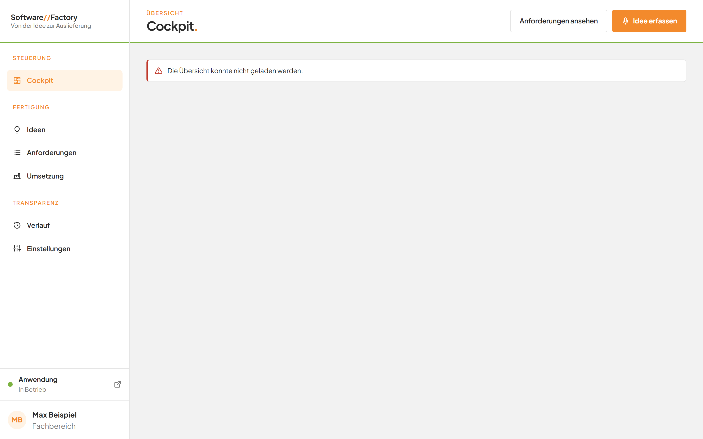

# Den Stand der Fertigung im Cockpit prüfen

## Worum geht es hier?
Das Cockpit ist die Startseite der Software Factory. Es zeigt auf einen Blick, wie viele Ideen und Anforderungen auf welcher Stufe stehen. Außerdem zeigt es, was gerade Ihre Entscheidung braucht, welche Aufträge laufen und was zuletzt passiert ist. Sie brauchen es, wenn Sie wissen wollen, wo es als Nächstes weitergeht.

## Wo finde ich das?
1. Öffnen Sie die Software Factory im Browser. Das Cockpit erscheint sofort.
2. Von jeder anderen Seite kommen Sie zurück, indem Sie in der linken Leiste auf **Cockpit** klicken. Auch ein Klick auf **Software//Factory** oben links führt hierher.

*Bild 1: Das Cockpit nach dem Öffnen. Weiter unten folgen Kennzahlen, Diagramme und Ereignisse.*

Alle Zahlen in diesem Handbuch sind Beispielwerte. Ihre Anzeige weicht davon ab.

## Was Sie auf dem Bildschirm sehen
Oben stehen der Titel und zwei Schaltflächen, darunter die Fertigungsstraße.

*Bild 2: Kopfbereich und Fertigungsstraße.*

| Nr. | Element | Bedeutung |
|---|---|---|
| 1 | **Anforderungen ansehen** | Öffnet die Liste aller [Anforderungen](07-anforderungen.md). |
| 2 | **Idee erfassen** (orange) | Öffnet die [Ideen-Tafel](03-ideen-tafel.md) mit dem Dialog zum Erfassen einer neuen Idee. |
| 3 | **Ideen in Klärung** | Ideen, die noch im Gespräch geklärt werden. Darunter steht **Im Dialog mit dem Product Owner**. Ein Klick öffnet die Ideen. |
| 4 | **Freigegeben** | Ideen, die Sie freigegeben haben. Darunter steht **Bereit für Anforderungen**. Ein Klick öffnet die Ideen. |
| 5 | **Offene Anforderungen** | Anforderungen, die noch nicht umgesetzt sind. Ein Klick zeigt genau diese Anforderungen. |
| 6 | **Umgesetzt** | Fertig umgesetzte Anforderungen. Darunter steht, in wie vielen Funktionen. Ein Klick zeigt genau diese Anforderungen. |
| 7 | **Auslieferungen** | Wie oft die Software Factory Änderungen ausgeliefert hat. Ein Klick öffnet die [Umsetzung](10-umsetzung.md). |

Ein Pfeil zwischen den Stationen zeigt die Richtung: von der Idee zur Auslieferung. Die ersten drei Stationen sind orange hervorgehoben, sobald ihre Zahl größer als 0 ist. Dann wartet dort Arbeit.

Der Bereich **Handlungsbedarf** und **Laufende Aufträge** erscheint nur, wenn es etwas anzuzeigen gibt.

*Bild 3: Handlungsbedarf und laufende Aufträge.*

| Nr. | Element | Bedeutung |
|---|---|---|
| 1 | Karte **Das steht an.** | Die nächsten Schritte, die Ihre Entscheidung brauchen. Höchstens 6 Einträge. |
| 2 | Hinweis am rechten Rand eines Eintrags | Der Link zur passenden Stelle, zum Beispiel **Idee prüfen**. |
| 3 | Karte **Laufende Aufträge.** | Aufträge, die warten oder gerade laufen. |

Die Punkte vor den Einträgen haben eine Bedeutung:

| Farbe | Bedeutung | Mögliche Hinweise |
|---|---|---|
| Orange | Die Software Factory wartet auf Sie. | **Idee prüfen**, **Dialog fortsetzen**, **Gespräch fortsetzen** |
| Grün | Der nächste Schritt ist möglich. | **Anforderungen erstellen**, **Anforderungen auswählen** |
| Rot | Ein Auftrag braucht eine Entscheidung. | **Auftrag öffnen** |

Darunter folgen vier Kennzahlen.

*Bild 4: Die vier Kennzahlen.*

| Nr. | Element | Bedeutung |
|---|---|---|
| 1 | **Umsetzungsgrad** | Anteil der umgesetzten Anforderungen in Prozent, mit Balken. Darunter steht, wie viele von wie vielen Anforderungen umgesetzt sind. |
| 2 | **Abnahmekriterien** | Die Summe aller Abnahmekriterien. Das sind die Prüfpunkte, an denen eine Anforderung gemessen wird. Darunter steht, in wie vielen Themenbereichen. |
| 3 | **Ideen gesamt** | Alle Ideen, die geklärt, freigegeben oder übernommen wurden. Darunter steht, wie viele davon in Anforderungen überführt sind. |
| 4 | **Durchlaufzeit** | Die durchschnittliche Dauer einer Auslieferung, als Sekunden, Minuten oder Stunden. Ohne Auslieferung steht dort „–“. |

Danach folgen drei Diagramme.

*Bild 5: Die drei Diagramme.*

| Nr. | Element | Bedeutung |
|---|---|---|
| 1 | **Stand der Anforderungen.** | Ring mit den Anteilen **Umgesetzt** und **Umsetzung offen**. In der Mitte steht die Gesamtzahl. Die Legende nennt die Anzahlen. |
| 2 | **Stand je Themenbereich.** | Pro Themenbereich ein waagerechter Balken aus **Umgesetzt** und **Umsetzung offen**. |
| 3 | **Änderungen je Tag.** | Säulen für die letzten 14 Tage bis heute. Die Achse nennt jeden zweiten Tag. |

Ganz unten stehen die letzten Ereignisse.

*Bild 6: Die letzten Ereignisse mit Marke, Text und Zeitpunkt.*

Jede Zeile zeigt vorn eine Marke (**Idee**, **Anforderung**, **Auftrag**, **Auslieferung** oder **Ereignis**), dann den Text und rechts Datum und Uhrzeit mit dem Zusatz „Uhr“.

## Schritt für Schritt: Sich einen Überblick verschaffen
1. Öffnen Sie das Cockpit.
2. Lesen Sie die Fertigungsstraße von links nach rechts. Orange Stationen zeigen, wo Arbeit wartet.
3. Gehen Sie zur Karte **Das steht an.** und lesen Sie den obersten Eintrag.
4. Klicken Sie auf den Eintrag. Sie landen direkt an der Stelle, an der es weitergeht.

## Schritt für Schritt: Eine Station öffnen
1. Klicken Sie in der Fertigungsstraße auf die Station, zum Beispiel **Offene Anforderungen**.
2. Die Liste erscheint bereits gefiltert. Hier sehen Sie nur die Anforderungen, die noch auf ihre Umsetzung warten.

## Schritt für Schritt: Dem Fortschritt eines Auftrags folgen
1. Suchen Sie die Karte **Laufende Aufträge.**
2. Lesen Sie in der Zeile die Nummer, die Art (**Umsetzung**, **Überführung** oder **Rücknahme**) und den Titel.
3. Rechts steht die aktive Phase. Läuft der Auftrag noch ohne Phase, steht dort **Läuft**. Wartet er, steht dort **Wartet**.
4. Klicken Sie auf die Zeile. Der Auftrag öffnet sich. Siehe [Umsetzung](10-umsetzung.md).

## Schritt für Schritt: Eine neue Idee festhalten
1. Klicken Sie oben rechts auf **Idee erfassen**.
2. Die Ideen-Tafel öffnet sich mit dem Dialog zum Erfassen. Weiter geht es unter [Die Ideen-Tafel](03-ideen-tafel.md).

## Schritt für Schritt: Alle Ereignisse ansehen
1. Scrollen Sie zur Karte **Letzte Ereignisse.**
2. Klicken Sie rechts oben in der Karte auf **Verlauf öffnen**.
3. Der vollständige [Verlauf](11-verlauf.md) öffnet sich.

## Gut zu wissen
- Das Cockpit zählt nur die Fachanwendung. Die Anforderungen der Software Factory selbst stehen in keiner Zahl und in keinem Diagramm.
- Die Station **Auslieferungen** zählt auch Auslieferungen mit, die später zurückgenommen wurden.
- Die Karte **Das steht an.** zeigt höchstens 6 Einträge, in der Reihenfolge: Ideen, Entwürfe, offene Anforderungen, nicht abgeschlossene Aufträge.
- Ein Entwurf ohne Titel erscheint dort als **Neue Anforderung**.
- Gibt es weder Handlungsbedarf noch aktive Aufträge, fehlen beide Karten. Das ist ein guter Zustand.
- Die Karte **Letzte Ereignisse.** zeigt die 6 neuesten fachlichen Ereignisse. Versionen aus der Versionsverwaltung stehen nur im [Verlauf](11-verlauf.md).
- Das Diagramm **Änderungen je Tag.** zählt Änderungen an der Anwendung, den Anforderungen und den Ideen. Änderungen an der Software Factory selbst zählen nicht. Fahren Sie mit der Maus über eine Säule, sehen Sie Datum und Anzahl.
- Das Cockpit aktualisiert sich von selbst.

Ohne Daten sieht das Cockpit so aus:

*Bild 7: Das Cockpit in einer neuen Umgebung ohne Ideen und Anforderungen.*

Die Hinweise lauten dann **Noch keine Themenbereiche vorhanden.**, **Im Zeitraum gab es keine Änderungen.**, **Noch keine Auslieferung gemessen** und **Sobald Sie mit der Software Factory arbeiten, erscheinen hier die Ereignisse.**

## Wenn etwas nicht klappt
| Das sehen Sie | Das bedeutet es | Das tun Sie |
|---|---|---|
| **Wird geladen …** | Das Cockpit holt beim ersten Öffnen seine Zahlen. | Warten Sie einen Moment. |
| Eine rote Fehlermeldung oben im Cockpit | Die Zahlen konnten nicht geladen werden. Der Text nennt den Grund. | Laden Sie die Seite neu. Bleibt der Fehler, prüfen Sie den [Systemzustand](12-einstellungen.md). |
| **Der Factory-Dienst ist nicht erreichbar.** | Der Dienst der Software Factory antwortet nicht. | Starten Sie die Software Factory neu und laden Sie die Seite. |
| **Im Moment ist nichts von Ihnen erforderlich.** | Es gibt keinen offenen Schritt für Sie. | Nichts. |
| **Derzeit läuft kein Auftrag.** | Es wartet oder läuft kein Auftrag. | Nichts. Neue Aufträge starten Sie in der [Umsetzung](10-umsetzung.md). |
| Zahlen stimmen nicht mit der Anforderungsliste überein | Das Cockpit zählt keine Werkzeug-Themenbereiche. | Nichts. Das ist gewollt. |

*Bild 8: Das Cockpit, wenn die Zahlen nicht geladen werden konnten.*

Weitere Antworten finden Sie in den [häufigen Fragen](faq.md).
