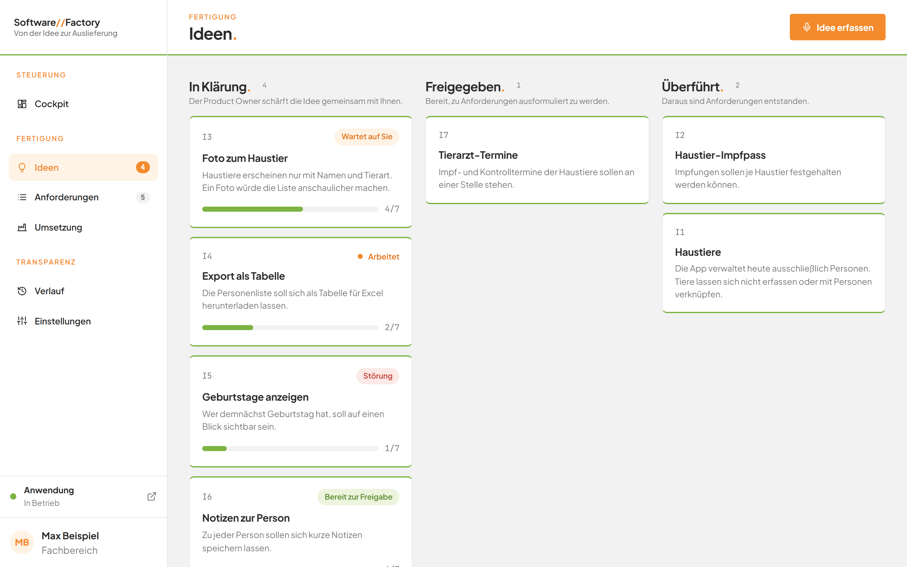
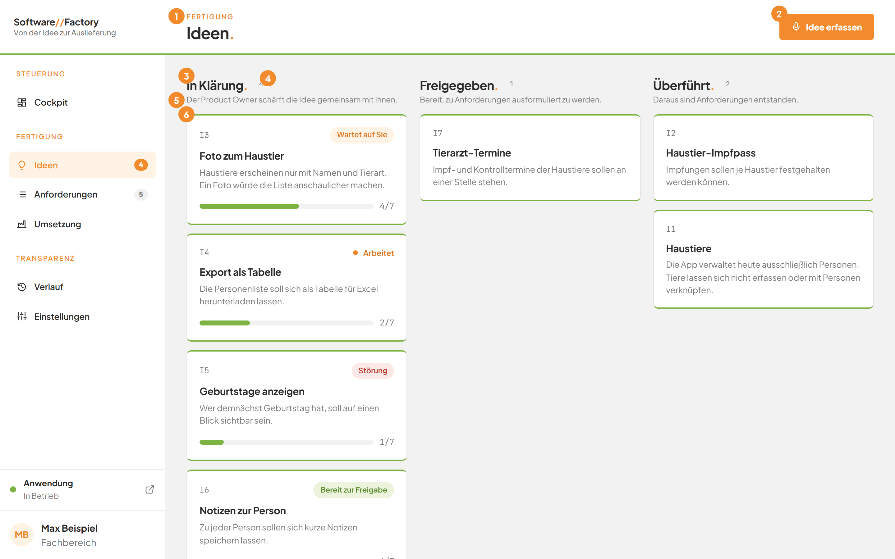
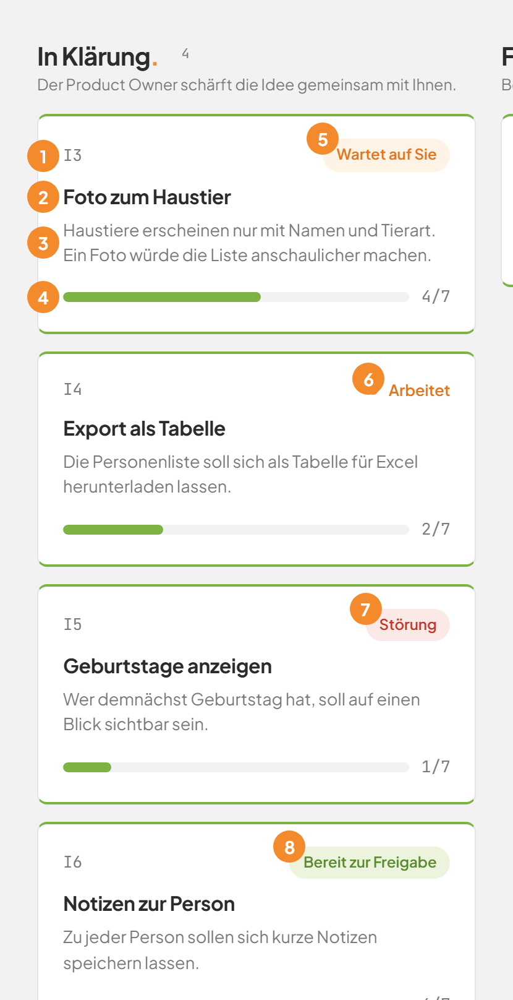
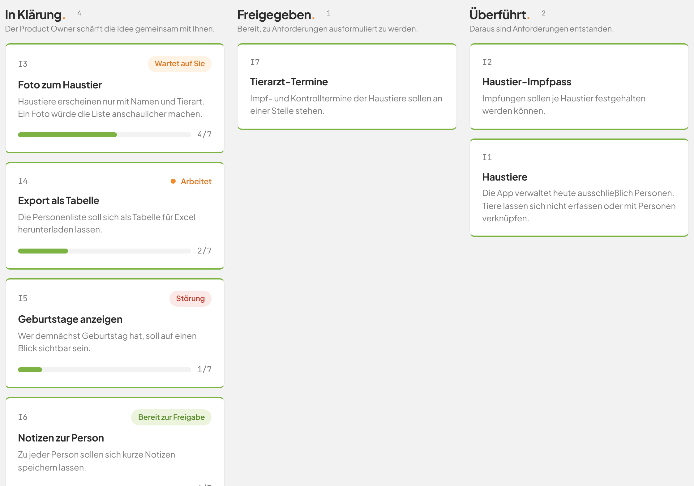
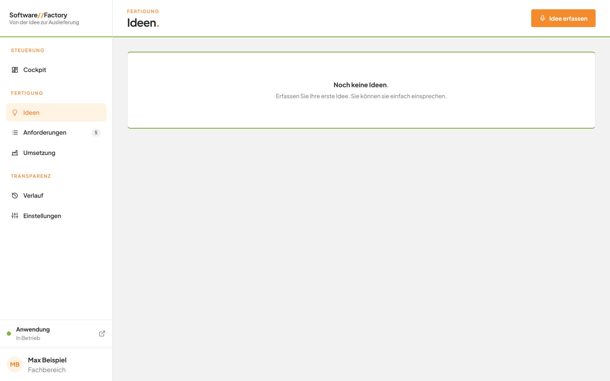
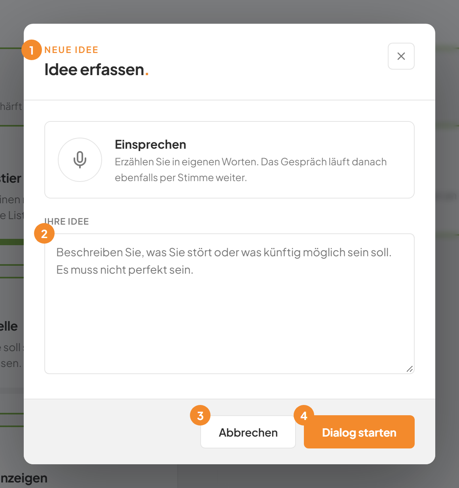
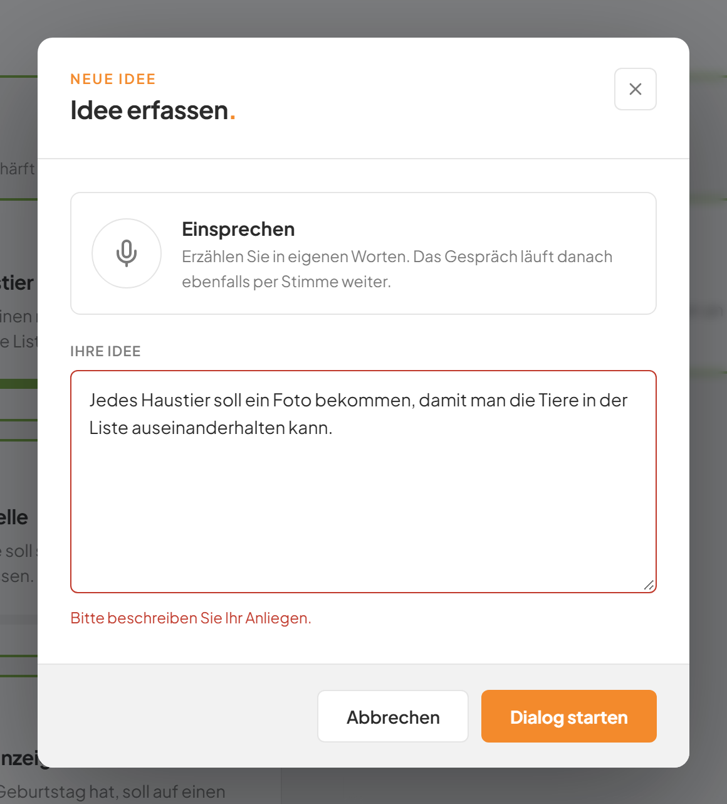

# Ideen auf der Tafel sehen und eine neue Idee erfassen

## Worum geht es hier?
Auf der Seite **Ideen** sehen Sie alle Ihre Ideen auf einen Blick. Jede Idee steht als Karte in einer von drei Spalten. Die Spalte zeigt, wie weit die Idee ist. Hier erfassen Sie auch eine neue Idee, entweder durch Tippen oder durch Einsprechen.

## Wo finden Sie das?
1. Öffnen Sie die Software Factory im Browser.
2. Klicken Sie in der linken Leiste unter **Fertigung** auf **Ideen**.

Die Seite **Ideen** öffnet sich. Rechts neben dem Eintrag steht eine Zahl. Sie nennt die Ideen, die noch in Klärung oder freigegeben sind.

*Bild 1: Die Seite Ideen mit Beispiel-Ideen.*

Die Seite hat auch eine eigene Adresse: `#/ideen`. Die Adresse `#/ideen?neu=1` öffnet die Seite und gleich danach den Dialog zum Erfassen einer Idee.

## Was Sie auf dem Bildschirm sehen

*Bild 2: Die wichtigsten Bereiche der Seite Ideen.*

| Nr. | Element | Bedeutung |
|---|---|---|
| 1 | Dachzeile **Fertigung** und Titel **Ideen.** | Zeigt, wo Sie sich befinden. |
| 2 | Schaltfläche **Idee erfassen** | Öffnet den Dialog, in dem Sie eine neue Idee beschreiben. |
| 3 | Spaltenüberschrift | Es gibt drei Spalten: **In Klärung.**, **Freigegeben.** und **Überführt.** |
| 4 | Zahl neben der Überschrift | Nennt, wie viele Karten in der Spalte stehen. |
| 5 | Hinweis unter der Überschrift | Erklärt in einem Satz, was die Spalte bedeutet. |
| 6 | Karte | Steht für eine Idee. Ein Klick öffnet das Gespräch zu dieser Idee. |

Die drei Spalten bedeuten:

| Spalte | Hinweis auf der Seite | Bedeutung |
|---|---|---|
| **In Klärung.** | Der Product Owner schärft die Idee gemeinsam mit Ihnen. | Die Idee ist noch nicht fertig. Sie klären sie im Gespräch. |
| **Freigegeben.** | Bereit, zu Anforderungen ausformuliert zu werden. | Sie haben die Idee bestätigt. Die Anforderungen können nun entstehen. |
| **Überführt.** | Daraus sind Anforderungen entstanden. | Die Idee ist abgeschlossen. Sie bleibt als Nachweis erhalten. |

Der **Product Owner** ist eine künstliche Intelligenz (kurz: KI). Sie stellt Ihnen Fragen, damit Ihre Idee klar und vollständig wird. Mehr dazu steht auf der Seite [Im Gespräch mit dem Product Owner](04-ideen-dialog.md).

Innerhalb einer Spalte stehen die Karten nach der Nummer der Idee. Die kleinste Nummer steht oben.

### Die Karte einer Idee

*Bild 3: Karten der Spalte In Klärung mit ihren Marken.*

| Nr. | Element | Bedeutung |
|---|---|---|
| 1 | Kennung, zum Beispiel `I3` | Die Nummer der Idee. Sie ändert sich nie. |
| 2 | Titel | Der Name der Idee. |
| 3 | Beschreibung | Das Problem, das die Idee lösen soll. Fehlt es, steht dort **Noch keine Beschreibung.** |
| 4 | Fortschrittsbalken mit Zahl, zum Beispiel `4/7` | Zeigt den Reifegrad. Von sieben Punkten sind vier erfüllt. Den Balken gibt es nur in der Spalte **In Klärung.** |
| 5 | Marke **Wartet auf Sie** | Der Product Owner wartet auf Ihre Antwort. Es sind noch weniger als sechs Punkte erfüllt. |
| 6 | Marke **Arbeitet** | Die KI arbeitet gerade an der Idee. |
| 7 | Marke **Störung** | Die letzte Runde der KI ist mit einem Fehler zu Ende gegangen. |
| 8 | Marke **Bereit zur Freigabe** | Sechs von sieben Punkten sind erfüllt. Sie können die Idee prüfen und freigeben. |

Der siebte Punkt ist Ihre Bestätigung. Deshalb steht bei einer Idee, die bereit ist, höchstens `6/7`.

*Bild 4: Die Spalten In Klärung, Freigegeben und Überführt nebeneinander.*

Die Karten in den Spalten **Freigegeben.** und **Überführt.** haben keinen Fortschrittsbalken.

Die Seite aktualisiert sich selbst. Sie müssen sie nicht neu laden, wenn die KI etwas Neues liefert.

### Wenn noch keine Idee vorhanden ist

*Bild 5: Die leere Tafel.*

Dann steht statt der Spalten **Noch keine Ideen.** Darunter steht: **Erfassen Sie Ihre erste Idee. Sie können sie einfach einsprechen.**

## Schritt für Schritt: Eine Idee erfassen
1. Klicken Sie oben rechts auf **Idee erfassen**.

   Ein Dialog mit dem Titel **Idee erfassen.** öffnet sich.

   
   *Bild 6: Der Dialog Idee erfassen.*

   | Nr. | Element | Bedeutung |
   |---|---|---|
   | 1 | Dachzeile **Neue Idee** | Zeigt, dass Sie gerade eine neue Idee anlegen. |
   | 2 | Feld **Ihre Idee** | Hier beschreiben Sie, was Sie stört oder was künftig möglich sein soll. |
   | 3 | Schaltfläche **Abbrechen** | Schließt den Dialog. Es wird nichts gespeichert. |
   | 4 | Schaltfläche **Dialog starten** | Legt die Idee an und startet das Gespräch. |

2. Klicken Sie in das Feld **Ihre Idee**.
3. Beschreiben Sie Ihre Idee in eigenen Worten. Sie muss nicht perfekt sein.

   Wollen Sie lieber sprechen, lesen Sie die Seite [Sprache](05-sprache.md).

   
   *Bild 7: Der Dialog mit einer beschriebenen Idee.*

4. Klicken Sie unten rechts auf **Dialog starten**.

   Die Factory legt die Idee mit dem Titel **Neue Idee** an. Die Seite wechselt zum Gespräch mit dem Product Owner. Der Product Owner beginnt sofort mit seiner ersten Antwort.

   Den Titel passt die KI später an. Sie können ihn auch selbst ändern, wie auf der Seite [Im Gespräch mit dem Product Owner](04-ideen-dialog.md) beschrieben.

## Gut zu wissen
- Sie schließen den Dialog mit **Abbrechen**, mit der Taste **Esc** oder mit einem Klick neben den Dialog. In allen Fällen wird nichts gespeichert.
- Das Feld **Ihre Idee** ist ein Pflichtfeld.
- Die Nummer einer neuen Idee vergibt die Factory selbst. Sie ist immer die nächste freie Nummer.
- Das Anlegen einer Idee erzeugt noch keine gesicherte Version der Dateien.
- Mehrere Ideen können gleichzeitig im Gespräch sein. Die Karten zeigen jeweils ihren eigenen Zustand.
- Eine Idee, die Sie nicht weiterverfolgen, können Sie verwerfen. Das steht auf der Seite [Im Gespräch mit dem Product Owner](04-ideen-dialog.md).
- Eine Idee in der Spalte **Überführt.** ist abgeschlossen. Die Anforderungen dazu sehen Sie auf der Seite [Anforderungen](07-anforderungen.md).

## Wenn etwas nicht klappt

*Bild 8: Das Feld Ihre Idee ist leer.*

| Das sehen Sie | Das bedeutet es | Das tun Sie |
|---|---|---|
| **Bitte beschreiben Sie Ihr Anliegen.** unter dem Feld | Das Feld **Ihre Idee** ist leer. | Schreiben Sie einen oder mehrere Sätze in das Feld. Klicken Sie dann erneut auf **Dialog starten**. |
| **Bitte beschreiben Sie Ihre Idee.** im Dialog | Der Dienst hat einen leeren Text zurückgewiesen. | Schreiben Sie einen Text in das Feld und starten Sie erneut. |
| Eine andere Fehlermeldung im Dialog, der Dialog bleibt offen | Die Idee konnte nicht angelegt werden. | Lesen Sie die Meldung. Versuchen Sie es nach einem Moment erneut. Ihr Text bleibt im Feld stehen. |
| **Der Factory-Dienst ist nicht erreichbar.** | Die Software Factory antwortet nicht. | Prüfen Sie die Meldung unter **Anwendung** links unten. Lesen Sie auch die [häufigen Fragen](faq.md). |
| Karte mit der Marke **Störung** | Die letzte Runde der KI ist fehlgeschlagen. | Öffnen Sie die Karte und klicken Sie im Gespräch auf **Erneut versuchen**. Siehe [Im Gespräch mit dem Product Owner](04-ideen-dialog.md). |
| Eine Idee fehlt auf der Tafel | Nur Ideen in der vorgesehenen Form erscheinen auf der Tafel. | Legen Sie die Idee über **Idee erfassen** an. |

Weiter geht es mit [Im Gespräch mit dem Product Owner](04-ideen-dialog.md).
