# Im Gespräch mit dem Product Owner eine Idee klären

## Worum geht es hier?
Auf dieser Seite klären Sie eine Idee im Gespräch mit dem Product Owner. Der Product Owner ist eine künstliche Intelligenz (kurz: KI). Sie stellt kritische Fragen, prüft Ihre Idee gegen das, was es schon gibt, und schreibt alles in ein Dokument. Am Ende geben Sie die Idee frei oder verwerfen sie.

## Wo finden Sie das?
1. Klicken Sie in der linken Leiste unter **Fertigung** auf **Ideen**.
2. Klicken Sie auf die Karte der Idee, die Sie bearbeiten wollen.

Nach dem Erfassen einer neuen Idee öffnet sich die Seite von selbst.

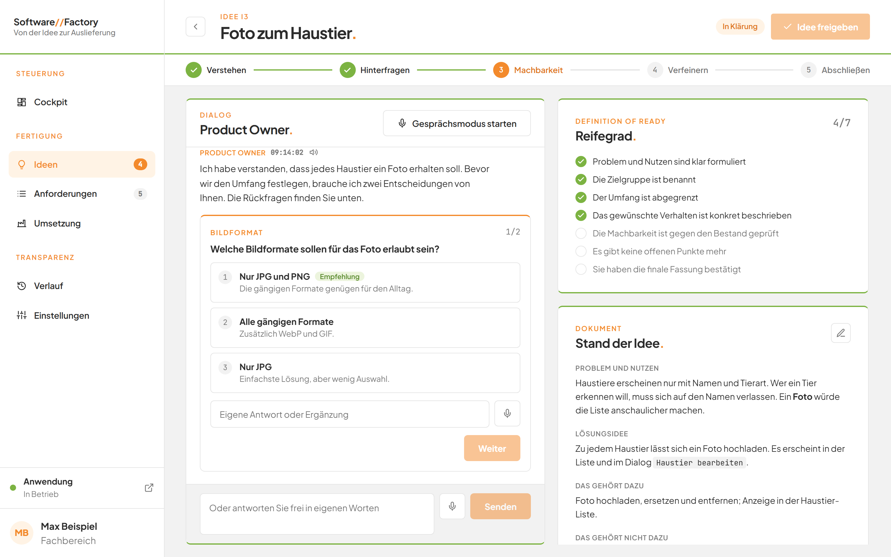
*Bild 1: Die Seite einer Idee in Klärung.*

## Was Sie auf dem Bildschirm sehen

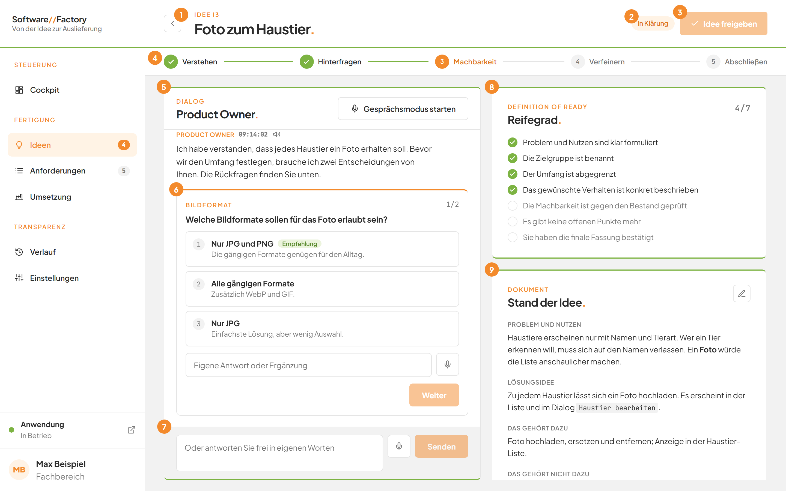
*Bild 2: Die Bereiche der Seite.*

| Nr. | Element | Bedeutung |
|---|---|---|
| 1 | Pfeil oben links | Die Schaltfläche **Zurück** führt zur Seite **Ideen**. |
| 2 | Marke neben dem Titel | Zeigt den Status der Idee: **In Klärung**, **Freigegeben** oder **Überführt**. |
| 3 | Schaltfläche **Idee freigeben** | Bestätigt die Idee als fertig. Sie ist grau, bis alle Voraussetzungen erfüllt sind. |
| 4 | Phasenband | Zeigt, in welcher von fünf Phasen das Gespräch steht. |
| 5 | Bereich **Product Owner.** | Das Gespräch. Ihre Beiträge tragen **Sie**, die der KI **Product Owner**. |
| 6 | Rückfrage | Stellt der Product Owner Fragen, erscheinen sie hier einzeln mit Antwortmöglichkeiten. |
| 7 | Eingabefeld mit **Senden** | Hier schreiben Sie Ihre Antworten. |
| 8 | Karte **Reifegrad.** | Zeigt, welche der sieben Voraussetzungen erfüllt sind. |
| 9 | Karte **Stand der Idee.** | Zeigt das Dokument, das der Product Owner laufend fortschreibt. |

Oben links steht die Dachzeile, zum Beispiel **Idee I3**, darunter der Titel der Idee. Jeder Beitrag im Gespräch zeigt die Uhrzeit mit Sekunden.

Gibt es die Idee nicht mehr, steht dort **Diese Idee existiert nicht mehr.**

## Schritt für Schritt: Dem Product Owner antworten
1. Lesen Sie die letzte Nachricht des Product Owners im Bereich **Product Owner.**
2. Klicken Sie unten in das Eingabefeld. Dort steht **Antworten Sie dem Product Owner oder ergänzen Sie etwas**.
3. Schreiben Sie Ihre Antwort.
4. Drücken Sie die Taste **Enter** oder klicken Sie auf **Senden**.

   Ihre Antwort erscheint im Gespräch. Der Product Owner beginnt zu arbeiten.

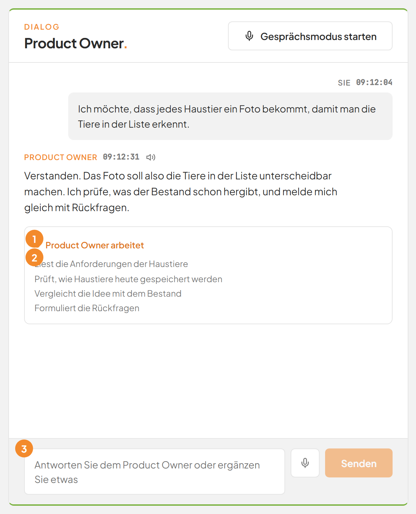
*Bild 3: Der Product Owner arbeitet an einer Antwort.*

| Nr. | Element | Bedeutung |
|---|---|---|
| 1 | **Product Owner arbeitet** | Die KI bereitet ihre Antwort vor. Das kann einige Minuten dauern. |
| 2 | Liste mit Zeilen | Die letzten vier Arbeitsschritte der KI. |
| 3 | Eingabefeld | Ist gesperrt, solange die KI arbeitet. |

5. Warten Sie, bis die neue Antwort erscheint.

   Der Verlauf rollt von selbst ans Ende.

Wollen Sie eine Zeile umbrechen, ohne zu senden, drücken Sie **Umschalt** und **Enter** gleichzeitig. Die Schaltfläche **Senden** ist grau, solange das Feld leer ist.

Die KI liest dabei nur. Sie ändert nichts an Ihrer Anwendung. Das Ideen-Dokument schreibt die Factory nach jeder Runde fort.

## Schritt für Schritt: Rückfragen beantworten
Stellt der Product Owner Fragen, erscheinen sie nacheinander als Auswahl. Pro Runde sind es höchstens drei Fragen.

1. Lesen Sie die Frage. Oben steht in der Dachzeile ihr Thema, zum Beispiel **BILDFORMAT**.
2. Klicken Sie auf eine Antwortmöglichkeit.

   Statt der Nummer erscheint ein Häkchen. Bei einer Frage mit nur einer Antwort ersetzt ein weiterer Klick die bisherige Wahl. Bei einer Frage mit mehreren Antworten schaltet jeder Klick die Möglichkeit an oder aus.

   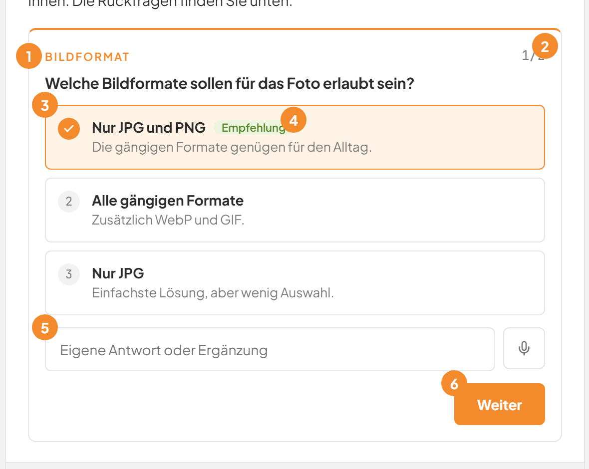
   *Bild 4: Die erste von zwei Rückfragen.*

   | Nr. | Element | Bedeutung |
   |---|---|---|
   | 1 | Dachzeile, zum Beispiel **BILDFORMAT** | Das Thema der Frage. |
   | 2 | Zahl `1/2` | Die erste von zwei Fragen. Bei nur einer Frage fehlt sie. |
   | 3 | Antwortmöglichkeit | Mit Nummer, Name und Erklärung. Die gewählte zeigt ein Häkchen. |
   | 4 | Marke **Empfehlung** | Der Product Owner empfiehlt diese Antwort. |
   | 5 | Feld **Eigene Antwort oder Ergänzung** | Hier ergänzen Sie freien Text. Daneben steht das Mikrofon zum Diktieren. |
   | 6 | Schaltfläche **Weiter** | Zeigt die nächste Frage. Sie ist grau, solange nichts gewählt oder geschrieben ist. |

3. Möchten Sie etwas ergänzen, schreiben Sie in das Feld **Eigene Antwort oder Ergänzung**.
4. Klicken Sie auf **Weiter**.

   Die nächste Frage erscheint. Ab der zweiten Frage steht daneben **Zurückgehen**. Damit sehen Sie die vorige Frage mit Ihren Antworten.

   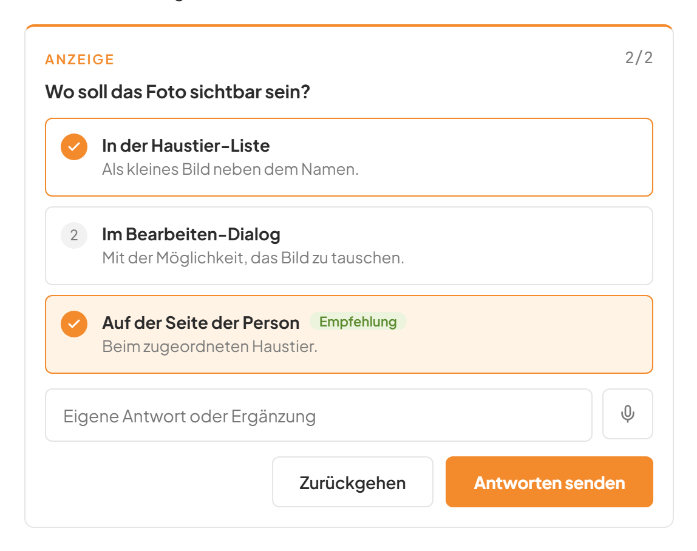
   *Bild 5: Bei der letzten Frage heißt die Schaltfläche Antworten senden.*

5. Klicken Sie bei der letzten Frage auf **Antworten senden**.

   Ihre Antworten erscheinen im Verlauf als Paare aus Frage und Antwort. Der Product Owner arbeitet weiter.

Sie müssen die Fragen nicht einzeln beantworten. Schreiben Sie stattdessen in das untere Eingabefeld. Dort steht bei offenen Fragen **Oder antworten Sie frei in eigenen Worten**. Eine freie Antwort beendet die offenen Fragen.

## Schritt für Schritt: Den Fortschritt der Idee lesen
### Die Phasen

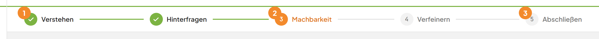
*Bild 6: Das Phasenband. Die dritte Phase ist aktiv.*

| Nr. | Element | Bedeutung |
|---|---|---|
| 1 | Häkchen | Diese Phase ist erledigt. |
| 2 | Orange Nummer | Hier steht das Gespräch gerade. |
| 3 | Graue Nummer | Diese Phase kommt noch. |

Die fünf Phasen heißen **Verstehen**, **Hinterfragen**, **Machbarkeit**, **Verfeinern** und **Abschließen**. Ist die Phase noch nicht bekannt, ist **Verstehen** aktiv. Bei einer freigegebenen oder überführten Idee sind alle Phasen erledigt.

### Der Reifegrad

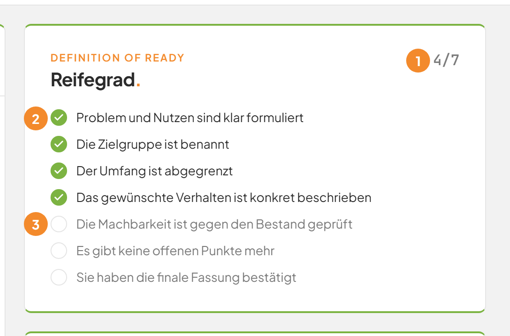
*Bild 7: Die Karte Reifegrad. Vier von sieben Punkten sind erfüllt.*

| Nr. | Element | Bedeutung |
|---|---|---|
| 1 | Zahl `4/7` | So viele Voraussetzungen sind erfüllt. |
| 2 | Punkt mit Häkchen | Diese Voraussetzung ist erfüllt. |
| 3 | Leerer Kreis | Diese Voraussetzung fehlt noch. |

Die Dachzeile heißt **Definition of Ready**. Das bedeutet: Das sind die Voraussetzungen, damit eine Idee bereit ist. Es sind sieben:

1. Problem und Nutzen sind klar formuliert
2. Die Zielgruppe ist benannt
3. Der Umfang ist abgegrenzt
4. Das gewünschte Verhalten ist konkret beschrieben
5. Die Machbarkeit ist gegen den Bestand geprüft
6. Es gibt keine offenen Punkte mehr
7. Sie haben die finale Fassung bestätigt

Die ersten fünf Punkte bewertet der Product Owner nach jeder Runde. Der sechste Punkt gilt, wenn keine offenen Punkte mehr bleiben. Den siebten Punkt erfüllen nur Sie durch die Freigabe.

## Schritt für Schritt: Das Dokument lesen
1. Schauen Sie rechts auf die Karte **Stand der Idee.** Scrollen Sie in der rechten Spalte, falls sie weiter unten steht.

   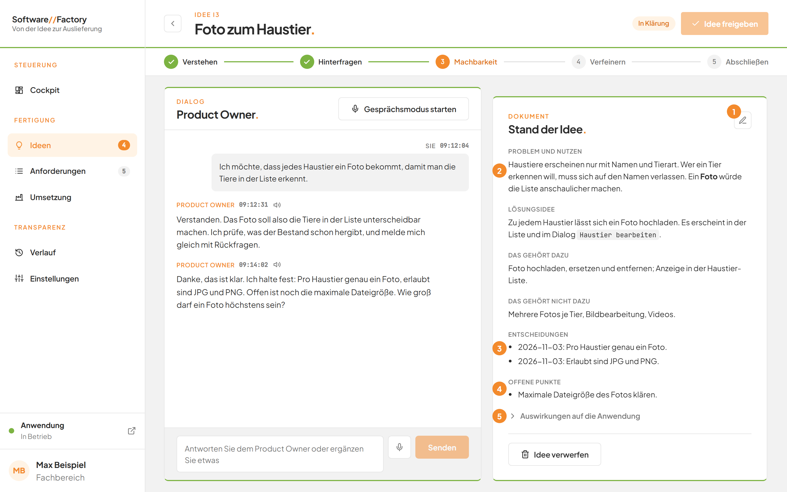
   *Bild 8: Das Dokument der Idee.*

   | Nr. | Element | Bedeutung |
   |---|---|---|
   | 1 | Stift | Öffnet den Dialog **Idee bearbeiten**. |
   | 2 | Abschnitt **Problem und Nutzen** | Welches Problem die Idee löst. |
   | 3 | Abschnitt **Entscheidungen** | Was Sie im Gespräch entschieden haben, mit Datum. |
   | 4 | Abschnitt **Offene Punkte** | Was noch zu klären ist. |
   | 5 | **Auswirkungen auf die Anwendung** | Ein Bereich zum Aufklappen. |

   Weitere Abschnitte sind **Lösungsidee**, **Das gehört dazu** und **Das gehört nicht dazu**.

2. Klicken Sie auf **Auswirkungen auf die Anwendung**, wenn Sie mehr wissen wollen.

   Der Bereich klappt auf. Er zeigt vier Abschnitte: **Anforderungen**, **Gespeicherte Daten**, **Serverlogik** und **Programmcode**.

   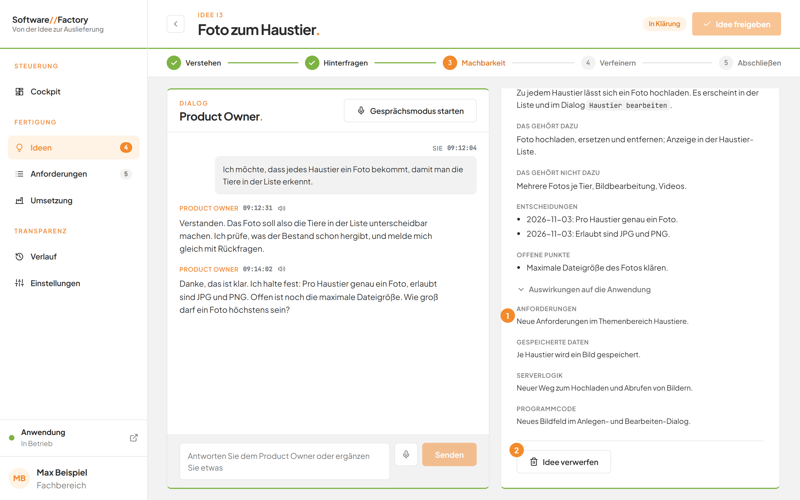
   *Bild 9: Die aufgeklappten Auswirkungen.*

   | Nr. | Element | Bedeutung |
   |---|---|---|
   | 1 | Aufgeklappter Abschnitt | Zeigt, was die Idee in der Anwendung verändern würde. |
   | 2 | Schaltfläche **Idee verwerfen** | Entfernt die Idee. Siehe weiter unten. |

Ist ein Abschnitt noch leer, steht dort **Noch offen**. Bei **Entscheidungen** steht dann **Noch keine Entscheidungen**, bei **Offene Punkte** steht **Keine offenen Punkte**. Text in Hochkommas erscheint als Code-Schrift, Text zwischen doppelten Sternen erscheint fett.

Ist die Idee überführt, erscheint zusätzlich der Abschnitt **Überführung**. Er listet auf, in welche Anforderungen die Idee übergegangen ist. Siehe [Aus einer Idee Anforderungen erstellen](06-ueberfuehrung-in-anforderungen.md).

## Schritt für Schritt: Die Idee selbst bearbeiten
Sie können das Dokument auch ohne Gespräch korrigieren. Das geht nur bei einer Idee **In Klärung**. Die KI darf dabei nicht arbeiten.

1. Klicken Sie auf der Karte **Stand der Idee.** oben rechts auf den Stift.

   Der Dialog **Idee bearbeiten.** öffnet sich.

   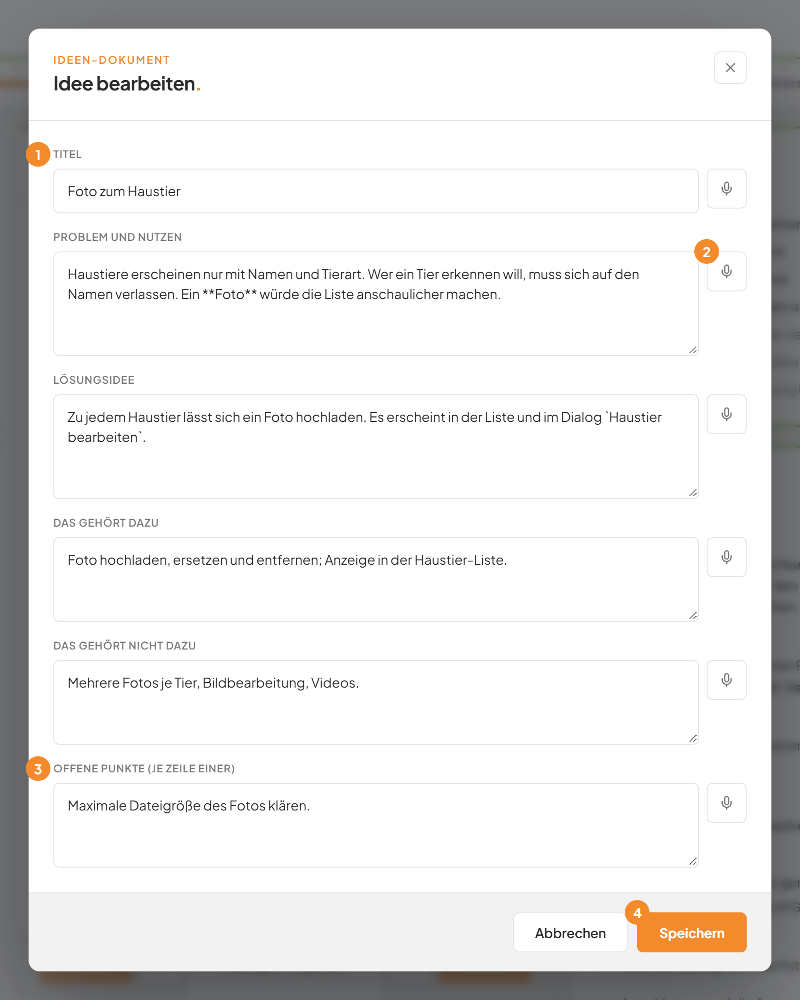
   *Bild 10: Der Dialog Idee bearbeiten.*

   | Nr. | Element | Bedeutung |
   |---|---|---|
   | 1 | Feld **Titel** | Der Name der Idee. |
   | 2 | Mikrofon neben einem Feld | Zum Diktieren. Jedes Feld hat eines. |
   | 3 | Feld **Offene Punkte (je Zeile einer)** | Schreiben Sie jeden offenen Punkt in eine eigene Zeile. |
   | 4 | Schaltfläche **Speichern** | Übernimmt Ihre Änderungen. |

2. Ändern Sie die Felder. Es gibt **Titel**, **Problem und Nutzen**, **Lösungsidee**, **Das gehört dazu**, **Das gehört nicht dazu** und **Offene Punkte (je Zeile einer)**.
3. Klicken Sie unten rechts auf **Speichern**.

   Der Dialog schließt sich. Das Dokument zeigt Ihre Änderungen. Mit **Abbrechen** schließen Sie den Dialog, ohne etwas zu speichern.

Bleibt der **Titel** leer, behält die Idee ihren alten Titel. Ändern Sie den Titel, bleibt die Nummer der Idee gleich.

## Schritt für Schritt: Die Idee freigeben
Die Freigabe erteilen nur Sie. Erst dann kann die KI daraus Anforderungen schreiben.

1. Prüfen Sie die Karte **Reifegrad.** Es müssen sechs von sieben Punkten erfüllt sein.

   Dann erscheint dort der Hinweis **Alle Punkte sind erfüllt. Bitte prüfen Sie das Dokument und geben Sie die Idee frei.** Die Schaltfläche **Idee freigeben** oben rechts ist nicht mehr grau.

   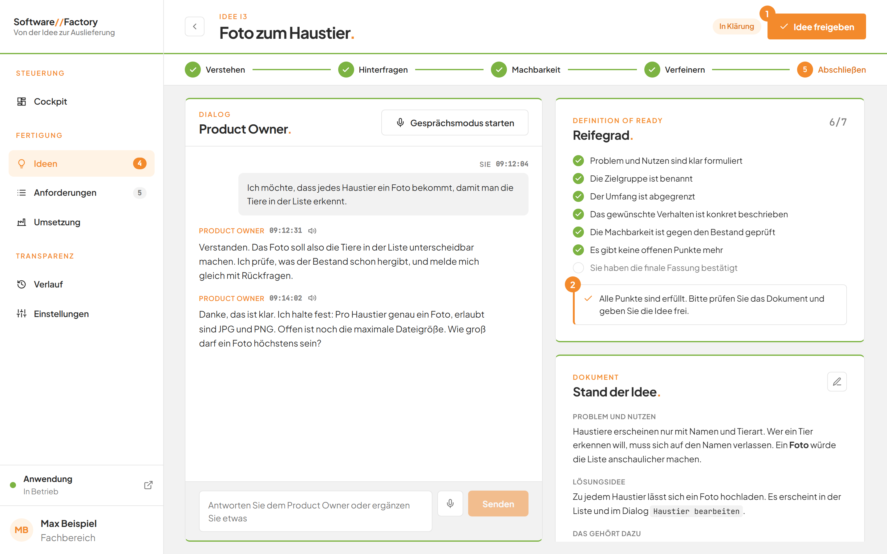
   *Bild 11: Die Freigabe ist möglich.*

   | Nr. | Element | Bedeutung |
   |---|---|---|
   | 1 | Schaltfläche **Idee freigeben** | Ist jetzt aktiv. |
   | 2 | Hinweis | Alle Punkte außer Ihrer Bestätigung sind erfüllt. |

2. Lesen Sie das Dokument in der Karte **Stand der Idee.** noch einmal durch.
3. Klicken Sie oben rechts auf **Idee freigeben**.

   Ein Dialog mit dem Titel **Idee freigeben.** öffnet sich.

   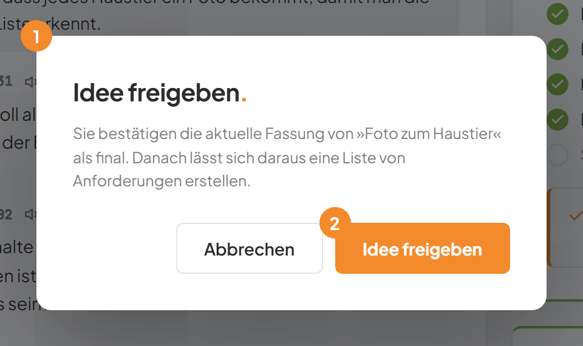
   *Bild 12: Der Bestätigungsdialog.*

4. Klicken Sie im Dialog auf **Idee freigeben**.

   Die Marke neben dem Titel wechselt zu **Freigegeben**. Die Karte steht nun in der Spalte **Freigegeben.** Zur Idee wird die Entscheidung „Der Stakeholder hat die finale Fassung bestätigt." mit dem Datum eingetragen. Die Factory sichert diesen Stand zusätzlich als Version.

Ist die Schaltfläche grau, zeigt ein Hinweis beim Darüberfahren: **Die Definition of Ready ist noch nicht erfüllt.** Das gilt auch, solange die KI arbeitet.

## Schritt für Schritt: Eine freigegebene Idee erneut öffnen
Sie haben noch etwas vergessen? Dann öffnen Sie die Idee wieder, solange sie nicht überführt ist.

1. Öffnen Sie die freigegebene Idee.

   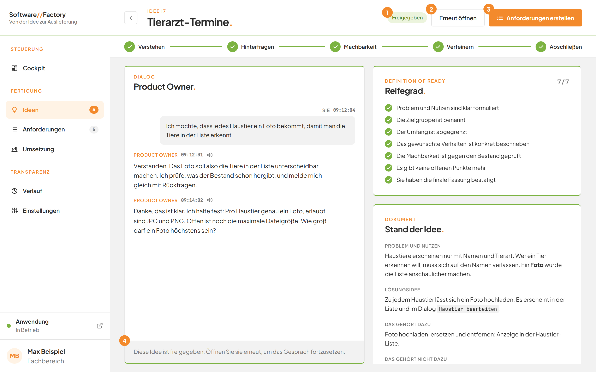
   *Bild 13: Eine freigegebene Idee.*

   | Nr. | Element | Bedeutung |
   |---|---|---|
   | 1 | Marke **Freigegeben** | Der Status der Idee. |
   | 2 | Schaltfläche **Erneut öffnen** | Macht die Idee wieder zu einer Idee in Klärung. |
   | 3 | Schaltfläche **Anforderungen erstellen** | Startet die Überführung in Anforderungen. |
   | 4 | Hinweis im Gespräch | Das Gespräch ist schreibgeschützt. |

2. Klicken Sie oben rechts auf **Erneut öffnen**.

   Es gibt keine Rückfrage. Die Idee steht wieder **In Klärung**. Das Gespräch ist wieder offen. Die frühere Entscheidung zur Freigabe bleibt im Dokument stehen. Danach müssen Sie die Idee erneut freigeben.

Solange das Gespräch schreibgeschützt ist, steht im Gespräch: **Diese Idee ist freigegeben. Öffnen Sie sie erneut, um das Gespräch fortzusetzen.**

## Schritt für Schritt: Eine Idee verwerfen
Verwerfen Sie eine Idee, die Sie nicht weiterverfolgen. Das geht bei Ideen **In Klärung** und bei freigegebenen Ideen. Überführte Ideen bleiben als Nachweis erhalten.

1. Scrollen Sie in der rechten Spalte ans Ende der Karte **Stand der Idee.**
2. Klicken Sie auf **Idee verwerfen**.

   Ein Dialog mit dem Titel **Idee verwerfen.** öffnet sich. Er nennt die Idee und warnt: Sie wird samt Gesprächsverlauf entfernt. Das lässt sich nicht rückgängig machen.

   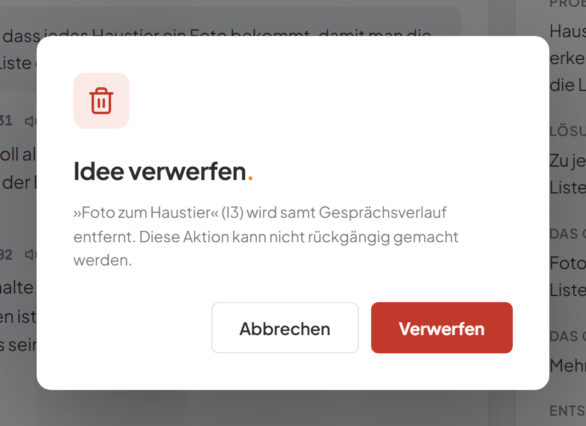
   *Bild 14: Der Bestätigungsdialog zum Verwerfen.*

3. Klicken Sie auf **Verwerfen**.

   Die Seite wechselt zur Tafel. Die Idee ist verschwunden. Mit **Abbrechen** behalten Sie die Idee.

## Schritt für Schritt: Mehrere Gespräche gleichzeitig führen
1. Beantworten Sie eine Frage in einer Idee.
2. Klicken Sie links auf **Ideen** und öffnen Sie eine andere Idee.
3. Führen Sie dort Ihr Gespräch.

   Die Karte der ersten Idee zeigt **Arbeitet**, solange die KI dort noch antwortet. Der Wechsel unterbricht die Runde nicht.

Höchstens vier KI-Runden laufen zugleich. Weitere Runden warten, bis eine fertig ist. Auch die Entwürfe im [Anforderungs-Assistenten](08-anforderungs-assistent.md) zählen mit. Ein laufender Auftrag in der [Umsetzung](10-umsetzung.md) blockiert Gespräche nicht.

## Gut zu wissen
- Pro Idee läuft immer nur eine Runde. Schreiben Sie während einer Runde, kommt **Die KI arbeitet noch an der letzten Antwort.**
- Wechseln Sie die Ansicht, während die KI arbeitet, bleibt der Verlauf erhalten.
- Startet der Dienst neu, bleibt der Gesprächsverlauf erhalten. Eine unterbrochene Runde meldet **Die Antwort wurde durch einen Neustart unterbrochen. Bitte versuchen Sie es erneut.**
- Eine Runde endet spätestens nach fünf Minuten.
- Nachrichten des Product Owners lassen sich vorlesen. Das Gespräch lässt sich auch ganz mit der Stimme führen. Siehe [Sprache](05-sprache.md).
- Aus einer freigegebenen Idee entstehen Anforderungen. Siehe [Aus einer Idee Anforderungen erstellen](06-ueberfuehrung-in-anforderungen.md).

## Wenn etwas nicht klappt

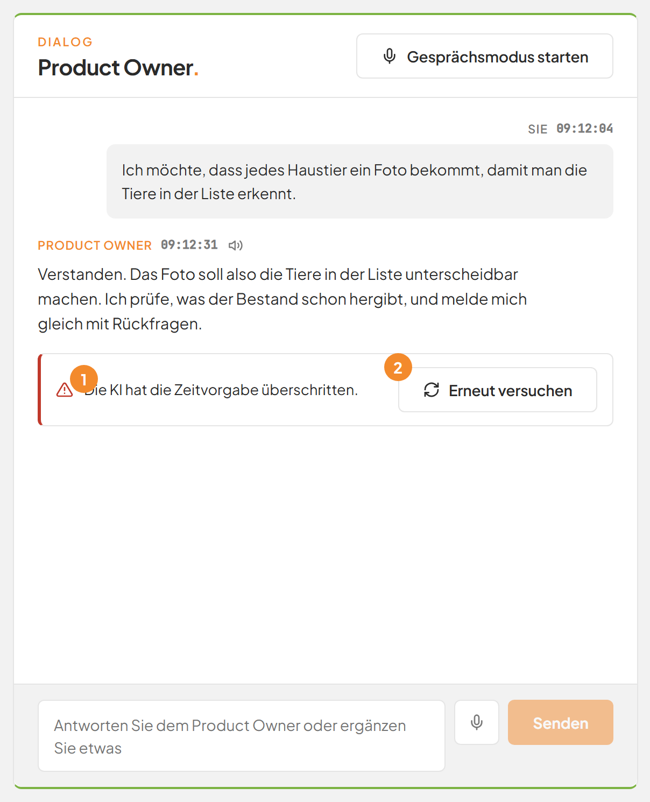
*Bild 15: Eine Runde ist fehlgeschlagen.*

| Nr. | Element | Bedeutung |
|---|---|---|
| 1 | Fehlermeldung | Nennt den Grund. |
| 2 | Schaltfläche **Erneut versuchen** | Wiederholt die Runde, ohne eine neue Nachricht anzulegen. |

| Das sehen Sie | Das bedeutet es | Das tun Sie |
|---|---|---|
| **Die KI hat die Zeitvorgabe überschritten.** | Die Runde hat länger als fünf Minuten gedauert. | Klicken Sie auf **Erneut versuchen**. |
| **Die KI hat keine auswertbare Antwort geliefert.** | Die Antwort der KI war nicht lesbar. | Klicken Sie auf **Erneut versuchen**. |
| **Die KI ist nicht angemeldet. Bitte starten Sie einmal „claude“ in einem Terminal und melden Sie sich an.** | Die KI ist auf diesem Rechner nicht angemeldet. | Bitten Sie die Person, die die Factory betreut, sich anzumelden. Klicken Sie danach auf **Erneut versuchen**. |
| **Das KI-Kontingent ist derzeit ausgeschöpft oder überlastet. Bitte versuchen Sie es später erneut.** | Die KI ist zurzeit nicht verfügbar. | Warten Sie einige Minuten. Klicken Sie dann auf **Erneut versuchen**. |
| **Die KI-Anbindung „claude“ ist auf diesem Rechner nicht installiert.** | Die KI-Software fehlt. | Bitten Sie die Person, die die Factory betreut, sie zu installieren. |
| **Die KI konnte den Auftrag nicht abschließen.** | Ein anderer Fehler ist aufgetreten. | Klicken Sie auf **Erneut versuchen**. Hilft das nicht, versuchen Sie es später. |
| **Die Antwort wurde durch einen Neustart unterbrochen. Bitte versuchen Sie es erneut.** | Die Factory wurde während der Runde neu gestartet. | Klicken Sie auf **Erneut versuchen**. |
| **Die KI arbeitet noch an der letzten Antwort.** | Es läuft schon eine Runde. | Warten Sie, bis sie fertig ist. |
| **Bitte geben Sie eine Antwort ein.** | Das Eingabefeld war leer. | Schreiben Sie eine Antwort und senden Sie erneut. |
| **Diese Idee ist freigegeben. Öffnen Sie sie erneut, um weiter daran zu arbeiten.** | Eine freigegebene Idee lässt sich nicht bearbeiten. | Klicken Sie auf **Erneut öffnen**. |
| **Die Idee ist noch nicht bereit: …** | Beim Freigeben fehlt noch ein Punkt des Reifegrads. Die Meldung nennt ihn. | Klären Sie den Punkt im Gespräch. |
| **Nur freigegebene Ideen lassen sich erneut öffnen.** | Die Idee ist nicht freigegeben. | Für Ideen in Klärung ist nichts nötig. |
| **Diese Idee wird gerade in Anforderungen überführt.** | Ein Auftrag verarbeitet die Idee. | Warten Sie, bis der Auftrag fertig ist. Siehe [Umsetzung](10-umsetzung.md). |
| **Eine überführte Idee bleibt als Nachweis erhalten und lässt sich nicht löschen.** | Überführte Ideen lassen sich nicht verwerfen. | Für diese Idee ist nichts zu tun. |
| **Diese Idee existiert nicht mehr.** | Die Idee wurde verworfen oder gibt es nicht. | Gehen Sie über **Zurück** zur Tafel. |

Weitere Fragen beantworten die [häufigen Fragen](faq.md).
