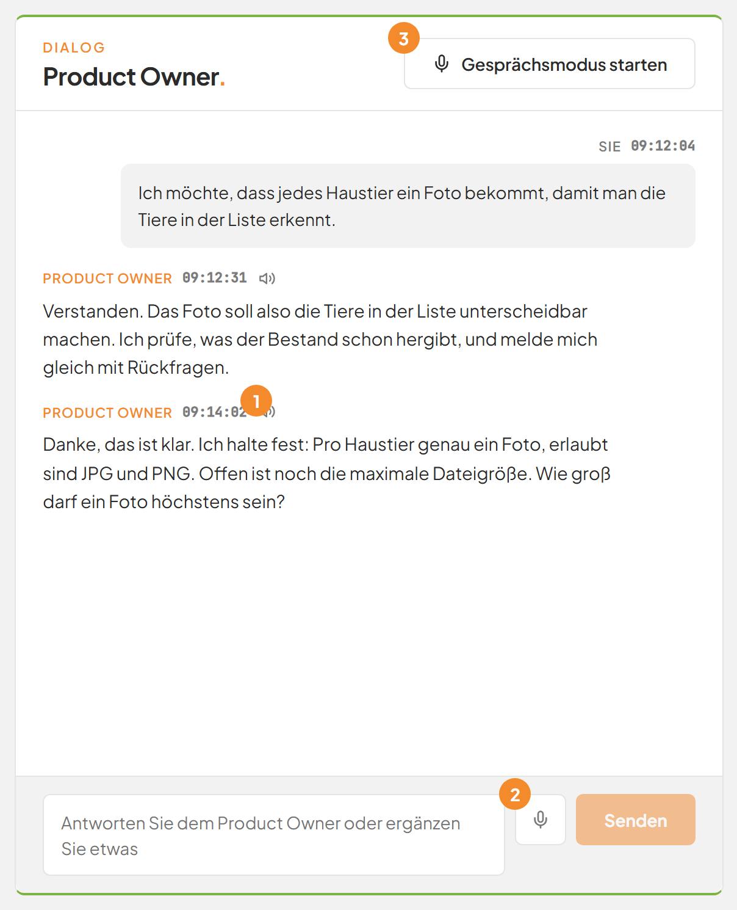
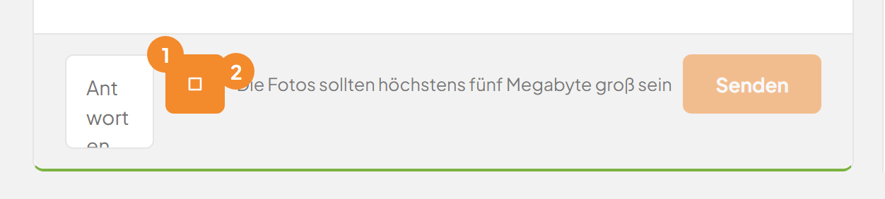
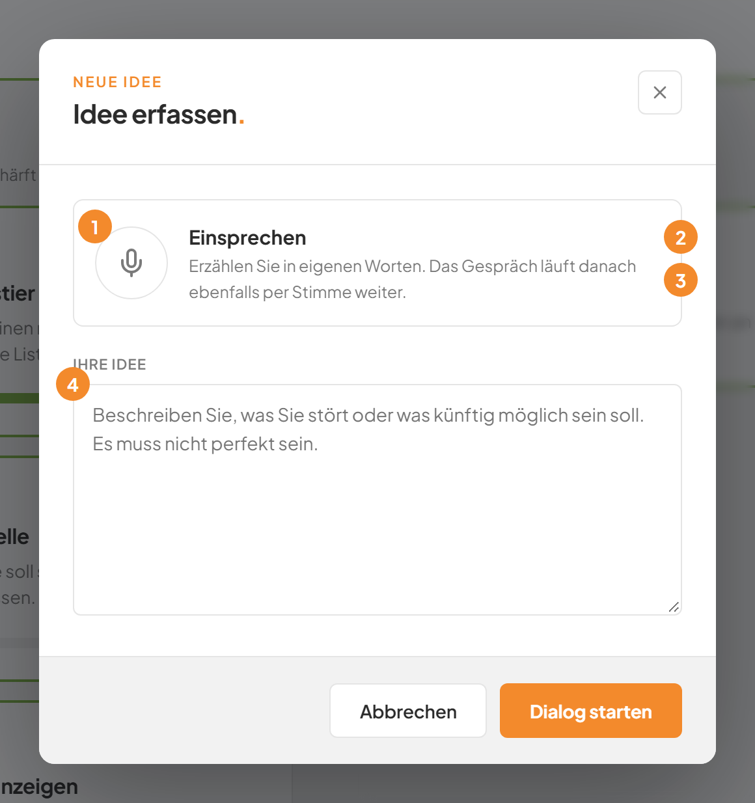
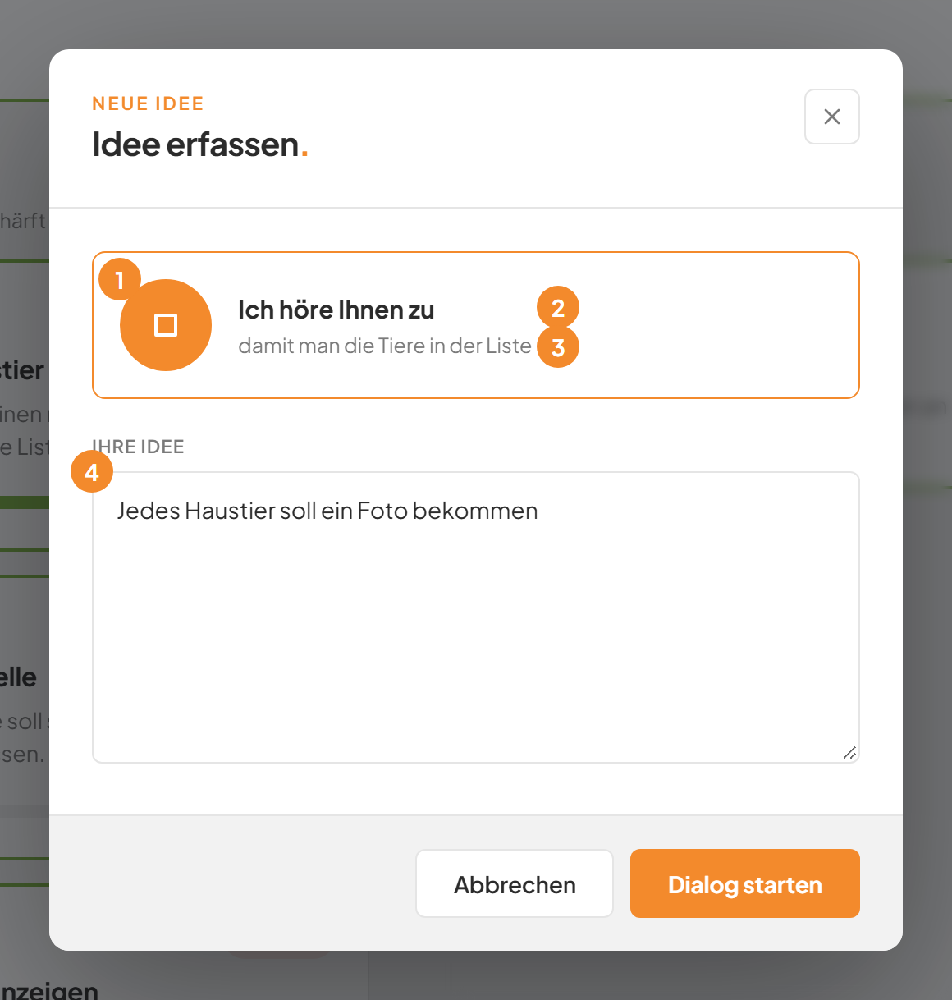
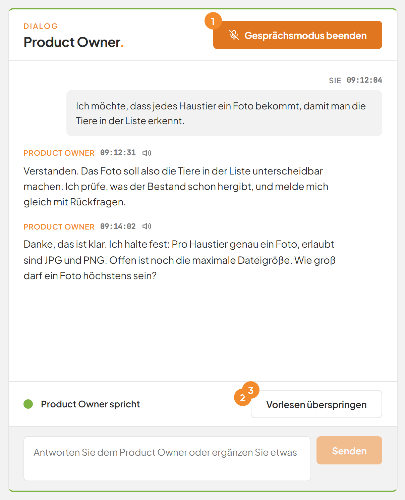
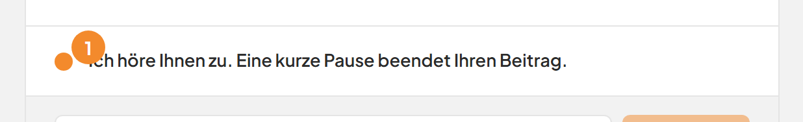
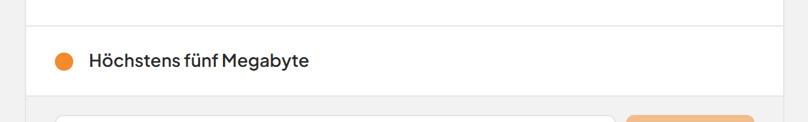
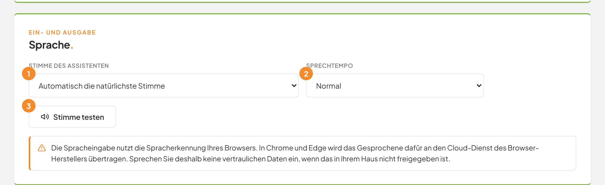

# Mit der Stimme arbeiten: Diktieren, Einsprechen und Gesprächsmodus

## Worum geht es hier?
Sie können in der Software Factory sprechen statt tippen. Sie können Texte diktieren, eine Idee beim Start einsprechen und sich Antworten vorlesen lassen. Im Gesprächsmodus führen Sie das ganze Gespräch mit dem Product Owner nur mit der Stimme. Der Product Owner ist die künstliche Intelligenz (kurz: KI), die Ihre Idee mit Ihnen klärt.

## Wo finden Sie das?
Die Sprachfunktionen stehen in vielen Dialogen. Das Gespräch zu einer Idee zeigt sie am besten.

1. Klicken Sie in der linken Leiste unter **Fertigung** auf **Ideen**.
2. Klicken Sie auf die Karte einer Idee.

*Bild 1: Die Sprachfunktionen im Gespräch.*

## Was Sie auf dem Bildschirm sehen

| Nr. | Element | Bedeutung |
|---|---|---|
| 1 | Lautsprecher an einer Nachricht des Product Owners | Liest diese Nachricht vor. Die Schaltfläche heißt **Vorlesen**. |
| 2 | Mikrofon neben dem Eingabefeld | Die Schaltfläche **Diktieren**. Sie wandelt Ihre Sprache in Text um. |
| 3 | Schaltfläche **Gesprächsmodus starten** | Schaltet das Gespräch auf Sprache um. |

Das Mikrofon und die große Aufnahme-Schaltfläche erscheinen nur, wenn Ihr Browser Spracherkennung kann. Der Lautsprecher erscheint nur, wenn Ihr Browser Sprache ausgeben kann. Am besten eignen sich Chrome und Edge. Fehlt etwas, nutzen Sie diese Browser.

## Schritt für Schritt: Einen Text diktieren
Das Mikrofon steht am Eingabefeld des Gesprächs, am Feld **Eigene Antwort oder Ergänzung** einer Rückfrage und an jedem Feld des Dialogs **Idee bearbeiten.** Es steht auch an den Feldern im Formular für Anforderungen. Siehe [Anforderungen](07-anforderungen.md).

1. Klicken Sie auf das Mikrofon neben dem Feld, das Sie füllen wollen.

   Beim ersten Mal fragt der Browser, ob er das Mikrofon verwenden darf. Erlauben Sie es.

2. Sprechen Sie.

   Neben dem Mikrofon erscheint Ihr Text zunächst als Vorschau. Er ist noch grau und vorläufig.

   
   *Bild 2: Ein Diktat läuft.*

   | Nr. | Element | Bedeutung |
   |---|---|---|
   | 1 | Schaltfläche **Diktat beenden** | Beendet die Aufnahme. Das Symbol ist jetzt ein Quadrat. |
   | 2 | Vorschau | Zeigt, was der Browser gerade erkennt. |

3. Klicken Sie erneut auf die Schaltfläche, wenn Sie fertig sind.

   Der erkannte Text steht am Ende des Feldes. Er hängt sich an den vorhandenen Text an. Sie können ihn wie jeden Text ändern.

Eine kurze Pause beendet die Aufnahme nicht. Der Browser hört weiter zu, bis Sie die Schaltfläche anklicken. Es ist immer nur ein Mikrofon zugleich aktiv. Starten Sie ein zweites, endet das erste. Auch eine laufende Sprachausgabe endet.

## Schritt für Schritt: Eine Idee beim Erfassen einsprechen
1. Klicken Sie auf der Seite **Ideen** oben rechts auf **Idee erfassen**.

   Oben im Dialog steht eine große runde Schaltfläche mit dem Wort **Einsprechen** daneben.

   
   *Bild 3: Der Dialog bereit zur Aufnahme.*

   | Nr. | Element | Bedeutung |
   |---|---|---|
   | 1 | Schaltfläche **Aufnahme starten** | Startet die Aufnahme. |
   | 2 | **Einsprechen** | Zeigt, dass Sie hier sprechen können. |
   | 3 | Erklärung | **Erzählen Sie in eigenen Worten. Das Gespräch läuft danach ebenfalls per Stimme weiter.** |
   | 4 | Feld **Ihre Idee** | Hier erscheint der erkannte Text. |

2. Klicken Sie auf die große Schaltfläche **Aufnahme starten**.

   Neben der Schaltfläche steht nun **Ich höre Ihnen zu**. Darunter erscheint Ihr Text als Vorschau. Solange noch nichts erkannt ist, steht dort **Sprechen Sie frei. Der Text erscheint unten im Feld.**

   
   *Bild 4: Die Aufnahme läuft. Der erkannte Text steht im Feld.*

3. Erzählen Sie Ihre Idee in eigenen Worten.
4. Klicken Sie auf **Aufnahme beenden**, wenn Sie fertig sind.

   Der Text steht im Feld **Ihre Idee**. Sie können ihn von Hand ändern.

5. Klicken Sie unten rechts auf **Dialog starten**.

   Das Gespräch öffnet sich. Weil Sie eingesprochen haben, startet es gleich im Gesprächsmodus. Eine laufende Aufnahme endet beim Absenden.

Haben Sie die Aufnahme nicht benutzt, startet das Gespräch ohne Gesprächsmodus. Das Mikrofon bleibt aus, wenn Sie die Seite später neu laden.

Dieselbe große Schaltfläche gibt es beim Einstieg in den Anforderungs-Assistenten. Siehe [Anforderungs-Assistent](08-anforderungs-assistent.md).

## Schritt für Schritt: Das Gespräch nur mit der Stimme führen
Im Gesprächsmodus liest die Anwendung jede Antwort vor und hört danach zu. Eine kurze Pause beendet Ihren Beitrag. Er wird dann von selbst gesendet.

1. Öffnen Sie das Gespräch einer Idee **In Klärung**.
2. Klicken Sie oben im Bereich **Product Owner.** auf **Gesprächsmodus starten**.

   Die Schaltfläche heißt jetzt **Gesprächsmodus beenden**. Die Anwendung liest die letzte Antwort des Product Owners vor. Das Mikrofon am Eingabefeld verschwindet. Über dem Eingabefeld erscheint ein Statusband.

   
   *Bild 5: Der Product Owner spricht.*

   | Nr. | Element | Bedeutung |
   |---|---|---|
   | 1 | Schaltfläche **Gesprächsmodus beenden** | Beendet den Gesprächsmodus. |
   | 2 | Statusband **Product Owner spricht** | Zeigt, was gerade passiert. |
   | 3 | Schaltfläche **Vorlesen überspringen** | Beendet das Vorlesen sofort. Danach hört die Anwendung zu. |

3. Hören Sie zu. Das Mikrofon ist aus, solange vorgelesen wird.
4. Sprechen Sie, sobald das Vorlesen endet.

   Das Statusband zeigt, dass die Anwendung zuhört.

   
   *Bild 6: Die Anwendung hört zu.*

   Dort steht **Ich höre Ihnen zu. Eine kurze Pause beendet Ihren Beitrag.** Sobald etwas erkannt wird, steht der erkannte Text dort.

   
   *Bild 7: Der erkannte Text erscheint im Statusband.*

5. Machen Sie eine Pause von etwa zwei Sekunden.

   Die Anwendung sendet Ihren Beitrag als Nachricht. Das Band zeigt **Product Owner denkt nach**, solange die KI arbeitet. Dann liest sie die Antwort vor.

6. Wiederholen Sie die Schritte 3 bis 5, bis das Gespräch fertig ist.
7. Sagen Sie **Stopp**, **Stop**, **Beenden** oder **Gesprächsmodus beenden**. Sie können auch auf **Gesprächsmodus beenden** klicken.

   Die Sprachausgabe und das Mikrofon enden.

Schlägt das Senden fehl, hört die Anwendung erneut zu. Endet eine Runde mit einem Fehler, liest die Anwendung die Fehlermeldung vor und hört danach zu.

Im Gesprächsmodus gilt auch der Assistent mit den Rückfragen. Er funktioniert im Ideen-Dialog und im [Anforderungs-Assistenten](08-anforderungs-assistent.md).

## Schritt für Schritt: Rückfragen frei gesprochen beantworten
Stellt der Product Owner Rückfragen, liest die Anwendung die erste Frage mit ihren Antwortmöglichkeiten vor. Zum Beispiel: „Frage 1 von 2. Welche Bildformate sollen erlaubt sein? Option 1: Nur JPG und PNG, meine Empfehlung. Option 2: …“

1. Sprechen Sie Ihre Antwort. Sie müssen die Möglichkeiten nicht wörtlich wiederholen.

   Die Anwendung erkennt, was Sie meinen. Dabei zählt weder Groß- noch Kleinschreibung noch Satzzeichen. Sie gilt als erkannt, wenn Sie

   - den Namen der Möglichkeit nennen, zum Beispiel „Nur JPG und PNG“,
   - die wichtigen Wörter des Namens nennen,
   - die Nummer nennen, zum Beispiel „zwei“, „die zweite“ oder „Option 2“, bis Option 4,
   - „Empfehlung“, „empfohlen“ oder „Ihr Vorschlag“ sagen, dann gilt die empfohlene Möglichkeit.

   Bei einer Frage mit mehreren Antworten wählt „alle“ alle Möglichkeiten.

2. Sagen Sie bei Bedarf mehr dazu.

   Passt nichts zu einer Möglichkeit, wird Ihr ganzer Satz die freie Antwort. Passt eine Möglichkeit und sagen Sie mehr als nur den Namen, wird der Satz zusätzlich eine freie Antwort.

3. Warten Sie die nächste Frage ab.

   Die Anwendung liest sie vor und hört wieder zu. Nach der letzten Frage sendet sie alle Antworten von selbst.

## Schritt für Schritt: Sich eine Antwort vorlesen lassen
Das geht auch ohne Gesprächsmodus.

1. Suchen Sie die Nachricht des Product Owners.
2. Klicken Sie neben der Uhrzeit auf den Lautsprecher mit der Bezeichnung **Vorlesen**.

   Die Nachricht wird satzweise vorgelesen. Zeichen wie Sterne oder Hochkommas liest die Anwendung nicht mit. Ein neuer Klick auf einen anderen Lautsprecher beendet die laufende Ausgabe. Die Ausgabe endet auch, wenn Sie das Gespräch verlassen.

Nur Nachrichten des Product Owners haben diesen Lautsprecher. Ihre eigenen Nachrichten nicht.

## Schritt für Schritt: Stimme und Tempo ändern
1. Klicken Sie in der linken Leiste unter **Transparenz** auf **Einstellungen**.
2. Suchen Sie die Karte **Sprache.**

   
   *Bild 8: Stimme und Sprechtempo.*

   | Nr. | Element | Bedeutung |
   |---|---|---|
   | 1 | Feld **Stimme des Assistenten** | Wählt die Stimme. Die Einstellung **Automatisch die natürlichste Stimme** ist vorgewählt. |
   | 2 | Feld **Sprechtempo** | Zur Wahl stehen **Ruhig**, **Normal** und **Zügig**. |
   | 3 | Schaltfläche **Stimme testen** | Spielt einen Beispielsatz ab. |

3. Wählen Sie eine Stimme und ein Tempo.
4. Klicken Sie auf **Stimme testen**.

   Sie hören den Beispielsatz mit Ihrer Auswahl.

Die Auswahl gilt ab der nächsten Ausgabe. Sie gilt nur in diesem Browser. Mehr dazu steht auf der Seite [Einstellungen](12-einstellungen.md).

## Gut zu wissen
- Zur Wahl stehen nur deutsche Stimmen. Natürlich klingende Stimmen stehen vorn. Fehlt Ihre gewählte Stimme, nimmt die Anwendung die erste passende.
- Ohne eigene Wahl liegt das Tempo bei **Normal**.
- In Chrome und Edge wird das Gesprochene an den Cloud-Dienst des Browser-Herstellers übertragen. Sprechen Sie deshalb keine vertraulichen Inhalte ein, wenn das in Ihrem Haus nicht freigegeben ist.
- Der Gesprächsmodus ist in einem schreibgeschützten Gespräch nicht verfügbar, zum Beispiel bei einer freigegebenen Idee.
- Stimme und Tempo merkt sich Ihr Browser. Andere Browser oder Rechner haben ihre eigenen Einstellungen.
- Ist der Speicher des Browsers gesperrt, nimmt die Anwendung die automatische Stimme und das Tempo **Normal**.

## Wenn etwas nicht klappt

| Das sehen Sie | Das bedeutet es | Das tun Sie |
|---|---|---|
| Kein Mikrofon-Symbol zu sehen | Ihr Browser unterstützt keine Spracherkennung. | Nutzen Sie Chrome oder Edge. |
| **Dieser Browser unterstützt keine Spracheingabe. Bitte verwenden Sie Chrome oder Edge.** | Ihr Browser kann nicht zuhören. | Wechseln Sie zu Chrome oder Edge. |
| **Der Browser hat den Zugriff auf das Mikrofon nicht erlaubt.** | Sie haben den Zugriff verweigert. | Erlauben Sie das Mikrofon in den Einstellungen des Browsers neben der Adresszeile. Laden Sie die Seite neu. |
| **Es wurde kein Mikrofon gefunden.** | Am Rechner ist kein Mikrofon angeschlossen oder aktiv. | Schließen Sie ein Mikrofon an. Wählen Sie es in den Einstellungen Ihres Rechners. |
| **Die Spracherkennung des Browsers ist nicht erreichbar.** | Der Erkennungsdienst antwortet nicht, zum Beispiel ohne Internet. | Prüfen Sie Ihre Verbindung. Versuchen Sie es erneut. |
| **Der Browser unterstützt die Spracherkennung auf Deutsch nicht.** | Dem Browser fehlt die deutsche Erkennung. | Nutzen Sie einen aktuellen Chrome oder Edge. |
| **Die Spracherkennung ist fehlgeschlagen.** | Ein anderer Fehler ist aufgetreten. | Klicken Sie erneut auf das Mikrofon. |
| Es kommt kein Ton | Sprachausgabe ist stumm oder nicht verfügbar. | Prüfen Sie die Lautstärke. Testen Sie in den **Einstellungen** mit **Stimme testen**. |
| Eine Sprechpause erzeugt keine Fehlermeldung | Das ist normal. | Sprechen Sie einfach weiter. |

Weitere Fragen beantworten die [häufigen Fragen](faq.md). Zurück zum [Gespräch mit dem Product Owner](04-ideen-dialog.md).
