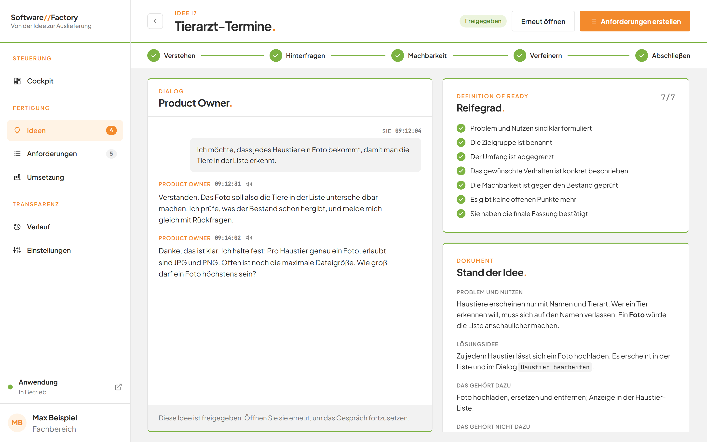
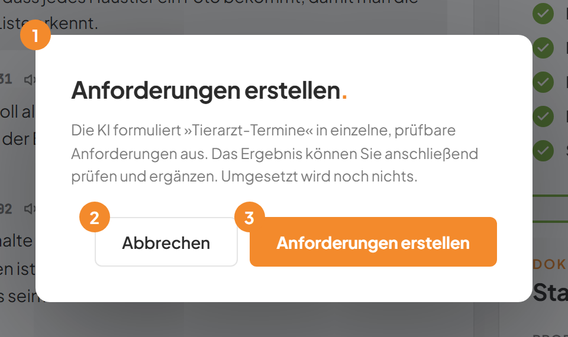
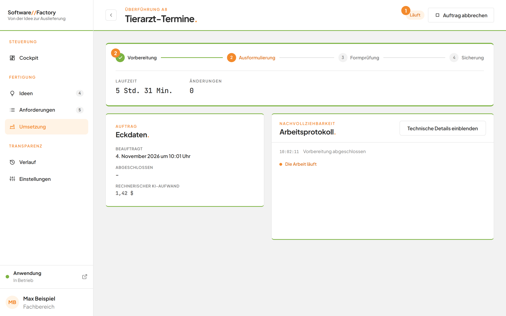
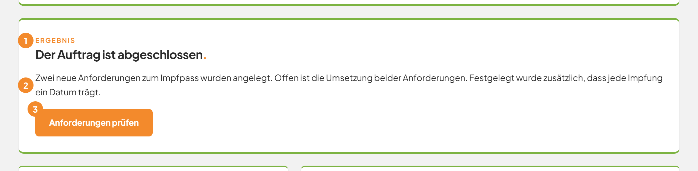
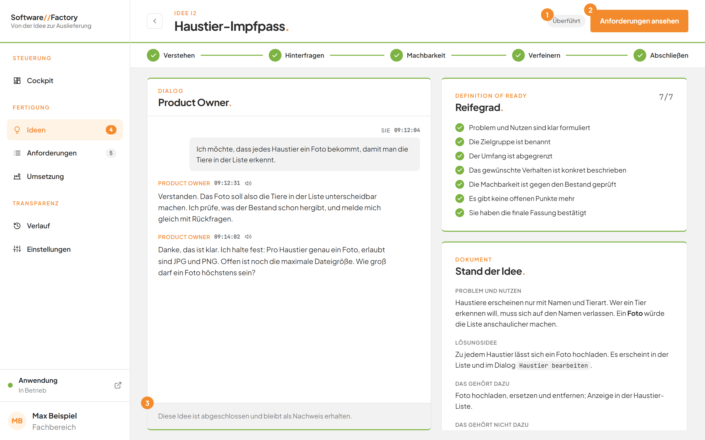
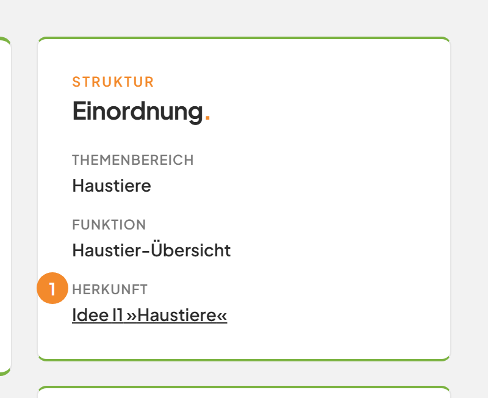
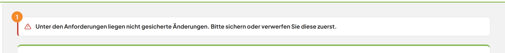

# Aus einer Idee Anforderungen erstellen

## Worum geht es hier?
Ist Ihre Idee freigegeben, lassen Sie daraus Anforderungen schreiben. Eine Anforderung ist eine einzelne, prüfbare Aufgabe für die Anwendung. Die künstliche Intelligenz (kurz: KI) formuliert sie für Sie aus. Das nennt die Factory „Überführung“. Dabei wird noch nichts umgesetzt. Sie prüfen das Ergebnis danach selbst.

## Wo finden Sie das?
1. Klicken Sie in der linken Leiste unter **Fertigung** auf **Ideen**.
2. Klicken Sie in der Spalte **Freigegeben.** auf die Karte der Idee.

Die Idee öffnet sich. Oben rechts stehen die Schaltflächen **Erneut öffnen** und **Anforderungen erstellen**.

*Bild 1: Eine freigegebene Idee.*

Eine Idee ist erst freigegeben, wenn Sie sie bestätigt haben. Wie das geht, steht auf der Seite [Im Gespräch mit dem Product Owner](04-ideen-dialog.md).

## Was Sie auf dem Bildschirm sehen
Die Überführung läuft als Auftrag. Aufträge sehen Sie in der [Umsetzung](10-umsetzung.md). Ein Auftrag zur Überführung zeigt vier Phasen:

| Phase | Was passiert |
|---|---|
| **Vorbereitung** | Die Factory prüft, ob der Bereich der Anforderungen sauber ist. |
| **Ausformulierung** | Die KI schreibt die Anforderungen. Das dauert höchstens 30 Minuten. |
| **Formprüfung** | Die Factory prüft, ob jede Anforderung vollständig ist. |
| **Sicherung** | Die Factory schließt die Idee ab und sichert alles als Version. |

## Schritt für Schritt: Anforderungen aus einer Idee erstellen
1. Öffnen Sie die freigegebene Idee.
2. Klicken Sie oben rechts auf **Anforderungen erstellen**.

   Ein Dialog mit dem Titel **Anforderungen erstellen.** öffnet sich.

   
   *Bild 2: Der Bestätigungsdialog.*

   | Nr. | Element | Bedeutung |
   |---|---|---|
   | 1 | Text im Dialog | Erklärt: Die KI formuliert die Idee in einzelne, prüfbare Anforderungen aus. Sie prüfen und ergänzen das Ergebnis danach. Umgesetzt wird noch nichts. |
   | 2 | Schaltfläche **Abbrechen** | Schließt den Dialog. Es passiert nichts. |
   | 3 | Schaltfläche **Anforderungen erstellen** | Beauftragt die Überführung. |

3. Klicken Sie im Dialog auf **Anforderungen erstellen**.

   Die Seite wechselt zum neuen Auftrag. Er trägt den Titel der Idee.

   
   *Bild 3: Der Auftrag läuft.*

   | Nr. | Element | Bedeutung |
   |---|---|---|
   | 1 | Marke neben dem Titel | Zeigt den Zustand des Auftrags, zum Beispiel **Läuft**. |
   | 2 | Phasenband | Zeigt die vier Phasen. Erledigte Phasen tragen ein Häkchen. |

4. Warten Sie, bis der Auftrag abgeschlossen ist.

   Sie müssen die Seite nicht offen lassen. Der Auftrag läuft weiter. Er steht in der Warteschlange hinter anderen Aufträgen. Die Marke zeigt dann **Wartet**.

   Das **Arbeitsprotokoll** auf der Seite zeigt, was die KI gerade tut. Mehr dazu auf der Seite [Umsetzung](10-umsetzung.md).

## Schritt für Schritt: Das Ergebnis prüfen
1. Öffnen Sie den Auftrag, zum Beispiel über **Umsetzung** in der linken Leiste.

   Ist er fertig, steht oben die Marke **Abgeschlossen**. Darunter erscheint die Karte **Der Auftrag ist abgeschlossen.**

   
   *Bild 4: Das Ergebnis der Überführung.*

   | Nr. | Element | Bedeutung |
   |---|---|---|
   | 1 | Dachzeile **Ergebnis** | Kennzeichnet die Karte. |
   | 2 | Zusammenfassung | Die KI nennt in höchstens drei Sätzen, was entstanden ist. Auch Festlegungen, die über Ihre Idee hinausgehen, stehen dort. |
   | 3 | Schaltfläche **Anforderungen prüfen** | Öffnet die Anforderungen, deren Umsetzung noch offen ist. |

2. Klicken Sie auf **Anforderungen prüfen**.

   Die Seite **Anforderungen** öffnet sich. Sie ist auf Anforderungen mit offener Umsetzung gefiltert. Wie Sie die neuen Anforderungen lesen, ändern und umsetzen lassen, steht auf der Seite [Anforderungen](07-anforderungen.md).

Die neuen Anforderungen tragen den Status **Umsetzung offen**. Das gilt auch für bestehende Anforderungen, die die KI geändert hat. Im Auftrag stehen sie im Bereich **Anforderungen**.

## Schritt für Schritt: Die überführte Idee ansehen
1. Klicken Sie links auf **Ideen**.
2. Suchen Sie die Idee in der Spalte **Überführt.** und öffnen Sie sie.

   
   *Bild 5: Eine überführte Idee.*

   | Nr. | Element | Bedeutung |
   |---|---|---|
   | 1 | Marke **Überführt** | Der Status der Idee. |
   | 2 | Schaltfläche **Anforderungen ansehen** | Öffnet die Liste aller Anforderungen. |
   | 3 | Hinweis im Gespräch | **Diese Idee ist abgeschlossen und bleibt als Nachweis erhalten.** |

   Im Dokument der Idee steht weiter unten der Abschnitt **Überführung**. Er nennt mit Datum die Anforderungen, die aus der Idee entstanden sind.

3. Klicken Sie auf **Anforderungen ansehen**.

   Die Seite **Anforderungen** öffnet sich.

Eine überführte Idee lässt sich weder bearbeiten noch verwerfen. Sie bleibt als Nachweis erhalten.

## Schritt für Schritt: Sehen, aus welcher Idee eine Anforderung stammt
1. Klicken Sie links auf **Anforderungen**.
2. Öffnen Sie eine Anforderung.
3. Suchen Sie die Karte **Einordnung.**

   
   *Bild 6: Die Zeile Herkunft nennt die Idee.*

   Die Zeile **Herkunft** nennt die Idee, zum Beispiel **Idee I1 »Haustiere«**. Dort steht **Direkt erfasst**, wenn die Anforderung nicht aus einer Idee stammt.

4. Klicken Sie auf den Namen der Idee.

   Die Idee öffnet sich. Dort lesen Sie nach, warum etwas so entschieden wurde.

## Gut zu wissen
- **Anforderungen erstellen** gibt es nur bei einer freigegebenen Idee.
- Zu einer Idee läuft immer nur eine Überführung. Wartet oder läuft schon eine, erscheint im Dialog eine Meldung.
- Solange der Auftrag läuft, lässt sich die Idee nicht erneut öffnen oder verwerfen.
- Die KI darf bei der Überführung nur Anforderungen schreiben. Ihre Anwendung bleibt unverändert.
- Sie prüfen die Anforderungen anschließend selbst und lassen sie erst dann umsetzen.
- Endet der Auftrag mit einem Fehler, bleibt die Idee freigegeben. Sie können es erneut versuchen. Siehe [Umsetzung](10-umsetzung.md).
- Die Herkunft erkennt die Factory auch bei Ideen, die von Hand gepflegt wurden.
- Anforderungen der Software Factory selbst lassen sich hier lesen. Ändern oder umsetzen lassen sie sich nicht.

## Wenn etwas nicht klappt

*Bild 7: Der Auftrag ist fehlgeschlagen. Die Meldung nennt den Grund.*

| Das sehen Sie | Das bedeutet es | Das tun Sie |
|---|---|---|
| **Nur freigegebene Ideen lassen sich in Anforderungen überführen.** im Dialog | Die Idee ist nicht freigegeben. | Geben Sie die Idee frei. Siehe [Im Gespräch mit dem Product Owner](04-ideen-dialog.md). |
| **Diese Idee wird bereits überführt.** im Dialog | Ein Auftrag zu dieser Idee wartet oder läuft schon. | Öffnen Sie den Auftrag unter **Umsetzung** und warten Sie ab. |
| **Unter den Anforderungen liegen nicht gesicherte Änderungen. Bitte sichern oder verwerfen Sie diese zuerst.** | Es gibt noch ungesicherte Änderungen an den Anforderungen, zum Beispiel aus einem früheren Auftrag. | Sichern oder verwerfen Sie die Änderungen. Siehe [Umsetzung](10-umsetzung.md). Beauftragen Sie danach erneut. |
| **Die KI hat keine Anforderungen angelegt.** | Die KI hat nichts Brauchbares geschrieben. | Beauftragen Sie die Überführung erneut. Ergänzen Sie sonst die Idee. |
| **Einige Anforderungen entsprechen nicht dem vorgeschriebenen Format.** | Mindestens eine Anforderung ist unvollständig, zum Beispiel ohne Titel oder ohne Abnahmekriterien. | Öffnen Sie die technischen Details im Auftrag. Beauftragen Sie danach erneut. |
| **Die KI hat Dateien außerhalb der Anforderungen verändert.** | Die KI hat mehr angefasst als erlaubt. Die Factory bricht deshalb ab. | Prüfen Sie die technischen Details. Beauftragen Sie erneut. |
| Eine andere Fehlermeldung der KI | Zum Beispiel ist die KI nicht angemeldet oder überlastet. | Lesen Sie die Tabelle in [Im Gespräch mit dem Product Owner](04-ideen-dialog.md). |

Weitere Fragen beantworten die [häufigen Fragen](faq.md). Weiter geht es mit [Anforderungen](07-anforderungen.md).
