# Anforderungen ansehen, anlegen, ändern und entfernen

## Worum geht es hier?
Eine Anforderung beschreibt in einem Satz, was die Anwendung künftig können soll, und nennt prüfbare Abnahmekriterien dazu. Auf der Seite **Anforderungen** sehen Sie alle Anforderungen auf einen Blick. Sie finden hier den Stand der Umsetzung, öffnen Einzelheiten und legen neue Anforderungen an. Außerdem ändern oder entfernen Sie hier bestehende Anforderungen.

## Wo finde ich das?
1. Öffnen Sie die Software Factory im Browser.
2. Klicken Sie in der linken Leiste unter **Fertigung** auf **Anforderungen**.

Die Seite zeigt links die Struktur und rechts die Tabelle mit allen Anforderungen.

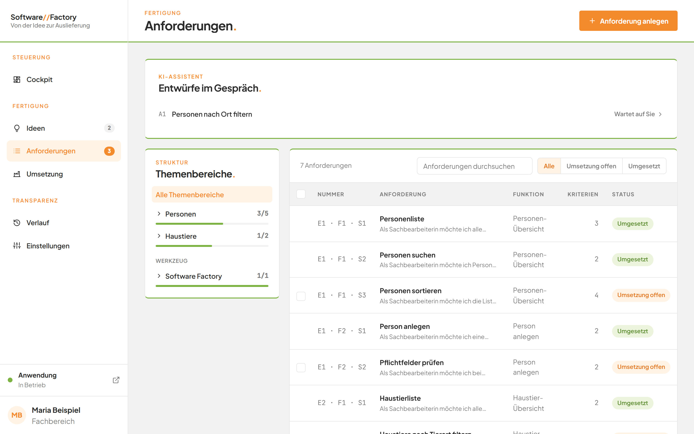
*Bild 1: Die Seite Anforderungen nach dem Öffnen.*

Einen Überblick über die Navigation finden Sie auf der Seite [Oberfläche und Navigation](01-navigation.md).

## Was Sie auf dem Bildschirm sehen

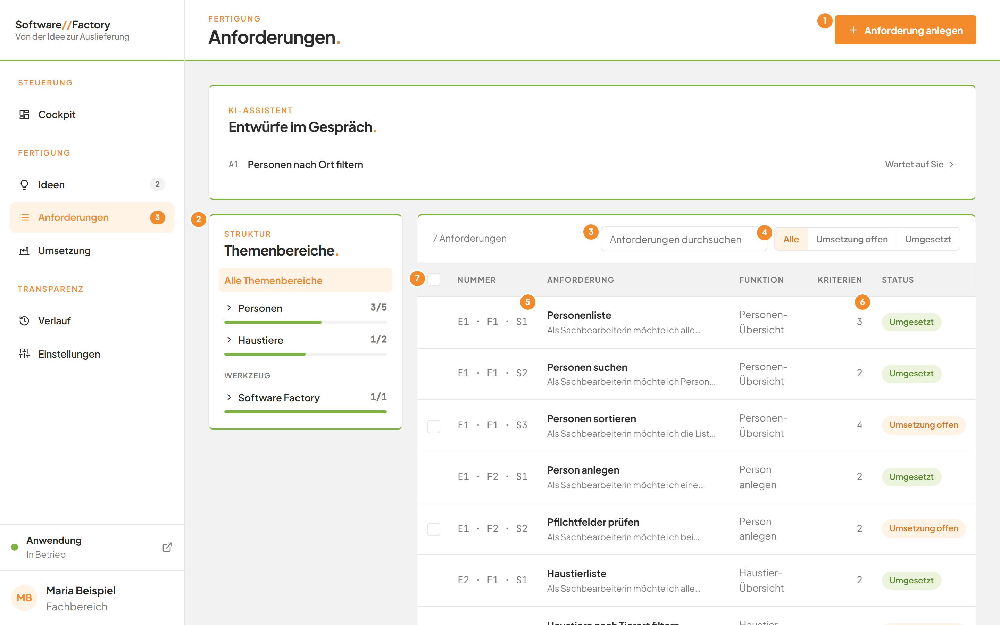
*Bild 2: Die Bereiche der Seite Anforderungen.*

| Nr. | Element | Bedeutung |
|---|---|---|
| 1 | **Anforderung anlegen** | Öffnet die Auswahl, wie Sie eine neue Anforderung erstellen (siehe [Anforderungs-Assistent](08-anforderungs-assistent.md)). |
| 2 | **Themenbereiche** | Die Struktur der Anforderungen. Ein Klick schränkt die Tabelle ein. |
| 3 | Suchfeld **Anforderungen durchsuchen** | Zeigt nur Anforderungen, die Ihren Suchbegriff enthalten. |
| 4 | Statusfilter | Die Auswahl **Alle**, **Umsetzung offen** und **Umgesetzt**. |
| 5 | Spalte **Anforderung** | Zeigt den Titel und darunter den Nutzen in einem Satz. Ein Klick auf den Titel öffnet die Einzelheiten. |
| 6 | Spalte **Status** | **Umgesetzt** bedeutet: Die KI hat die Anforderung umgesetzt. **Umsetzung offen** bedeutet: Sie ist neu oder geändert und noch nicht umgesetzt. |
| 7 | Kontrollkästchen am Zeilenanfang | Wählt offene Anforderungen für die Umsetzung aus (siehe [Umsetzung](10-umsetzung.md)). |

Die weiteren Spalten sind **Nummer**, **Funktion** und **Kriterien**. Die Nummer hat die Form **E1 · F2 · S3**: Themenbereich, Funktion und Anforderung. **Kriterien** nennt die Anzahl der Abnahmekriterien. Über der Tabelle steht, wie viele Anforderungen sie zeigt, zum Beispiel **7 Anforderungen**.

Ein Klick auf eine beliebige Zeile öffnet die Einzelheiten der Anforderung.

## Schritt für Schritt: Anforderungen eingrenzen
1. Klicken Sie links in der Karte **Themenbereiche** auf einen Themenbereich, zum Beispiel **Personen**.
2. Die Tabelle zeigt nur noch dessen Anforderungen. Darunter klappen die Funktionen und die Unterlagen auf.
3. Klicken Sie auf eine Funktion, zum Beispiel **Personen-Übersicht**, um die Tabelle weiter einzuschränken.
4. Klicken Sie über der Tabelle auf **Umsetzung offen**, um nur noch Anforderungen ohne Umsetzung zu sehen.
5. Tippen Sie in das Feld **Anforderungen durchsuchen** einen Begriff, zum Beispiel **sortieren**.
6. Die Tabelle zeigt nur Anforderungen, die alle Einschränkungen erfüllen.

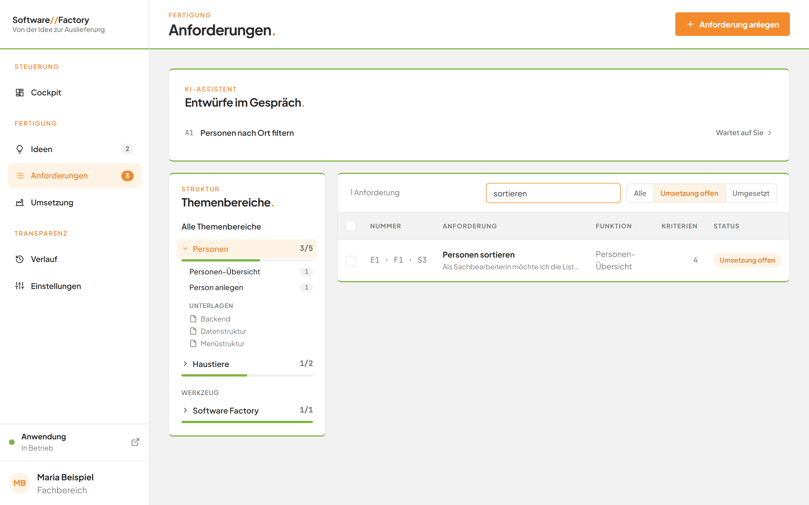
*Bild 3: Filter und Suche wirken gemeinsam.*

Die Einträge der Karte **Themenbereiche** bedeuten:

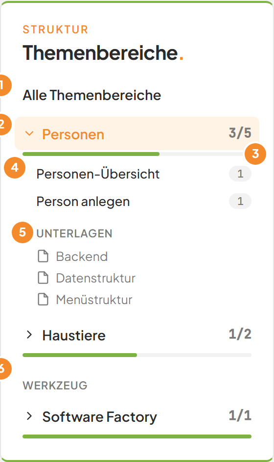
*Bild 4: Die Struktur der Themenbereiche.*

| Nr. | Element | Bedeutung |
|---|---|---|
| 1 | **Alle Themenbereiche** | Hebt die Einschränkung auf. |
| 2 | Name des Themenbereichs | Zeigt rechts den Stand, zum Beispiel **3/5**: drei von fünf Anforderungen sind umgesetzt. |
| 3 | Fortschrittsbalken | Zeigt den Anteil der umgesetzten Anforderungen. |
| 4 | Funktion | Die Zahl rechts nennt die offenen Anforderungen. Ohne offene Anforderung steht dort keine Zahl. |
| 5 | **Unterlagen** | Hintergrundtexte des Themenbereichs, zum Beispiel **Datenstruktur**. |
| 6 | **Werkzeug** | Themenbereiche, die die Software Factory selbst beschreiben. |

Um zum vollständigen Bestand zurückzukehren, klicken Sie auf **Alle Themenbereiche** und danach auf **Alle**.

## Schritt für Schritt: Unterlagen eines Themenbereichs lesen
1. Klicken Sie links auf einen Themenbereich, zum Beispiel **Personen**.
2. Klicken Sie unter **Unterlagen** auf den Namen einer Unterlage, zum Beispiel **Datenstruktur**.
3. Ein Fenster zeigt den Text mit Zwischenüberschriften, Tabellen und Listen.
4. Klicken Sie oben rechts im Fenster auf das Kreuz, um es zu schließen.

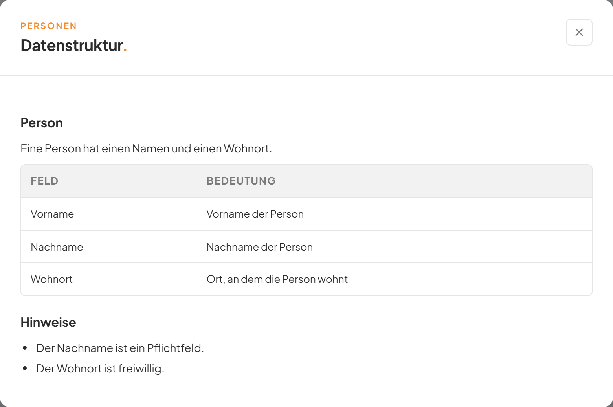
*Bild 5: Eine Unterlage lässt sich nur lesen, nicht ändern.*

## Schritt für Schritt: Eine Anforderung ansehen
1. Klicken Sie in der Tabelle auf den Titel einer Anforderung, zum Beispiel **Personen sortieren**.
2. Die Einzelheiten öffnen sich auf einer eigenen Seite.
3. Klicken Sie oben links auf den Pfeil **Zurück**, um zur Tabelle zurückzukehren.

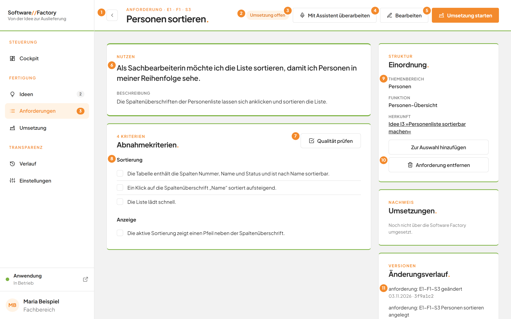
*Bild 6: Die Einzelseite einer offenen Anforderung.*

| Nr. | Element | Bedeutung |
|---|---|---|
| 1 | **Zurück** | Führt zur Seite **Anforderungen**. |
| 2 | Statusmarke | **Umgesetzt** oder **Umsetzung offen**. |
| 3 | **Mit Assistent überarbeiten** | Ändert die Anforderung im Gespräch mit dem KI-Assistenten (siehe [Anforderungs-Assistent](08-anforderungs-assistent.md)). |
| 4 | **Bearbeiten** | Öffnet das Formular zum selbst Ändern. |
| 5 | **Umsetzung starten** | Beauftragt die Umsetzung (siehe [Umsetzung](10-umsetzung.md)). |
| 6 | **Nutzen** | Der Nutzen in einem Satz, darunter die **Beschreibung**, falls vorhanden. |
| 7 | **Qualität prüfen** | Lässt die Abnahmekriterien von der KI prüfen (siehe [Qualitätsprüfung](09-qualitaetspruefung.md)). |
| 8 | **Abnahmekriterien** | Die prüfbaren Aussagen, nach Themen gruppiert. |
| 9 | **Einordnung** | Themenbereich, Funktion und **Herkunft**. Bei einer Anforderung aus einer Idee führt ein Link zu dieser Idee (siehe [Überführung in Anforderungen](06-ueberfuehrung-in-anforderungen.md)). Sonst steht dort **Direkt erfasst**. |
| 10 | **Anforderung entfernen** | Löscht eine offene Anforderung (siehe unten). |
| 11 | **Änderungsverlauf** | Die letzten gesicherten Versionen mit Betreff, Datum und Kurzkennung. |

Rechts stehen außerdem die Karten **Umsetzungen** und **Änderungsverlauf**. Die Karte **Umsetzungen** listet jeden Auftrag, der diese Anforderung umgesetzt hat, mit Nummer, Status und Datum. Ein Klick darauf öffnet den Auftrag. Ohne Auftrag steht dort **Noch nicht über die Software Factory umgesetzt.** Ohne gesicherte Version zeigt der Änderungsverlauf **Noch keine gesicherte Version.**

Bei einer umgesetzten Anforderung trägt jedes Kriterium ein Häkchen. Bei einer offenen Anforderung steht kein Häkchen.

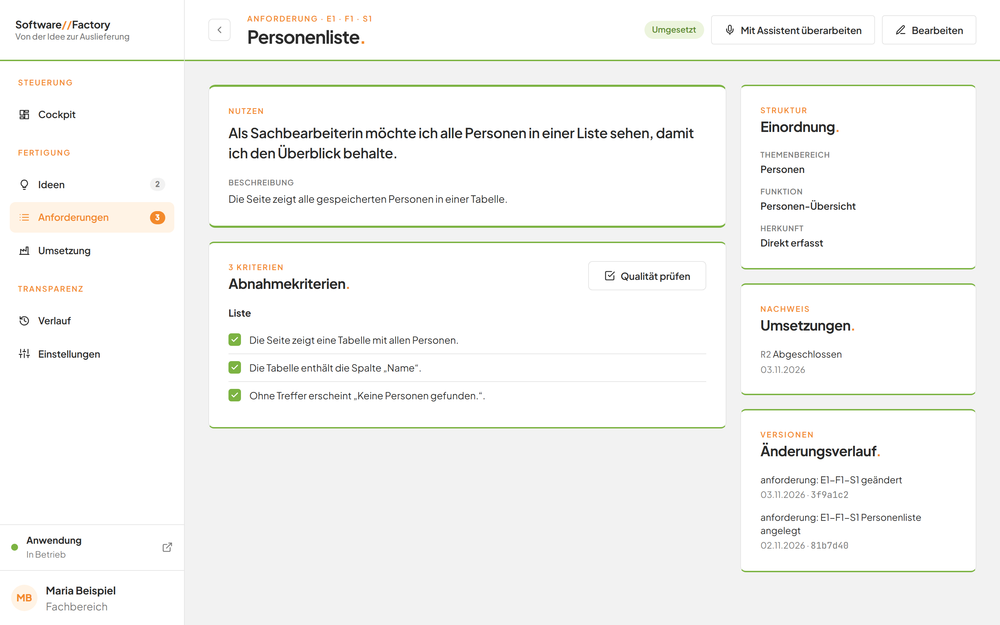
*Bild 7: Eine umgesetzte Anforderung mit Häkchen und dem zugehörigen Auftrag.*

## Schritt für Schritt: Eine Anforderung selbst formulieren
1. Klicken Sie oben rechts auf **Anforderung anlegen**.
2. Klicken Sie im Fenster auf **Selbst formulieren**.
3. Das Formular **Anforderung formulieren.** öffnet sich. Der Cursor steht im Feld **Titel**.
4. Wählen Sie bei **Themenbereich** einen Themenbereich. Ist rechts in der Tabelle schon einer gewählt, steht er bereits da.
5. Wählen Sie bei **Funktion** eine Funktion.
6. Geben Sie bei **Titel** eine kurze Überschrift ein.
7. Beschreiben Sie bei **Nutzen** in einem Satz: **Als … möchte ich …, damit …**
8. Ergänzen Sie bei Bedarf die **Beschreibung**.
9. Schreiben Sie bei **Abnahmekriterien** in die erste Zeile eine prüfbare Aussage.
10. Drücken Sie die Eingabetaste, um eine neue Zeile anzufügen. Alternativ klicken Sie auf **Kriterium hinzufügen**.
11. Klicken Sie unten rechts auf **Anlegen**.
12. Das Formular schließt sich. Die Einzelseite der neuen Anforderung öffnet sich mit der Marke **Umsetzung offen**.

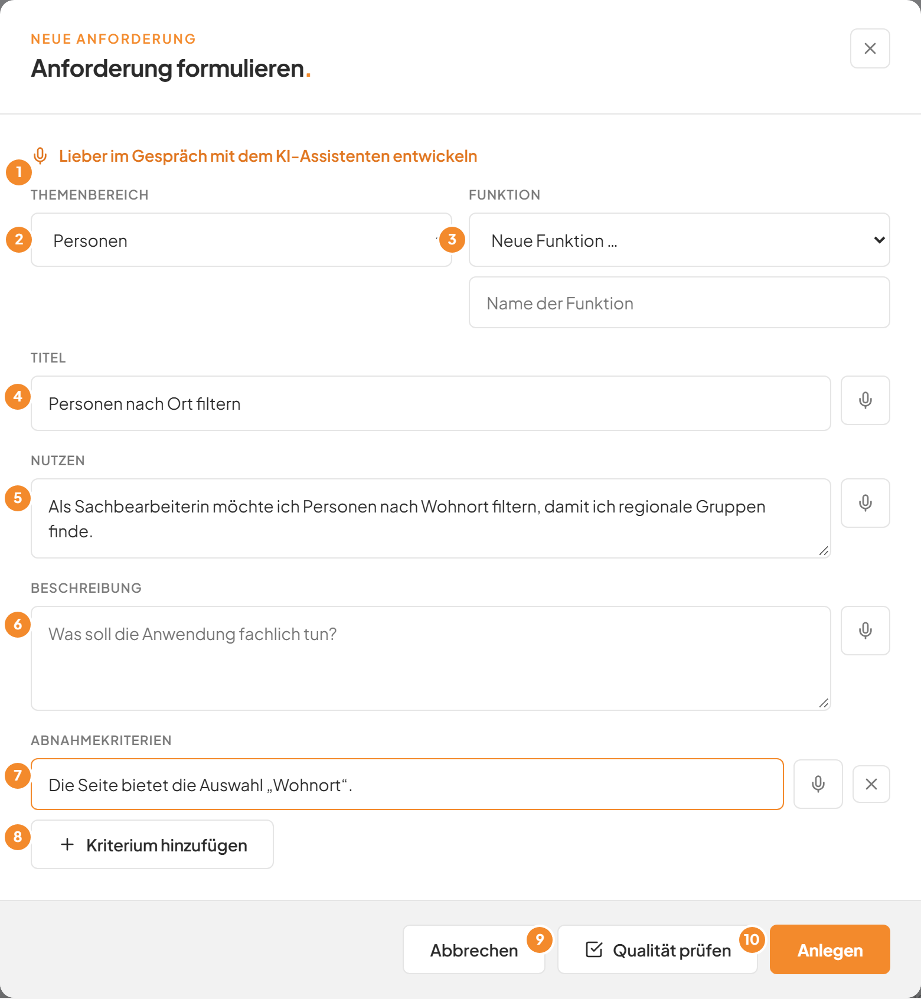
*Bild 8: Das Formular zum Anlegen einer Anforderung.*

| Nr. | Element | Bedeutung |
|---|---|---|
| 1 | **Lieber im Gespräch mit dem KI-Assistenten entwickeln** | Wechselt zum Anforderungs-Assistenten. |
| 2 | **Themenbereich** | Der Themenbereich, zu dem die Anforderung gehört. |
| 3 | **Funktion** | Die Funktion innerhalb des Themenbereichs. |
| 4 | **Titel** | Eine kurze, aussagekräftige Überschrift. |
| 5 | **Nutzen** | Wer was braucht und wozu. |
| 6 | **Beschreibung** | Was die Anwendung fachlich tun soll. |
| 7 | Zeile der **Abnahmekriterien** | Eine prüfbare Aussage. Das Kreuz rechts entfernt die Zeile (**Kriterium entfernen**). |
| 8 | **Kriterium hinzufügen** | Fügt eine neue Zeile an. |
| 9 | **Qualität prüfen** | Prüft die Kriterien mit der KI (siehe [Qualitätsprüfung](09-qualitaetspruefung.md)). |
| 10 | **Anlegen** | Speichert die neue Anforderung. |

Jedes Textfeld hat rechts ein Mikrofon-Symbol. Damit diktieren Sie den Text (siehe [Sprache](05-sprache.md)). Leere Kriterien-Zeilen ignoriert die Anwendung beim Speichern.

Für einen neuen Themenbereich oder eine neue Funktion wählen Sie in der Auswahl **Neuer Themenbereich …** beziehungsweise **Neue Funktion …**. Darunter erscheint ein Feld, in das Sie den Namen eintippen.

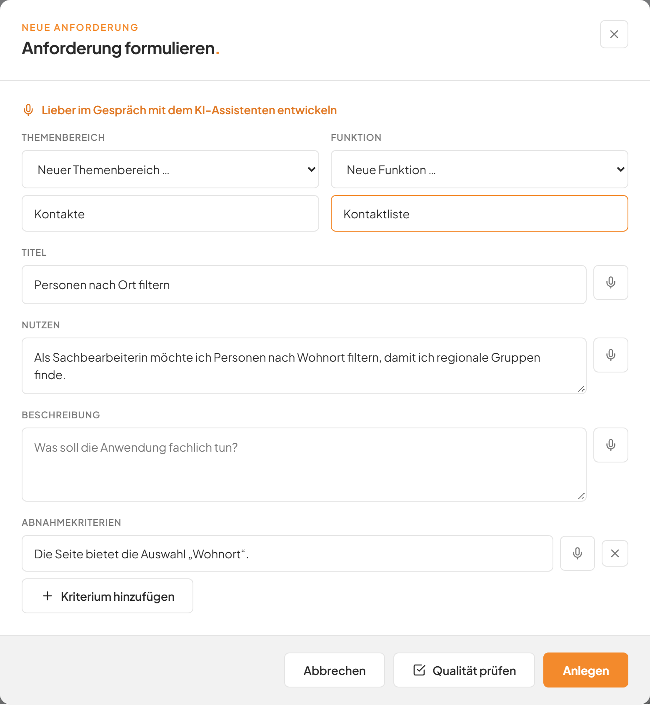
*Bild 9: Ein neuer Themenbereich und eine neue Funktion.*

Gibt es den eingegebenen Namen schon, verwendet die Anwendung den vorhandenen Eintrag. Die neue Anforderung erhält automatisch die nächste freie Nummer und den Status **Umsetzung offen**.

Fehlt eine Angabe, erscheint oben im Formular eine rote Meldung, und nichts wird gespeichert.

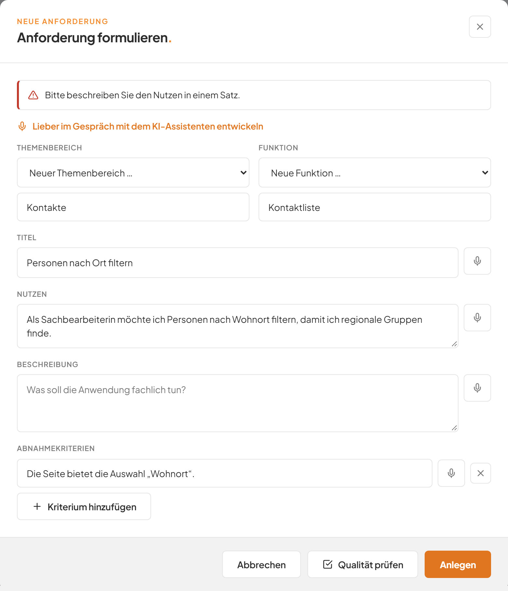
*Bild 10: Eine Meldung im Formular. Korrigieren Sie die Angabe und klicken Sie erneut auf Anlegen.*

## Schritt für Schritt: Eine Anforderung bearbeiten
1. Öffnen Sie die Einzelseite der Anforderung.
2. Klicken Sie oben rechts auf **Bearbeiten**.
3. Das Formular **Anforderung bearbeiten.** öffnet sich. Es enthält die bisherigen Angaben. **Themenbereich** und **Funktion** stehen nicht zur Wahl.
4. Ändern Sie, was nötig ist.
5. Klicken Sie unten rechts auf **Speichern**.
6. Das Formular schließt sich. Die Einzelseite zeigt die Änderung.

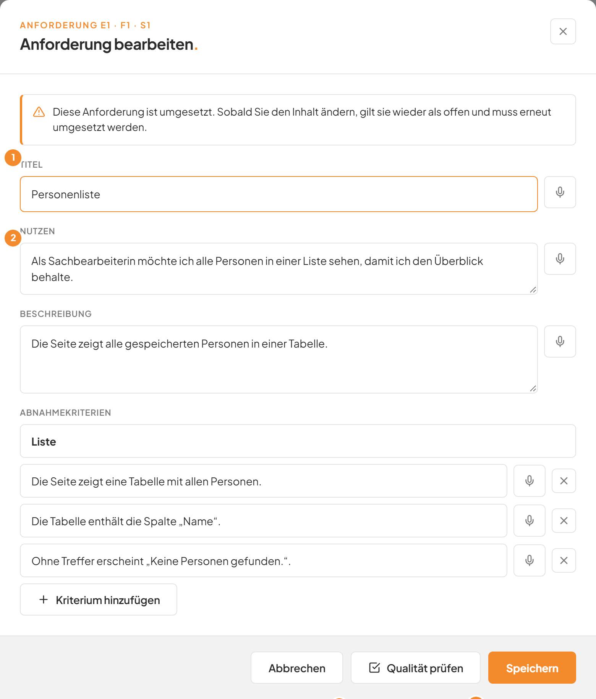
*Bild 11: Das Formular zum Bearbeiten.*

| Nr. | Element | Bedeutung |
|---|---|---|
| 1 | Hinweis | Erscheint bei umgesetzten Anforderungen: Mit einer Änderung gilt sie wieder als offen. |
| 2 | **Titel** | Die Felder sind mit den bisherigen Angaben gefüllt. |
| 3 | **Qualität prüfen** | Prüft die Kriterien (siehe [Qualitätsprüfung](09-qualitaetspruefung.md)). |
| 4 | **Speichern** | Speichert die Änderung. |

Ändern Sie eine umgesetzte Anforderung, gilt sie danach wieder als **Umsetzung offen**. Sie muss dann erneut umgesetzt werden. Bleibt der Inhalt unverändert, wird nichts gespeichert und der Status bleibt.

## Schritt für Schritt: Eine Anforderung entfernen
1. Öffnen Sie die Einzelseite einer Anforderung mit der Marke **Umsetzung offen**.
2. Klicken Sie rechts in der Karte **Einordnung** auf **Anforderung entfernen**.
3. Prüfen Sie im Fenster **Anforderung entfernen.** den Titel.
4. Klicken Sie auf **Entfernen**.
5. Die Seite **Anforderungen** öffnet sich. Die Anforderung steht nicht mehr in der Tabelle.

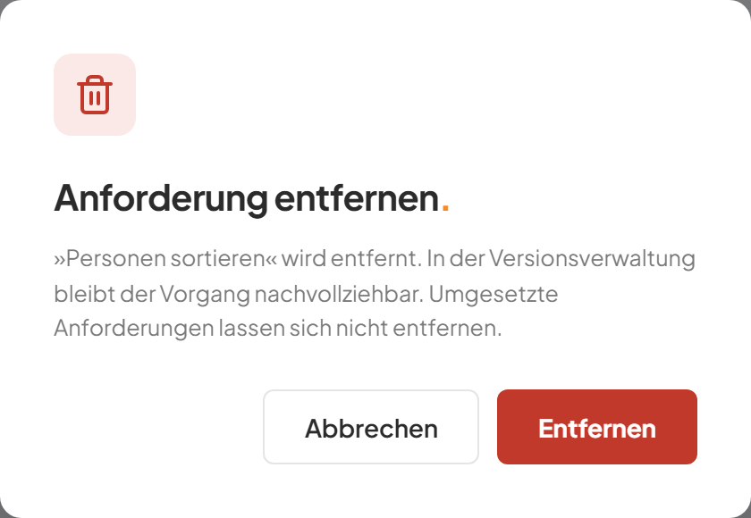
*Bild 12: Die Rückfrage vor dem Entfernen.*

Mit **Abbrechen** schließen Sie das Fenster, ohne etwas zu entfernen. Der Vorgang bleibt in der Versionsverwaltung nachvollziehbar. Wird die Anforderung entfernt, nimmt die Anwendung sie auch aus Ihrer aktuellen Auswahl für die Umsetzung.

Eine Anforderung, die schon einmal umgesetzt war, lässt sich nicht entfernen. Sie bleibt als Nachweis erhalten. Dann erscheint im Fenster eine rote Meldung.

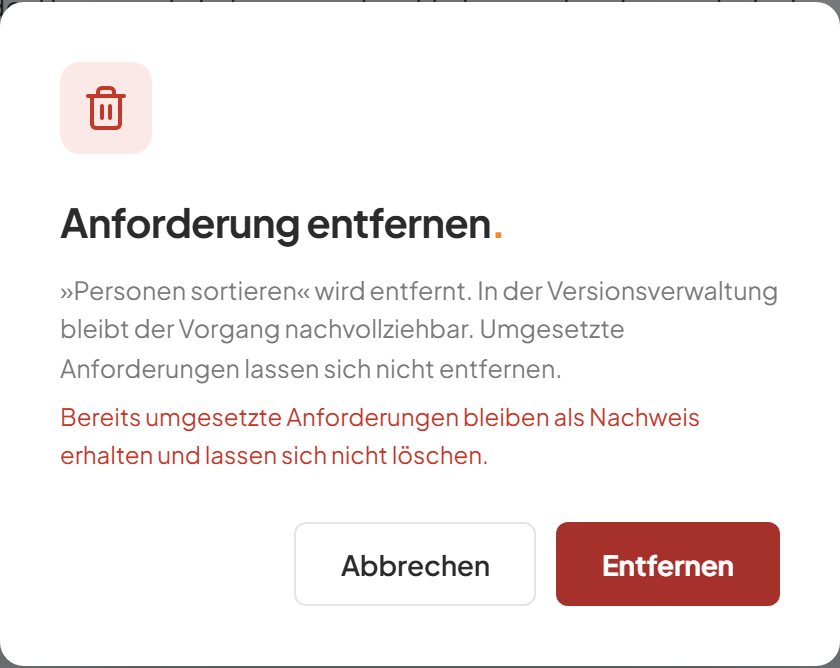
*Bild 13: Eine bereits umgesetzte Anforderung bleibt erhalten.*

## Gut zu wissen
- Anforderungen aus dem Themenbereich **Software Factory** beschreiben die Anwendung selbst. Sie lassen sich hier lesen, aber nicht ändern, entfernen oder umsetzen. Die Einzelseite zeigt dazu einen Hinweis und keine Änderungsschaltflächen.
- Diese Anforderungen erscheinen in der Tabelle nur, wenn Sie links **Software Factory** wählen. Sie zählen nicht in die Zähler.
- Läuft ein Auftrag, sind Änderungen gesperrt (siehe den nächsten Abschnitt).
- Suchen finden Treffer in Titel, Nutzen, Beschreibung, Funktion, Themenbereich und Nummer. In den Abnahmekriterien sucht die Anwendung nicht.
- Die Adresse mit **?filter=offen** am Ende öffnet die Liste direkt mit dem Filter **Umsetzung offen**. Mit **?filter=umgesetzt** öffnet sie **Umgesetzt**.
- Die Seite aktualisiert sich selbst, wenn sich etwas ändert. Sie müssen sie nicht neu laden.

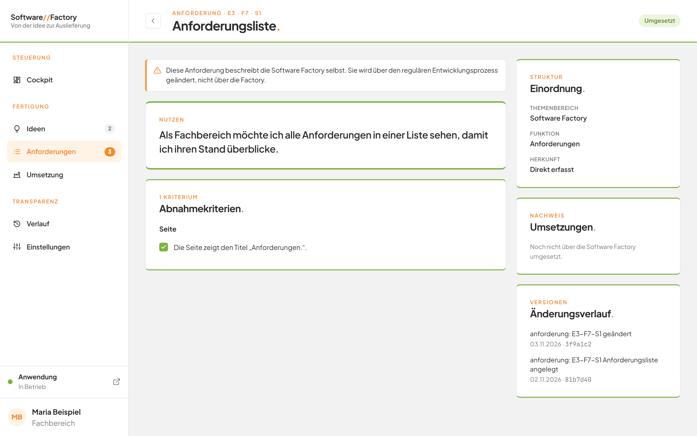
*Bild 14: Anforderungen der Software Factory sind nur lesbar.*

### Sperre während eines Auftrags
Solange ein Auftrag läuft, ändert die KI den gemeinsamen Arbeitsstand. Deshalb sind in dieser Zeit keine Änderungen an Anforderungen möglich. Die Seite zeigt oben einen Hinweis.

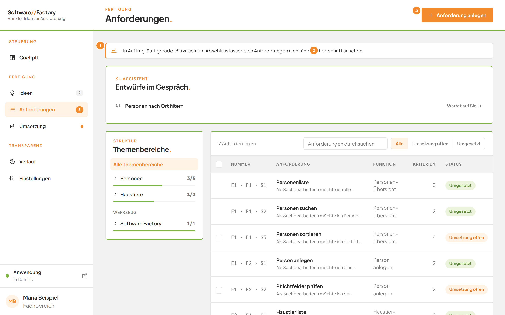
*Bild 15: Der Hinweis während eines laufenden Auftrags.*

| Nr. | Element | Bedeutung |
|---|---|---|
| 1 | Hinweis | **Ein Auftrag läuft gerade. Bis zu seinem Abschluss lassen sich Anforderungen nicht ändern.** |
| 2 | **Fortschritt ansehen** | Öffnet die Seite **Umsetzung** (siehe [Umsetzung](10-umsetzung.md)). |
| 3 | **Anforderung anlegen** | Bleibt auch während eines Auftrags möglich. |

Auf der Einzelseite fehlen in dieser Zeit die Schaltflächen **Mit Assistent überarbeiten**, **Bearbeiten** und **Umsetzung starten**. **Anforderung entfernen** ist ausgegraut. Die Auswahl für die nächste Umsetzung bleibt möglich. Die Sperre endet von selbst, sobald der Auftrag beendet ist.

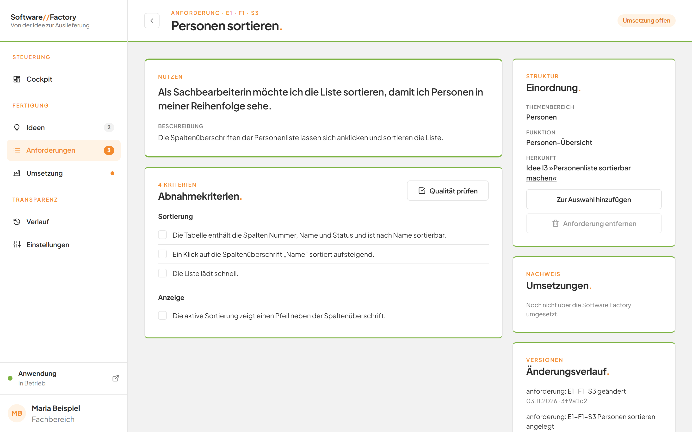
*Bild 16: Die Einzelseite während der Sperre.*

## Wenn etwas nicht klappt

| Das sehen Sie | Das bedeutet es | Das tun Sie |
|---|---|---|
| **Keine Anforderungen gefunden.** mit dem Hinweis **Ändern Sie den Filter oder legen Sie eine neue Anforderung an.** | Kein Eintrag passt zu Suche, Themenbereich und Status. | Leeren Sie das Suchfeld, klicken Sie auf **Alle** und auf **Alle Themenbereiche**. |
| **Diese Anforderung existiert nicht mehr.** | Die Anforderung wurde entfernt oder die Adresse ist falsch. | Öffnen Sie die Seite **Anforderungen** und wählen Sie die Anforderung dort aus. |
| **Bitte geben Sie der Anforderung einen Titel.** | Das Feld **Titel** ist leer. | Tragen Sie einen Titel ein. |
| **Der Titel darf höchstens 120 Zeichen lang sein.** | Der Titel ist zu lang. | Kürzen Sie den Titel. |
| **Bitte beschreiben Sie den Nutzen in einem Satz.** | Das Feld **Nutzen** ist leer. | Schreiben Sie: **Als … möchte ich …, damit …** |
| **Bitte erfassen Sie mindestens ein Abnahmekriterium.** | Es gibt keine ausgefüllte Kriterien-Zeile. | Tragen Sie mindestens eine prüfbare Aussage ein. |
| **Bitte wählen Sie einen Themenbereich.** oder **Bitte wählen Sie eine Funktion.** | Bei **Neuer Themenbereich …** oder **Neue Funktion …** fehlt der Name. | Tragen Sie den Namen ein oder wählen Sie einen vorhandenen Eintrag. |
| **Der Themenbereich „Software Factory“ wird nicht über die Factory geändert.** | Dieser Themenbereich ist nur lesbar. | Wählen Sie einen anderen Themenbereich. |
| **Während eines laufenden Auftrags lassen sich Anforderungen nicht ändern. Bitte warten Sie den Abschluss ab.** | Ein Auftrag läuft. | Warten Sie, bis der Auftrag beendet ist, und versuchen Sie es erneut. |
| **Bereits umgesetzte Anforderungen bleiben als Nachweis erhalten und lassen sich nicht löschen.** | Die Anforderung war schon einmal umgesetzt oder gehört zur Software Factory. | Ändern Sie die Anforderung stattdessen mit **Bearbeiten**. |
| **Diese Unterlage existiert nicht.** | Die Unterlage wurde inzwischen entfernt. | Schließen Sie das Fenster und laden Sie die Seite neu. |
| **Der Factory-Dienst ist nicht erreichbar.** | Die Verbindung zur Software Factory ist unterbrochen. | Prüfen Sie den Betriebsstatus (siehe [Einstellungen](12-einstellungen.md)). |

Weitere Fragen beantwortet die [FAQ der Software Factory](faq.md).
