# Anforderungen mit dem KI-Assistenten entwickeln

## Worum geht es hier?
Der Anforderungs-Assistent hilft Ihnen, eine Anforderung im Gespräch zu formulieren. Sie erzählen in eigenen Worten, was Sie brauchen. Der Assistent stellt Rückfragen und schreibt daraus eine prüfbare Anforderung. Sie können mit dem Assistenten auch eine bestehende Anforderung überarbeiten.

## Wo finde ich das?
1. Klicken Sie in der linken Leiste unter **Fertigung** auf **Anforderungen**.
2. Klicken Sie oben rechts auf **Anforderung anlegen**.
3. Klicken Sie im Fenster auf **Mit dem KI-Assistenten entwickeln**.
4. Beschreiben Sie Ihr Anliegen und klicken Sie auf **Gespräch starten**.

Die Seite **Anforderungen** erklärt die Tabelle ausführlich (siehe [Anforderungen](07-anforderungen.md)).

*Bild 1: Die Auswahl des Wegs.*

## Was Sie auf dem Bildschirm sehen

### Den Weg wählen
| Nr. | Element | Bedeutung |
|---|---|---|
| 1 | **Mit dem KI-Assistenten entwickeln** | Sie erzählen per Stimme oder Text, was Sie brauchen. Der Assistent fragt nach und formuliert die Anforderung aus. |
| 2 | **Selbst formulieren** | Sie schreiben oder diktieren alle Angaben selbst. Die Qualitätsprüfung steht Ihnen trotzdem zur Verfügung. Dieser Weg steht auf der Seite [Anforderungen](07-anforderungen.md). |

### Das Gespräch
Die Seite des Assistenten zeigt links das Gespräch und rechts den wachsenden Entwurf.

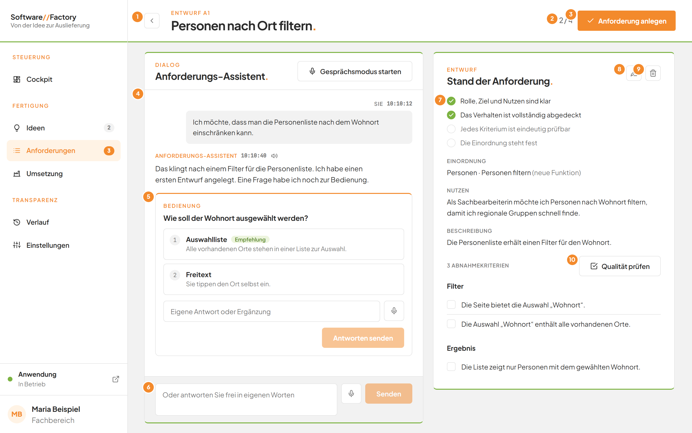
*Bild 2: Gespräch links, Entwurf rechts.*

| Nr. | Element | Bedeutung |
|---|---|---|
| 1 | **Zurück** | Führt zur Seite **Anforderungen**. Der Entwurf bleibt erhalten. |
| 2 | Zahl wie **2/4** | Der Reifegrad: wie viele der vier Punkte in der Liste rechts erfüllt sind. |
| 3 | **Anforderung anlegen** | Speichert den Entwurf als Anforderung. |
| 4 | **Anforderungs-Assistent** | Das Gespräch mit Ihren Nachrichten und den Antworten des Assistenten. |
| 5 | Rückfrage | Der Assistent stellt eine Frage mit Antwortmöglichkeiten. Eine Empfehlung ist grün gekennzeichnet. |
| 6 | Eingabefeld | Dort antworten Sie frei in eigenen Worten. Der Platzhalter lautet **Antworten Sie dem Assistenten oder ergänzen Sie etwas**. |
| 7 | **Stand der Anforderung** | Die vier Punkte: **Rolle, Ziel und Nutzen sind klar**, **Das Verhalten ist vollständig abgedeckt**, **Jedes Kriterium ist eindeutig prüfbar**, **Die Einordnung steht fest**. Ein erfüllter Punkt trägt ein grünes Häkchen. |
| 8 | Stift-Symbol | **Entwurf selbst bearbeiten**. |
| 9 | Papierkorb-Symbol | **Entwurf verwerfen**. |
| 10 | **Qualität prüfen** | Prüft die Abnahmekriterien (siehe [Qualitätsprüfung](09-qualitaetspruefung.md)). |

Unter **Stand der Anforderung** stehen außerdem die Abschnitte **Einordnung**, **Nutzen**, **Beschreibung** und die Abnahmekriterien mit ihrer Anzahl. Ist noch nichts bekannt, steht dort **Noch offen**. Bei der Einordnung steht der Themenbereich, getrennt durch einen Punkt die Funktion. Ein Zusatz wie **(neuer Themenbereich)** oder **(neue Funktion)** zeigt, dass dieser Eintrag noch nicht existiert.

## Schritt für Schritt: Eine Anforderung im Gespräch entwickeln
1. Klicken Sie auf der Seite **Anforderungen** oben rechts auf **Anforderung anlegen**.
2. Klicken Sie auf **Mit dem KI-Assistenten entwickeln**.
3. Das Fenster **Anforderung entwickeln.** öffnet sich.
4. Schreiben Sie unter **Was soll die Anwendung künftig können** in eigenen Worten, was Sie brauchen und wofür. Alternativ klicken Sie auf das Mikrofon und sprechen (siehe [Sprache](05-sprache.md)).
5. Klicken Sie unten rechts auf **Gespräch starten**.
6. Die Seite des Assistenten öffnet sich. Unter dem Titel steht **Entwurf A1**, wobei die Zahl je Entwurf unterschiedlich ist.
7. Warten Sie, bis der Assistent antwortet. Solange steht dort **Anforderungs-Assistent arbeitet**.
8. Beantworten Sie die Rückfrage: Klicken Sie auf eine Antwort oder schreiben Sie bei **Eigene Antwort oder Ergänzung** einen Text.
9. Klicken Sie auf **Weiter**. Bei der letzten Frage heißt die Schaltfläche **Antworten senden**.
10. Der Assistent aktualisiert den Entwurf rechts. Wiederholen Sie die Schritte 8 und 9, bis alle vier Punkte unter **Stand der Anforderung** ein Häkchen tragen.
11. Klicken Sie oben rechts auf **Anforderung anlegen**.
12. Die Einzelseite der neuen Anforderung öffnet sich mit der Marke **Umsetzung offen**.

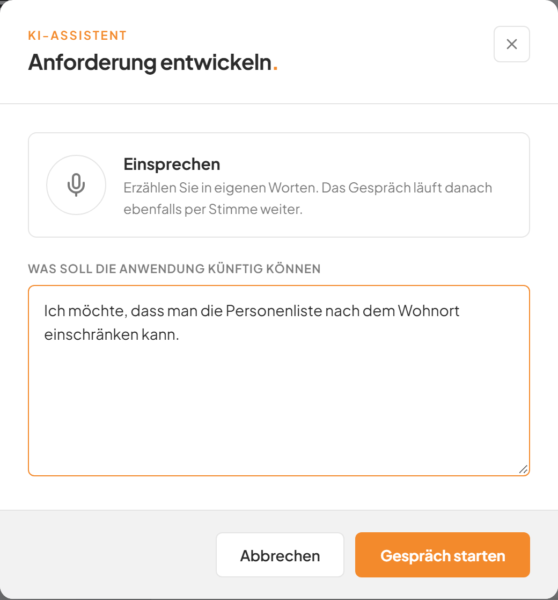
*Bild 3: Das Anliegen in eigenen Worten beschreiben.*

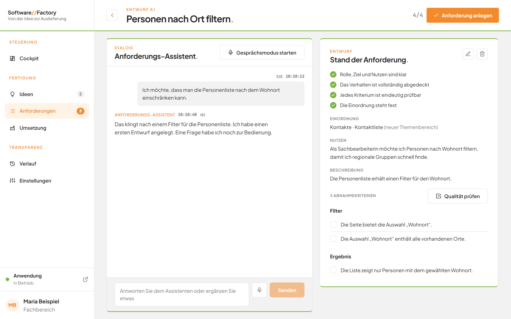
*Bild 4: Alle vier Punkte sind erfüllt. Jetzt lässt sich die Anforderung anlegen.*

Lassen Sie das Textfeld leer, erscheint unter dem Feld eine rote Meldung, und das Gespräch startet nicht.

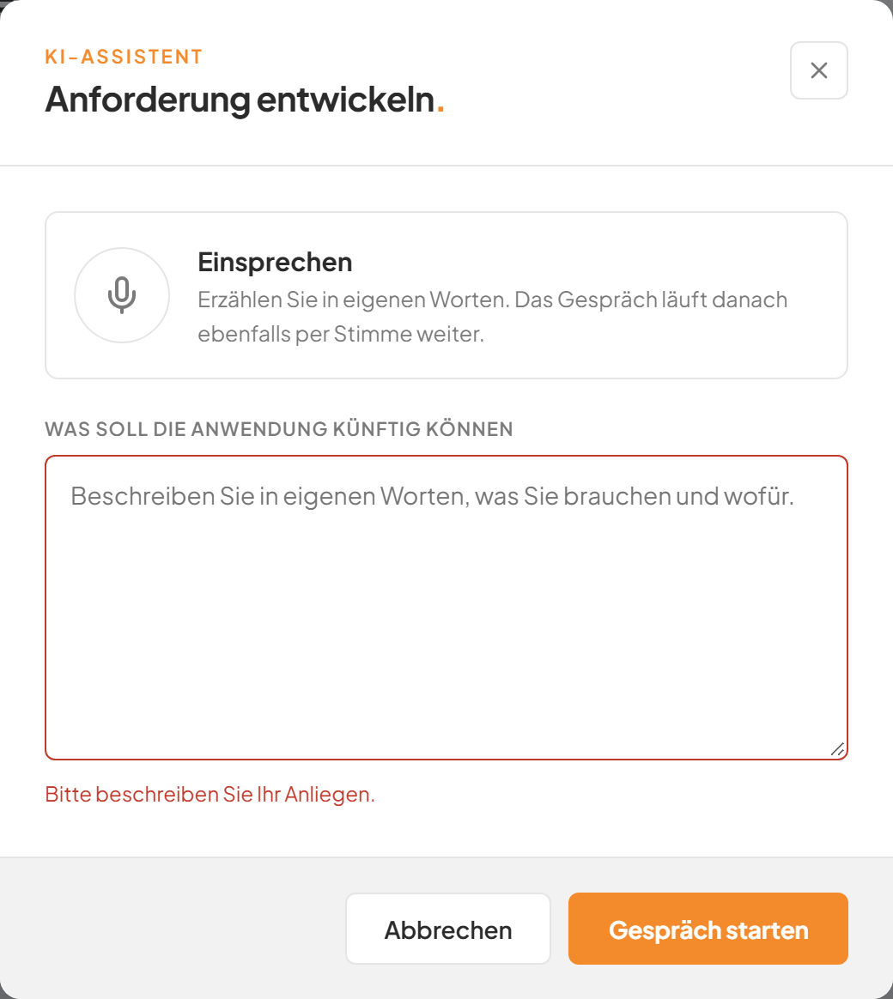
*Bild 3a: Ohne Text startet das Gespräch nicht.*

Der Entwurf ist noch keine Anforderung. Erst **Anforderung anlegen** speichert sie im Bestand.

Statt auf eine Rückfrage zu antworten, schreiben Sie in das Eingabefeld unten, drücken die Eingabetaste oder klicken auf **Senden**. Mit **Zurückgehen** kehren Sie bei mehreren Fragen zur vorherigen zurück.

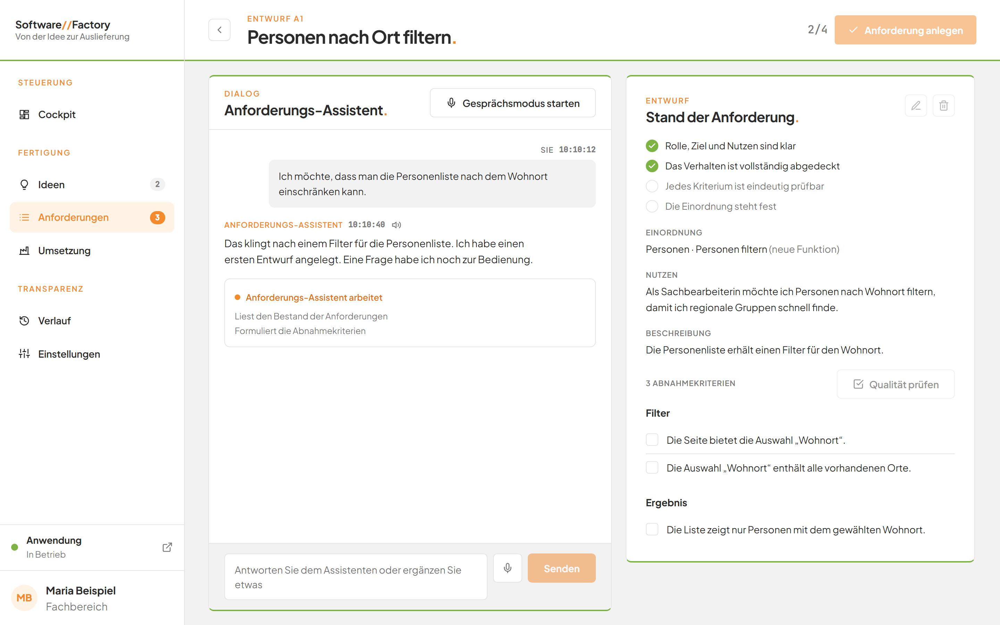
*Bild 5: Solange der Assistent arbeitet, ist das Eingabefeld gesperrt.*

## Schritt für Schritt: Mit dem Gesprächsmodus sprechen
1. Klicken Sie oben im Gespräch auf **Gesprächsmodus starten**.
2. Der Assistent liest seine Antworten vor. Danach hört er zu.
3. Sprechen Sie Ihre Antwort. Eine kurze Pause beendet Ihren Beitrag.
4. Klicken Sie auf **Gesprächsmodus beenden**, um wieder zu tippen.

Die Sprachfunktionen beschreibt die Seite [Sprache](05-sprache.md).

## Schritt für Schritt: Einen offenen Entwurf fortsetzen
1. Klicken Sie in der linken Leiste auf **Anforderungen**.
2. Suchen Sie oben die Karte **Entwürfe im Gespräch.**
3. Klicken Sie auf den gewünschten Eintrag.
4. Das Gespräch öffnet sich dort, wo Sie aufgehört haben.

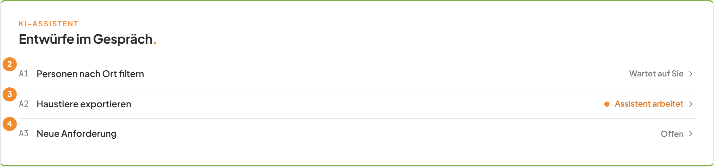
*Bild 6: Offene Entwürfe auf der Seite Anforderungen.*

| Nr. | Element | Bedeutung |
|---|---|---|
| 1 | **Entwürfe im Gespräch.** | Die Karte erscheint nur, wenn mindestens ein Entwurf offen ist. |
| 2 | **Wartet auf Sie** | Der Assistent hat zuletzt geantwortet. Jetzt sind Sie dran. |
| 3 | **Assistent arbeitet** | Die KI arbeitet gerade an einer Antwort. |
| 4 | **Offen** | Der Entwurf ist offen, und Ihre Nachricht war die letzte. Ein Entwurf ohne Titel heißt **Neue Anforderung**. |

Mehrere Entwürfe lassen sich gleichzeitig führen.

## Schritt für Schritt: Den Entwurf selbst bearbeiten
1. Klicken Sie rechts neben **Stand der Anforderung.** auf das Stift-Symbol.
2. Das Formular **Entwurf bearbeiten.** öffnet sich mit der Dachzeile **Entwurf A1**.
3. Ändern Sie die Felder. Bei einem neuen Entwurf wählen Sie auch **Themenbereich** und **Funktion**.
4. Klicken Sie unten rechts auf **Speichern**.
5. Das Formular schließt sich. Der Entwurf rechts zeigt Ihre Änderung.

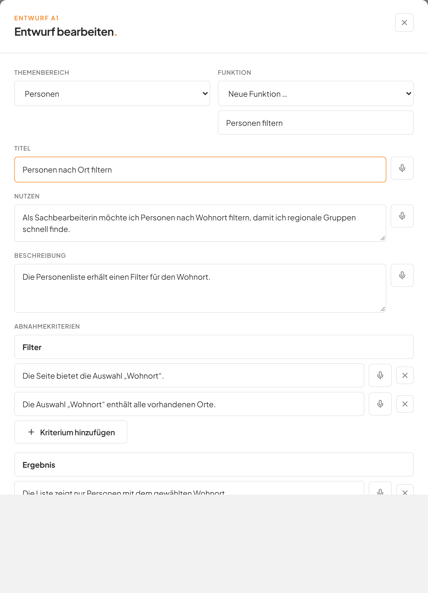
*Bild 7: Der Entwurf lässt sich im bekannten Formular ändern.*

Das Speichern im Formular legt noch keine Anforderung an. Das Formular ist auf der Seite [Anforderungen](07-anforderungen.md) beschrieben. Das Stift-Symbol ist ausgegraut, solange der Assistent arbeitet.

## Schritt für Schritt: Einen Entwurf verwerfen
1. Klicken Sie rechts neben **Stand der Anforderung.** auf das Papierkorb-Symbol.
2. Klicken Sie im Fenster **Entwurf verwerfen.** auf **Verwerfen**.
3. Die Seite **Anforderungen** öffnet sich. Der Entwurf und das Gespräch sind entfernt.

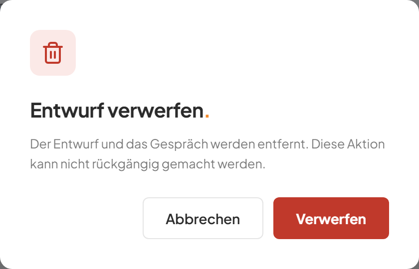
*Bild 8: Die Rückfrage vor dem Verwerfen.*

Mit **Abbrechen** behalten Sie den Entwurf. Verworfene Entwürfe lassen sich nicht wiederherstellen. Das Papierkorb-Symbol ist ausgegraut, solange der Assistent arbeitet.

## Schritt für Schritt: Eine bestehende Anforderung überarbeiten
1. Öffnen Sie die Einzelseite einer Anforderung (siehe [Anforderungen](07-anforderungen.md)).
2. Klicken Sie oben rechts auf **Mit Assistent überarbeiten**.
3. Beschreiben Sie im Fenster **Mit dem Assistenten überarbeiten.** unter **Was soll sich ändern**, was anders werden soll.
4. Klicken Sie auf **Gespräch starten**.
5. Die Seite des Assistenten öffnet sich. Oben steht **Überarbeitung von E1 · F1 · S3**, wobei die Nummer Ihrer Anforderung entspricht.
6. Führen Sie das Gespräch wie bei einer neuen Anforderung.
7. Klicken Sie oben rechts auf **Änderung speichern**.
8. Die Einzelseite der Anforderung öffnet sich mit dem neuen Inhalt. Die Marke zeigt **Umsetzung offen**.

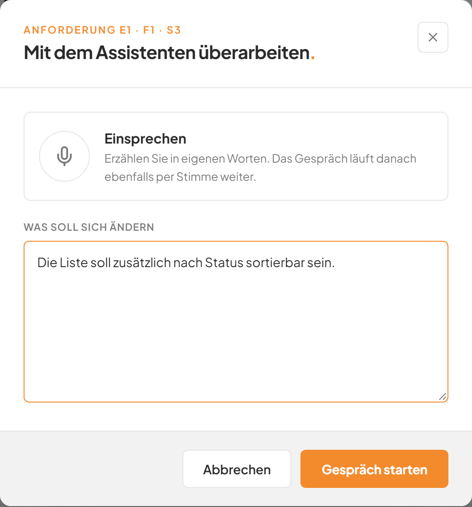
*Bild 9: Beschreiben Sie, was sich ändern soll.*

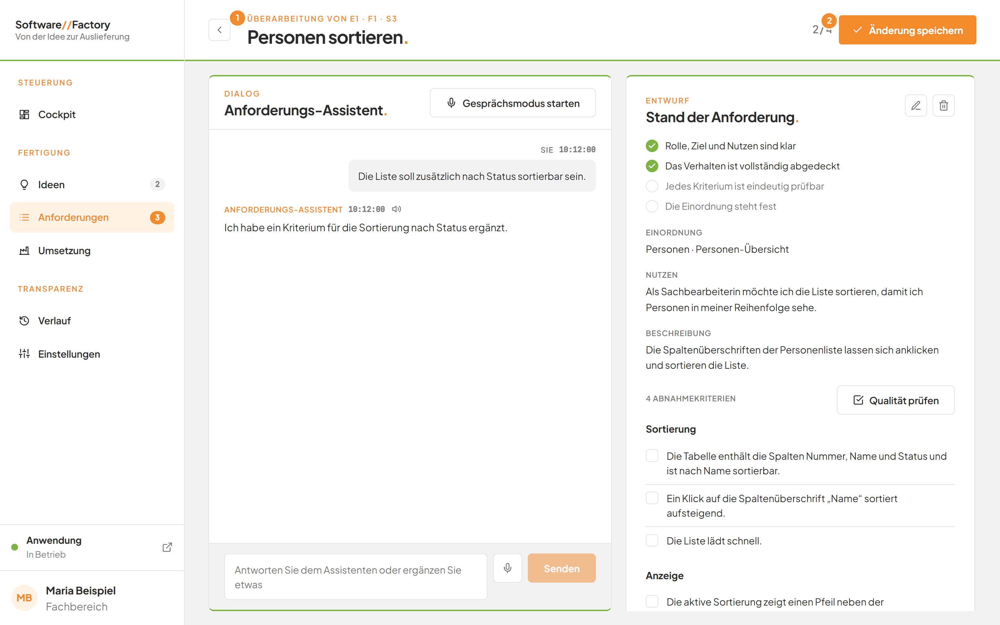
*Bild 10: Die Überarbeitung einer bestehenden Anforderung.*

| Nr. | Element | Bedeutung |
|---|---|---|
| 1 | **Überarbeitung von …** | Nennt die Anforderung, an der Sie arbeiten. |
| 2 | **Änderung speichern** | Überträgt den Entwurf in die Anforderung. |

Der Assistent arbeitet auf einer Kopie. Die Anforderung ändert sich erst, wenn Sie **Änderung speichern** klicken. Die Einordnung bleibt gleich, auch wenn der Assistent eine andere vorschlägt. Im Formular **Entwurf bearbeiten.** fehlen bei einer Überarbeitung die Auswahlen **Themenbereich** und **Funktion**.

## Gut zu wissen
- **Anforderung anlegen** ist ausgegraut, solange kein **Titel**, kein **Nutzen** oder kein Abnahmekriterium vorliegt und solange der Assistent arbeitet.
- Nach dem Speichern zeigt das Gespräch **Dieser Entwurf wurde gespeichert.** Der Entwurf verschwindet aus der Karte **Entwürfe im Gespräch.** und lässt sich nicht mehr ändern.
- Der Assistent verändert nichts im Bestand, bevor Sie speichern.
- Auch das Speichern aus dem Assistenten ist während eines laufenden Auftrags gesperrt (siehe [Anforderungen](07-anforderungen.md)).
- Ein Entwurf bleibt erhalten, wenn Sie die Seite verlassen.

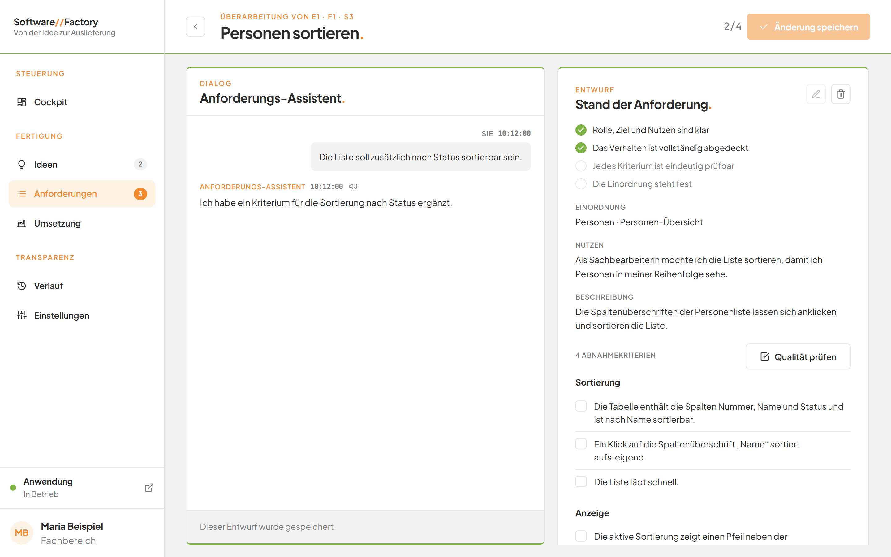
*Bild 11: Ein gespeicherter Entwurf ist nur noch lesbar.*

## Wenn etwas nicht klappt

| Das sehen Sie | Das bedeutet es | Das tun Sie |
|---|---|---|
| **Bitte beschreiben Sie Ihr Anliegen.** unter dem Textfeld | Das Feld **Was soll die Anwendung künftig können** ist leer. | Beschreiben Sie Ihr Anliegen in einem oder mehreren Sätzen. |
| **Bitte beschreiben Sie, was die Anwendung künftig können soll.** | Die Anwendung hat keinen Text erhalten. | Tragen Sie einen Text ein und klicken Sie erneut auf **Gespräch starten**. |
| **Dieser Entwurf existiert nicht mehr.** | Der Entwurf wurde verworfen. | Öffnen Sie die Seite **Anforderungen** und starten Sie neu. |
| **Die KI arbeitet noch an der letzten Antwort.** | Sie haben den Entwurf geändert, während der Assistent arbeitet. | Warten Sie, bis **Assistent arbeitet** verschwindet. |
| Rote Meldung mit der Schaltfläche **Erneut versuchen** | Die KI konnte nicht antworten. | Klicken Sie auf **Erneut versuchen**. |
| **Dieser Entwurf wurde bereits gespeichert.** | Der Entwurf ist schon eine Anforderung. | Öffnen Sie die Anforderung auf der Seite **Anforderungen**. |
| **Während eines laufenden Auftrags lassen sich Anforderungen nicht ändern. Bitte warten Sie den Abschluss ab.** | Ein Auftrag läuft. | Warten Sie auf das Ende des Auftrags und klicken Sie erneut auf **Anforderung anlegen**. |
| **Bitte geben Sie der Anforderung einen Titel.**, **Bitte beschreiben Sie den Nutzen in einem Satz.** oder **Bitte erfassen Sie mindestens ein Abnahmekriterium.** | Dem Entwurf fehlt eine Angabe. | Ergänzen Sie sie im Gespräch oder mit dem Stift-Symbol. |
| **Der Themenbereich „Software Factory“ wird nicht über die Factory geändert.** | Dieser Themenbereich ist nur lesbar. | Wählen Sie im Formular einen anderen Themenbereich. |

Weitere Fragen beantwortet die [FAQ der Software Factory](faq.md).
