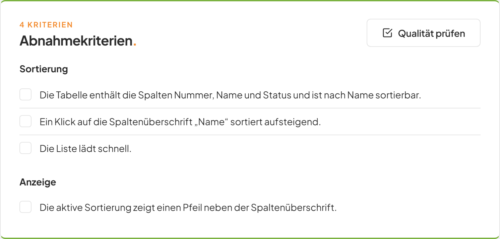
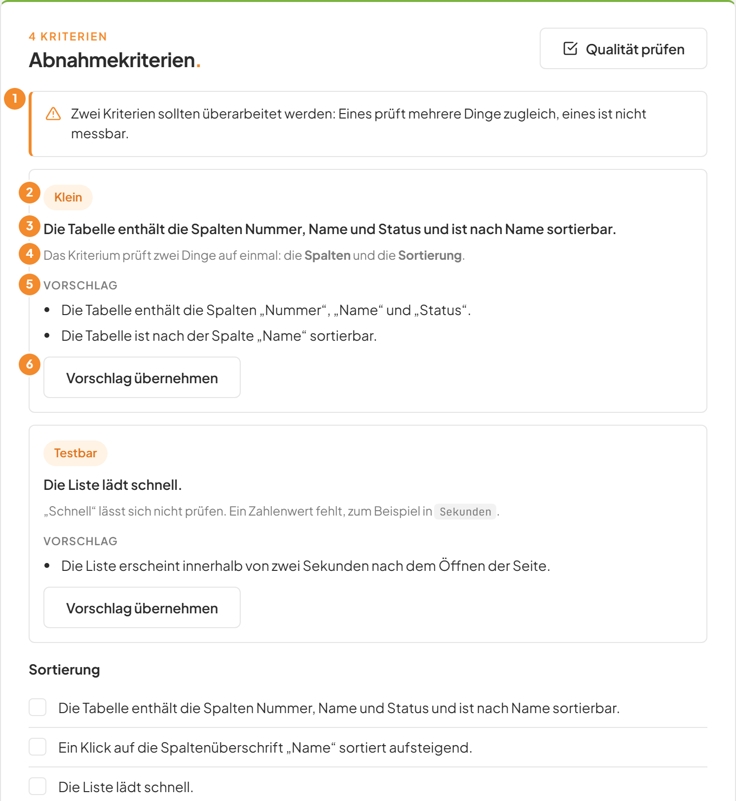
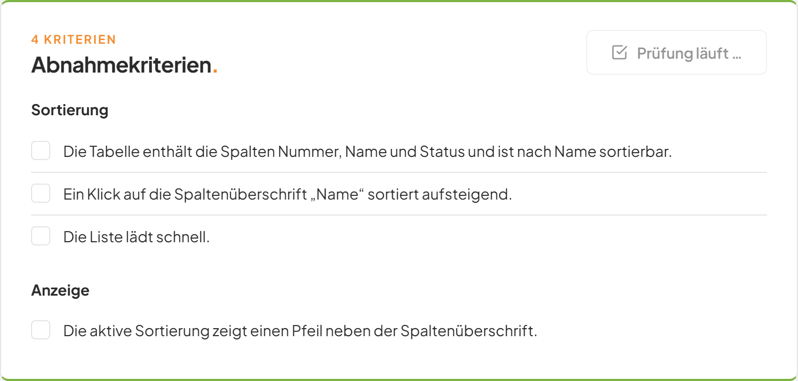
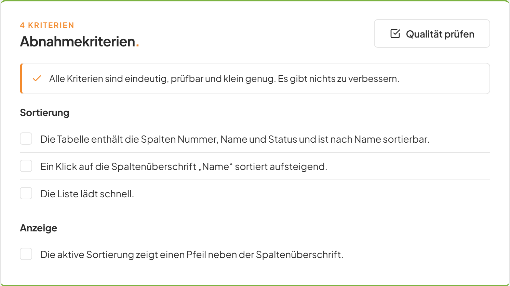
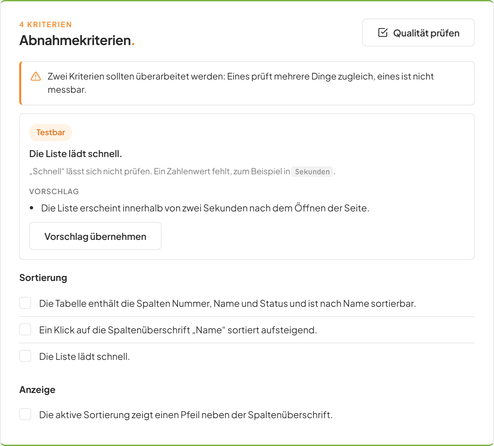
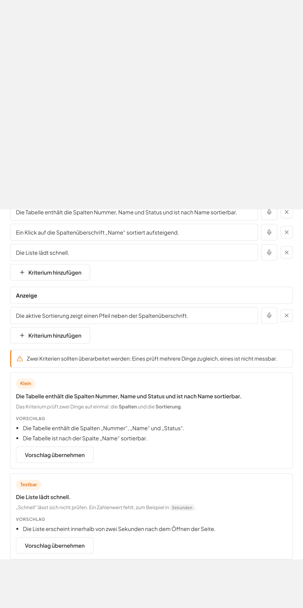
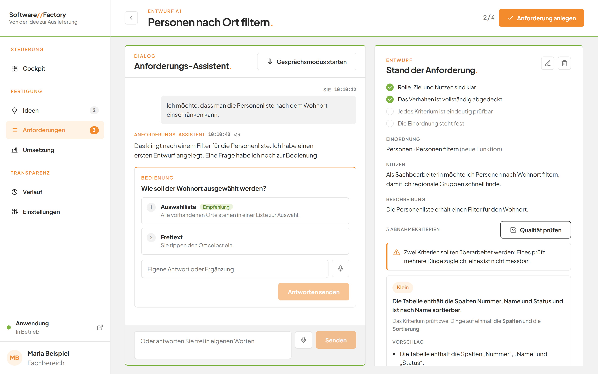
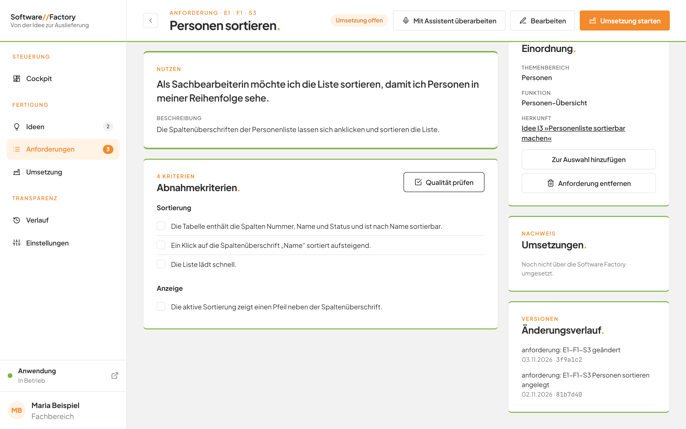

# Die Qualität von Abnahmekriterien prüfen lassen

## Worum geht es hier?
Abnahmekriterien müssen eindeutig, prüfbar und klein genug sein, damit die KI sie richtig umsetzen kann. Die Qualitätsprüfung bewertet jedes Kriterium und nennt Mängel mit einem Verbesserungsvorschlag. Sie verändert dabei selbst nichts. Sie entscheiden, ob Sie einen Vorschlag übernehmen.

## Wo finde ich das?
Die Schaltfläche **Qualität prüfen** gibt es an drei Stellen:

1. Auf der Einzelseite einer Anforderung in der Karte **Abnahmekriterien.**
2. Im Formular **Anforderung formulieren.** und **Anforderung bearbeiten.** unten in der Fußzeile.
3. Auf der Seite des Assistenten rechts neben den Abnahmekriterien.

Um die erste Stelle zu erreichen, klicken Sie links auf **Anforderungen** und dann auf den Titel einer Anforderung (siehe [Anforderungen](07-anforderungen.md)).

*Bild 1: Die Karte Abnahmekriterien mit der Schaltfläche oben rechts.*

Bei Anforderungen aus dem Themenbereich **Software Factory** fehlt die Schaltfläche auf der Einzelseite.

## Was Sie auf dem Bildschirm sehen

*Bild 2: Das Ergebnis einer Prüfung.*

| Nr. | Element | Bedeutung |
|---|---|---|
| 1 | Hinweis mit Zusammenfassung | Zwei Sätze zum Gesamtergebnis. Ein Häkchen bedeutet, dass alles in Ordnung ist. Ein Warnzeichen bedeutet, dass Sie nachbessern sollten. |
| 2 | Orange Marke | Das betroffene Prinzip. Mögliche Werte: **Unabhängig**, **Verhandelbar**, **Wertvoll**, **Schätzbar**, **Klein** und **Testbar**. |
| 3 | Fettgedruckter Satz | Das geprüfte Kriterium im ursprünglichen Wortlaut. |
| 4 | Graue Zeile | Der Mangel: Was an dem Kriterium nicht stimmt. |
| 5 | **Vorschlag** | Eine oder mehrere bessere Formulierungen. |
| 6 | **Vorschlag übernehmen** | Ersetzt das Kriterium durch die Vorschläge. |

Es erscheinen nur Kriterien mit echten Mängeln. Text in Hochkommas wie `Sekunden` erscheint als Code-Schrift, Text in doppelten Sternen erscheint fett.

Die sechs Prinzipien bedeuten in einfachen Worten:

| Marke | Frage an das Kriterium |
|---|---|
| **Unabhängig** | Lässt es sich ohne andere Kriterien verstehen? |
| **Verhandelbar** | Beschreibt es das Ergebnis und nicht die technische Lösung? |
| **Wertvoll** | Bringt es dem Fachbereich einen erkennbaren Nutzen? |
| **Schätzbar** | Lässt sich der Aufwand abschätzen? |
| **Klein** | Prüft es genau eine Sache? |
| **Testbar** | Lässt sich eindeutig mit Ja oder Nein entscheiden, ob es erfüllt ist? |

## Schritt für Schritt: Kriterien prüfen
1. Öffnen Sie die Einzelseite einer Anforderung.
2. Klicken Sie in der Karte **Abnahmekriterien.** auf **Qualität prüfen**.
3. Die Schaltfläche heißt jetzt **Prüfung läuft …** und ist ausgegraut. Warten Sie.
4. Oberhalb der Kriterien erscheint das Ergebnis.
5. Lesen Sie den Hinweis oben. Ein Häkchen bedeutet, dass nichts zu tun ist.

*Bild 3: Während der Prüfung ist die Schaltfläche ausgegraut.*

Bei einem guten Ergebnis zeigt der Hinweis ein Häkchen und es folgen keine Befunde.

*Bild 4: Alle Kriterien sind in Ordnung.*

Klicken Sie erneut auf **Qualität prüfen**, entfernt die Anwendung das alte Ergebnis und prüft neu. Die Prüfung dauert einige Sekunden bis wenige Minuten.

## Schritt für Schritt: Einen Vorschlag übernehmen
1. Lesen Sie einen Befund und den **Vorschlag**.
2. Klicken Sie im Befund auf **Vorschlag übernehmen**.
3. Der Befund verschwindet aus dem Ergebnis. Das bemängelte Kriterium ist durch den Vorschlag ersetzt. Die übrigen Kriterien bleiben unverändert.

*Bild 5: Der übernommene Befund ist verschwunden, ein weiterer bleibt.*

Was die Übernahme bewirkt, hängt vom Ort ab.

| Ort | Wirkung der Übernahme |
|---|---|
| Einzelseite einer Anforderung | Die Anforderung wird sofort geändert und gilt als **Umsetzung offen**. Die Änderung erscheint im **Änderungsverlauf**. |
| Formular | Nur das Formular ändert sich. Erst **Speichern** oder **Anlegen** sichert die Änderung. |
| Seite des Assistenten | Der Entwurf wird sofort geändert. Die Anforderung entsteht erst mit **Anforderung anlegen**. |

Auf der Einzelseite erscheint **Vorschlag übernehmen** nur, wenn die Anforderung änderbar ist. Das gilt nicht für Anforderungen der Software Factory und nicht während eines laufenden Auftrags.

## Schritt für Schritt: Im Formular prüfen
1. Füllen Sie das Formular aus oder öffnen Sie **Bearbeiten**.
2. Klicken Sie unten auf **Qualität prüfen**.
3. Das Ergebnis erscheint unter den Abnahmekriterien.
4. Klicken Sie bei Bedarf auf **Vorschlag übernehmen**.
5. Klicken Sie unten rechts auf **Anlegen** beziehungsweise **Speichern**.

*Bild 6: Das Ergebnis im Formular.*

## Schritt für Schritt: Im Assistenten prüfen
1. Klicken Sie rechts im Abschnitt mit den Abnahmekriterien auf **Qualität prüfen**.
2. Das Ergebnis erscheint über der Kriterienliste.
3. Klicken Sie bei Bedarf auf **Vorschlag übernehmen**.

*Bild 7: Das Ergebnis rechts im Entwurf.*

Die Schaltfläche ist ausgegraut, solange kein **Titel**, kein **Nutzen** oder kein Abnahmekriterium vorliegt und solange der Assistent arbeitet.

## Gut zu wissen
- Die Prüfung verändert nichts und speichert nichts. Erst Ihre Übernahme ändert Inhalte.
- Die Prüfung nutzt dieselben Regeln wie der Assistent. Sie bewertet jedes Kriterium nach den genannten Prinzipien.
- Ein Befund bezieht sich auf den genauen Wortlaut eines Kriteriums. Haben Sie das Kriterium inzwischen geändert, passt die Übernahme nicht mehr.
- Die Prüfung erfordert eine laufende KI-Anbindung (siehe [Einstellungen](12-einstellungen.md)).
- Vorschläge sind Hilfen. Sie dürfen sie ablehnen und das Kriterium selbst ändern.

*Bild 8: Eine rote Meldung zeigt, wenn die Prüfung nicht gelungen ist.*

## Wenn etwas nicht klappt

| Das sehen Sie | Das bedeutet es | Das tun Sie |
|---|---|---|
| **Prüfung läuft …** dauert sehr lange | Die KI arbeitet noch. | Warten Sie. Die Seite bleibt bedienbar. |
| Rote Meldung nach der Prüfung, zum Beispiel **Die KI hat keine Antwort geliefert.** | Die KI konnte nicht antworten. | Klicken Sie erneut auf **Qualität prüfen**. Hilft das nicht, prüfen Sie den Systemzustand (siehe [Einstellungen](12-einstellungen.md)). |
| **Bitte geben Sie der Anforderung einen Titel.**, **Bitte beschreiben Sie den Nutzen in einem Satz.** oder **Bitte erfassen Sie mindestens ein Abnahmekriterium.** | Vor der Prüfung fehlt eine Pflichtangabe. | Ergänzen Sie die Angabe und prüfen Sie erneut. |
| **Qualität prüfen** ist ausgegraut (Assistent) | Titel, Nutzen oder Kriterium fehlen, oder der Assistent arbeitet. | Ergänzen Sie die Angaben oder warten Sie. |
| **Vorschlag übernehmen** fehlt | Die Anforderung ist nicht änderbar. | Prüfen Sie, ob ein Auftrag läuft oder die Anforderung zur Software Factory gehört. |
| **Während eines laufenden Auftrags lassen sich Anforderungen nicht ändern. Bitte warten Sie den Abschluss ab.** | Sie haben auf der Einzelseite eine Übernahme versucht, während ein Auftrag läuft. | Warten Sie auf das Ende des Auftrags. |

Weitere Fragen beantwortet die [FAQ der Software Factory](faq.md).
