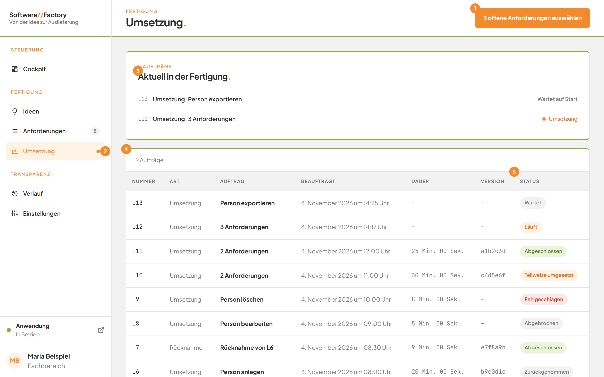
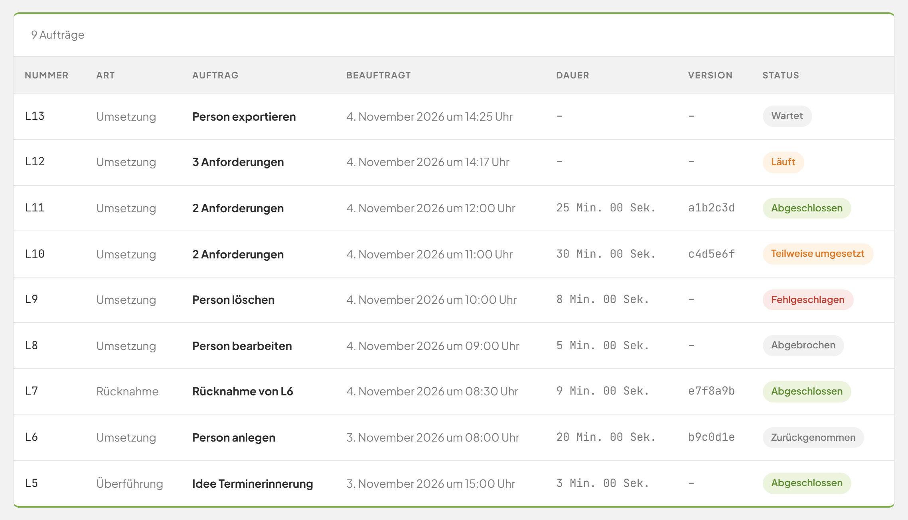
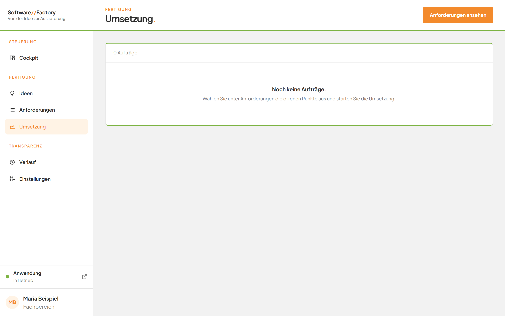

# Aufträge verfolgen: die Seite Umsetzung

## Worum geht es hier?
Auf der Seite **Umsetzung** sehen Sie alle Aufträge der Software Factory. Ein Auftrag ist eine Arbeit, die die Factory für Sie erledigt, zum Beispiel das Umsetzen von Anforderungen.
Es läuft immer nur ein Auftrag gleichzeitig. Weitere Aufträge stehen in einer Warteschlange und starten nacheinander von selbst.
Sie brauchen die Seite, um zu sehen, was gerade läuft, was wartet und wie frühere Aufträge ausgegangen sind.

## Wo finde ich das?
1. Öffnen Sie die Software Factory.
2. Klicken Sie in der linken Leiste unter **Fertigung** auf **Umsetzung**.

Läuft oder wartet ein Auftrag, steht rechts neben **Umsetzung** ein oranger Punkt.

*Bild 1: Die Seite Umsetzung mit einem laufenden und einem wartenden Auftrag.*

## Was Sie auf dem Bildschirm sehen

| Nr. | Element | Bedeutung |
|---|---|---|
| 1 | Schaltfläche oben rechts | Führt zur Liste der offenen Anforderungen. Sie zeigt zum Beispiel **5 offene Anforderungen auswählen**. Gibt es keine offene Anforderung, heißt sie **Anforderungen ansehen**. |
| 2 | Oranger Punkt an **Umsetzung** | Ein Auftrag wartet oder läuft gerade. |
| 3 | Karte **Aktuell in der Fertigung.** | Zeigt wartende und laufende Aufträge. Sie erscheint nur, solange es solche gibt. |
| 4 | Zeile über der Tabelle | Nennt die Anzahl der Aufträge, zum Beispiel **9 Aufträge**. |
| 5 | Spalte **Status** | Zeigt, wie weit ein Auftrag ist. |

Die Tabelle hat die Spalten **Nummer**, **Art**, **Auftrag**, **Beauftragt**, **Dauer**, **Version** und **Status**. Der neueste Auftrag steht oben.

- **Nummer:** die Kennung des Auftrags, zum Beispiel **L12**.
- **Art:** **Umsetzung**, **Überführung** oder **Rücknahme**.
- **Dauer:** wie lange der Auftrag gearbeitet hat. Solange Start oder Ende fehlen, steht dort **–**.
- **Version:** die Kurzkennung des gesicherten Stands. Ohne Version steht dort **–**.

*Bild 2: Die Tabelle mit den Marken Wartet, Läuft, Abgeschlossen, Teilweise umgesetzt, Fehlgeschlagen, Abgebrochen und Zurückgenommen.*

| Marke | Bedeutung |
|---|---|
| **Wartet** | Der Auftrag steht in der Warteschlange. |
| **Läuft** | Die Factory arbeitet gerade daran. |
| **Abgeschlossen** | Der Auftrag ist vollständig erledigt. |
| **Teilweise umgesetzt** | Nicht alle Anforderungen des Auftrags wurden fertig. |
| **Fehlgeschlagen** | Der Auftrag ist mit einem Fehler beendet worden. |
| **Abgebrochen** | Sie haben den Auftrag abgebrochen. |
| **Zurückgenommen** | Die Auslieferung wurde später rückgängig gemacht. |

## Schritt für Schritt: Die Warteschlange verstehen
1. Öffnen Sie die Seite **Umsetzung**.
2. Sehen Sie oben die Karte **Aktuell in der Fertigung.** an. Sie nennt über dem Titel die Anzahl, zum Beispiel **2 Aufträge**.
3. Lesen Sie jeden Eintrag. Er zeigt die Nummer, die Art und den Titel, zum Beispiel **Umsetzung: 3 Anforderungen**.
4. Achten Sie auf die Angabe rechts. Bei einem laufenden Auftrag steht dort der Name der aktiven Phase. Bei einem wartenden Auftrag steht dort **Wartet auf Start**.

Ergebnis: Sie wissen, welcher Auftrag arbeitet und welche Aufträge danach folgen. Die Aufträge starten in der Reihenfolge, in der sie beauftragt wurden.

## Schritt für Schritt: Einen Auftrag öffnen
1. Klicken Sie in der Karte **Aktuell in der Fertigung.** oder in der Tabelle auf den gewünschten Auftrag.
2. Die Seite des Auftrags öffnet sich. Sie ist in [Einen Auftrag verfolgen](10b-auftrag.md) beschrieben.

## Schritt für Schritt: Einen neuen Auftrag beauftragen
1. Klicken Sie oben rechts auf die orange Schaltfläche, zum Beispiel **5 offene Anforderungen auswählen**.
2. Die Liste der offenen Anforderungen öffnet sich. Wie es weitergeht, steht in [Anforderungen auswählen und beauftragen](10a-auswahl-und-beauftragung.md).

## Gut zu wissen
- Es läuft immer nur ein Auftrag. Das gilt für Umsetzungen, Überführungen und Rücknahmen gemeinsam.
- Sie können weitere Aufträge beauftragen, während einer läuft. Sie warten dann.
- Wird der Dienst der Factory neu gestartet, gelten wartende und laufende Aufträge als fehlgeschlagen. Der Auftrag zeigt dann **Der Auftrag wurde durch einen Neustart des Dienstes unterbrochen.** Sie können ihn erneut beauftragen.
- Ein Auftrag, der zurückgenommen wurde, trägt in der Tabelle die Marke **Zurückgenommen**.

*Bild 3: Die Seite Umsetzung, solange noch kein Auftrag beauftragt wurde.*

Ohne Aufträge steht in der Tabelle **Noch keine Aufträge.** und darunter **Wählen Sie unter Anforderungen die offenen Punkte aus und starten Sie die Umsetzung.**

## Wenn etwas nicht klappt

| Das sehen Sie | Das bedeutet es | Das tun Sie |
|---|---|---|
| **Noch keine Aufträge.** | Es wurde noch nichts beauftragt. | Wählen Sie unter **Anforderungen** offene Punkte aus und starten Sie die Umsetzung. |
| **Wird geladen …** über der Tabelle | Die Seite lädt die Aufträge noch. | Warten Sie einen Moment. |
| Ein Auftrag steht lange auf **Wartet** | Ein anderer Auftrag arbeitet noch. | Warten Sie, bis der laufende Auftrag fertig ist. |
| Ein Auftrag zeigt **Der Auftrag wurde durch einen Neustart des Dienstes unterbrochen.** | Die Factory wurde während der Arbeit neu gestartet. | Öffnen Sie den Auftrag und klicken Sie auf **Erneut beauftragen** oder zuerst auf **Änderungen verwerfen**. |

Weitere Fragen beantwortet die [FAQ](faq.md).

## Weiterführende Seiten
- [Anforderungen auswählen und beauftragen](10a-auswahl-und-beauftragung.md)
- [Einen Auftrag verfolgen](10b-auftrag.md)
- [Das Arbeitsprotokoll](10c-arbeitsprotokoll.md)
- [Abbrechen und Änderungen verwerfen](10d-abbrechen-und-verwerfen.md)
- [Eine Auslieferung zurücknehmen](10e-auslieferung-zuruecknehmen.md)
- [Einen Auftrag erneut beauftragen](10f-erneut-beauftragen.md)
- [Geänderte Bereiche](10g-geaenderte-bereiche.md)
- [Selbstständige Nachbesserung](10h-nachbesserung.md)
- Zurück zur [Navigation](01-navigation.md), zum [Cockpit](02-cockpit.md) und zu den [Anforderungen](07-anforderungen.md)
