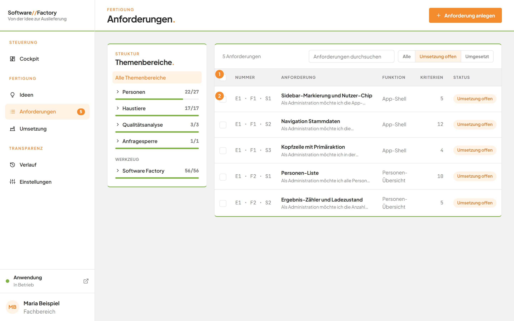
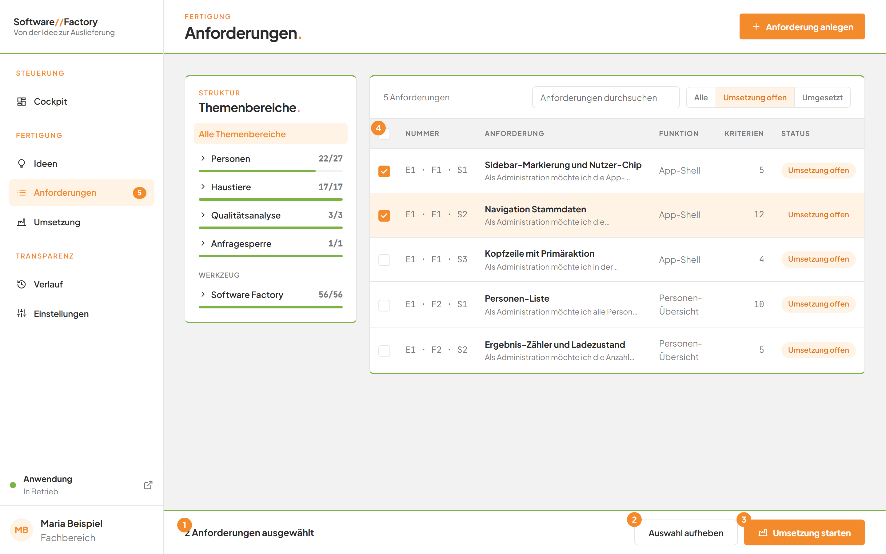
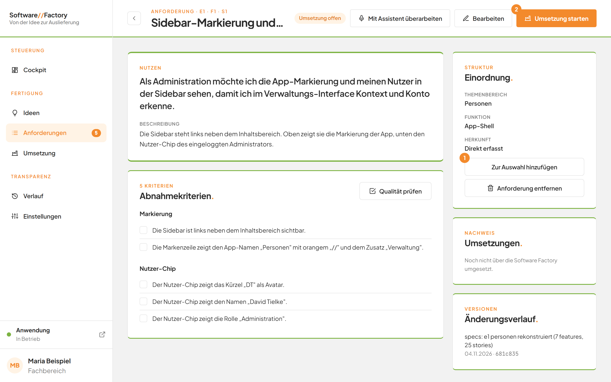
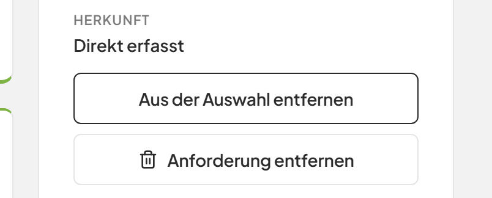
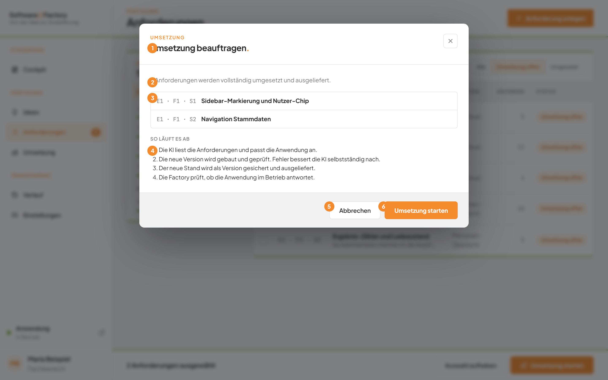
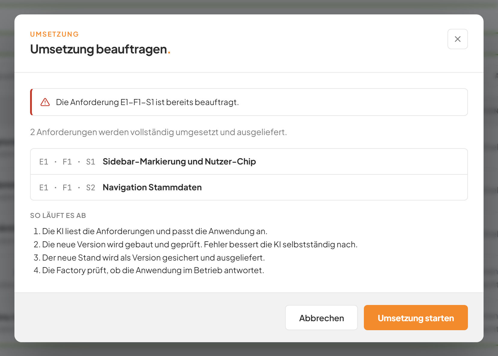

# Anforderungen auswählen und beauftragen

## Worum geht es hier?
Offene Anforderungen setzt die Software Factory für Sie um und liefert das Ergebnis aus. Dafür wählen Sie die Anforderungen aus und beauftragen die Umsetzung.
Eine offene Anforderung ist eine, die noch nicht umgesetzt ist. Sie erkennen sie an der Marke **Umsetzung offen**.
Ein Dialog erklärt vor dem Start, was passiert.

## Wo finde ich das?
1. Klicken Sie in der linken Leiste unter **Fertigung** auf **Anforderungen**.
2. Klicken Sie über der Tabelle auf den Filter **Umsetzung offen**. Alternativ klicken Sie auf der Seite **Umsetzung** oben rechts auf die orange Schaltfläche.

*Bild 1: Die Anforderungsliste mit dem Filter Umsetzung offen.*

## Was Sie auf dem Bildschirm sehen

| Nr. | Element | Bedeutung |
|---|---|---|
| 1 | Auswahlfeld im Tabellenkopf, **Alle offenen Anforderungen auswählen** | Wählt alle sichtbaren offenen Anforderungen auf einmal aus. |
| 2 | Auswahlfeld in einer Zeile | Wählt genau diese Anforderung aus. |

Nur offene Anforderungen haben ein Auswahlfeld. Umgesetzte Anforderungen und die Anforderungen der Software Factory selbst haben keines.
Das Auswahlfeld im Tabellenkopf ist grau, wenn keine auswählbare Anforderung sichtbar ist.

## Schritt für Schritt: In der Liste auswählen
1. Klicken Sie links in der Zeile auf das Auswahlfeld der gewünschten Anforderung.
2. Wiederholen Sie das für jede weitere Anforderung.
3. Alternativ klicken Sie im Tabellenkopf auf **Alle offenen Anforderungen auswählen**. Damit wählen Sie alle sichtbaren offenen Anforderungen aus.

Ergebnis: Die Felder sind markiert. Unten auf der Seite erscheint die Auswahlleiste. Ein Klick auf das Auswahlfeld öffnet nicht die Detailseite der Anforderung.

*Bild 2: Die Auswahlleiste am unteren Rand.*

| Nr. | Element | Bedeutung |
|---|---|---|
| 1 | Anzahl, zum Beispiel **2 Anforderungen ausgewählt** | Zeigt, wie viele Anforderungen Sie gewählt haben. Bei einer steht **1 Anforderung ausgewählt**. |
| 2 | **Auswahl aufheben** | Leert die Auswahl. |
| 3 | **Umsetzung starten** | Öffnet den Dialog zur Beauftragung. |
| 4 | Auswahlfeld im Tabellenkopf | Hebt die Auswahl aller sichtbaren Anforderungen auf, wenn sie schon alle gewählt sind. |

## Schritt für Schritt: Auf der Detailseite auswählen
1. Klicken Sie in der Liste auf den Titel einer offenen Anforderung.
2. Klicken Sie in der Karte mit den Eckdaten auf **Zur Auswahl hinzufügen**.

*Bild 3: Die Detailseite einer offenen Anforderung.*

| Nr. | Element | Bedeutung |
|---|---|---|
| 1 | **Zur Auswahl hinzufügen** | Nimmt die Anforderung in die Auswahl auf. |
| 2 | **Umsetzung starten** (oben rechts) | Beauftragt nur diese eine Anforderung. |

Ergebnis: Die Schaltfläche heißt jetzt **Aus der Auswahl entfernen**. Mit einem Klick darauf nehmen Sie die Anforderung wieder heraus.

*Bild 4: Die Anforderung ist ausgewählt.*

Die Auswahl bleibt erhalten, wenn Sie zwischen den Seiten wechseln. Beim Neuladen der Seite geht sie verloren.

## Schritt für Schritt: Die Umsetzung beauftragen
1. Klicken Sie in der Auswahlleiste unten auf **Umsetzung starten**. Auf der Detailseite klicken Sie oben rechts auf **Umsetzung starten**.
2. Der Dialog **Umsetzung beauftragen.** öffnet sich.
3. Prüfen Sie die Liste der Anforderungen. Sie zeigt Nummer und Titel jeder Anforderung.
4. Lesen Sie den Abschnitt **So läuft es ab**.
5. Klicken Sie unten rechts auf **Umsetzung starten**.

*Bild 5: Der Dialog zur Beauftragung.*

| Nr. | Element | Bedeutung |
|---|---|---|
| 1 | Titel **Umsetzung beauftragen.** mit der Dachzeile **Umsetzung** | Name des Dialogs. |
| 2 | Satz unter dem Titel | Nennt den Umfang, zum Beispiel **2 Anforderungen werden vollständig umgesetzt und ausgeliefert.** |
| 3 | Liste | Nummer und Titel jeder Anforderung. |
| 4 | **So läuft es ab** | Die vier Schritte: Die KI liest die Anforderungen und passt die Anwendung an. Die neue Version wird gebaut und geprüft, Fehler bessert die KI selbstständig nach. Der neue Stand wird als Version gesichert und ausgeliefert. Die Factory prüft, ob die Anwendung im Betrieb antwortet. |
| 5 | **Abbrechen** | Schließt den Dialog, ohne etwas zu beauftragen. |
| 6 | **Umsetzung starten** | Beauftragt die Umsetzung. |

Ergebnis: Die Seite des neuen Auftrags öffnet sich, und die Auswahl ist leer. Der Auftrag trägt bei einer Anforderung deren Titel, bei mehreren den Titel **{Anzahl} Anforderungen**.
Läuft schon ein Auftrag, steht der neue in der Warteschlange.

## Gut zu wissen
- Die KI setzt die Anforderungen vollständig um und liefert die neue Version aus. Planen Sie das ein, bevor Sie starten.
- Anforderungen der Software Factory selbst lassen sich hier nicht umsetzen.
- Eine Anforderung, die schon wartet oder läuft, lässt sich nicht noch einmal beauftragen.
- Den Fortschritt sehen Sie auf der Seite [Umsetzung](10-umsetzung.md) und im [Auftrag](10b-auftrag.md).

## Wenn etwas nicht klappt

*Bild 6: Der Dialog zeigt die Meldung der Factory an.*

| Das sehen Sie | Das bedeutet es | Das tun Sie |
|---|---|---|
| **Bitte wählen Sie mindestens eine Anforderung aus.** | Es ist keine Anforderung gewählt. | Schließen Sie den Dialog und wählen Sie eine Anforderung aus. |
| **Die Anforderung {Nummer} ist bereits umgesetzt.** | Die Anforderung ist schon fertig. | Nehmen Sie sie aus der Auswahl. |
| **Der Themenbereich „Software Factory“ lässt sich nicht über die Factory selbst umsetzen.** | Anforderungen der Factory selbst sind ausgeschlossen. | Nehmen Sie sie aus der Auswahl. |
| **Die Anforderung {Nummer} ist bereits beauftragt.** | Die Anforderung wartet oder läuft schon. | Verfolgen Sie den Auftrag auf der Seite **Umsetzung**. |
| Das Auswahlfeld im Tabellenkopf ist grau | Es sind keine offenen Anforderungen sichtbar. | Ändern Sie den Filter auf **Umsetzung offen**. |

Weitere Fragen beantwortet die [FAQ](faq.md). Mehr zur Liste steht unter [Anforderungen](07-anforderungen.md).
