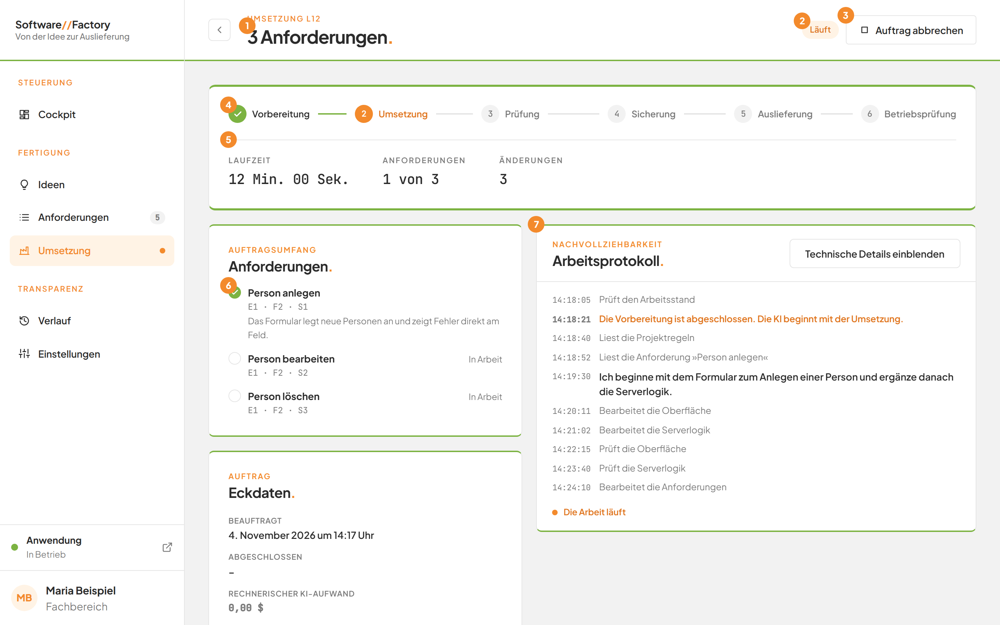
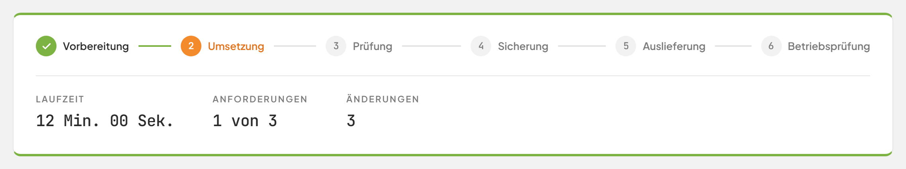
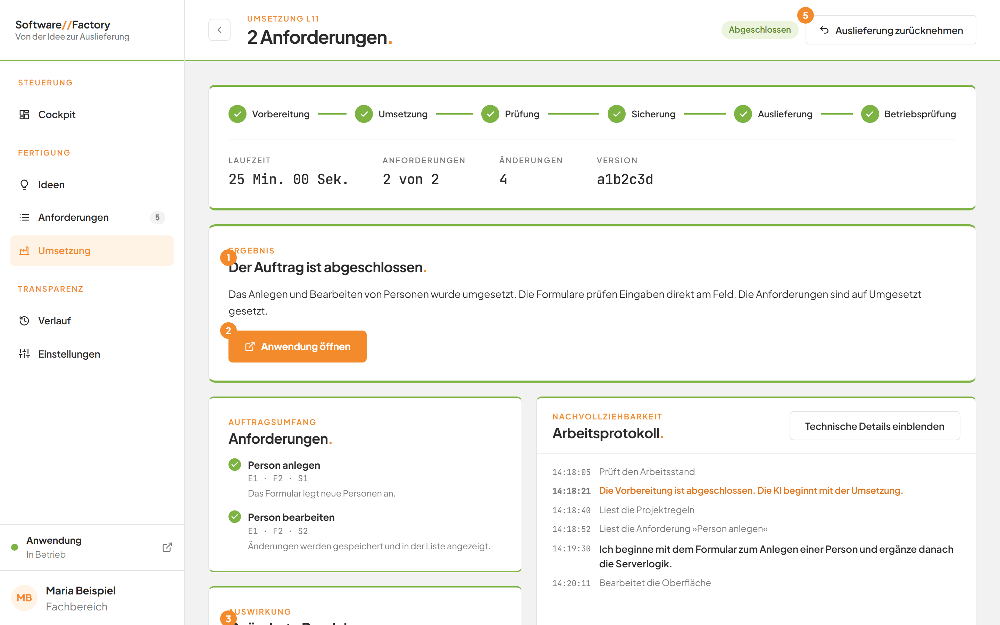
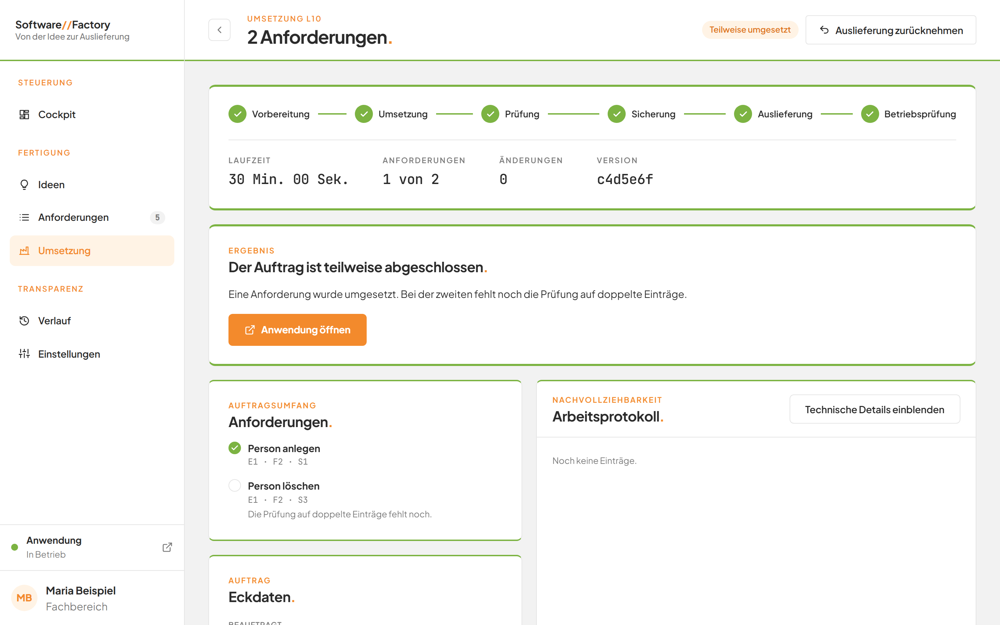
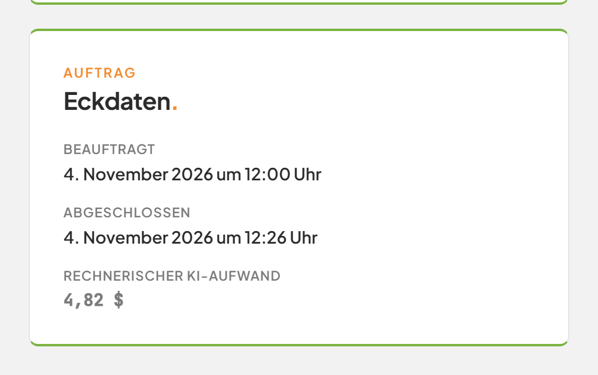
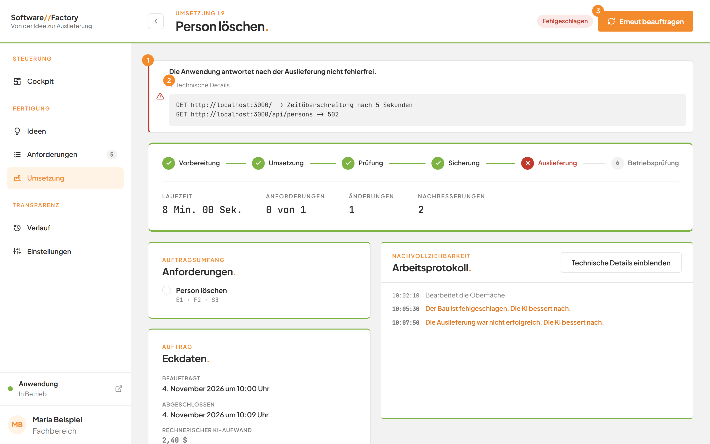
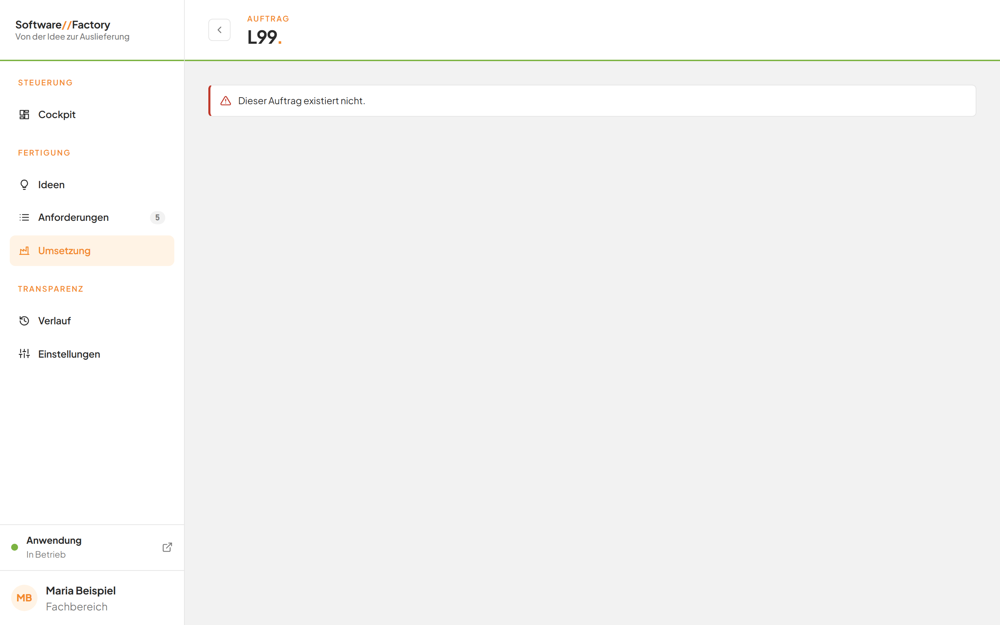

# Einen Auftrag verfolgen

## Worum geht es hier?
Die Seite eines Auftrags zeigt, wie weit die Factory ist. Sie sehen die Phasen der Arbeit, die Laufzeit, die betroffenen Anforderungen und am Ende das Ergebnis.
Sie brauchen die Seite, wenn Sie wissen wollen, ob ein Auftrag fertig ist, was er bewirkt hat und was Sie als Nächstes tun können.

## Wo finde ich das?
1. Klicken Sie in der linken Leiste unter **Fertigung** auf **Umsetzung**.
2. Klicken Sie in der Tabelle auf den gewünschten Auftrag. Nach dem Start einer Umsetzung öffnet sich die Seite von selbst.

Mit der Schaltfläche **Zurück** links oben kehren Sie zur Seite [Umsetzung](10-umsetzung.md) zurück.

*Bild 1: Ein laufender Auftrag.*

## Was Sie auf dem Bildschirm sehen

| Nr. | Element | Bedeutung |
|---|---|---|
| 1 | Titel mit Dachzeile, zum Beispiel **Umsetzung L12** | Art, Nummer und Titel des Auftrags. |
| 2 | Statusmarke, zum Beispiel **Läuft** | Der aktuelle Stand des Auftrags. |
| 3 | **Auftrag abbrechen** | Beendet den Auftrag. Die Schaltfläche steht nur bei wartenden und laufenden Aufträgen. |
| 4 | Phasen | Die Schritte der Arbeit, siehe unten. |
| 5 | Kennzahlen | **Laufzeit**, **Anforderungen**, **Änderungen** und weitere. |
| 6 | Karte **Anforderungen.** | Die Anforderungen, die zum Auftrag gehören. |
| 7 | Karte **Arbeitsprotokoll.** | Was die Factory getan hat, siehe [Das Arbeitsprotokoll](10c-arbeitsprotokoll.md). |

## Schritt für Schritt: Den Ablauf verfolgen
1. Öffnen Sie den Auftrag.
2. Sehen Sie sich die Phasen oben an. Eine Phase zeigt eines von drei Zeichen:
   - ein Häkchen: Die Phase ist abgeschlossen.
   - ein Kreuz: Die Phase ist gescheitert.
   - eine Nummer: Die Phase ist aktiv oder kommt noch.
3. Lesen Sie die Kennzahlen darunter.

Bei einer Umsetzung durchläuft der Auftrag diese Phasen: **Vorbereitung**, **Umsetzung**, **Prüfung**, **Sicherung**, **Auslieferung** und **Betriebsprüfung**.

*Bild 2: Die Phasen und Kennzahlen.*

| Phase | Was passiert |
|---|---|
| **Vorbereitung** | Die Factory prüft, ob alles bereit ist. |
| **Umsetzung** | Die KI liest die Anforderungen und passt die Anwendung an. |
| **Prüfung** | Die neue Version wird gebaut und geprüft. |
| **Sicherung** | Der neue Stand wird als Version gesichert. |
| **Auslieferung** | Die neue Version wird in Betrieb genommen. |
| **Betriebsprüfung** | Die Factory prüft, ob die Anwendung antwortet. |

| Kennzahl | Bedeutung |
|---|---|
| **Laufzeit** | Zählt während des Laufs jede Sekunde weiter, zum Beispiel **12 Min. 00 Sek.**. |
| **Anforderungen** | Nur bei Umsetzungen. Zeigt den Stand, zum Beispiel **1 von 3**. |
| **Änderungen** | Die Anzahl der geänderten Dateien. Solange der Stand noch nicht gesichert ist, zählt sie die ändernden Arbeitsschritte. |
| **Nachbesserungen** | Erscheint nur, wenn die KI nachgebessert hat, siehe [Selbstständige Nachbesserung](10h-nachbesserung.md). |
| **Version** | Erscheint, sobald der Stand gesichert ist. |

## Schritt für Schritt: Die Anforderungen des Auftrags prüfen
1. Sehen Sie in die Karte **Anforderungen.** mit der Dachzeile **Auftragsumfang**.
2. Lesen Sie je Anforderung den Titel und die Nummer.
3. Ein grünes Häkchen bedeutet: Die Anforderung ist fertig. Während des Laufs steht bei nicht fertigen Anforderungen **In Arbeit**.
4. Darunter steht gegebenenfalls eine Notiz der KI.
5. Klicken Sie auf den Titel, um die Anforderung zu öffnen.

## Schritt für Schritt: Das Ergebnis lesen
1. Warten Sie, bis die Statusmarke **Abgeschlossen** oder **Teilweise umgesetzt** zeigt.
2. Lesen Sie die Karte **Ergebnis**.

*Bild 3: Ein abgeschlossener Auftrag.*

| Nr. | Element | Bedeutung |
|---|---|---|
| 1 | **Der Auftrag ist abgeschlossen.** | Alle Anforderungen sind umgesetzt. Bei einem Teilerfolg steht **Der Auftrag ist teilweise abgeschlossen.** |
| 2 | **Anwendung öffnen** | Öffnet die ausgelieferte Anwendung in einem neuen Tab. |
| 3 | Karte **Geänderte Bereiche.** | Siehe [Geänderte Bereiche](10g-geaenderte-bereiche.md). |
| 4 | Karte **Eckdaten.** | Zeitpunkte und Aufwand, siehe unten. |
| 5 | **Auslieferung zurücknehmen** | Siehe [Eine Auslieferung zurücknehmen](10e-auslieferung-zuruecknehmen.md). |

Unter dem Titel steht eine Zusammenfassung der KI. Bei einer Überführung führt statt **Anwendung öffnen** die Schaltfläche **Anforderungen prüfen** zu den offenen Anforderungen.

Bei **Teilweise umgesetzt** sind nicht alle Anforderungen fertig. Die Notizen in der Karte **Anforderungen.** nennen den Grund. Die nicht fertigen Anforderungen bleiben offen und lassen sich erneut beauftragen.

*Bild 4: Ein teilweise abgeschlossener Auftrag.*

## Schritt für Schritt: Die Eckdaten lesen
1. Blättern Sie zur Karte **Eckdaten.** mit der Dachzeile **Auftrag**.
2. Lesen Sie die Zeilen.

*Bild 5: Die Eckdaten eines Auftrags.*

- **Beauftragt:** wann Sie den Auftrag erteilt haben.
- **Abgeschlossen:** wann er geendet hat. Ohne Wert steht dort **–**.
- **Rechnerischer KI-Aufwand:** der Aufwand aller KI-Läufe des Auftrags als Betrag in US-Dollar. Er ist eine Rechengröße und keine Rechnung.

## Gut zu wissen
- Die Seite aktualisiert sich selbst. Sie müssen sie nicht neu laden.
- Eine Rücknahme zeigt die Phasen **Vorbereitung**, **Rücknahme**, **Auslieferung** und **Betriebsprüfung**.
- Eine Überführung, die eine Idee in Anforderungen verwandelt, zeigt ebenfalls diese Seite. Mehr dazu unter [Überführung in Anforderungen](06-ueberfuehrung-in-anforderungen.md).
- Lag ein Auftrag vor dem Neustart des Dienstes in Arbeit, zeigt er **Der Auftrag wurde durch einen Neustart des Dienstes unterbrochen.**

## Wenn etwas nicht klappt

*Bild 6: Ein gescheiterter Auftrag mit Fehlermeldung.*

Bei einem Fehler zeigt die Seite oben eine rote Meldung (1). Darunter lässt sich der Bereich **Technische Details** aufklappen (2). Er ist für Fachleute gedacht. Rechts oben steht gegebenenfalls **Erneut beauftragen** (3).

| Das sehen Sie | Das bedeutet es | Das tun Sie |
|---|---|---|
| **Dieser Auftrag existiert nicht.** | Die Nummer in der Adresse ist unbekannt. | Öffnen Sie den Auftrag über die Seite **Umsetzung**. |
| **Im Arbeitsstand liegen nicht gesicherte Änderungen. Bitte sichern oder verwerfen Sie diese, bevor eine Umsetzung startet.** | Im Projekt liegen Änderungen, die noch nicht gesichert sind. | Lassen Sie die Änderungen sichern oder verwerfen. Beauftragen Sie danach erneut. |
| **Die Betriebsumgebung ist nicht erreichbar. Bitte starten Sie Docker Desktop.** | Das Programm, das die Anwendung betreibt, läuft nicht. | Starten Sie Docker Desktop und beauftragen Sie den Auftrag erneut. |
| **Die KI hat Dateien außerhalb des erlaubten Bereichs verändert.** | Die KI hat etwas angefasst, das sie nicht ändern darf. Der Auftrag endet. | Verwerfen Sie die Änderungen, siehe [Abbrechen und Änderungen verwerfen](10d-abbrechen-und-verwerfen.md). |
| **Die Anwendung antwortet nach der Auslieferung nicht fehlerfrei.** | Die neue Version läuft nicht richtig. | Öffnen Sie **Technische Details** und wenden Sie sich an die Entwicklung. Sie können die Auslieferung zurücknehmen, falls sie schon gesichert ist. |

*Bild 7: Die Meldung bei einer unbekannten Auftragsnummer.*

Weitere Fragen beantwortet die [FAQ](faq.md).
