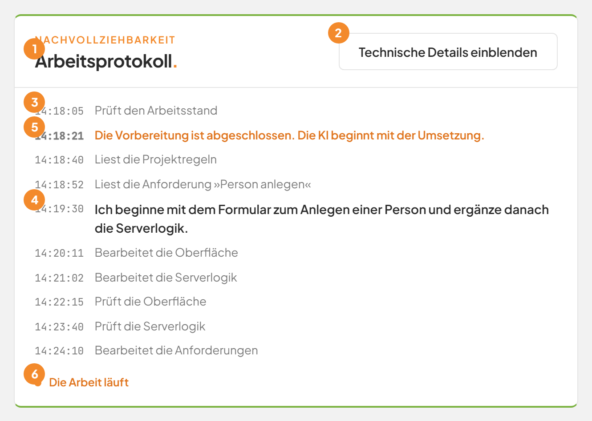
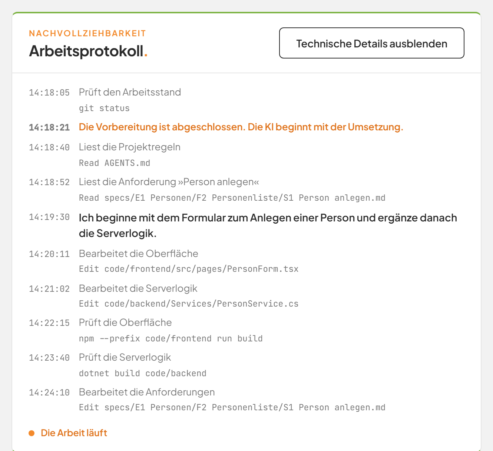

# Das Arbeitsprotokoll lesen

## Worum geht es hier?
Das Arbeitsprotokoll zeigt Schritt für Schritt, was die Factory bei einem Auftrag getan hat. Es steht auf der Seite jedes Auftrags rechts neben den Anforderungen.
Sie brauchen es, wenn Sie nachvollziehen wollen, woran die KI gearbeitet hat oder warum ein Auftrag gescheitert ist.

## Wo finde ich das?
1. Klicken Sie in der linken Leiste auf **Umsetzung**.
2. Öffnen Sie einen Auftrag in der Tabelle.
3. Sehen Sie auf die Karte **Arbeitsprotokoll.** mit der Dachzeile **Nachvollziehbarkeit**.

*Bild 1: Das Arbeitsprotokoll eines laufenden Auftrags.*

## Was Sie auf dem Bildschirm sehen

| Nr. | Element | Bedeutung |
|---|---|---|
| 1 | Titel **Arbeitsprotokoll.** | Name der Karte. |
| 2 | **Technische Details einblenden** | Zeigt zu jedem Eintrag Einzelheiten für Fachleute. |
| 3 | Uhrzeit | Wann der Schritt stattfand, im Format Stunde:Minute:Sekunde. |
| 4 | Fett gedruckter Eintrag | Ein Text der KI, in dem sie ihr Vorgehen beschreibt. |
| 5 | Oranger Eintrag | Ein Hinweis der Factory. |
| 6 | **Die Arbeit läuft** | Steht am Ende, solange der Auftrag arbeitet. |

Normale Einträge in grauer Schrift sind Arbeitsschritte der KI.

## Schritt für Schritt: Das Protokoll lesen
1. Öffnen Sie die Seite des Auftrags.
2. Lesen Sie die Einträge von oben nach unten. Der neueste steht unten.
3. Während der Auftrag läuft, rollt das Protokoll bei jedem neuen Eintrag von selbst ans Ende.

Die Einträge sind in einfacher Sprache gehalten. Zum Beispiel:

| Eintrag | Bedeutung |
|---|---|
| **Liest die Anforderung »{Titel}«** | Die KI liest eine Anforderung. |
| **Liest die Projektregeln** | Die KI liest die Regeln des Projekts. |
| **Bearbeitet die Oberfläche** | Die KI ändert die Bildschirme der Anwendung. |
| **Bearbeitet die Serverlogik** | Die KI ändert die Fachlogik im Hintergrund. |
| **Bearbeitet die Anforderungen** | Die KI zieht die Anforderungen nach. |
| **Durchsucht den Bestand** | Die KI sucht im Projekt. |
| **Prüft die Oberfläche** oder **Prüft die Serverlogik** | Die KI prüft, ob ihre Änderung fehlerfrei funktioniert. |
| **Stellt benötigte Programmbausteine bereit** | Die KI lädt Hilfsprogramme. |
| **Bereitet die Datenbankänderung vor** | Die KI bereitet eine Änderung an der Datenbank vor. |
| **Führt einen Prüfschritt aus** | Die KI führt einen anderen Prüfbefehl aus. |
| **Arbeitet am Auftrag** | Die KI nutzt ein anderes Werkzeug. |

Weitere Gegenstände heißen zum Beispiel **das Datenmodell**, **die Schnittstellenbeschreibung**, **die Menüstruktur**, **die Idee »{Titel}«**, **die Projektregeln**, **die Datenbankstruktur**, **die Serverlogik**, **die Oberfläche** und **die Betriebsumgebung**.

## Schritt für Schritt: Technische Details einblenden
1. Klicken Sie oben rechts in der Karte auf **Technische Details einblenden**.
2. Unter jedem Eintrag erscheint in kleiner Schrift, was genau geschah, zum Beispiel ein Dateiname oder ein Befehl.
3. Zum Ausblenden klicken Sie auf **Technische Details ausblenden**.

*Bild 2: Das Protokoll mit eingeblendeten Details.*

## Gut zu wissen
- Hat ein Auftrag noch keine Einträge, steht dort **Der Auftrag wartet auf seinen Start.** oder **Noch keine Einträge.**
- Das Protokoll zeigt höchstens die letzten 600 Einträge eines Auftrags.
- Sperrt die Factory Aktionen der KI, steht dort **Die KI wollte {n} nicht freigegebene Aktionen ausführen. Sie wurden blockiert.** Das ist ein Schutz und kein Fehler.
- Nach einem Fehler beim Bau oder bei der Auslieferung steht ein oranger Hinweis, dass die KI nachbessert. Mehr dazu unter [Selbstständige Nachbesserung](10h-nachbesserung.md).

## Wenn etwas nicht klappt

| Das sehen Sie | Das bedeutet es | Das tun Sie |
|---|---|---|
| **Der Auftrag wartet auf seinen Start.** | Ein anderer Auftrag arbeitet noch. | Warten Sie. Der Auftrag startet von selbst. |
| **Noch keine Einträge.** | Der Auftrag hat noch nichts protokolliert. | Warten Sie einen Moment. |
| **Die KI wollte {n} nicht freigegebene Aktionen ausführen. Sie wurden blockiert.** | Die Schutzregeln haben Aktionen verhindert. | Sie müssen nichts tun. Scheitert der Auftrag, lesen Sie die Meldung auf der Seite. |
| Der Hinweis **Der Bau ist fehlgeschlagen. Die KI bessert nach.** | Die neue Version ließ sich nicht bauen. | Warten Sie. Die KI versucht es selbst erneut. |

Weitere Fragen beantwortet die [FAQ](faq.md). Zur Seite des Auftrags geht es unter [Einen Auftrag verfolgen](10b-auftrag.md).
