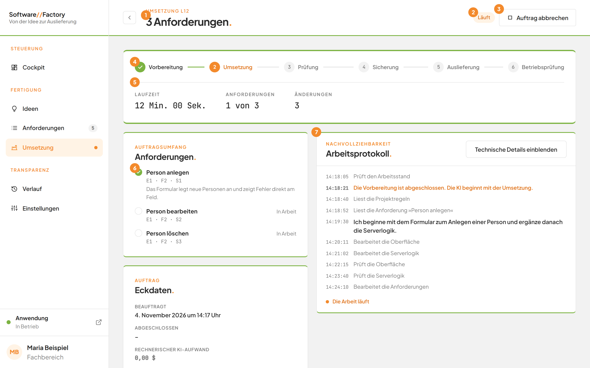
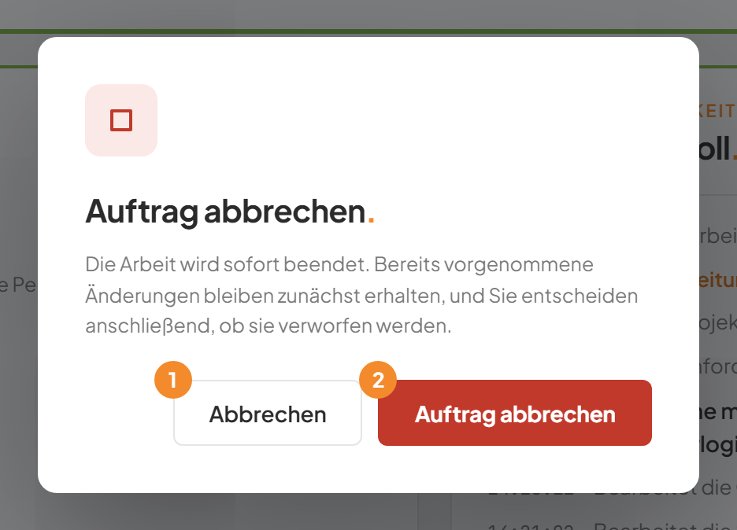
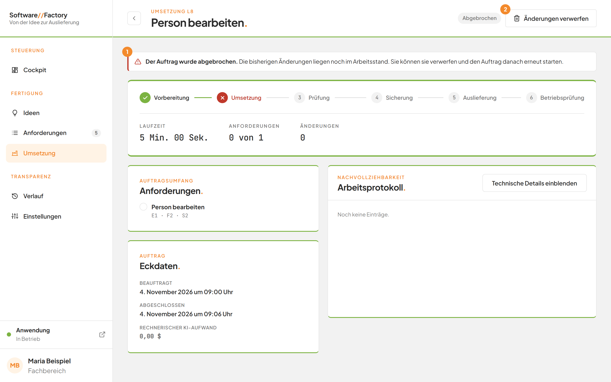
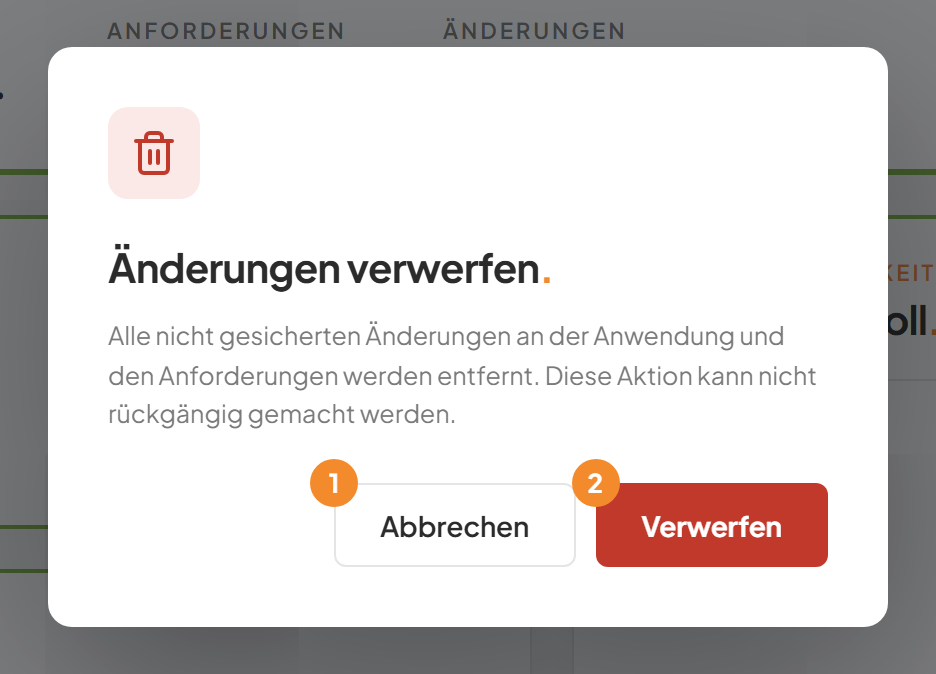

# Einen Auftrag abbrechen und Änderungen verwerfen

## Worum geht es hier?
Sie können einen wartenden oder laufenden Auftrag jederzeit abbrechen. Hat die KI bis dahin schon Änderungen vorgenommen, können Sie diese anschließend verwerfen.
Verwerfen bedeutet: Alle noch nicht gesicherten Änderungen werden entfernt. Der Stand der letzten gesicherten Version bleibt.

## Wo finde ich das?
1. Klicken Sie in der linken Leiste auf **Umsetzung**.
2. Öffnen Sie den gewünschten Auftrag in der Tabelle.
3. Die Schaltflächen stehen oben rechts neben der Statusmarke.

*Bild 1: Ein laufender Auftrag. Oben rechts steht Auftrag abbrechen.*

## Was Sie auf dem Bildschirm sehen

| Schaltfläche | Wann sie erscheint |
|---|---|
| **Auftrag abbrechen** | Solange der Auftrag **Wartet** oder **Läuft**. |
| **Änderungen verwerfen** | Wenn nach einem Abbruch oder Fehler noch nicht gesicherte Änderungen im Projekt liegen. |

## Schritt für Schritt: Einen Auftrag abbrechen
1. Öffnen Sie den Auftrag.
2. Klicken Sie oben rechts auf **Auftrag abbrechen**.
3. Der Dialog **Auftrag abbrechen.** öffnet sich. Er erklärt: Die Arbeit wird sofort beendet. Bereits vorgenommene Änderungen bleiben zunächst erhalten, und Sie entscheiden anschließend, ob sie verworfen werden.
4. Klicken Sie auf **Auftrag abbrechen**. Mit **Abbrechen** schließen Sie den Dialog, und der Auftrag läuft weiter.

*Bild 2: Der Bestätigungsdialog.*

| Nr. | Element | Bedeutung |
|---|---|---|
| 1 | **Abbrechen** | Schließt den Dialog. Der Auftrag bleibt unverändert. |
| 2 | **Auftrag abbrechen** | Beendet den Auftrag sofort. |

Ergebnis: Ein wartender Auftrag verlässt die Warteschlange und zeigt **Abgebrochen**. Ein laufender Auftrag wird sofort beendet und zeigt ebenfalls **Abgebrochen** mit der Meldung **Der Auftrag wurde abgebrochen.**

## Schritt für Schritt: Änderungen verwerfen
1. Öffnen Sie den abgebrochenen oder gescheiterten Auftrag.
2. Lesen Sie die Meldung oben. Sie ergänzt: **Die bisherigen Änderungen liegen noch im Arbeitsstand. Sie können sie verwerfen und den Auftrag danach erneut starten.**
3. Klicken Sie oben rechts auf **Änderungen verwerfen**.
4. Der Dialog **Änderungen verwerfen.** öffnet sich. Er warnt: Alle nicht gesicherten Änderungen an der Anwendung und den Anforderungen werden entfernt. Diese Aktion kann nicht rückgängig gemacht werden.
5. Klicken Sie auf **Verwerfen**. Mit **Abbrechen** schließen Sie den Dialog, ohne etwas zu entfernen.

*Bild 3: Ein abgebrochener Auftrag.*

| Nr. | Element | Bedeutung |
|---|---|---|
| 1 | Rote Meldung | Nennt den Grund und weist auf die offenen Änderungen hin. |
| 2 | **Änderungen verwerfen** | Entfernt die nicht gesicherten Änderungen. |

*Bild 4: Der Bestätigungsdialog zum Verwerfen.*

| Nr. | Element | Bedeutung |
|---|---|---|
| 1 | **Abbrechen** | Schließt den Dialog. Es wird nichts entfernt. |
| 2 | **Verwerfen** | Entfernt die Änderungen endgültig. |

Ergebnis: Die Änderungen sind entfernt, die Schaltfläche **Änderungen verwerfen** verschwindet. Jetzt können Sie den Auftrag mit **Erneut beauftragen** neu starten, siehe [Einen Auftrag erneut beauftragen](10f-erneut-beauftragen.md).

## Gut zu wissen
- Verwerfen lässt sich nicht rückgängig machen. Gesicherte Versionen bleiben aber unberührt.
- Bei einer Umsetzung werden die Anwendung und die Anforderungen auf den letzten gesicherten Stand zurückgesetzt. Bei einer Überführung werden nur die Anforderungen zurückgesetzt.
- Scheitert ein Auftrag schon in der Vorbereitung, gibt es nichts zu verwerfen. Die Schaltfläche fehlt dann.
- Bei einer Rücknahme gibt es keine Schaltfläche **Änderungen verwerfen**.
- Wurde der Dienst der Factory während der Arbeit neu gestartet, können ebenfalls Änderungen übrig sein. Dann steht auch dort **Änderungen verwerfen** zur Verfügung.

## Wenn etwas nicht klappt

| Das sehen Sie | Das bedeutet es | Das tun Sie |
|---|---|---|
| **Dieser Auftrag läuft nicht mehr.** | Der Auftrag war schon fertig, als Sie abgebrochen haben. | Laden Sie die Seite und lesen Sie das Ergebnis. |
| **Zu diesem Auftrag gibt es keine verwerfbaren Änderungen.** | Es liegen keine nicht gesicherten Änderungen vor. | Beauftragen Sie den Auftrag gegebenenfalls erneut. |
| **Bitte warten Sie, bis der laufende Auftrag abgeschlossen ist.** | Ein anderer Auftrag läuft gerade. Dann lässt sich nichts verwerfen. | Warten Sie oder brechen Sie den laufenden Auftrag ab. |

Weitere Fragen beantwortet die [FAQ](faq.md). Zur Auftragsliste geht es unter [Umsetzung](10-umsetzung.md).
