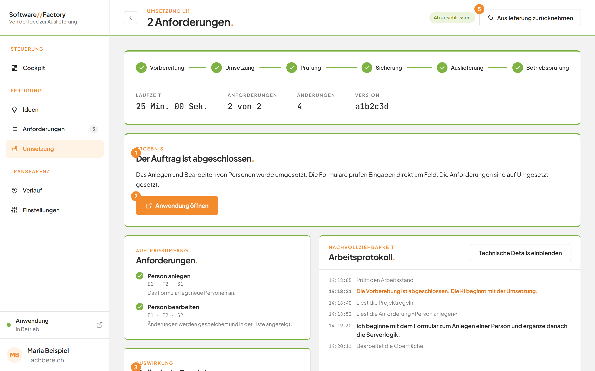
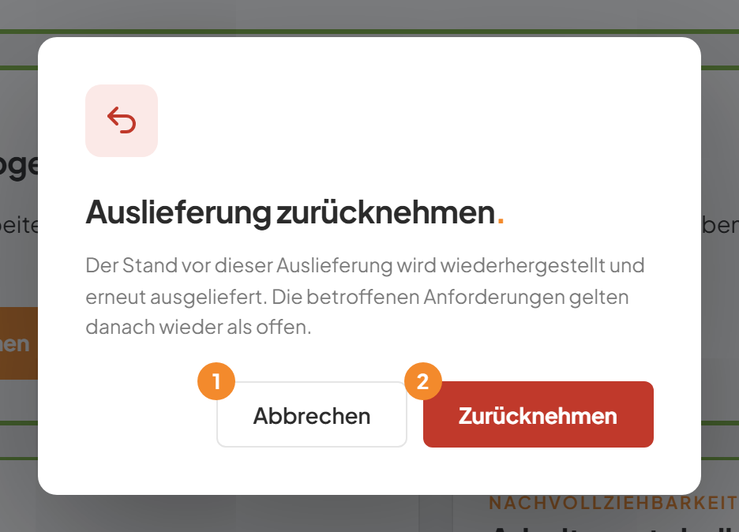
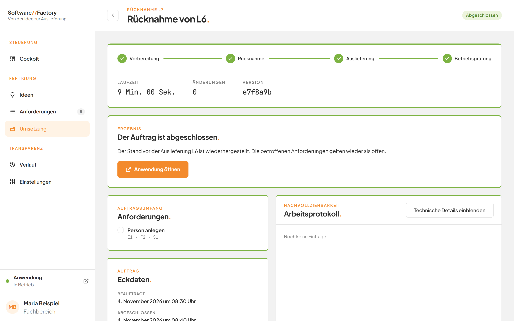
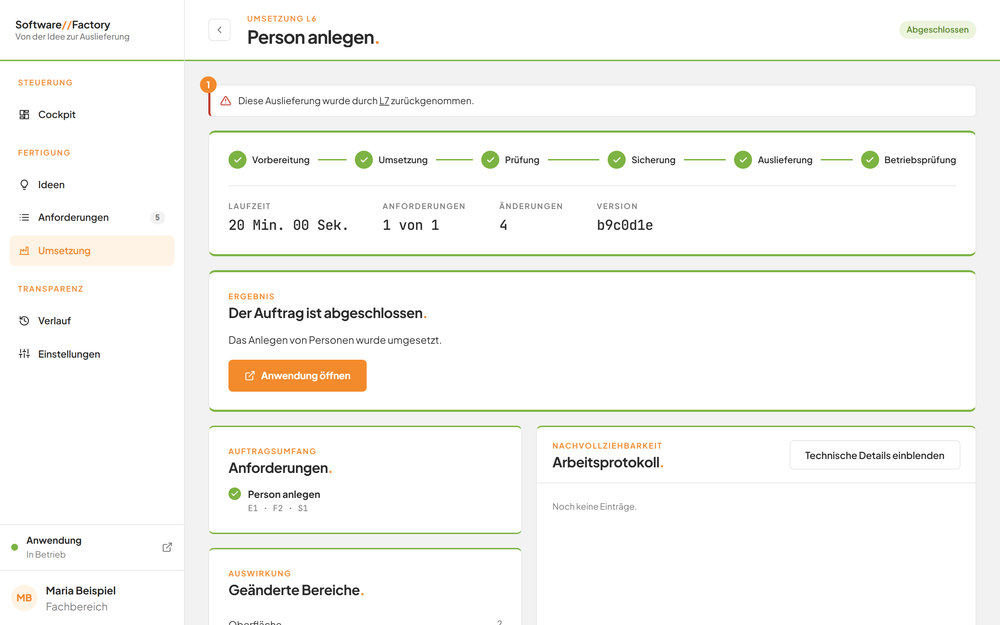
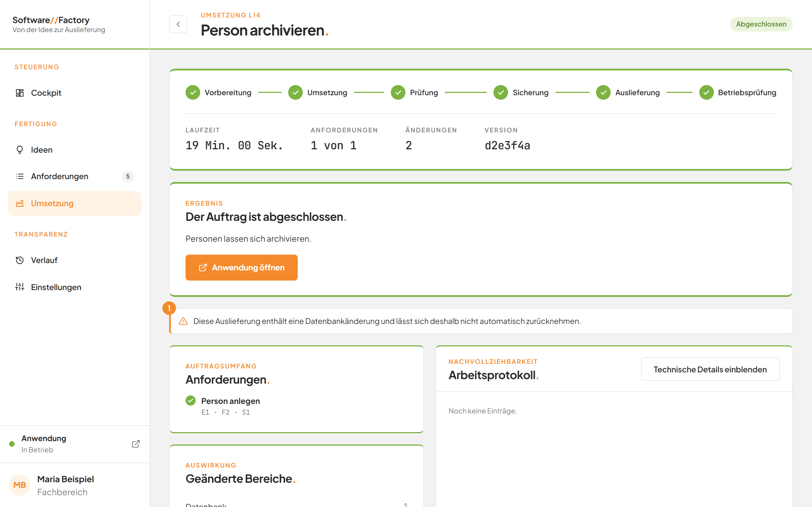

# Eine Auslieferung zurücknehmen

## Worum geht es hier?
Eine Umsetzung, die schon ausgeliefert ist, lässt sich zurücknehmen. Die Factory stellt dann den Stand vor dieser Auslieferung wieder her und liefert ihn erneut aus.
Die betroffenen Anforderungen gelten danach wieder als offen.
Sie brauchen das, wenn eine ausgelieferte Änderung nicht Ihren Erwartungen entspricht.

## Wo finde ich das?
1. Klicken Sie in der linken Leiste auf **Umsetzung**.
2. Öffnen Sie in der Tabelle eine abgeschlossene Umsetzung mit einer Version.
3. Die Schaltfläche **Auslieferung zurücknehmen** steht oben rechts.

*Bild 1: Die Schaltfläche steht oben rechts neben der Statusmarke.*

## Was Sie auf dem Bildschirm sehen
Die Schaltfläche **Auslieferung zurücknehmen** erscheint nur, wenn alle Punkte zutreffen:
- Der Auftrag ist eine Umsetzung und hat eine Version.
- Er wartet nicht und läuft nicht mehr.
- Er wurde nicht schon zurückgenommen.
- Er enthält keine Änderung an der Datenbank.

## Schritt für Schritt: Eine Auslieferung zurücknehmen
1. Öffnen Sie die ausgelieferte Umsetzung.
2. Klicken Sie oben rechts auf **Auslieferung zurücknehmen**.
3. Der Dialog **Auslieferung zurücknehmen.** öffnet sich. Er erklärt: Der Stand vor dieser Auslieferung wird wiederhergestellt und erneut ausgeliefert. Die betroffenen Anforderungen gelten danach wieder als offen.
4. Klicken Sie auf **Zurücknehmen**. Mit **Abbrechen** schließen Sie den Dialog, ohne etwas zu ändern.

*Bild 2: Der Bestätigungsdialog.*

| Nr. | Element | Bedeutung |
|---|---|---|
| 1 | **Abbrechen** | Schließt den Dialog. |
| 2 | **Zurücknehmen** | Beauftragt die Rücknahme. |

Ergebnis: Die Seite eines neuen Auftrags öffnet sich. Er trägt den Titel **Rücknahme von {Nummer}** und die Art **Rücknahme**. Er übernimmt die Anforderungen der zurückgenommenen Umsetzung.

## Schritt für Schritt: Die Rücknahme verfolgen
1. Sehen Sie auf die Phasen des neuen Auftrags: **Vorbereitung**, **Rücknahme**, **Auslieferung** und **Betriebsprüfung**.
2. Warten Sie, bis die Statusmarke **Abgeschlossen** zeigt.
3. Lesen Sie die Meldung: **Der Stand vor der Auslieferung {Nummer} ist wiederhergestellt. Die betroffenen Anforderungen gelten wieder als offen.**

*Bild 3: Eine abgeschlossene Rücknahme.*

Ergebnis: Die zurückgenommene Umsetzung zeigt jetzt **Diese Auslieferung wurde durch {Nummer} zurückgenommen.** Die Nummer ist ein Verweis auf die Rücknahme. In der Tabelle trägt die Umsetzung die Marke **Zurückgenommen**.

*Bild 4: Die zurückgenommene Umsetzung.*

## Gut zu wissen
- Eine Rücknahme macht alle Versionen der Umsetzung rückgängig, auch die der Nachbesserungen.
- Eine Rücknahme bessert nicht selbstständig nach.
- Enthält die Auslieferung eine Änderung an der Datenbank, fehlt die Schaltfläche. Dort steht stattdessen ein Hinweis.

*Bild 5: Der Hinweis (1) ersetzt die Schaltfläche.*

## Wenn etwas nicht klappt

| Das sehen Sie | Das bedeutet es | Das tun Sie |
|---|---|---|
| **Diese Auslieferung enthält eine Datenbankänderung und lässt sich deshalb nicht automatisch zurücknehmen.** | Die Auslieferung verändert die Datenbank. | Wenden Sie sich an die Entwicklung. |
| **Nur ausgelieferte Umsetzungen lassen sich zurücknehmen.** | Der Auftrag ist keine Umsetzung oder hat keine Version. | Öffnen Sie die passende Umsetzung. |
| **Diese Auslieferung wurde bereits zurückgenommen.** | Die Rücknahme ist schon erfolgt. | Sie müssen nichts tun. |
| **Diese Auslieferung wird bereits zurückgenommen.** | Eine Rücknahme wartet oder läuft schon. | Verfolgen Sie sie auf der Seite **Umsetzung**. |
| **Im Arbeitsstand liegen nicht gesicherte Änderungen.** | Im Projekt liegen noch ungesicherte Änderungen. | Lassen Sie sie sichern oder verwerfen und starten Sie die Rücknahme erneut. |
| **Die Auslieferung lässt sich nicht automatisch zurücknehmen, weil spätere Änderungen darauf aufbauen.** | Neuere Arbeit hängt von dieser Auslieferung ab. Die Factory hat den Stand zurückgesetzt. | Wenden Sie sich an die Entwicklung. |

Weitere Fragen beantwortet die [FAQ](faq.md). Mehr zum Auftrag steht unter [Einen Auftrag verfolgen](10b-auftrag.md).
