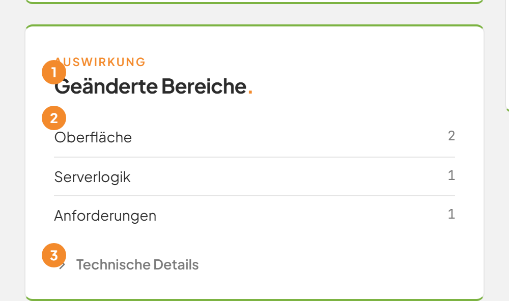
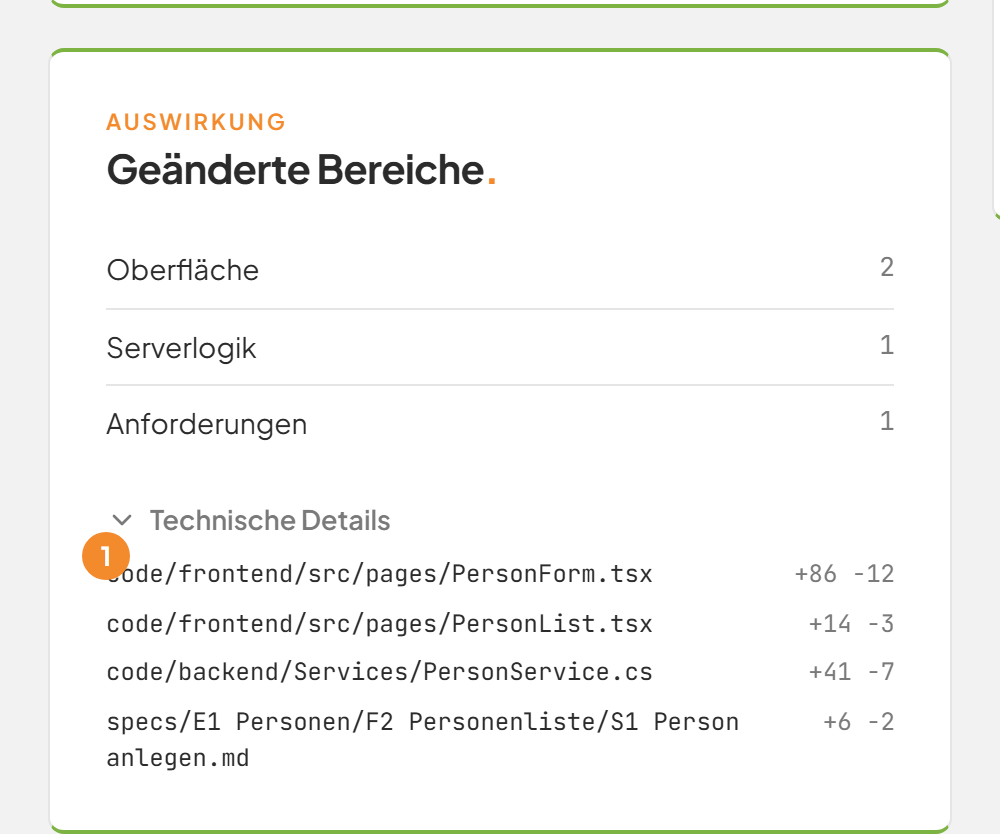

# Geänderte Bereiche prüfen

## Worum geht es hier?
Nach einer Umsetzung zeigt die Karte **Geänderte Bereiche.**, wo die Anwendung verändert wurde. Sie sehen auf einen Blick, ob zum Beispiel die Oberfläche, die Datenbank oder die Anforderungen betroffen sind.

## Wo finde ich das?
1. Klicken Sie in der linken Leiste auf **Umsetzung**.
2. Öffnen Sie eine ausgelieferte Umsetzung.
3. Blättern Sie links unter die Karte **Anforderungen.** zur Karte **Geänderte Bereiche.** mit der Dachzeile **Auswirkung**.

Die Karte erscheint nur bei Umsetzungen, deren Stand schon gesichert ist.

*Bild 1: Die Karte Geänderte Bereiche.*

## Was Sie auf dem Bildschirm sehen

| Nr. | Element | Bedeutung |
|---|---|---|
| 1 | Titel **Geänderte Bereiche.** | Name der Karte. |
| 2 | Liste der Bereiche | Je Bereich die Anzahl der geänderten Dateien. |
| 3 | **Technische Details** | Klappt die Liste der einzelnen Dateien auf. |

| Bereich | Das wurde geändert |
|---|---|
| **Oberfläche** | Die Bildschirme der Anwendung. |
| **Serverlogik** | Die Fachlogik im Hintergrund. |
| **Datenbank** | Die Struktur der Datenbank. |
| **Anforderungen** | Die Beschreibungen der Anforderungen. |
| **Betriebsumgebung** | Alles, was den Betrieb der Anwendung betrifft. |

## Schritt für Schritt: Die geänderten Dateien ansehen
1. Öffnen Sie die Karte **Geänderte Bereiche.**
2. Klicken Sie unten auf **Technische Details**. Der Bereich ist beim Öffnen zugeklappt.
3. Lesen Sie die Liste. Jede Zeile zeigt den Pfad der Datei und rechts die Zeilen, die hinzukamen und wegfielen, zum Beispiel **+86 −12**.
4. Klicken Sie erneut auf **Technische Details**, um die Liste zuzuklappen.

*Bild 2: Die Dateien mit hinzugefügten und entfernten Zeilen (1).*

## Gut zu wissen
- Die Zahlen stammen aus allen Versionen des Auftrags, auch aus Nachbesserungen.
- Ist der Bereich **Datenbank** dabei, lässt sich die Auslieferung nicht automatisch zurücknehmen, siehe [Eine Auslieferung zurücknehmen](10e-auslieferung-zuruecknehmen.md).
- Bei Überführungen und Rücknahmen gibt es die Karte nicht.

## Wenn etwas nicht klappt

| Das sehen Sie | Das bedeutet es | Das tun Sie |
|---|---|---|
| Die Karte fehlt | Der Auftrag läuft noch, ist keine Umsetzung oder hat nichts gesichert. | Warten Sie auf das Ende des Auftrags. |
| Die Liste ist zugeklappt | Das ist der Normalzustand. | Klicken Sie auf **Technische Details**. |

Weitere Fragen beantwortet die [FAQ](faq.md). Mehr zum Auftrag steht unter [Einen Auftrag verfolgen](10b-auftrag.md).
