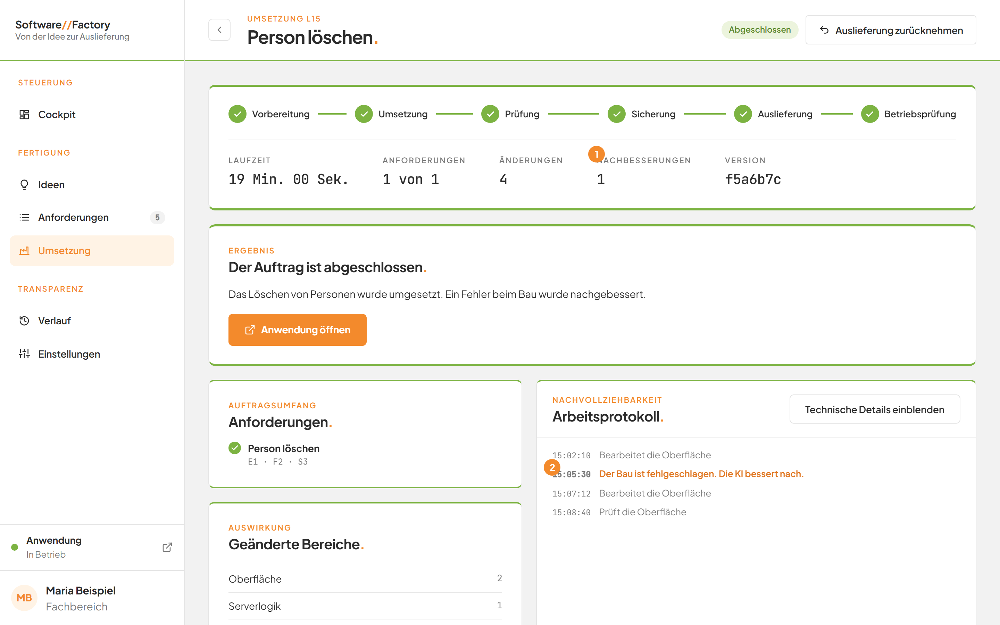

# Selbstständige Nachbesserung verstehen

## Worum geht es hier?
Scheitert bei einer Umsetzung der Bau der neuen Version oder die Auslieferung, behebt die KI den Fehler selbst. Sie bessert nach und versucht es erneut.
Sie müssen dafür nichts tun. Sie sehen nur, dass es passiert.

## Wo finde ich das?
1. Klicken Sie in der linken Leiste auf **Umsetzung**.
2. Öffnen Sie einen Auftrag.
3. Sehen Sie in die Kennzahlen oben und in das **Arbeitsprotokoll.**

*Bild 1: Die Kennzahl Nachbesserungen und der Hinweis im Protokoll.*

## Was Sie auf dem Bildschirm sehen

| Nr. | Element | Bedeutung |
|---|---|---|
| 1 | Kennzahl **Nachbesserungen** | Wie oft die KI bei diesem Auftrag nachgebessert hat. Sie erscheint erst ab der ersten Nachbesserung. |
| 2 | Oranger Hinweis im Protokoll | Nennt den Grund der Nachbesserung. |

Zwei Hinweise sind möglich:
- **Der Bau ist fehlgeschlagen. Die KI bessert nach.** Die neue Version ließ sich nicht bauen oder prüfen.
- **Die Auslieferung war nicht erfolgreich. Die KI bessert nach.** Die Auslieferung oder die Betriebsprüfung ist gescheitert.

## Schritt für Schritt: Eine Nachbesserung begleiten
1. Öffnen Sie den laufenden Auftrag.
2. Lesen Sie im **Arbeitsprotokoll.** den orangen Hinweis. Mit **Technische Details einblenden** sehen Sie die Fehlermeldung.
3. Warten Sie. Die KI ändert die Anwendung und baut sie erneut.
4. Prüfen Sie, ob die Kennzahl **Nachbesserungen** steigt und der Auftrag weiterläuft.

Bei einem Fehler in der Auslieferung kehrt der Auftrag für die Nachbesserung zur Phase **Prüfung** zurück. Danach läuft er weiter bis zur Betriebsprüfung.
Gibt es durch die Nachbesserung neue Änderungen, werden sie als eigene Version gesichert. Die Zahl der geänderten Dateien beziehen diese ein.

## Gut zu wissen
- Pro Bauschritt gibt es höchstens zwei Nachbesserungen, ebenso für die Auslieferung.
- Eine einzelne Nachbesserung endet spätestens nach 30 Minuten.
- Sind die Versuche ausgeschöpft, endet der Auftrag mit **Fehlgeschlagen** und der letzten Fehlermeldung.
- Nach einem Abbruch beginnt keine weitere Nachbesserung.
- Eine Rücknahme bessert nie nach.
- Die KI darf bei der Nachbesserung die Factory selbst, Ideen und Projektregeln nicht ändern.

## Wenn etwas nicht klappt

| Das sehen Sie | Das bedeutet es | Das tun Sie |
|---|---|---|
| **Die Anwendung antwortet nach der Auslieferung nicht fehlerfrei.** | Auch nach den Nachbesserungen läuft die Anwendung nicht. | Öffnen Sie **Technische Details** auf der Seite des Auftrags und wenden Sie sich an die Entwicklung. |
| Der Auftrag endet mit **Fehlgeschlagen**, obwohl die KI nachgebessert hat | Die Versuche sind ausgeschöpft. | Lesen Sie die Meldung. Verwerfen Sie die Änderungen, falls angeboten, und beauftragen Sie erneut. |

Weitere Fragen beantwortet die [FAQ](faq.md). Mehr zum Protokoll steht unter [Das Arbeitsprotokoll lesen](10c-arbeitsprotokoll.md) und zum Neustart unter [Einen Auftrag erneut beauftragen](10f-erneut-beauftragen.md).
