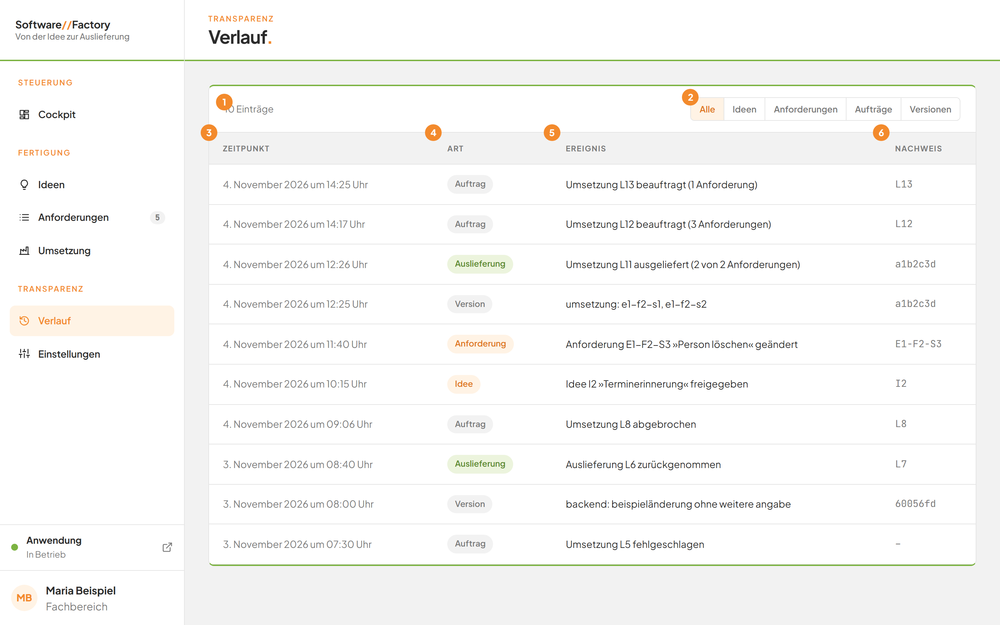
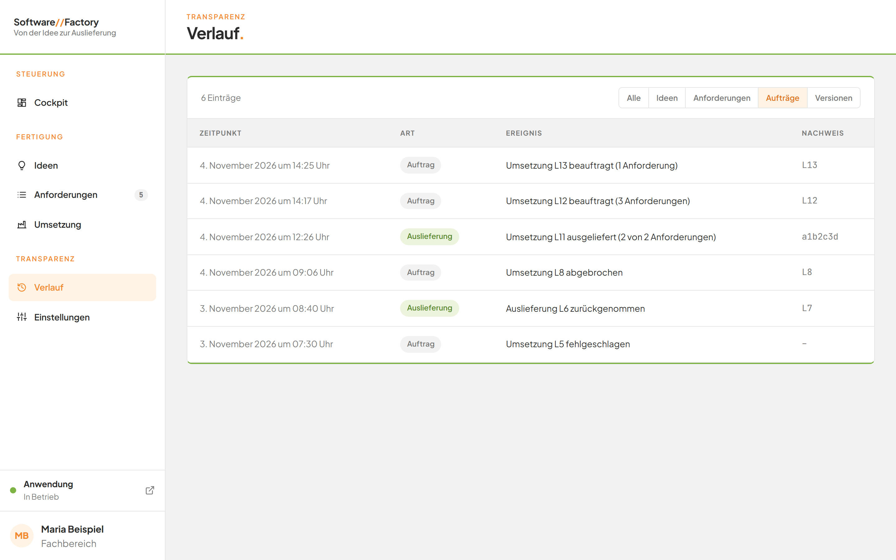
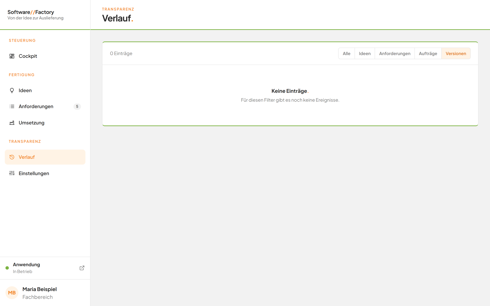

# Den Verlauf nachlesen

## Worum geht es hier?
Der Verlauf ist das Tagebuch der Software Factory. Er listet auf, was bei Ideen, Anforderungen und Aufträgen passiert ist, und zeigt die gesicherten Versionen der Anwendung.
Sie brauchen ihn, wenn Sie nachvollziehen wollen, wann etwas geschehen ist und welcher Auftrag dahintersteht.

## Wo finde ich das?
1. Öffnen Sie die Software Factory.
2. Klicken Sie in der linken Leiste unter **Transparenz** auf **Verlauf**.

*Bild 1: Die Seite Verlauf mit allen Einträgen.*

## Was Sie auf dem Bildschirm sehen
Die Seite trägt oben die Dachzeile **Transparenz** und den Titel **Verlauf.**

| Nr. | Element | Bedeutung |
|---|---|---|
| 1 | Zeile über der Tabelle | Nennt die Anzahl der Einträge, zum Beispiel **10 Einträge**. Beim Laden steht dort **Wird geladen …**. |
| 2 | Filter | Die Schaltflächen **Alle**, **Ideen**, **Anforderungen**, **Aufträge** und **Versionen**. |
| 3 | Spalte **Zeitpunkt** | Datum und Uhrzeit mit dem Zusatz **Uhr**. |
| 4 | Spalte **Art** | Die Art des Ereignisses als Marke. |
| 5 | Spalte **Ereignis** | Was geschehen ist. |
| 6 | Spalte **Nachweis** | Die Nummer, die das Ereignis belegt. |

Der neueste Eintrag steht oben. Die Liste enthält die Ereignisse der Factory und die letzten 100 gesicherten Versionen.

| Marke | Bedeutung |
|---|---|
| **Idee** | Ein Ereignis bei einer Idee. |
| **Anforderung** | Ein Ereignis bei einer Anforderung. |
| **Auftrag** | Ein Auftrag wurde beauftragt, abgebrochen oder ist gescheitert. |
| **Auslieferung** | Eine Umsetzung oder Rücknahme wurde ausgeliefert. |
| **Version** | Ein gesicherter Stand der Anwendung. Das Ereignis nennt den Betreff der Version. |

Die Spalte **Nachweis** zeigt die Kennung der Version, sonst die Nummer des Auftrags, der Idee oder der Anforderung. Gibt es keinen Nachweis, steht dort **–**.

## Schritt für Schritt: Nach einer Art filtern
1. Klicken Sie oben rechts über der Tabelle auf den gewünschten Filter, zum Beispiel **Aufträge**.
2. Lesen Sie die gefilterte Liste. Die Zeile über der Tabelle zeigt die neue Anzahl.
3. Klicken Sie auf **Alle**, um wieder alles zu sehen.

Beim Öffnen der Seite ist **Alle** aktiv.

*Bild 2: Der Filter Aufträge zeigt nur Aufträge und Auslieferungen.*

| Filter | Das sehen Sie |
|---|---|
| **Alle** | Alle Einträge. |
| **Ideen** | Nur Ereignisse bei Ideen. |
| **Anforderungen** | Nur Ereignisse bei Anforderungen. |
| **Aufträge** | Aufträge und Auslieferungen. |
| **Versionen** | Nur gesicherte Versionen. |

## Schritt für Schritt: Zu einem Eintrag springen
1. Suchen Sie in der Spalte **Ereignis** einen Eintrag, der als Link dargestellt ist.
2. Klicken Sie auf den Titel.

Ergebnis: Gehört der Eintrag zu einem Auftrag, öffnet sich der [Auftrag](10b-auftrag.md). Gehört er zu einer Idee, öffnet sich der [Ideen-Dialog](04-ideen-dialog.md). Gehört er zu einer Anforderung, öffnet sich die Detailseite unter [Anforderungen](07-anforderungen.md).
Einträge ohne Verweis, etwa Versionen, zeigen nur den Titel.

## Gut zu wissen
- Die Liste aktualisiert sich selbst, sobald sich bei Ideen, Anforderungen oder Aufträgen etwas ändert.
- Der Verlauf dient dem Nachlesen. Sie können hier nichts ändern oder löschen.
- Die Titel der Versionen stammen von denen, die sie gesichert haben, und sind oft knapp gehalten.

## Wenn etwas nicht klappt

*Bild 3: Für den Filter Versionen gibt es keine Einträge.*

| Das sehen Sie | Das bedeutet es | Das tun Sie |
|---|---|---|
| **Keine Einträge.** und darunter **Für diesen Filter gibt es noch keine Ereignisse.** | Zu dem gewählten Filter gibt es noch nichts. | Klicken Sie auf **Alle** oder wählen Sie einen anderen Filter. |
| **Wird geladen …** | Die Seite lädt den Verlauf noch. | Warten Sie einen Moment. |
| Ein Eintrag lässt sich nicht anklicken | Zu dem Eintrag gibt es kein Ziel. | Lesen Sie den Titel und die Spalte **Nachweis**. |

Weitere Fragen beantwortet die [FAQ](faq.md). Zurück zur [Navigation](01-navigation.md) oder zum [Cockpit](02-cockpit.md).
