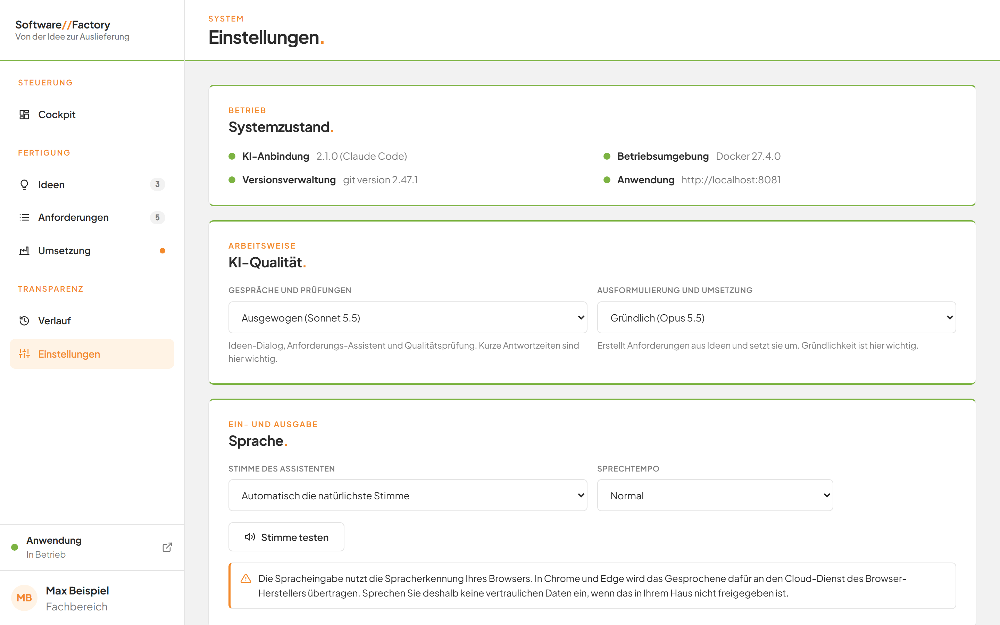
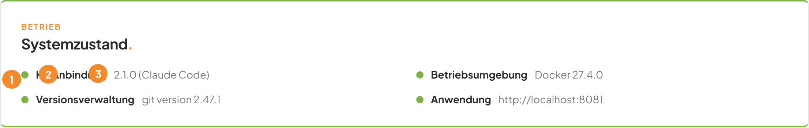
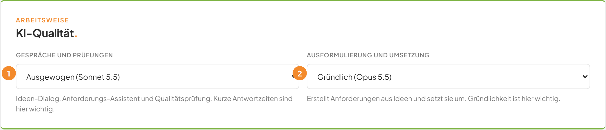
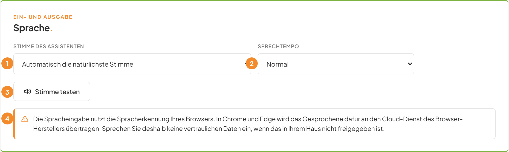
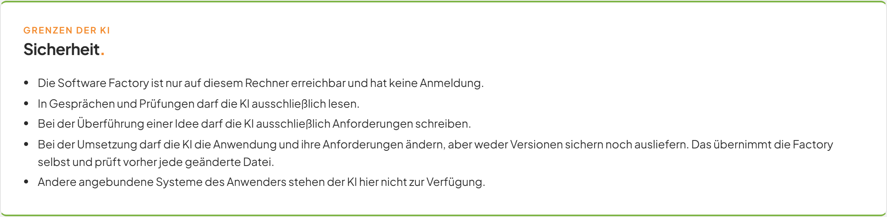
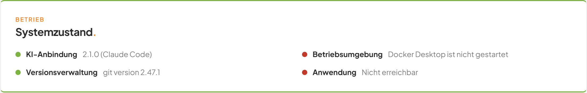

# Systemzustand prüfen und die Software Factory einstellen

## Worum geht es hier?
Auf der Seite **Einstellungen** prüfen Sie, ob alles bereit ist, was die Software Factory braucht. Außerdem wählen Sie hier die KI-Qualität, Stimme und Sprechtempo und lesen nach, was die KI darf. Sie brauchen die Seite, wenn etwas nicht läuft oder wenn Sie Antwortzeit und Gründlichkeit der KI steuern wollen.

## Wo finde ich das?
1. Öffnen Sie die Software Factory im Browser.
2. Klicken Sie in der linken Seitenleiste unter **Transparenz** auf **Einstellungen**.

*Bild 1: Die Seite Einstellungen. Weiter unten folgen die Karten Sprache und Sicherheit.*

Die Seite trägt oben die Dachzeile **System** und den Titel **Einstellungen.**

## Was Sie auf dem Bildschirm sehen
Die Seite besteht aus vier Karten untereinander.

*Bild 2: Die Karte Systemzustand.*

| Nr. | Element | Bedeutung |
|---|---|---|
| 1 | Bezeichnung der Prüfung | **KI-Anbindung**, **Betriebsumgebung**, **Versionsverwaltung** oder **Anwendung**. |
| 2 | Punkt vor der Bezeichnung | Grün: bestanden. Rot: nicht bestanden. |
| 3 | Angabe rechts daneben | Das Ergebnis, zum Beispiel eine Versionsnummer oder ein Hinweis. |

Die vier Prüfungen:

| Prüfung | Erfolg | Misserfolg |
|---|---|---|
| **KI-Anbindung** | Die Version der KI-Software | **Nicht installiert** |
| **Betriebsumgebung** | **Docker** mit Versionsnummer | **Docker Desktop ist nicht gestartet** |
| **Versionsverwaltung** | Die Version des Programms Git | keine Version sichtbar |
| **Anwendung** | Die Adresse Ihrer Anwendung | **Nicht erreichbar** |

Die Prüfungen laufen auf Ihrem Rechner. Dauert ein Programm länger als 15 Sekunden, gilt die Prüfung als nicht bestanden. Ihre Anwendung bekommt dafür 3 Sekunden Zeit.

*Bild 3: Die Karte KI-Qualität.*

| Nr. | Element | Bedeutung |
|---|---|---|
| 1 | **Gespräche und Prüfungen** | Die KI für Ideen-Dialog, Anforderungs-Assistent und Qualitätsprüfung. Kurze Antwortzeiten sind hier wichtig. |
| 2 | **Ausformulierung und Umsetzung** | Die KI, die Anforderungen aus Ideen erstellt und sie umsetzt. Gründlichkeit ist hier wichtig. |

Beide Felder bieten dieselben vier Stufen:

| Auswahl | Gedacht für |
|---|---|
| **Schnell (Haiku 5.5)** | Kürzeste Wartezeit |
| **Ausgewogen (Sonnet 5.5)** | Guter Mittelweg. Voreinstellung für Gespräche und Prüfungen. |
| **Gründlich (Opus 5.5)** | Sorgfältige Arbeit. Voreinstellung für Ausformulierung und Umsetzung. |
| **Maximal (Fable 5.1)** | Höchste Gründlichkeit, dafür längere Wartezeit |

*Bild 4: Die Karte Sprache.*

| Nr. | Element | Bedeutung |
|---|---|---|
| 1 | **Stimme des Assistenten** | Wählt die Stimme, mit der Ihnen vorgelesen wird. **Automatisch die natürlichste Stimme** ist voreingestellt. |
| 2 | **Sprechtempo** | **Ruhig**, **Normal** oder **Zügig**. |
| 3 | **Stimme testen** | Liest einen Beispielsatz vor. |
| 4 | Orange umrandeter Hinweis | Erklärt, wohin Gesprochenes übertragen wird. |

Zur Wirkung der Auswahl siehe [Sprache](05-sprache.md).

*Bild 5: Die Karte Sicherheit.*

Die Karte **Sicherheit.** trägt die Dachzeile **Grenzen der KI** und enthält nur Text. Sie ändern dort nichts.

## Schritt für Schritt: Den Systemzustand prüfen
1. Klicken Sie in der linken Seitenleiste auf **Einstellungen**.
2. Sehen Sie in der Karte **Systemzustand.** auf die vier Punkte. Kurz steht dort **Wird geprüft …**.
3. Sind alle Punkte grün, ist alles in Ordnung.
4. Ist ein Punkt rot, lesen Sie die Angabe rechts daneben. Siehe die Tabelle unten.

*Bild 6: Der Systemzustand, wenn Docker Desktop nicht läuft.*

## Schritt für Schritt: Die KI-Qualität ändern
1. Gehen Sie zur Karte **KI-Qualität.**
2. Öffnen Sie das Feld **Gespräche und Prüfungen** und wählen Sie eine Stufe.
3. Öffnen Sie bei Bedarf das Feld **Ausformulierung und Umsetzung** und wählen Sie eine Stufe.
4. Die Auswahl ist sofort gespeichert. Eine Schaltfläche zum Speichern gibt es nicht.

Die Änderung gilt ab dem nächsten Start der KI. Ein Gespräch oder Auftrag, der schon läuft, arbeitet mit der alten Auswahl weiter.

## Schritt für Schritt: Stimme und Sprechtempo wählen
1. Gehen Sie zur Karte **Sprache.**
2. Wählen Sie im Feld **Stimme des Assistenten** eine Stimme. Die Liste enthält die deutschen Stimmen Ihres Browsers.
3. Wählen Sie im Feld **Sprechtempo** die Geschwindigkeit.
4. Klicken Sie auf **Stimme testen**. Sie hören: „Guten Tag. So klinge ich, wenn ich Ihnen im Gesprächsmodus antworte.“
5. Klicken Sie erneut auf **Stimme testen**, wird die laufende Ausgabe beendet und neu begonnen.

Diese Auswahl gilt nur für diesen Browser auf diesem Rechner.

## Gut zu wissen
- Die Adresse Ihrer Anwendung und deren Prüfwege lassen sich hier nicht ändern.
- Auch die KI-Qualität gilt für die ganze Software Factory auf diesem Rechner.
- Spracheingabe nutzt die Spracherkennung Ihres Browsers. In Chrome und Edge wird das Gesprochene an den Cloud-Dienst des Browser-Herstellers übertragen. Sprechen Sie keine vertraulichen Daten ein, wenn das in Ihrem Haus nicht freigegeben ist.
- Unterstützt Ihr Browser keine Spracheingabe, steht in der Karte: **Dieser Browser unterstützt keine Spracheingabe. Bitte verwenden Sie Chrome oder Edge.**
- Unterstützt Ihr Browser keine Sprachausgabe, sind **Stimme des Assistenten**, **Sprechtempo** und **Stimme testen** ausgegraut.
- Die Karte **Sicherheit.** sagt Ihnen: Die Software Factory ist nur auf diesem Rechner erreichbar und hat keine Anmeldung. In Gesprächen und Prüfungen darf die KI nur lesen. Bei der Überführung einer Idee darf sie nur Anforderungen schreiben. Bei der Umsetzung ändert sie die Anwendung und ihre Anforderungen, sichert aber selbst keine Versionen und liefert nichts aus. Das übernimmt die Software Factory und prüft vorher jede geänderte Datei. Andere angebundene Systeme stehen der KI nicht zur Verfügung.
- Die Seite aktualisiert sich selbst, wenn sich eine Einstellung ändert.

## Wenn etwas nicht klappt
| Das sehen Sie | Das bedeutet es | Das tun Sie |
|---|---|---|
| **Nicht installiert** bei **KI-Anbindung** | Das KI-Programm ist auf diesem Rechner nicht auffindbar. | Lassen Sie die KI-Software installieren. Ohne sie arbeiten Ideen-Dialog, Assistent und Umsetzung nicht. |
| **Docker Desktop ist nicht gestartet** bei **Betriebsumgebung** | Die Umgebung, in der Ihre Anwendung läuft, ist aus. | Starten Sie Docker Desktop und laden Sie die Seite neu. |
| **Nicht erreichbar** bei **Anwendung** | Ihre ausgelieferte Anwendung antwortet nicht. | Starten Sie Docker Desktop. Warten Sie einen Moment und laden Sie die Seite neu. |
| Bei **Versionsverwaltung** steht keine Version | Git ist nicht verfügbar. | Lassen Sie Git installieren. |
| **Wird geprüft …** bleibt stehen | Der Dienst der Software Factory antwortet nicht. | Laden Sie die Seite neu. |
| **Unbekanntes KI-Modell.** | Die gewählte Stufe kennt die Software Factory nicht. | Wählen Sie eine der vier angebotenen Stufen. |
| **Der Factory-Dienst ist nicht erreichbar.** | Der Dienst auf diesem Rechner antwortet nicht. | Starten Sie die Software Factory und laden Sie die Seite neu. |
| **Zugriff nur lokal erlaubt.** | Die Software Factory wurde nicht über diesen Rechner aufgerufen. | Öffnen Sie sie direkt auf dem Rechner, auf dem sie läuft. |
| **Ungültiges Anfrageformat.** | Die Anfrage kam nicht aus der Oberfläche. | Laden Sie die Seite neu und arbeiten Sie in der Oberfläche. |
| **Dieser Browser unterstützt keine Spracheingabe. Bitte verwenden Sie Chrome oder Edge.** | Ihr Browser kann Sprache nicht erkennen. | Wechseln Sie zu Chrome oder Edge. |

Weitere Antworten finden Sie in den [häufigen Fragen](faq.md).
