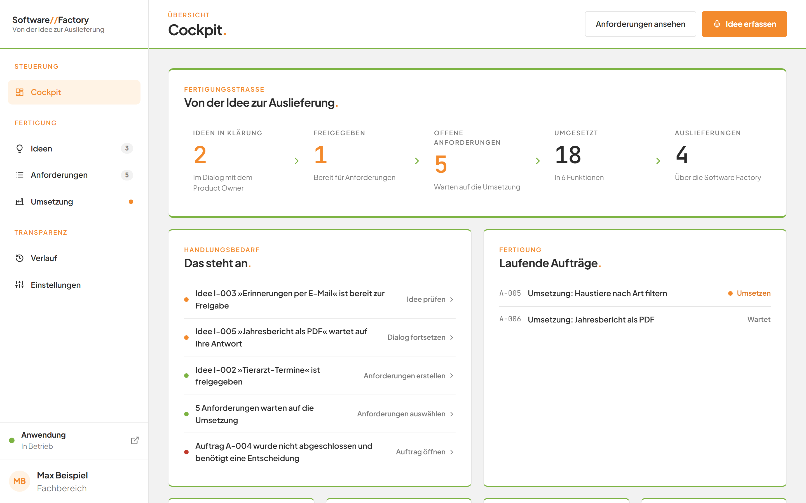

# Modul Software Factory

## Was kann dieses Modul?

Die Software Factory begleitet eine Idee von der ersten Skizze bis zur Auslieferung. Sie halten eine Idee fest und klären sie im Gespräch mit dem Product Owner, einer KI. Aus der freigegebenen Idee entstehen Anforderungen, die Sie prüfen und verbessern. Danach setzt die Software Factory die Anforderungen um und liefert die neue Version Ihrer Anwendung aus. Das Cockpit zeigt Ihnen auf einen Blick, wo es gerade weitergeht.

Sie öffnen die Software Factory unter `http://localhost:4000`. Eine Anmeldung ist nicht nötig.

*Bild 1: Die Software Factory nach dem Öffnen. Links die Seitenleiste, rechts das Cockpit.*

## Die Seiten dieses Moduls

Lesen Sie die Seiten in dieser Reihenfolge. So folgen Sie dem Weg einer Idee.

1. [Die Oberfläche kennenlernen](01-navigation.md) – die Seitenleiste, die Zähler und der Zustand Ihrer Anwendung.
2. [Das Cockpit](02-cockpit.md) – der Überblick über Ideen, Anforderungen, Aufträge und Ereignisse.
3. [Die Ideen-Tafel](03-ideen-tafel.md) – Ideen auf einen Blick sehen und eine neue Idee erfassen.
4. [Im Gespräch mit dem Product Owner](04-ideen-dialog.md) – eine Idee im Dialog klären, freigeben oder verwerfen.
5. [Mit der Stimme arbeiten](05-sprache.md) – diktieren, einsprechen und das Gespräch hören.
6. [Aus einer Idee Anforderungen erstellen](06-ueberfuehrung-in-anforderungen.md) – eine freigegebene Idee in Anforderungen verwandeln.
7. [Anforderungen ansehen, anlegen, ändern und entfernen](07-anforderungen.md) – die Liste der Anforderungen und ihre Pflege.
8. [Anforderungen mit dem KI-Assistenten entwickeln](08-anforderungs-assistent.md) – eine Anforderung im Gespräch entwerfen und speichern.
9. [Die Qualität von Abnahmekriterien prüfen](09-qualitaetspruefung.md) – Kriterien bewerten lassen und Vorschläge übernehmen.
10. [Aufträge verfolgen: die Seite Umsetzung](10-umsetzung.md) – alle Aufträge in einer Tabelle.
    - [Anforderungen auswählen und beauftragen](10a-auswahl-und-beauftragung.md) – offene Anforderungen wählen und die Umsetzung starten.
    - [Einen Auftrag verfolgen](10b-auftrag.md) – Phasen, Eckdaten und Ergebnis eines Auftrags.
    - [Das Arbeitsprotokoll lesen](10c-arbeitsprotokoll.md) – nachlesen, was die KI während eines Auftrags tut.
    - [Einen Auftrag abbrechen und Änderungen verwerfen](10d-abbrechen-und-verwerfen.md) – einen Lauf beenden und ungesicherte Änderungen entfernen.
    - [Eine Auslieferung zurücknehmen](10e-auslieferung-zuruecknehmen.md) – eine ausgelieferte Version wieder rückgängig machen.
    - [Einen Auftrag erneut beauftragen](10f-erneut-beauftragen.md) – einen gescheiterten oder abgebrochenen Auftrag wiederholen.
    - [Geänderte Bereiche prüfen](10g-geaenderte-bereiche.md) – sehen, welche Teile der Anwendung ein Auftrag verändert hat.
    - [Selbstständige Nachbesserung verstehen](10h-nachbesserung.md) – wie die KI Fehler beim Bauen und Ausliefern selbst behebt.
11. [Den Verlauf nachlesen](11-verlauf.md) – alle Ereignisse der Reihe nach, mit Filter.
12. [Systemzustand prüfen und die Software Factory einstellen](12-einstellungen.md) – Zustand der Bausteine, KI-Qualität und Sprache.

## Häufige Fragen

Antworten auf typische Fragen und alle Fehlermeldungen finden Sie in den [häufigen Fragen zur Software Factory](faq.md). Fragen zur ganzen Anwendung beantworten die [allgemeinen häufigen Fragen](../faq.md).
