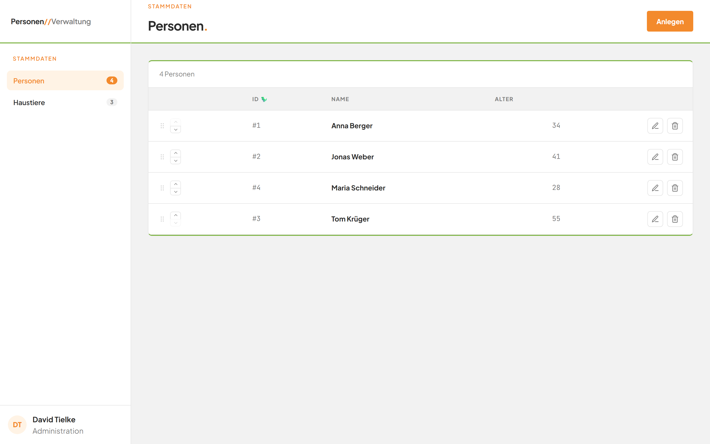
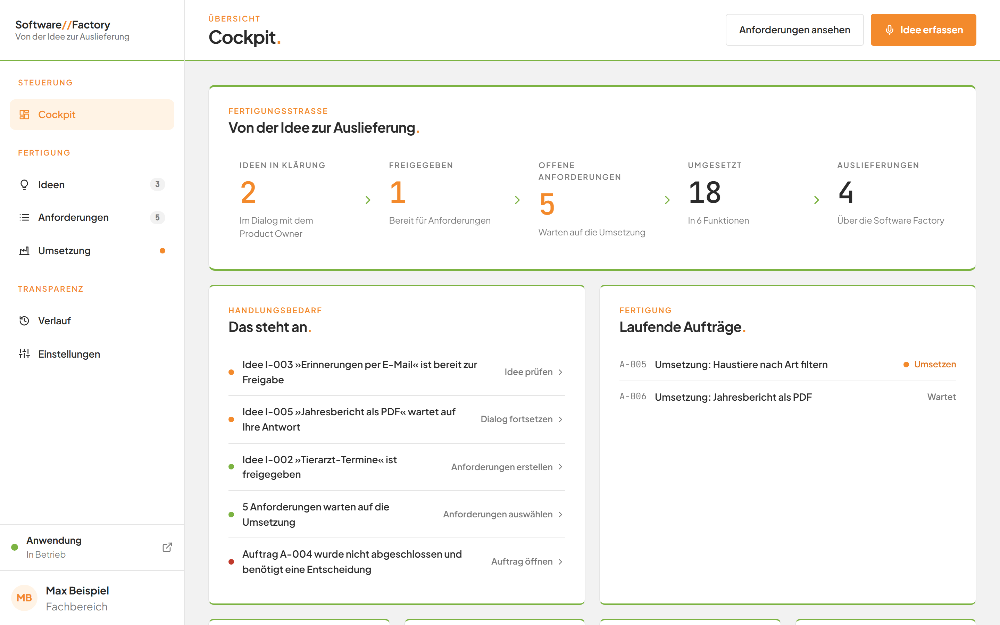

# Anwenderdokumentation

## Was ist diese Anwendung?

Die Anwendung besteht aus zwei Teilen, die Sie getrennt öffnen.

Der erste Teil ist die **Personen- und Haustierverwaltung**. Dort pflegen Sie Personen und Haustiere und ordnen jeder Person ein Haustier zu.

Der zweite Teil ist die **Software Factory**. Dort entwickeln Sie Wünsche an die Anwendung weiter. Sie halten eine Idee fest, klären sie im Gespräch mit einer KI und machen daraus Anforderungen. Die Software Factory setzt die Anforderungen um und liefert die neue Version aus.

Wie Sie beide Teile öffnen, steht in den [ersten Schritten](00-erste-schritte.md). Antworten auf häufige Fragen finden Sie in den [häufigen Fragen](faq.md).

*Bild 1: Die Personenverwaltung nach dem Öffnen.*

*Bild 2: Die Software Factory nach dem Öffnen.*

## Wo fange ich an?

1. Lesen Sie die [ersten Schritte](00-erste-schritte.md). Sie erklären Aufruf, Bildschirm und Grundbegriffe.
2. Wählen Sie danach das Modul, das Sie brauchen.

## Die Module

### Modul Personen

Hier verwalten Sie Personen. Überblick: [Modul Personen](E1-personen/README.md). Fragen dazu: [häufige Fragen zu Personen](E1-personen/faq.md).

1. [Die Anwendung im Überblick](E1-personen/01-navigation.md)
2. [Die Personenliste](E1-personen/02-personenliste.md)
3. [Eine Person anlegen](E1-personen/03-person-anlegen.md)
4. [Eine Person bearbeiten](E1-personen/04-person-bearbeiten.md)
5. [Eine Person löschen](E1-personen/05-person-loeschen.md)
6. [Die Reihenfolge ändern](E1-personen/06-reihenfolge-aendern.md)

### Modul Haustiere

Hier verwalten Sie Haustiere. Überblick: [Modul Haustiere](E2-haustiere/README.md). Fragen dazu: [häufige Fragen zu Haustieren](E2-haustiere/faq.md).

1. [Haustierliste](E2-haustiere/01-haustierliste.md)
2. [Haustier anlegen](E2-haustiere/02-haustier-anlegen.md)
3. [Haustier bearbeiten](E2-haustiere/03-haustier-bearbeiten.md)
4. [Haustier löschen](E2-haustiere/04-haustier-loeschen.md)
5. [Dialoge schließen](E2-haustiere/05-dialoge-schliessen.md)

### Modul Software Factory

Hier entwickeln Sie Ideen bis zur Auslieferung. Überblick: [Modul Software Factory](E3-software-factory/README.md). Fragen dazu: [häufige Fragen zur Software Factory](E3-software-factory/faq.md).

1. [Die Oberfläche kennenlernen](E3-software-factory/01-navigation.md)
2. [Das Cockpit](E3-software-factory/02-cockpit.md)
3. [Die Ideen-Tafel](E3-software-factory/03-ideen-tafel.md)
4. [Im Gespräch mit dem Product Owner](E3-software-factory/04-ideen-dialog.md)
5. [Mit der Stimme arbeiten](E3-software-factory/05-sprache.md)
6. [Aus einer Idee Anforderungen erstellen](E3-software-factory/06-ueberfuehrung-in-anforderungen.md)
7. [Anforderungen ansehen, anlegen, ändern und entfernen](E3-software-factory/07-anforderungen.md)
8. [Anforderungen mit dem KI-Assistenten entwickeln](E3-software-factory/08-anforderungs-assistent.md)
9. [Die Qualität von Abnahmekriterien prüfen](E3-software-factory/09-qualitaetspruefung.md)
10. [Aufträge verfolgen: die Seite Umsetzung](E3-software-factory/10-umsetzung.md)
    - [Anforderungen auswählen und beauftragen](E3-software-factory/10a-auswahl-und-beauftragung.md)
    - [Einen Auftrag verfolgen](E3-software-factory/10b-auftrag.md)
    - [Das Arbeitsprotokoll lesen](E3-software-factory/10c-arbeitsprotokoll.md)
    - [Einen Auftrag abbrechen und Änderungen verwerfen](E3-software-factory/10d-abbrechen-und-verwerfen.md)
    - [Eine Auslieferung zurücknehmen](E3-software-factory/10e-auslieferung-zuruecknehmen.md)
    - [Einen Auftrag erneut beauftragen](E3-software-factory/10f-erneut-beauftragen.md)
    - [Geänderte Bereiche prüfen](E3-software-factory/10g-geaenderte-bereiche.md)
    - [Selbstständige Nachbesserung verstehen](E3-software-factory/10h-nachbesserung.md)
11. [Den Verlauf nachlesen](E3-software-factory/11-verlauf.md)
12. [Systemzustand prüfen und die Software Factory einstellen](E3-software-factory/12-einstellungen.md)

## Für alle Module

- [Erste Schritte](00-erste-schritte.md)
- [Häufige Fragen zur ganzen Anwendung](faq.md)
